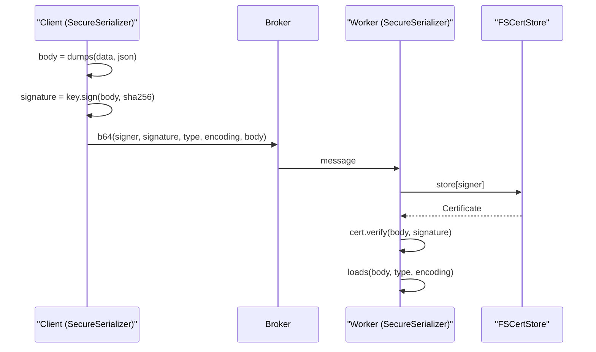

## Overview

Anyone who can publish to the broker can make a worker run tasks, and with pickle they can make it run arbitrary code. Celery's `auth` serializer adds message signing: each message body is serialized normally, signed with the sender's RSA private key, and packed together with the signer's certificate id; the receiver looks the certificate up in a trusted certificate store, verifies the signature, and only then deserializes. `app.setup_security()` installs it and disables the other serializers. The code lives in `celery/security`, and needs the `cryptography` package (the `auth` extra); importing it without `cryptography` raises `ImproperlyConfigured`.

Sources: [celery/security/__init__.py:1-42](repo://celery/security/__init__.py#L1-L42), [celery/security/serialization.py:20-60](repo://celery/security/serialization.py#L20-L60)

## Enabling signing

`app.setup_security(allowed_serializers=None, key=None, key_password=None, cert=None, store=None, digest='sha256', serializer='json')` calls `celery.security.setup_security` with the app. Its docstring stresses that this is global: it affects every app in the process, because it changes Kombu's serializer registry.

Sources: [celery/app/base.py:750-780](repo://celery/app/base.py#L750-L780)

`setup_security`:

Sources: [celery/security/__init__.py:44-70](repo://celery/security/__init__.py#L44-L70)

1. Disables every Kombu serializer except those in `allowed_serializers`, so a worker refuses unsigned pickle, JSON or YAML messages.
2. Requires `task_serializer = 'auth'` and `accept_content = ['auth']`, raising `ImproperlyConfigured` with an explanation otherwise ("There is no point in signing messages if they are not verified").
3. Takes the key file, key password, certificate file, certificate store and digest from the arguments or the `security_*` settings, and raises `ImproperlyConfigured` when key, certificate or store is missing.
4. Reads the key and certificate files, registers the `auth` serializer and makes it Kombu's default.

Sources: [celery/security/__init__.py:16-35](repo://celery/security/__init__.py#L16-L35), [celery/security/__init__.py:44-70](repo://celery/security/__init__.py#L44-L70)

| Setting | Meaning |
| --- | --- |
| `security_key` | Path to the PEM private key used to sign |
| `security_key_password` | Password for an encrypted key (bytes) |
| `security_certificate` | Path to the PEM certificate matching the key |
| `security_cert_store` | Directory or glob of trusted certificates for verification |
| `security_digest` | Hash algorithm name, default `sha256` |

Sources: [celery/app/defaults.py:239-247](repo://celery/app/defaults.py#L239-L247), [celery/app/defaults.py:20-20](repo://celery/app/defaults.py#L20-L20)

The example in `examples/security/mysecureapp.py` shows a complete setup. It signs task and event messages with `auth` but keeps results as JSON through `result_accept_content`, since signing covers what workers receive.

Sources: [examples/security/mysecureapp.py:28-49](repo://examples/security/mysecureapp.py#L28-L49)

```python
app.conf.update(
    security_key='ssl/worker.key',
    security_certificate='ssl/worker.pem',
    security_cert_store='ssl/*.pem',
    task_serializer='auth',
    event_serializer='auth',
    accept_content=['auth'],
    result_accept_content=['json']
)
app.setup_security()
```

Sources: [examples/security/mysecureapp.py:35-44](repo://examples/security/mysecureapp.py#L35-L44)

## The signed message format

`register_auth` builds a `SecureSerializer` from a `PrivateKey`, a `Certificate` and an `FSCertStore` and registers its `serialize`/`deserialize` pair under the name `auth` with content type `application/data`.

Sources: [celery/security/serialization.py:80-90](repo://celery/security/serialization.py#L80-L90)

`serialize(data)` first encodes the data with the inner serializer (JSON by default), then signs those encoded bytes. The comment explains why the serialized body is signed rather than the data: the receiver can check the signature without decoding anything, which avoids flaws in the decoding step. The signature, the signer id, the inner content type and encoding, and the body are joined with the separator `\x00\x01` (signer and signature base64-encoded first) and the whole is base64-encoded.

Sources: [celery/security/serialization.py:31-66](repo://celery/security/serialization.py#L31-L66), [celery/security/serialization.py:14-17](repo://celery/security/serialization.py#L14-L17)

`deserialize(data)` splits the payload into at most five parts, looks the signer up in the certificate store, verifies the signature over the body, and only then decodes the body with the recorded content type, using `force=True` because the inner serializer has been disabled for direct use. Any failure in either direction is raised as `SecurityError` ("Unable to serialize" / "Unable to deserialize").

Sources: [celery/security/serialization.py:48-78](repo://celery/security/serialization.py#L48-L78), [celery/security/utils.py:19-28](repo://celery/security/utils.py#L19-L28)



Sources: [celery/security/serialization.py:31-78](repo://celery/security/serialization.py#L31-L78)

## Keys, certificates and the store

`PrivateKey(pem, password)` loads a PEM private key and `Certificate(pem)` an X.509 certificate; both reject anything that is not RSA ("Non-RSA keys are not supported", "Non-RSA certificates are not supported") and raise `SecurityError` for invalid input. Signing and verification use RSA-PSS with MGF1 and the maximum salt length, over the configured digest, which `get_digest_algorithm` resolves to the `cryptography` hash class of that name.

Sources: [celery/security/key.py:12-35](repo://celery/security/key.py#L12-L35), [celery/security/certificate.py:31-73](repo://celery/security/certificate.py#L31-L73), [celery/security/utils.py:13-16](repo://celery/security/utils.py#L13-L16)

A certificate's id is its issuer followed by its serial number, and that id is what a signed message carries as the signer. `CertStore` maps ids to certificates, raising `SecurityError` for an unknown signer or a duplicate certificate. `FSCertStore(path)` loads every file matching a glob, or every file in a directory, and refuses to start if any certificate has expired.

Sources: [celery/security/certificate.py:57-63](repo://celery/security/certificate.py#L57-L63), [celery/security/certificate.py:76-113](repo://celery/security/certificate.py#L76-L113)

Verification only proves that the sender holds a key whose certificate is in the store; every party that sends tasks or events needs a key and certificate, and every receiver needs their certificates in its store. The example generates a self-signed RSA certificate with `openssl req -x509 -newkey rsa:4096`.

Sources: [examples/security/mysecureapp.py:1-26](repo://examples/security/mysecureapp.py#L1-L26)

## Related protections

Even without signing, the worker refuses to run as root while accepting pickle unless `C_FORCE_ROOT` is set ([[Daemonization and celery multi]]), and result backends refuse to rebuild a stored "exception" that is not an exception class, raising `SecurityError` ([[Result Backend Architecture]]).

Sources: [celery/platforms.py:788-845](repo://celery/platforms.py#L788-L845), [celery/backends/base.py:495-518](repo://celery/backends/base.py#L495-L518)
