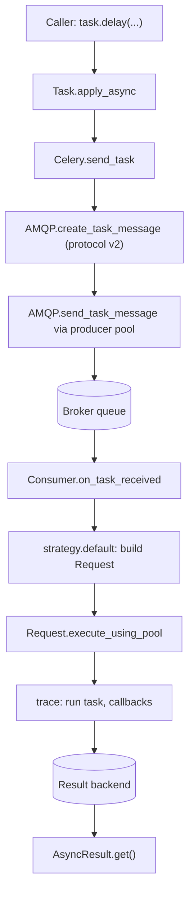

## Overview

Celery is a distributed task queue for Python. A client turns a function call into a message and publishes it to a broker; worker processes consume those messages, run the function, and optionally store its return value in a result backend where the client can read it. The package describes itself in one line, "Distributed Task Queue", and exposes a small public surface from `celery/__init__.py`: the `Celery` app class, `shared_task`, `Task`, `current_app`, `current_task` and the canvas primitives (`signature`, `chain`, `group`, `chord`, `chunks`, `xmap`, `xstarmap`).

Sources: [celery/__init__.py:1-42](repo://celery/__init__.py#L1-L42)

Messaging goes through Kombu: the app opens broker connections and producers through Kombu objects, so the same code runs over RabbitMQ, Redis, SQS and the other transports Kombu supports. The README sums the model up: a client puts a message on the queue, the broker delivers it to a worker, and a system can have many workers and brokers for availability and horizontal scaling.

Sources: [celery/app/base.py:1043-1130](repo://celery/app/base.py#L1043-L1130), [README.rst:86-102](repo://README.rst#L86-L102)

## Parts of Celery

| Area | What it does | Page |
| --- | --- | --- |
| Getting started | Install, define a task, run a worker | [[Quickstart]] |
| Application | The `Celery` object, its registry, pools and lazy finalization | [[The Celery Application]] |
| Configuration | Settings, defaults, loaders and fixups | [[Configuration and Loaders]] |
| Tasks | The `Task` class and `@app.task` options | [[Defining Tasks]] |
| Publishing | `apply_async`, routing, message protocol | [[Sending Tasks and Routing]] |
| Failure | `retry`, autoretry, exception types | [[Retries and Error Handling]] |
| Canvas | Signatures, callbacks and chains | [[Signatures and Chains]] |
| Canvas | Parallel groups and chords | [[Groups and Chords]] |
| Results | `AsyncResult`, `GroupResult`, task states | [[Task Results and States]] |
| Backends | How results are stored and fetched | [[Result Backend Architecture]] |
| Backends | Redis, database, MongoDB, S3 and the rest | [[Result Backend Catalogue]] |
| Worker | `WorkController` and the bootstep graph | [[Worker Startup and Bootsteps]] |
| Worker | Broker consumer, QoS and event loop | [[The Consumer and Event Loop]] |
| Worker | From message to stored result | [[Task Execution Pipeline]] |
| Worker | prefork, threads, solo, eventlet, gevent | [[Execution Pools]] |
| Worker | Broadcast commands and inspection | [[Remote Control and Inspection]] |
| Scheduling | The `celery beat` service | [[Periodic Tasks with Beat]] |
| Scheduling | `schedule`, `crontab`, `solar` | [[Schedules]] |
| Monitoring | Task and worker events, cluster state | [[Events and Monitoring]] |
| Hooks | Signals sent across the lifecycle | [[Signals]] |
| Operations | The `celery` command | [[Command-Line Interface]] |
| Operations | Pidfiles, detaching, `celery multi` | [[Daemonization and celery multi]] |
| Operations | Log setup and task loggers | [[Logging]] |
| Security | Signed messages with the `auth` serializer | [[Message Signing]] |
| Integrations | Django fixup and `DjangoTask` | [[Django Integration]] |
| Testing | pytest fixtures and embedded workers | [[Testing Celery Apps]] |

Sources: [celery/__init__.py:36-42](repo://celery/__init__.py#L36-L42), [celery/app/base.py:297-305](repo://celery/app/base.py#L297-L305)

## Main flow

Sources: [celery/app/task.py:523-535](repo://celery/app/task.py#L523-L535), [celery/app/base.py:1004-1042](repo://celery/app/base.py#L1004-L1042), [celery/worker/consumer/consumer.py:723-784](repo://celery/worker/consumer/consumer.py#L723-L784), [celery/worker/strategy.py:132-209](repo://celery/worker/strategy.py#L132-L209), [celery/worker/request.py:341-370](repo://celery/worker/request.py#L341-L370), [celery/app/trace.py:610-627](repo://celery/app/trace.py#L610-L627)

1. `Task.delay` is the star-argument form of `apply_async`, which merges task options and hands off to `Celery.send_task` unless `task_always_eager` runs the task in-process instead ([[Defining Tasks]], [[Sending Tasks and Routing]]).
2. `send_task` routes the task to a queue, builds the message with `amqp.create_task_message`, and publishes it through a producer taken from the app's pool; it returns an `AsyncResult` for the new task id ([[Sending Tasks and Routing]]).
3. In the worker, the consumer's `on_task_received` callback reads the task name from the `task` header and looks up that task's strategy ([[The Consumer and Event Loop]]).
4. The default strategy builds a `Request`, checks ETA, rate limits and revocation, and passes it to the pool ([[Task Execution Pipeline]], [[Execution Pools]]).
5. The tracer runs the task body, sends callbacks and chain links, and stores the outcome with `backend.mark_as_done` or a failure state ([[Task Execution Pipeline]], [[Result Backend Architecture]]).
6. The caller's `AsyncResult.get()` waits on the backend for the stored state ([[Task Results and States]]).

Sources: [celery/app/task.py:680-707](repo://celery/app/task.py#L680-L707), [celery/app/base.py:1004-1042](repo://celery/app/base.py#L1004-L1042)

## Design decisions

### Lazy app finalization

Creating tasks is deferred until the app is used. `@app.task` on an unfinalized app returns a `PromiseProxy` and appends it to `app._pending`; `finalize()` evaluates every pending proxy, binds every registered task and sends `on_after_finalize`. The decorator's docstring gives the reason: the act of creating the task is not performed until the task is used or the registry is accessed, so modules can declare tasks before configuration exists.

Sources: [celery/app/base.py:515-585](repo://celery/app/base.py#L515-L585), [celery/app/base.py:657-677](repo://celery/app/base.py#L657-L677)

A `PromiseProxy` evaluates its factory once, caches the result, and then runs any callbacks queued on it with `__then__`. The `celery` package itself uses the same idea: `local.recreate_module` replaces the module so `Celery`, `Task` and the canvas names are imported on first attribute access, which the comment says "makes the library faster to use".

Sources: [celery/local.py:282-345](repo://celery/local.py#L282-L345), [celery/__init__.py:151-180](repo://celery/__init__.py#L151-L180)

### Current app as thread state

`celery._state` keeps a global default app, a weak set of all apps, and the set of finalizer callbacks that shared tasks and built-in tasks register, so a `shared_task` is created on every app that is finalized. `current_app` and `current_task` are proxies over this state.

Sources: [celery/_state.py:1-40](repo://celery/_state.py#L1-L40)

### Configuration travels with the app

Constructor arguments such as `broker` and `backend` are written into the pending configuration rather than kept as attributes; the comment says these options "are moved to the config to simplify pickling of the app object". The configuration itself is only read when first needed ([[Configuration and Loaders]]).

Sources: [celery/app/base.py:390-406](repo://celery/app/base.py#L390-L406)

### Message protocol versions

`AMQP` keeps a table from protocol number to message builder, `as_task_v1` and `as_task_v2`, and picks one from `task_protocol`. With protocol v2 the task name is a message header, so the worker can choose a strategy without decoding the body; the consumer only decodes the body itself for v1 messages.

Sources: [celery/app/amqp.py:257-267](repo://celery/app/amqp.py#L257-L267), [celery/worker/consumer/consumer.py:731-748](repo://celery/worker/consumer/consumer.py#L731-L748)

### Pluggable parts by name

Backends, pools and app components are named by strings and resolved with `symbol_by_name`. `BACKEND_ALIASES` maps URL schemes to backend classes and also loads classes from the `celery.result_backends` entry point; `concurrency.ALIASES` maps `--pool` names to pool classes and accepts an out-of-tree pool through `CELERY_CUSTOM_WORKER_POOL`. The app's own collaborators (`amqp_cls`, `events_cls`, `log_cls`, `control_cls`, `task_cls`) are strings that can be overridden per app.

Sources: [celery/app/backends.py:15-56](repo://celery/app/backends.py#L15-L56), [celery/concurrency/__init__.py:11-48](repo://celery/concurrency/__init__.py#L11-L48), [celery/app/base.py:297-305](repo://celery/app/base.py#L297-L305)

### Workers built from bootsteps

The worker and its consumer are each a `Blueprint` of steps: the worker's `default_steps` are Hub, Pool, Beat, Timer, StateDB, Consumer and the autoscaler, and the consumer adds Connection, Mingle, Events, Gossip, Heart, Control, Tasks, DelayedDelivery, the event loop and Agent. Steps declare their dependencies, so users can add their own through `app.steps` ([[Worker Startup and Bootsteps]]).

Sources: [celery/worker/worker.py:76-88](repo://celery/worker/worker.py#L76-L88), [celery/worker/consumer/consumer.py:175-186](repo://celery/worker/consumer/consumer.py#L175-L186), [celery/bootsteps.py:74-104](repo://celery/bootsteps.py#L74-L104)
