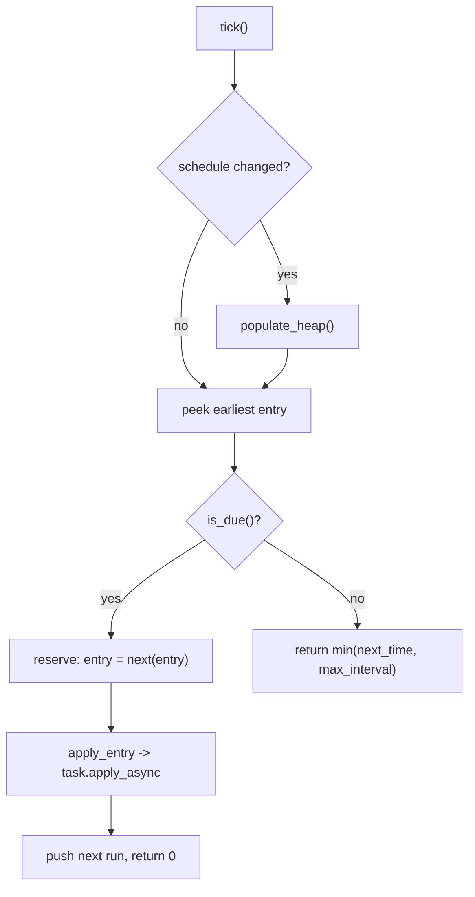

## Overview

`celery beat` is the scheduler that sends tasks on a timetable. It does not run tasks: it holds a set of schedule entries, wakes up when the next one is due, publishes that task like any client would ([[Sending Tasks and Routing]]), and sleeps again. The entries come from the `beat_schedule` setting and `app.add_periodic_task`, and the default `PersistentScheduler` remembers when each entry last ran in a local `shelve` file so restarts do not re-send or skip runs. Only one beat should run per schedule. This page covers the service, the scheduler loop and its storage; the schedule types (`schedule`, `crontab`, `solar`) are in [[Schedules]].

Sources: [celery/beat.py:219-266](repo://celery/beat.py#L219-L266), [celery/beat.py:505-611](repo://celery/beat.py#L505-L611), [celery/beat.py:612-680](repo://celery/beat.py#L612-L680)

## Declaring periodic tasks

### beat_schedule

`beat_schedule` maps an entry name to a dict with `task`, `schedule` and optionally `args`, `kwargs` and `options` (passed to `apply_async`). `schedule` may be a number of seconds, a `timedelta` or a schedule object; `maybe_schedule` converts the first two ([[Schedules]]). Arguments can be `BeatLazyFunc` objects, which are called at send time so the value is computed when the task fires rather than when the schedule is loaded.

Sources: [celery/beat.py:50-80](repo://celery/beat.py#L50-L80), [celery/beat.py:117-128](repo://celery/beat.py#L117-L128), [celery/beat.py:201-216](repo://celery/beat.py#L201-L216)

```python
from celery.schedules import crontab

app.conf.beat_schedule = {
    'cleanup-every-night': {
        'task': 'proj.tasks.cleanup',
        'schedule': crontab(hour=3, minute=0),
        'args': (7,),
    },
    'ping-every-30s': {'task': 'proj.tasks.ping', 'schedule': 30.0},
}
```

Sources: [celery/beat.py:82-128](repo://celery/beat.py#L82-L128)

### add_periodic_task

`app.add_periodic_task(schedule, sig, args=(), kwargs=(), name=None, **opts)` turns a signature into a `beat_schedule` entry keyed by `name` or, without one, by `repr(sig)`. Adding the same signature twice therefore replaces the first entry, and an unnamed entry that shadows an existing key logs a warning suggesting a `name`. Before the app is configured, the call is queued and applied when configuration loads ([[Configuration and Loaders]]). It is usually called from an `on_after_configure` receiver.

Sources: [celery/app/base.py:1295-1333](repo://celery/app/base.py#L1295-L1333), [celery/app/base.py:1272-1276](repo://celery/app/base.py#L1272-L1276)

## Schedule entries

A `ScheduleEntry` holds the entry `name`, `task` name, `schedule`, `args`, `kwargs`, `options`, `last_run_at` (defaulting to now) and `total_run_count`. `is_due()` delegates to `schedule.is_due(last_run_at)`, which returns `(is_due, next_time_to_check)`. `next(entry)` returns a copy with `last_run_at` set to now and the run count incremented. Two entries compare equal when their editable fields (task, schedule, args, kwargs, options) match, and `update()` copies only those fields, so a schedule change keeps the run history.

Sources: [celery/beat.py:82-199](repo://celery/beat.py#L82-L199)

## The scheduler loop

### Setup

`Scheduler.__init__` takes the schedule, the maximum sleep (`beat_max_loop_interval`, else 300 seconds), a producer class and `beat_sync_every`, and calls `setup_schedule` unless `lazy` (used when beat only introspects the scheduler for its banner). `setup_schedule` adds default entries and merges `beat_schedule` in place: names no longer present are removed, existing ones are updated, new ones created.

Sources: [celery/beat.py:240-266](repo://celery/beat.py#L240-L266), [celery/beat.py:423-472](repo://celery/beat.py#L423-L472)

The one default entry is `celery.backend_cleanup`, scheduled daily at 4:00 with a 12-hour expiry, added when `result_expires` is set and the result backend cannot expire results itself ([[Result Backend Architecture]]).

Sources: [celery/beat.py:268-277](repo://celery/beat.py#L268-L277)

### tick

Each call to `tick()` sends at most one due task and returns how long to sleep:

Sources: [celery/beat.py:326-364](repo://celery/beat.py#L326-L364)

1. If the schedule changed since the last tick (compared entry by entry), rebuild the heap: each entry is pushed with the timestamp it next becomes due (now when already due), at priority 5.
2. With an empty heap, return `max_interval`.
3. Look at the earliest entry. If it is due and still the heap top, replace it in the schedule with `next(entry)`, send it, push the new entry with its next due time, and return 0 so the loop ticks again immediately.
4. If it is not due, return its remaining time (minus a 10 ms drift adjustment), capped at `max_interval`.

Sources: [celery/beat.py:292-324](repo://celery/beat.py#L292-L324), [celery/beat.py:326-379](repo://celery/beat.py#L326-L379)



Sources: [celery/beat.py:326-364](repo://celery/beat.py#L326-L364)

### Sending

`apply_async(entry)` evaluates lazy arguments and calls `task.apply_async(args, kwargs, producer=..., **entry.options)` when the task is registered locally, or `app.send_task(entry.task, ...)` otherwise, so beat can schedule tasks whose code it does not import. A failure is re-raised as `SchedulingError`, which `apply_entry` logs as a "Message Error" without stopping the loop. The producer uses a write connection established with retries ("beat: Connection error ... Trying again").

Sources: [celery/beat.py:279-290](repo://celery/beat.py#L279-L290), [celery/beat.py:393-421](repo://celery/beat.py#L393-L421), [celery/beat.py:474-499](repo://celery/beat.py#L474-L499)

After every send the scheduler counts tasks since the last sync and syncs when `sync_every` (3 minutes) has passed or `beat_sync_every` tasks have been sent.

Sources: [celery/beat.py:381-387](repo://celery/beat.py#L381-L387), [celery/beat.py:415-418](repo://celery/beat.py#L415-L418), [celery/beat.py:427-433](repo://celery/beat.py#L427-L433)

## Persistent schedule

`PersistentScheduler`, the default `beat_scheduler`, keeps its entries in a `shelve` file named by `beat_schedule_filename` (`celerybeat-schedule`, `-s` on the command line). `setup_schedule` opens it, and if the file is unreadable deletes every known suffix (`.db`, `.dat`, `.bak`, `.dir`) and starts fresh. It clears the stored entries when the file predates the `__version__`, `tz` or `utc_enabled` fields, or when the configured `timezone` or `enable_utc` changed, since stored run times would be wrong. It then merges `beat_schedule`, adds default entries, records the version, timezone and UTC flag, and syncs.

Sources: [celery/beat.py:505-590](repo://celery/beat.py#L505-L590), [celery/app/defaults.py:73-82](repo://celery/app/defaults.py#L73-L82)

`sync()` flushes the shelve, and `close()` syncs and closes it. Other schedulers can be selected with `-S/--scheduler` or `beat_scheduler`, by class path or by a name registered under the `celery.beat_schedulers` entry point.

Sources: [celery/beat.py:592-610](repo://celery/beat.py#L592-L610), [celery/beat.py:666-680](repo://celery/beat.py#L666-L680)

## The Service

`Service.start()` sends `beat_init` (and `beat_embedded_init` when embedded), then loops until shut down: call `tick()`, sleep for the returned interval, and sync if due. `KeyboardInterrupt` and `SystemExit` end the loop, and the scheduler is always closed in `finally`. `stop(wait=True)` sets the shutdown event and waits for the loop to finish.

Sources: [celery/beat.py:612-664](repo://celery/beat.py#L612-L664)

## Running beat

### celery beat

`celery beat` parses extra `key=value` settings, drops privileges, and runs `app.Beat(...)`, optionally inside `platforms.detached` with `--detach` ([[Daemonization and celery multi]]). `Beat.run` prints the version, initializes the loader (importing task modules) and finalizes the app, sets the process title, creates the pidfile lock, prints the banner with the broker, scheduler and maximum interval, sets up logging, and starts the service. Its `SIGTERM` and `SIGINT` handlers sync the schedule before exiting.

Sources: [celery/bin/beat.py:50-70](repo://celery/bin/beat.py#L50-L70), [celery/apps/beat.py:78-160](repo://celery/apps/beat.py#L78-L160)

### Embedded in a worker

`celery worker -B` adds the worker's `Beat` bootstep, which starts `EmbeddedService`: a child process (`_Process`) that resets signals, closes inherited file descriptors and runs the service, or a daemon thread (`_Threaded`) with a one-second maximum interval when multiprocessing is unavailable. The step refuses eventlet and gevent pools ([[Worker Startup and Bootsteps]]).

Sources: [celery/beat.py:682-738](repo://celery/beat.py#L682-L738), [celery/worker/components.py:181-206](repo://celery/worker/components.py#L181-L206)
