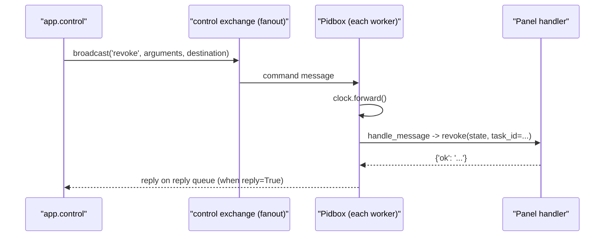

## Overview

Running workers can be inspected and controlled over the broker. A client calls `app.control` (or the `celery inspect` and `celery control` commands), which broadcasts a command message on a fanout exchange through a Kombu *pidbox* mailbox; every worker listening on that exchange runs the named handler from its command registry and, when asked, sends a reply back on a reply queue. This page follows a command from the client API through the mailbox to the worker handlers. Revoking also interacts with the worker state described in [[Task Execution Pipeline]].

Sources: [celery/app/control.py:426-452](repo://celery/app/control.py#L426-L452), [celery/worker/pidbox.py:16-44](repo://celery/worker/pidbox.py#L16-L44), [celery/worker/control.py:39-75](repo://celery/worker/control.py#L39-L75)



Sources: [celery/app/control.py:755-790](repo://celery/app/control.py#L755-L790), [celery/worker/pidbox.py:29-44](repo://celery/worker/pidbox.py#L29-L44)

## The client: Control

### The mailbox

`Control.__init__` builds a Kombu `Mailbox` on `control_exchange` with type `fanout`, the app's accepted content and task serializer, the AMQP producer pool, and the TTL, expiry, exclusivity and durability settings for command and reply queues. Setting both `control_queue_durable` and `control_queue_exclusive` raises `ImproperlyConfigured`, since exclusive queues are deleted automatically and cannot be durable. After a fork the mailbox's producer pool is dropped.

Sources: [celery/app/control.py:426-456](repo://celery/app/control.py#L426-L456)

### broadcast

`broadcast(command, arguments, destination, reply=False, timeout=1.0, limit, callback, pattern, matcher)` acquires a connection and calls the mailbox's `_broadcast`. `destination` limits the command to listed node names; `pattern` with `matcher` selects nodes by pattern; with `reply=True` it collects replies until `timeout` or `limit` replies, calling `callback` for each as it arrives.

Sources: [celery/app/control.py:755-790](repo://celery/app/control.py#L755-L790)

### Control methods

Each method is a thin wrapper that calls `broadcast` with a command name and arguments:

Sources: [celery/app/control.py:488-510](repo://celery/app/control.py#L488-L510), [celery/app/control.py:578-598](repo://celery/app/control.py#L578-L598)

| Method | Command | Effect on the worker |
| --- | --- | --- |
| `revoke(task_id, terminate=False, signal='TERM')` | `revoke` | Skip the task(s); optionally kill the running process |
| `revoke_by_stamped_headers(headers, ...)` | `revoke_by_stamped_headers` | Skip tasks whose stamps match |
| `terminate(task_id, signal)` | `revoke` with terminate | Kill the process running the task |
| `ping()` | `ping` | Reply `pong` |
| `rate_limit(task_name, '10/m')` | `rate_limit` | Change a task's rate limit |
| `time_limit(task_name, soft, hard)` | `time_limit` | Change a task's time limits |
| `add_consumer(queue, ...)`, `cancel_consumer(queue)` | same | Start or stop consuming from a queue |
| `enable_events()`, `disable_events()` | same | Turn task events on or off |
| `pool_grow(n)`, `pool_shrink(n)`, `autoscale(max, min)` | same | Resize the pool |
| `pool_restart(modules, reload)` | `pool_restart` | Reload modules and restart the pool |
| `shutdown()` | `shutdown` | Warm shutdown |
| `heartbeat()` | `heartbeat` | Send a heartbeat event now |
| `election(id, topic, action)` | `election` | Start a gossip election |

Sources: [celery/app/control.py:480-599](repo://celery/app/control.py#L480-L599), [celery/app/control.py:600-719](repo://celery/app/control.py#L600-L719), [celery/app/control.py:720-753](repo://celery/app/control.py#L720-L753)

`purge()` is different: it does not talk to workers but purges the task queues directly through a task consumer, returning the number of messages deleted.

Sources: [celery/app/control.py:462-478](repo://celery/app/control.py#L462-L478)

## The client: Inspect

`app.control.inspect(destination=None, timeout=1.0, callback=None, limit=None, pattern=None)` returns an app-bound `Inspect`. Every method calls `_request(command, **kwargs)`, which broadcasts with `reply=True` and turns the list of `{node: reply}` items into one dict, warning with `DuplicateNodenameWarning` when two workers share a name. With a single `destination` it returns that node's reply only.

Sources: [celery/app/control.py:73-117](repo://celery/app/control.py#L73-L117), [celery/app/control.py:38-63](repo://celery/app/control.py#L38-L63), [celery/app/control.py:458-460](repo://celery/app/control.py#L458-L460)

| Method | Returns per worker |
| --- | --- |
| `active(safe=None)` | Requests being executed |
| `reserved()` | Requests received but not yet running (excluding active) |
| `scheduled()` | Requests waiting for their ETA, with priority |
| `revoked()` | Revoked task ids |
| `registered(*attrs)` | Registered task names, optionally with attributes |
| `stats()` | `WorkController.stats()`: pool, consumer, rusage, totals |
| `query_task(*ids)` | State and info of the given tasks |
| `active_queues()` | Queues the task consumer is consuming from |
| `conf(with_defaults=False)` | The worker's configuration |
| `clock()`, `ping()`, `report()` | Logical clock, `pong`, bug report text |
| `memsample()`, `memdump()`, `objgraph()` | Memory diagnostics |

Sources: [celery/app/control.py:119-235](repo://celery/app/control.py#L119-L235), [celery/app/control.py:236-345](repo://celery/app/control.py#L236-L345), [celery/app/control.py:346-424](repo://celery/app/control.py#L346-L424)

## The worker side

### Pidbox

The consumer's `Control` bootstep is included when `worker_enable_remote_control` is on and the transport supports fanout exchanges. It creates a `Pidbox`, or a `gPidbox` for green pools ([[The Consumer and Event Loop]]).

Sources: [celery/worker/consumer/control.py:18-33](repo://celery/worker/consumer/control.py#L18-L33)

`Pidbox` creates a mailbox `Node` named after the worker's hostname, whose handlers are the global `Panel.data` registry and whose `state` gives handlers the app, hostname and consumer. `start` opens a channel and listens with `on_message`, which advances the logical clock and lets the node dispatch the command. An unknown command is logged as "No such control command"; any other error is logged and the pidbox consumer is reset.

Sources: [celery/worker/pidbox.py:16-78](repo://celery/worker/pidbox.py#L16-L78)

`gPidbox` runs the same listener in its own green thread on a separate read connection, draining events with a one-second timeout until shutdown, and handles resets inside that loop.

Sources: [celery/worker/pidbox.py:81-125](repo://celery/worker/pidbox.py#L81-L125)

### The command registry

`Panel` is a global registry. `@control_command(...)` and `@inspect_command(...)` register a function under its name (and an optional alias such as `dump_active`), with metadata used by the CLI: type, visibility, default timeout, help (the first docstring line), signature, typed positional `args` and a `variadic` argument name. Handlers receive the pidbox `state` and return `{'ok': ...}` or `{'error': ...}` through `ok()` and `nok()`. Because the registry is global, custom commands are added by decorating a function in a module the worker imports.

Sources: [celery/worker/control.py:24-75](repo://celery/worker/control.py#L24-L75)

### Revoking

`revoke` adds the ids to the worker's `revoked` set and stores `REVOKED` in the result backend for each, logging but ignoring backend errors. Requests already received are dropped when they come to run, and Mingle shares the revoked set with workers that start later. With `terminate=True` it also finds running requests with those ids and terminates their processes with the given signal (default `TERM`).

Sources: [celery/worker/control.py:134-154](repo://celery/worker/control.py#L134-L154), [celery/worker/control.py:214-243](repo://celery/worker/control.py#L214-L243)

`revoke_by_stamped_headers` adds values to `revoked_stamps` by header name, and with `terminate` kills running requests whose stamps match. `terminate(signal, task_id)` is `revoke` with `terminate=True`.

Sources: [celery/worker/control.py:156-212](repo://celery/worker/control.py#L156-L212), [celery/worker/control.py:245-252](repo://celery/worker/control.py#L245-L252)

### Limits, pool and queues

`rate_limit` validates the rate string, sets the task's `rate_limit` and rebuilds the consumer's buckets; an empty value disables limiting. `time_limit` sets the task's soft and hard limits for future requests. `pool_grow` and `pool_shrink` resize the pool and the prefetch count, but refuse when autoscaling is active; `autoscale` updates the autoscaler's range; `pool_restart` requires `worker_pool_restarts`.

Sources: [celery/worker/control.py:255-323](repo://celery/worker/control.py#L255-L323), [celery/worker/control.py:541-590](repo://celery/worker/control.py#L541-L590)

`add_consumer` and `cancel_consumer` schedule `add_task_queue` and `cancel_task_queue` on the consumer with `call_soon`, so the change happens in the event loop. `shutdown` logs the message and raises `WorkerShutdown(EX_OK)`.

Sources: [celery/worker/control.py:592-637](repo://celery/worker/control.py#L592-L637)

### Inspect handlers

`active`, `reserved` and `scheduled` read the worker state sets and the timer's queue and return `Request.info()` for each (with `safe=True`, argument reprs instead of values). `stats` returns `WorkController.stats()`. `hello`, hidden from the CLI, answers Mingle: it merges the sender's revoked ids, purges expired ones and returns its own with the clock. `ping` uses a 0.2-second default timeout.

Sources: [celery/worker/control.py:381-455](repo://celery/worker/control.py#L381-L455)

## Command line

`celery inspect COMMAND` and `celery control COMMAND` check the command name against the registry for their type, convert positional arguments with the registered `args` types (collecting the rest into the `variadic` argument), broadcast with `-t/--timeout` (default 1 second) and `-d/--destination`, and print each reply as it arrives or, with `-j/--json`, the collected replies as JSON. No reply exits with `EX_UNAVAILABLE` and "No nodes replied within time constraint". `celery status` pings all workers and prints how many are online.

Sources: [celery/bin/control.py:26-56](repo://celery/bin/control.py#L26-L56), [celery/bin/control.py:129-150](repo://celery/bin/control.py#L129-L150), [celery/bin/control.py:178-262](repo://celery/bin/control.py#L178-L262)

```bash
celery -A proj inspect active
celery -A proj control rate_limit tasks.add 10/m
celery -A proj control -d worker1@host revoke 3c2d...
```

Sources: [celery/worker/control.py:255-261](repo://celery/worker/control.py#L255-L261), [celery/worker/control.py:444-449](repo://celery/worker/control.py#L444-L449)
