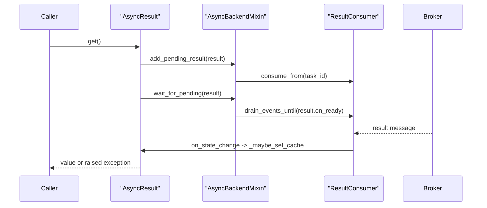

## Overview

A result backend stores what happened to each task (its state, return value or exception, traceback and children) so that callers can read it through `AsyncResult` and chords can tell when their header is done. Every backend derives from `celery.backends.base.Backend`, which defines the write side the worker calls (`mark_as_done`, `mark_as_failure`, `store_result` …), the read side results call (`get_task_meta`, `wait_for_pending`, `iter_native`), encoding, and the chord hooks. Two families sit on top: key/value backends that only implement `get`/`set`/`delete`, and asynchronous backends that receive results as messages. This page covers that shared machinery; individual backends are listed in [[Result Backend Catalogue]], and the result objects in [[Task Results and States]].

Sources: [celery/backends/base.py:108-166](repo://celery/backends/base.py#L108-L166), [celery/backends/base.py:879-978](repo://celery/backends/base.py#L879-L978)

## Choosing a backend

`app.backend` is created on first use from `result_backend` (or the app's `backend` argument). `by_url` splits the URL at `://`: the scheme names the backend, and a `+` in the scheme separates the backend from the URL it is given (for example `db+postgresql://…` selects the database backend with a SQLAlchemy URL). `by_name` resolves the name through `BACKEND_ALIASES`, the loader's `override_backends` and the `celery.result_backends` entry point, and rejects a module that is not a class. With no setting at all the backend is `disabled`.

Sources: [celery/app/backends.py:15-69](repo://celery/app/backends.py#L15-L69), [celery/app/base.py:1224-1228](repo://celery/app/base.py#L1224-L1228)

The constructor reads `result_serializer`, the accepted content types (`result_accept_content`, falling back to `accept_content`), `result_expires`, the size of the local result cache (`result_cache_max`, `-1` disables it), and the retry settings described below. `result_backend_thread_safe` decides whether the app shares one instance across threads ([[The Celery Application]]).

Sources: [celery/backends/base.py:138-165](repo://celery/backends/base.py#L138-L165)

## Writing results

### The mark_as methods

The worker's tracer records outcomes through these methods ([[Task Execution Pipeline]]):

Sources: [celery/app/trace.py:620-627](repo://celery/app/trace.py#L620-L627)

| Method | Stores | Extra work |
| --- | --- | --- |
| `mark_as_started` | `STARTED` with pid and hostname | none |
| `mark_as_done` | `SUCCESS` and the return value, unless the request ignores results | `on_chord_part_return` when the task is in a chord |
| `mark_as_failure` | `FAILURE` and the exception | chord hook, propagation down the remaining chain, errbacks |
| `mark_as_retry` | `RETRY` and the exception | none |
| `mark_as_revoked` | `REVOKED` with a `TaskRevokedError(reason)` | chord hook |

Sources: [celery/backends/base.py:176-252](repo://celery/backends/base.py#L176-L252), [celery/backends/base.py:306-323](repo://celery/backends/base.py#L306-L323)

`mark_as_failure` also marks the failed task's later chain steps failed so nothing waits on them forever, as described in [[Groups and Chords]]. Errbacks are called by `_call_task_errbacks`: an errback task whose signature takes more than one argument is called inline as `errback(request, exc, traceback)`, while older single-argument errbacks (or ones not registered in this process) are sent as a group with the failed task id as argument.

Sources: [celery/backends/base.py:200-252](repo://celery/backends/base.py#L200-L252), [celery/backends/base.py:254-304](repo://celery/backends/base.py#L254-L304)

### store_result and the metadata record

`store_result` encodes the result, then calls the backend's `_store_result` through `_ensure_retryable`, raising `BackendStoreError` if retries run out. `_get_result_meta` builds the stored record: `status`, `result`, `traceback`, `children` (the current task's subtask results as tuples), `date_done` for ready states, and `group_id`/`parent_id` when known.

Sources: [celery/backends/base.py:673-693](repo://celery/backends/base.py#L673-L693), [celery/backends/base.py:581-630](repo://celery/backends/base.py#L581-L630)

With `result_extended` on, the record also holds the task `name`, `args`, `kwargs`, the `worker` hostname, `retries`, the `queue` (the routing key it arrived with) and any stamps. These are the fields behind `AsyncResult.name`, `.args` and `.worker`.

Sources: [celery/backends/base.py:603-629](repo://celery/backends/base.py#L603-L629)

## Encoding

Values are serialized with the backend's serializer through Kombu. `encode_result` turns exceptions in exception states into a portable form with `prepare_exception`, and turns result objects into tuples when the serializer is not pickle. With pickle the exception object itself is stored (after `get_pickleable_exception`); otherwise it is a dict of `exc_type` (qualified name), `exc_message` (the args, made serializable) and `exc_module`.

Sources: [celery/backends/base.py:447-455](repo://celery/backends/base.py#L447-L455), [celery/backends/base.py:528-576](repo://celery/backends/base.py#L528-L576), [celery/backends/base.py:38-38](repo://celery/backends/base.py#L38-L38)

On read, `meta_from_decoded` rebuilds exceptions with `exception_to_python`. It imports `exc_module` and walks `exc_type`, falling back to a generated class in `celery.exceptions` when the module or class is missing. It then refuses anything that is not a `BaseException` subclass with `SecurityError`; the comment explains that otherwise a stored record naming `os` and `system` could make the reader run an arbitrary command.

Sources: [celery/backends/base.py:457-526](repo://celery/backends/base.py#L457-L526), [celery/backends/base.py:541-556](repo://celery/backends/base.py#L541-L556)

## Reading results

### Task metadata

`get_task_meta(task_id)` returns the record from the local LRU cache or calls `_get_task_meta_for` with retries (raising `BackendGetMetaError` when they fail), and caches only `SUCCESS` records. It warns when `task_always_eager` is on without `task_store_eager_result`, since nothing was stored. `get_state`, `get_result`, `get_traceback` and `get_children` are shortcuts over it; groups use `save_group`, `restore_group` and `delete_group` the same way.

Sources: [celery/backends/base.py:695-768](repo://celery/backends/base.py#L695-L768), [celery/backends/base.py:785-818](repo://celery/backends/base.py#L785-L818)

### Synchronous backends

`SyncBackendMixin` gives polling backends their waiting behaviour. `wait_for` loops on `get_task_meta`, sleeping `interval` seconds between reads, and raises `TimeoutError` when `timeout` passes; `wait_for_pending` uses it, fills the result's cache and re-raises if needed. `iter_native` yields nested result sets as they are and fetches all plain ids with `get_many`.

Sources: [celery/backends/base.py:879-955](repo://celery/backends/base.py#L879-L955)

### Retrying backend operations

`_ensure_retryable` retries a failed operation only when `result_backend_always_retry` is on and the backend's `exception_safe_to_retry(exc)` says so (the base answer is always no). It sleeps with exponential backoff and full jitter between `result_backend_base_sleep_between_retries_ms` and `result_backend_max_sleep_between_retries_ms`, calls the `on_backend_retryable_error` hook before each retry, and after `result_backend_max_retries` raises the fallback exception carrying the task id and state.

Sources: [celery/backends/base.py:632-671](repo://celery/backends/base.py#L632-L671), [celery/backends/base.py:732-744](repo://celery/backends/base.py#L732-L744)

## Key/value backends

`BaseKeyValueStoreBackend` implements the whole interface on five primitives a subclass provides: `get`, `mget`, `set`, `delete` and optionally `incr` and `expire`. Keys are `celery-task-meta-<id>`, `celery-taskset-meta-<id>` for groups and `chord-unlock-<id>` for chord counters, optionally prefixed by `global_keyprefix` from `result_backend_transport_options`.

Sources: [celery/backends/base.py:964-1052](repo://celery/backends/base.py#L964-L1052)

`_store_result` reads the current record first and does not overwrite a `SUCCESS`; the comment explains that a lost or partitioned worker could otherwise replace a successful result with a later state. A missing key reads as `PENDING`. `get_many` serves cached ready results first, then polls `mget` for the rest every `interval`, yielding results as they become ready, and stops at `timeout` or `max_iterations`.

Sources: [celery/backends/base.py:1113-1153](repo://celery/backends/base.py#L1113-L1153), [celery/backends/base.py:1075-1111](repo://celery/backends/base.py#L1075-L1111)

A backend that sets `implements_incr` gets counter-based chords: its `apply_chord` becomes `_apply_chord_incr`, and `on_chord_part_return` counts parts with `incr` ([[Groups and Chords]]).

Sources: [celery/backends/base.py:971-978](repo://celery/backends/base.py#L971-L978), [celery/backends/base.py:1183-1256](repo://celery/backends/base.py#L1183-L1256)

## Asynchronous backends

### Pending results and the result consumer

Backends that receive results as messages (RPC, and Redis through pub/sub) mix in `AsyncBackendMixin`. `add_pending_result` starts the drainer, resolves the result immediately if its message already arrived and was buffered, and otherwise records it (strongly or weakly) and tells the result consumer to start consuming for that id. `wait_for_pending` drains events until the result's `on_ready` promise is fulfilled, then re-raises if needed; `is_async` is true so result sets fulfil their promises.

Sources: [celery/backends/asynchronous.py:225-313](repo://celery/backends/asynchronous.py#L225-L313)

`BaseResultConsumer.on_state_change` is called for every result message. For a ready state it looks the task up among the pending results, fills its cache and hands it to a waiting `iter_native` bucket; a message for a result nobody is waiting on yet is kept in the pending-messages buffer. `reconnect_on_error` turns transport connection errors into a reconnect, and raises `RuntimeError` telling you to restart Celery if reconnecting fails too.

Sources: [celery/backends/asynchronous.py:316-372](repo://celery/backends/asynchronous.py#L316-L372), [celery/backends/asynchronous.py:427-449](repo://celery/backends/asynchronous.py#L427-L449)

### Drainers

The drainer decides how events are pumped and is chosen by `detect_environment()`. The default `Drainer` calls `drain_events` in the waiting thread in one-interval steps until the promise is ready or the timeout passes, logging and sleeping on recoverable `OSError`s. Under eventlet or gevent, `greenletDrainer` runs `drain_events` in its own green thread and signals waiters through a completion event after every pass.

Sources: [celery/backends/asynchronous.py:58-113](repo://celery/backends/asynchronous.py#L58-L113), [celery/backends/asynchronous.py:115-223](repo://celery/backends/asynchronous.py#L115-L223)

Sources: [celery/backends/asynchronous.py:260-310](repo://celery/backends/asynchronous.py#L260-L310), [celery/backends/asynchronous.py:393-449](repo://celery/backends/asynchronous.py#L393-L449), [celery/result.py:244-270](repo://celery/result.py#L244-L270)

## The RPC backend

`rpc://` sends results back as AMQP messages instead of storing them. Each client process gets one reply queue named after the app's `thread_oid`, declared auto-delete with the result expiry; `on_task_call` declares it before a task is sent (skipped inside prefork children, where it already exists). The worker's `store_result` publishes `{task_id, status, result, traceback, children}` to the request's `reply_to` with its `correlation_id`, through the anonymous exchange.

Sources: [celery/backends/rpc.py:178-271](repo://celery/backends/rpc.py#L178-L271), [celery/backends/rpc.py:388-401](repo://celery/backends/rpc.py#L388-L401)

Because results are messages, only the client that sent the task can receive them, and they are not kept: the backend is not `persistent` by default, `supports_autoexpire` is true, and `save_group`, `restore_group` and `delete_group` raise `NotImplementedError`. `ensure_chords_allowed` also raises, so chords need another backend. `supports_native_join` is true, so result sets join through the consumer.

Sources: [celery/backends/rpc.py:157-159](repo://celery/backends/rpc.py#L157-L159), [celery/backends/rpc.py:214-215](repo://celery/backends/rpc.py#L214-L215), [celery/backends/rpc.py:364-374](repo://celery/backends/rpc.py#L364-L374)

`ResultConsumer.start` opens a connection, records its connection and channel errors for reconnection, and consumes the reply queue with `on_state_change` as callback. A reply that arrives for a task nobody is waiting on is buffered in `_out_of_band` and served by a later `get_task_meta`.

Sources: [celery/backends/rpc.py:41-72](repo://celery/backends/rpc.py#L41-L72), [celery/backends/rpc.py:282-298](repo://celery/backends/rpc.py#L282-L298)

## Cleanup and expiry

`cleanup()` is called by the built-in `celery.backend_cleanup` task, which the scheduler can run daily for backends that cannot expire results themselves (`supports_autoexpire = False`); `process_cleanup()` runs after each task in the worker. Both do nothing in the base class.

Sources: [celery/backends/base.py:820-824](repo://celery/backends/base.py#L820-L824), [celery/backends/base.py:126-129](repo://celery/backends/base.py#L126-L129), [celery/app/builtins.py:12-23](repo://celery/app/builtins.py#L12-L23)
