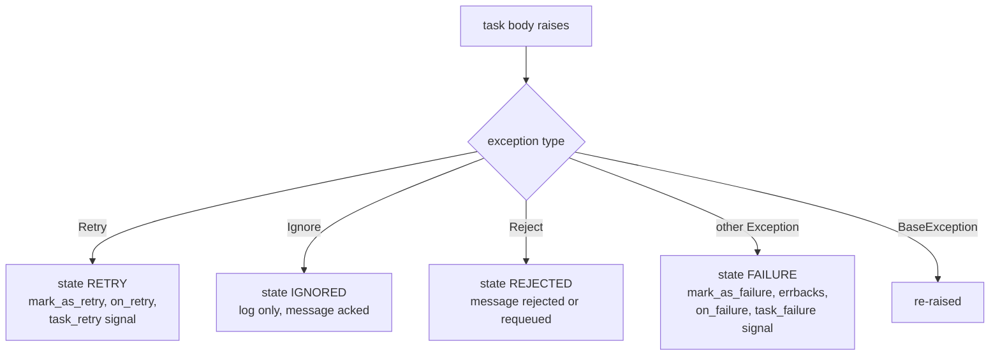

## Overview

A task ends in one of a few ways: it returns, it raises an ordinary exception, or it raises one of Celery's *task predicates* (`Retry`, `Ignore`, `Reject`), which are exceptions that tell the worker what to do with the message rather than report an error. Retrying is built on `Retry`: `Task.retry` sends a new copy of the task and raises `Retry` so the worker records the `RETRY` state instead of `FAILURE`. `autoretry_for` wraps a task so chosen exceptions call `retry` automatically. This page follows each outcome from the raise in the task body to the state stored and what happens to the message. The full execution path is in [[Task Execution Pipeline]].

Sources: [celery/exceptions.py:141-204](repo://celery/exceptions.py#L141-L204), [celery/app/task.py:756-867](repo://celery/app/task.py#L756-L867)

## Task.retry

`retry(args=None, kwargs=None, exc=None, throw=True, eta=None, countdown=None, max_retries=None, **options)` is called from a bound task, usually as `raise self.retry(exc=exc, countdown=60)`.

Sources: [celery/app/task.py:756-772](repo://celery/app/task.py#L756-L772)

1. It increments `request.retries`. A `max_retries` argument overrides the task's limit for this call only (stored in `override_max_retries` for autoretry).
2. If the task was called directly (not by a worker or `apply`), there is nothing to retry: it re-raises the current exception, or `exc`, or a plain `Retry`.
3. Without `eta` or `countdown`, the delay is `default_retry_delay` (180 seconds by default).
4. It builds a signature from the current request with `signature_from_request`, which keeps the request's execution options (ids, group, chord, chain, links, limits, headers), its priority, and its original queue: a message delivered through the anonymous exchange is sent back to the queue named by its routing key, anything else reuses the delivery info.
5. If the incremented count exceeds the limit, it raises `exc` if one was given, otherwise `MaxRetriesExceededError` carrying the task's args and kwargs.
6. Otherwise it creates `Retry(exc=exc, when=eta or countdown, sig=S)`. In eager mode it raises (or returns) that immediately so `apply` can re-apply it. In a worker it sends the signature with `apply_async`; if sending fails, it raises `Reject(exc, requeue=False)`. Finally it raises `Retry`, or returns it when `throw=False`.

Sources: [celery/app/task.py:820-867](repo://celery/app/task.py#L820-L867), [celery/app/task.py:731-753](repo://celery/app/task.py#L731-L753)

`max_retries=None` passed to `retry` means "use the default", so retrying forever requires setting the task's `max_retries` attribute to `None`. With `throw=False` the worker does not see `Retry`, so the task is marked failed if it raises afterwards or successful if it returns.

Sources: [celery/app/task.py:798-818](repo://celery/app/task.py#L798-L818)

The `Retry` exception stores the original exception in a pickleable form (`exc`) together with its `safe_repr` (`excs`), the `when` value and the signature. Its string form reads `Retry in 60s: <exc>` or `Retry at <datetime>: <exc>`, and it pickles without the signature.

Sources: [celery/exceptions.py:145-187](repo://celery/exceptions.py#L145-L187)

## Automatic retries

`add_autoretry_behaviour` runs for every task the app creates or registers. It reads `autoretry_for`, `dont_autoretry_for`, `retry_kwargs`, `retry_backoff`, `retry_backoff_max` (600) and `retry_jitter` (true) from the decorator options or the class. When `autoretry_for` is non-empty, it replaces `task.run` with a wrapper and keeps the original in `_orig_run`, so wrapping happens only once.

Sources: [celery/app/autoretry.py:8-37](repo://celery/app/autoretry.py#L8-L37), [celery/app/base.py:625-627](repo://celery/app/base.py#L625-L627)

The wrapper lets `Ignore`, `Retry` and anything in `dont_autoretry_for` propagate unchanged. For an exception in `autoretry_for` it sets `countdown` from exponential backoff when `retry_backoff` is set, honours a `max_retries` override from an earlier `retry` call, and raises the result of `task.retry(exc=exc, **retry_kwargs)`.

Sources: [celery/app/autoretry.py:37-66](repo://celery/app/autoretry.py#L37-L66)

```python
@app.task(bind=True, autoretry_for=(ConnectionError,),
          retry_backoff=True, retry_kwargs={'max_retries': 5})
def fetch(self, url):
    ...
```

Sources: [celery/app/autoretry.py:8-37](repo://celery/app/autoretry.py#L8-L37)

## Backoff

`get_exponential_backoff_interval(factor, retries, maximum, full_jitter)` returns `min(maximum, factor * 2 ** retries)`; with full jitter it picks a random value between 0 and that number, following the AWS "exponential backoff and jitter" approach the comment links to. `retry_backoff=True` becomes a factor of 1, so delays are 1, 2, 4, 8 … seconds before jitter, capped at `retry_backoff_max`.

Sources: [celery/utils/time.py:463-477](repo://celery/utils/time.py#L463-L477), [celery/app/autoretry.py:22-25](repo://celery/app/autoretry.py#L22-L25), [celery/app/autoretry.py:48-54](repo://celery/app/autoretry.py#L48-L54)

## What the tracer records

The tracer runs the task body and sorts the outcome. `Reject` and `Ignore` produce the internal states `REJECTED` and `IGNORED` and are only logged. `Retry` goes to `on_error` with state `RETRY` and without calling errbacks. Any other `Exception` goes to `on_error` with `FAILURE`. `BaseException` subclasses (such as `SystemExit`) are re-raised. In eager mode with `propagate`, `on_error` re-raises instead.

Sources: [celery/app/trace.py:577-609](repo://celery/app/trace.py#L577-L609), [celery/app/trace.py:417-424](repo://celery/app/trace.py#L417-L424)

`TraceInfo.handle_error_state` decides whether to store the error: tasks that ignore results store it only with `store_errors_even_if_ignored`, eager tasks only with `store_eager_result`. For `RETRY`, `handle_retry` calls `backend.mark_as_retry` with the original exception, the task's `on_retry` handler and the `task_retry` signal, and logs the retry. For `FAILURE`, `handle_failure` converts the exception to a pickleable one, calls `backend.mark_as_failure` (which also runs errbacks and fails a chord when relevant), the task's `on_failure`, the `task_failure` signal, and logs the error.

Sources: [celery/app/trace.py:179-282](repo://celery/app/trace.py#L179-L282)



Sources: [celery/app/trace.py:577-609](repo://celery/app/trace.py#L577-L609), [celery/worker/request.py:622-675](repo://celery/worker/request.py#L622-L675)

`after_return` runs for every state except the ignored ones, and the `task_postrun` signal is sent in a `finally` block whatever the outcome. An exception raised by the tracer itself (not by the task) is reported as an internal error with the `task_internal_error` signal.

Sources: [celery/app/trace.py:649-688](repo://celery/app/trace.py#L649-L688)

## What happens to the message

In the worker, `Request.on_failure` decides the message's fate. `Reject(requeue=False)` records a terminal `FAILURE` (so the task does not stay `PENDING` forever, per the comment on Issue #4222), sends `task_failure` and a `task-failed` event, then rejects; `Reject(requeue=True)` returns the message to the queue. `Ignore` acknowledges it. `Retry` calls `on_retry`. A `Terminated` exception is announced as a revoke.

Sources: [celery/worker/request.py:622-675](repo://celery/worker/request.py#L622-L675)

For other failures with `acks_late`, the message is requeued when `reject_on_worker_lost` is set and the child process died (`WorkerLostError`), or when the task hit its hard time limit and `acks_on_timeout` is false; otherwise it is acknowledged when `acks_on_failure` (or `acks_on_timeout`) is true and rejected without requeue when not.

Sources: [celery/worker/request.py:677-697](repo://celery/worker/request.py#L677-L697)

## Exception reference

The module docstring of `celery/exceptions.py` lays out the hierarchy. Most errors derive from `CeleryError`; `OperationalError` comes from Kombu and is raised for transport errors while sending, and the time-limit and worker-lost errors come from billiard.

Sources: [celery/exceptions.py:1-48](repo://celery/exceptions.py#L1-L48)

| Exception | Raised when |
| --- | --- |
| `Retry` | The task was re-sent for a retry |
| `Ignore` | The task wants no state update |
| `Reject(reason, requeue)` | The task rejects (or requeues) its message |
| `MaxRetriesExceededError` | `retry` was called past `max_retries`; carries `task_args`, `task_kwargs` |
| `NotRegistered` | A task name is not in the registry (also a `KeyError`) |
| `QueueNotFound` | A route names a queue missing from `task_queues` (also a `KeyError`) |
| `TimeoutError` | Waiting for a result timed out |
| `TaskRevokedError` | The task was revoked, so it has no result |
| `InvalidTaskError` | The message or its arguments are malformed |
| `ChordError` | A task in a chord's header failed |
| `ImproperlyConfigured`, `SecurityError` | Configuration or message-signing problems |
| `BackendGetMetaError`, `BackendStoreError` | The result backend could not read or write |
| `SoftTimeLimitExceeded`, `TimeLimitExceeded`, `WorkerLostError`, `Terminated` | billiard pool events |
| `WorkerShutdown`, `WorkerTerminate` | `SystemExit` subclasses for warm and cold shutdown |

Sources: [celery/exceptions.py:141-237](repo://celery/exceptions.py#L141-L237), [celery/exceptions.py:238-304](repo://celery/exceptions.py#L238-L304)
