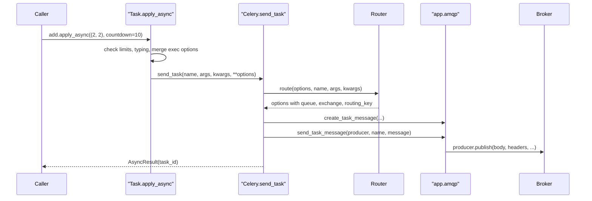

## Overview

Calling a task asynchronously produces one broker message. `Task.apply_async` validates and merges options, `Celery.send_task` resolves the route and builds the message, and `AMQP.send_task_message` publishes it with a producer from the app's pool. The caller gets back an `AsyncResult` for the task id ([[Task Results and States]]). This page follows that path and the objects it uses: the routing table, the queue declarations and the protocol v2 message. The task options themselves are listed in [[Defining Tasks]].

Sources: [celery/app/task.py:651-707](repo://celery/app/task.py#L651-L707), [celery/app/base.py:1004-1042](repo://celery/app/base.py#L1004-L1042)



Sources: [celery/app/task.py:651-707](repo://celery/app/task.py#L651-L707), [celery/app/base.py:927-1042](repo://celery/app/base.py#L927-L1042), [celery/app/amqp.py:506-607](repo://celery/app/amqp.py#L506-L607)

## apply_async

`apply_async(args, kwargs, task_id, producer, link, link_error, shadow, **options)` first raises `ValueError` if `soft_time_limit` exceeds `time_limit`, and when `typing` is on checks the arguments against the task signature. It computes `shadow` (a display name for logs) from `shadow_name`, then merges the task's cached execution options (`queue`, `routing_key`, `exchange`, `priority`, `expires`, `serializer`, `delivery_mode`, `compression`, `time_limit`, `soft_time_limit`) under the caller's options, and sets `ignore_result` and `priority` defaults from the task.

Sources: [celery/app/task.py:651-680](repo://celery/app/task.py#L651-L680), [celery/app/task.py:27-31](repo://celery/app/task.py#L27-L31), [celery/app/task.py:1256-1259](repo://celery/app/task.py#L1256-L1259)

With `task_always_eager` the task never reaches the broker: the arguments are serialized and deserialized with the configured serializer (so non-serializable arguments fail just as they would over the wire) and `apply` runs the task inline, inside `denied_join_result` so it cannot block on other results. Otherwise `apply_async` calls `app.send_task` with `task_type=self` and the task's `AsyncResult` class.

Sources: [celery/app/task.py:682-707](repo://celery/app/task.py#L682-L707)

The options `apply_async` documents are the ones below; anything else is passed through to `kombu.Producer.publish`.

Sources: [celery/app/task.py:636-640](repo://celery/app/task.py#L636-L640)

| Option | Meaning |
| --- | --- |
| `countdown`, `eta` | Earliest execution time, relative or absolute |
| `expires` | Seconds or datetime after which the worker discards the task |
| `queue`, `exchange`, `routing_key` | Destination, overriding routing |
| `priority` | 0–9; meaning depends on the broker |
| `serializer`, `compression` | Body encoding |
| `retry`, `retry_policy` | Retry publishing on connection errors |
| `link`, `link_error` | Callback and errback signatures |
| `time_limit`, `soft_time_limit` | Per-call limits |
| `ignore_result`, `add_to_parent`, `headers`, `connection`, `producer` | Result storage, trail, extra headers, reuse of a connection |

Sources: [celery/app/task.py:536-640](repo://celery/app/task.py#L536-L640)

## send_task

### Option resolution

`send_task(name, ...)` can send any task by name, registered locally or not; `task_always_eager` has no effect on it and only produces a warning. When called directly (no `task_type`), it looks the name up in the raw registry without finalizing the app and, if found, merges that task's non-`None` execution options under the given ones. `time_limit`, `soft_time_limit` and `expires` are popped from options so the explicit arguments win, and an explicit `None` clears a task default.

Sources: [celery/app/base.py:846-925](repo://celery/app/base.py#L846-L925)

### Expiry and parentage

A datetime or ISO string `expires` is converted to seconds from now; a negative value is logged as a warning and clamped to `0`, and the number becomes the message's `expiration` property. If no `root_id`/`parent_id` is given and the call happens inside a worker task, they are taken from the running request; with `task_inherit_parent_priority`, so is the priority.

Sources: [celery/app/base.py:967-1003](repo://celery/app/base.py#L967-L1003)

### Publishing and the result

After routing and building the message, `send_task` acquires a producer (or wraps the given `connection`), calls `backend.on_task_call` unless the result is ignored (the RPC backend uses it to start consuming replies), and publishes with `amqp.send_task_message`, converting transport errors into Kombu library errors. The `AsyncResult` it returns has `ignored` set, and when `add_to_parent` is true and a worker task is running, it is appended to that task's `request.children`.

Sources: [celery/app/base.py:1005-1042](repo://celery/app/base.py#L1005-L1042)

## Routing

### The router

`send_task` passes the merged options to `router.route(options, name, args, kwargs, task_type)`. `Router.route` expands a `queue` name in the options to its `Queue` declaration, then asks each router in `task_routes` in order; the first non-`None` answer is expanded and merged under the options, so explicit options still win. With no route and no `queue`, the task goes to `task_default_queue`. A queue name missing from `task_queues` raises `QueueNotFound` from `expand_destination`.

Sources: [celery/app/routes.py:56-107](repo://celery/app/routes.py#L56-L107), [celery/app/base.py:925-926](repo://celery/app/base.py#L925-L926)

### task_routes

`prepare` turns each entry of `task_routes` into a router. A dict (or a list of pairs) becomes a `MapRoute`: exact names are looked up first, then glob patterns (`'feed.*'`) and compiled regexes in insertion order. A route value can be a dict of options or a bare queue name. A string entry is a lazily imported router; a callable is called as `router(name, args, kwargs, options, task=task)`, and pre-4.0 classes with `route_for_task` still work.

Sources: [celery/app/routes.py:26-53](repo://celery/app/routes.py#L26-L53), [celery/app/routes.py:109-136](repo://celery/app/routes.py#L109-L136)

```python
app.conf.task_routes = {
    'feed.tasks.import_feed': {'queue': 'feeds'},
    'web.*': 'web',
}
```

Sources: [celery/app/routes.py:26-53](repo://celery/app/routes.py#L26-L53)

`app.amqp.routes` caches the prepared table; `AMQP` binds to configuration updates and rebuilds the table and the router when `task_routes` changes.

Sources: [celery/app/amqp.py:310-311](repo://celery/app/amqp.py#L310-L311), [celery/app/amqp.py:623-660](repo://celery/app/amqp.py#L623-L660)

### Queues

`app.amqp.queues` is a `Queues` mapping built from `task_queues`; when that is empty it contains one queue named `task_default_queue` (declared as a quorum queue when `task_default_queue_type` is `quorum`). Looking up an unknown name creates the queue when `task_create_missing_queues` is on, with an exchange and routing key of the same name, optionally as a quorum queue or with `task_create_missing_queue_exchange_type`. Queues without an exchange get the default exchange, and `task_queue_max_priority` adds `x-max-priority`.

Sources: [celery/app/amqp.py:272-304](repo://celery/app/amqp.py#L272-L304), [celery/app/amqp.py:34-130](repo://celery/app/amqp.py#L34-L130), [celery/app/amqp.py:200-217](repo://celery/app/amqp.py#L200-L217)

The same mapping tells the worker what to consume. `select` restricts consumption to named queues (`celery worker -Q`), `deselect` removes some (`-X`), and `select_add` adds a queue that stays consumed even when a subset is selected; `consume_from` returns the active set.

Sources: [celery/app/amqp.py:150-199](repo://celery/app/amqp.py#L150-L199), [celery/app/amqp.py:218-223](repo://celery/app/amqp.py#L218-L223)

### Native delayed delivery

When a task has an `eta` or `countdown` and `detect_quorum_queues` reports quorum queues on the transport, `send_task` turns the delay into a routing key with `calculate_routing_key` and publishes to the `celery_delayed_27` topic exchange instead of the queue, so the broker holds the message until it is due. A direct exchange cannot be used this way: the code logs a warning that the task may block the worker until its ETA. The worker side is the `DelayedDelivery` step in [[The Consumer and Event Loop]].

Sources: [celery/app/base.py:928-965](repo://celery/app/base.py#L928-L965)

## The protocol v2 message

`create_task_message` is `as_task_v2` unless `task_protocol` is `1`. It requires `args` to be a list or tuple and `kwargs` a mapping, turns `countdown` and numeric `expires` into timezone-aware datetimes, and serializes `eta` and `expires` as ISO 8601 strings. It returns a `task_message` of headers, properties, body and an optional `task-sent` event payload.

Sources: [celery/app/amqp.py:265-267](repo://celery/app/amqp.py#L265-L267), [celery/app/amqp.py:326-368](repo://celery/app/amqp.py#L326-L368), [celery/app/amqp.py:28-30](repo://celery/app/amqp.py#L28-L30)

| Part | Contents |
| --- | --- |
| headers | `lang`, `task`, `id`, `shadow`, `eta`, `expires`, `group`, `group_index`, `retries`, `timelimit`, `root_id`, `parent_id`, `argsrepr`, `kwargsrepr`, `origin`, `ignore_result`, `replaced_task_nesting`, `stamped_headers`, `stamps` |
| properties | `correlation_id` (the task id), `reply_to` |
| body | `(args, kwargs, {callbacks, errbacks, chain, chord})` |
| sent event | `uuid`, `root_id`, `parent_id`, `name`, `args`, `kwargs`, `retries`, `eta`, `expires` when `task_send_sent_event` is on |

Sources: [celery/app/amqp.py:370-418](repo://celery/app/amqp.py#L370-L418)

Putting the task name and id in headers lets the worker dispatch without deserializing the body. `argsrepr` and `kwargsrepr` are `saferepr` strings capped at 1024 characters, used by logs and monitors that should not decode arguments. `root_id` defaults to the task's own id, and `origin` to the sender's node name.

Sources: [celery/app/amqp.py:250-255](repo://celery/app/amqp.py#L250-L255), [celery/app/amqp.py:362-392](repo://celery/app/amqp.py#L362-L392)

## Publishing

`_create_task_sender` reads its defaults once (`task_publish_retry`, `task_publish_retry_policy`, `task_default_delivery_mode`, serializer, compression, default exchange and routing key) and returns the `send_task_message` closure. For each message it merges extra headers and properties, picks the default queue when neither queue nor exchange is given, takes the delivery mode and exchange type from the queue, and for direct exchanges publishes through the anonymous exchange with the queue name as routing key. The queue is declared on publish unless it is a `Broadcast` queue.

Sources: [celery/app/amqp.py:485-555](repo://celery/app/amqp.py#L485-L555)

The publish itself is wrapped by signals: `before_task_publish` gets the body, exchange, routing key, headers and properties before sending, `after_task_publish` gets the body, headers, exchange and routing key afterwards, and the deprecated `task_sent` is still sent when it has receivers. Each signal is only sent when something is connected to it. Finally, if the message carries a sent event, it is published as `task-sent` with the queue, exchange and routing key added ([[Signals]], [[Events and Monitoring]]).

Sources: [celery/app/amqp.py:557-607](repo://celery/app/amqp.py#L557-L607)

The producer pool is Kombu's producer pool for the write connection, limited to the size of the app's connection pool (`broker_pool_limit`). Publishing retries follow the merged `retry_policy`, which is how a temporarily unavailable broker is ridden out ([[The Celery Application]]).

Sources: [celery/app/amqp.py:637-645](repo://celery/app/amqp.py#L637-L645), [celery/app/amqp.py:545-570](repo://celery/app/amqp.py#L545-L570)
