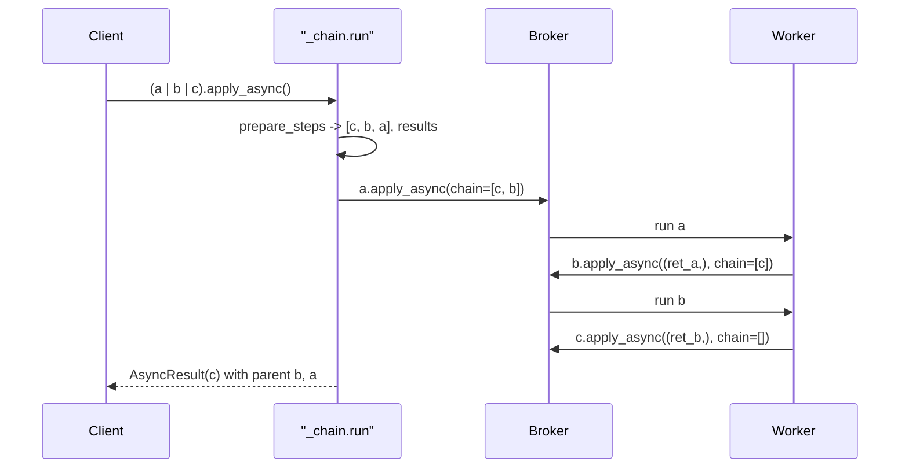

## Overview

A signature is a task call that has not happened yet: the task name, its arguments and its execution options, packed into a `dict` subclass so it can travel inside a message. Signatures are the parts that callbacks, chains, groups and chords are built from, collectively called the canvas. This page covers the `Signature` type, its callbacks and the `chain` primitive, which runs signatures one after another passing each result to the next. Parallel primitives are in [[Groups and Chords]]; the results a canvas returns are in [[Task Results and States]].

Sources: [celery/canvas.py:233-292](repo://celery/canvas.py#L233-L292)

## Creating a signature

### Constructors

`Signature(task, args, kwargs, options, immutable=False, app=None, **ex)` accepts a task name, a task class or instance (its `name` is used and the type is remembered), or a dict, which is copied as-is. The stored keys are `task`, `args` (always a tuple), `kwargs`, `options` (the given options plus any extra keyword arguments), `subtask_type` and `immutable`; properties such as `sig.id`, `sig.args` and `sig.options` read them back.

Sources: [celery/canvas.py:323-345](repo://celery/canvas.py#L323-L345), [celery/canvas.py:866-874](repo://celery/canvas.py#L866-L874)

The common entry points are the task methods `s(*args, **kwargs)`, `si(...)` (immutable) and `signature(args, kwargs, **options)`, and the `signature()` function, which clones an existing signature, rebuilds one from a dict, or creates a new one. `maybe_signature` does the same for values that may be `None` and optionally binds them to an app.

Sources: [celery/app/task.py:962-986](repo://celery/app/task.py#L962-L986), [celery/canvas.py:2395-2439](repo://celery/canvas.py#L2395-L2439)

```pycon
>>> add.s(2, 2).set(countdown=10).set(expires=30).delay()
>>> signature('tasks.add', args=(2, 2))
{'task': 'tasks.add', args=(2, 2), kwargs={}, options={}}
```

Sources: [celery/canvas.py:252-277](repo://celery/canvas.py#L252-L277)

### Serialization and types

A signature pickles and JSON-encodes as its plain dict, and the task type is looked up lazily from the app's registry when first needed. Subclasses register under a name with `Signature.register_type`, and `from_dict` uses the `subtask_type` key to rebuild the right class (`chain`, `group`, `chord`, `xmap`, `xstarmap`, `chunks`), which is how a worker turns the callbacks in a message body back into objects.

Sources: [celery/canvas.py:296-321](repo://celery/canvas.py#L296-L321), [celery/canvas.py:823-829](repo://celery/canvas.py#L823-L829), [celery/canvas.py:843-850](repo://celery/canvas.py#L843-L850)

## Calling a signature

### Calling methods

`sig.delay(*args, **kwargs)` and `sig.apply_async(args, kwargs, **options)` send the task; `sig.apply()` runs it eagerly; `sig(*args)` calls the task body directly; `~sig` sends it and waits for the result. Options passed as `None` are dropped. When the task is not registered locally, `_apply_async` falls back to `app.send_task` with the stored name, so a signature can call a task that only exists on the workers.

Sources: [celery/canvas.py:347-401](repo://celery/canvas.py#L347-L401), [celery/canvas.py:820-821](repo://celery/canvas.py#L820-L821), [celery/canvas.py:858-864](repo://celery/canvas.py#L858-L864)

### Partial application

All of these go through `_merge`. New positional arguments are *prepended* to the stored ones, so `add.s(4)` called with a parent result `8` runs `add(8, 4)`. New keyword arguments update the stored ones, and new options override stored options except `group_id` and stamped headers, which stay fixed because changing them would stop parent tasks from completing. An immutable signature keeps its arguments and only merges options.

Sources: [celery/canvas.py:403-443](repo://celery/canvas.py#L403-L443), [celery/canvas.py:290-292](repo://celery/canvas.py#L290-L292)

`clone(args, kwargs, **opts)` (alias `partial`) returns a merged copy with deep-copied options, `replace(args, kwargs, options)` a copy with whole sections swapped, and `set(immutable=None, **options)` updates options in place and returns the signature for chaining.

Sources: [celery/canvas.py:445-471](repo://celery/canvas.py#L445-L471), [celery/canvas.py:524-552](repo://celery/canvas.py#L524-L552)

### Freezing

`freeze(_id, group_id, chord, root_id, parent_id, group_index)` fixes the task id before sending: it keeps an existing `task_id` option or sets a new one, fills `root_id`, `parent_id`, `group_id` (only if not already set), `chord` and `group_index`, defaults `reply_to` to the app's per-thread id, and returns an `AsyncResult` for that id. The docstring warns that sending a frozen signature twice produces two messages with the same id. Canvas primitives freeze their parts to build the result tree before anything is published.

Sources: [celery/canvas.py:473-522](repo://celery/canvas.py#L473-L522)

## Callbacks and errbacks

`link(callback)` appends a signature to the `link` option and `link_error(errback)` to `link_error`; both return the argument they were given. `on_error(errback)` does the same as `link_error` but returns the original signature, so `add.s(2, 2).on_error(handler.s()).delay()` calls `add`. The lists are stored once per value, and `flatten_links` walks `link` options recursively.

Sources: [celery/canvas.py:685-757](repo://celery/canvas.py#L685-L757)

When a task succeeds, the tracer sends its callbacks with the return value as the first argument. A single callback is applied directly. With several, groups among them are applied one by one and the remaining signatures are wrapped in one `group` so they run in parallel. The docstring notes that dispatch is not atomic: after a reject and redelivery, callbacks already sent can be sent again, which is accepted under at-least-once delivery. Errbacks run from the backend's `mark_as_failure` ([[Retries and Error Handling]]).

Sources: [celery/app/trace.py:426-466](repo://celery/app/trace.py#L426-L466)

## Chains

### Building a chain

The `|` operator builds chains. `task | task` and `task | chain` produce a `_chain`; `task | group` unrolls a one-member group first. `chain(a, b, c)` is defined to work exactly like `a | b | c` by reducing the arguments with `operator.or_`, and a single iterable argument (including a generator) is accepted as the list of tasks. `__ior__` is overridden because Python 3.9 made `|=` the dict merge operator.

Sources: [celery/canvas.py:759-786](repo://celery/canvas.py#L759-L786), [celery/canvas.py:1322-1382](repo://celery/canvas.py#L1322-L1382)

A `_chain` is itself a signature for the `celery.chain` task whose `kwargs['tasks']` holds the steps. `_chain.__or__` upgrades as it goes: `chain | group` appends the group (or pipes it into the body when the chain ends with a chord); `chain | chain` concatenates; `chain | task` when the chain ends with a group turns that group and the task into a `chord`, and collapses two consecutive chords by moving the second into the first's body; `chain | task` when the chain ends with a chord pipes the task into the chord body.

Sources: [celery/canvas.py:934-1006](repo://celery/canvas.py#L934-L1006)

`unchain_tasks` returns cloned steps with the chain's own `link` callbacks moved to the last step and its `link_error` errbacks added to every step, so an error anywhere in the chain reaches the chain's errback.

Sources: [celery/canvas.py:1017-1034](repo://celery/canvas.py#L1017-L1034)

### Preparing the steps

`prepare_steps` walks the steps *from last to first*, popping from a deque:

Sources: [celery/canvas.py:1153-1170](repo://celery/canvas.py#L1153-L1170)

1. Dicts are turned into signatures; nested groups are unrolled, and empty groups in the middle of a chain are skipped.
2. The first step gets the chain's partial arguments; every step is cloned unless `clone=False`.
3. A nested chain is spliced into the queue instead of becoming a step.
4. A group followed by a step becomes `chord(group, body=next_step)`, reusing the body's frozen id.
5. The last step is frozen with the chain's `task_id`, `group_id`, chord body and `group_index` (so an enclosing group or chord synchronizes on the chain's final task); the others are frozen with only the `root_id`.
6. Each result's `parent` is set to the result of the step before it, and the chain's `link_error` is added to every step (and to a chord's body).
7. A chord step checks `backend.ensure_chords_allowed()`, and the next parent pointer is moved to the chord's header result.

Sources: [celery/canvas.py:1170-1289](repo://celery/canvas.py#L1170-L1289)

The comment explains the reverse order: the resulting list is placed in the message's `chain` field, and because it is reversed the worker only has to `pop()` the next task. Storing the steps in one list instead of linking each task to the next avoids the deep recursion pickle needed for a linked tree, which is why `use_link` is only on for protocol 1.

Sources: [celery/canvas.py:1159-1186](repo://celery/canvas.py#L1159-L1186)

### Running a chain



Sources: [celery/canvas.py:1048-1094](repo://celery/canvas.py#L1048-L1094), [celery/app/trace.py:466-473](repo://celery/app/trace.py#L466-L473)

`_chain.apply_async` runs the chain eagerly with `apply` under `task_always_eager`. Otherwise `run` prepares the steps, adds any `link` to the first step, pops the first task and sends it with `chain` set to the remaining steps through `_prepare_chain_from_options`. That helper never mutates the shared options dict; its long comment records Issue #5354, where mutating the `chain` list inside a group made sibling tasks inherit each other's chains, so it builds a `ChainMap` and concatenates lists instead.

Sources: [celery/canvas.py:1036-1094](repo://celery/canvas.py#L1036-L1094), [celery/canvas.py:877-931](repo://celery/canvas.py#L877-L931)

In the worker, after a successful step the tracer takes `chain[-1]` as the next signature and sends it with the return value as its first argument and `chain[:-1]` as the rest. A chain of several tasks returns the `AsyncResult` of its last task, whose `parent` links lead back to the first; a chain of one task returns that task's real result, which matters when it is a group.

Sources: [celery/app/trace.py:466-473](repo://celery/app/trace.py#L466-L473), [celery/canvas.py:1076-1094](repo://celery/canvas.py#L1076-L1094)

`_chain.apply` runs each step locally in order, cloning it with the previous result as argument and setting `parent` links. `freeze` runs `prepare_steps` without cloning and returns the first result (the last task's).

Sources: [celery/canvas.py:1294-1302](repo://celery/canvas.py#L1294-L1302), [celery/canvas.py:1096-1105](repo://celery/canvas.py#L1096-L1105)

## Stamping

`stamp(visitor=None, append_stamps=False, **headers)` adds custom headers to a signature and to everything linked from it. A `StampingVisitor` subclass can return headers per primitive through `on_signature`, `on_chain_start`, `on_group_start`, `on_chord_header_start`, `on_chord_body`, `on_callback` and `on_errback`. Stamped header names are recorded in `stamped_headers`, are treated as immutable options during merging, and are carried by the protocol v2 message ([[Sending Tasks and Routing]]).

Sources: [celery/canvas.py:119-230](repo://celery/canvas.py#L119-L230), [celery/canvas.py:614-634](repo://celery/canvas.py#L614-L634), [celery/canvas.py:1107-1118](repo://celery/canvas.py#L1107-L1118)
