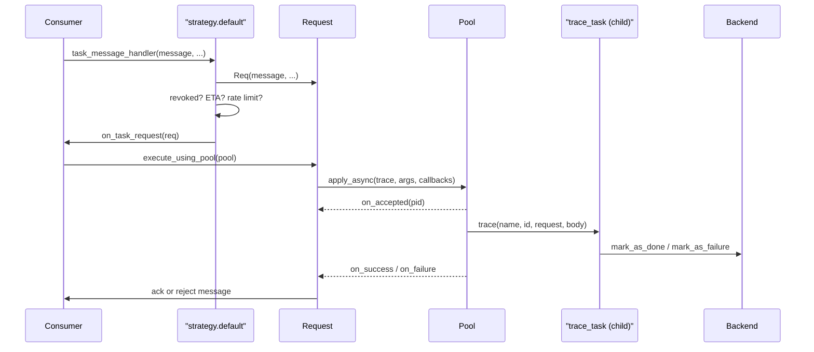

## Overview

Once the consumer has a task message ([[The Consumer and Event Loop]]), three pieces run it. The task's *strategy* turns the message into a `Request` and decides when it may run (ETA, rate limit, revoked). The `Request` sends itself to the execution pool and handles the pool's callbacks: acknowledging the message, time limits, success and failure. Inside the pool process, the *tracer* built by `build_tracer` calls the task function, stores the outcome in the backend, sends callbacks and chain steps, and fires the task signals. Worker-wide bookkeeping of reserved, active and revoked tasks lives in `celery/worker/state.py`. Pool internals are covered in [[Execution Pools]].

Sources: [celery/worker/strategy.py:99-209](repo://celery/worker/strategy.py#L99-L209), [celery/worker/request.py:341-372](repo://celery/worker/request.py#L341-L372), [celery/app/trace.py:344-364](repo://celery/app/trace.py#L344-L364)

Sources: [celery/worker/strategy.py:132-209](repo://celery/worker/strategy.py#L132-L209), [celery/worker/worker.py:220-231](repo://celery/worker/worker.py#L220-L231), [celery/worker/request.py:341-372](repo://celery/worker/request.py#L341-L372), [celery/worker/request.py:515-527](repo://celery/worker/request.py#L515-L527), [celery/app/trace.py:735-790](repo://celery/app/trace.py#L735-L790)

## The strategy

### Building the handler

`Task.start_strategy` instantiates `Task.Strategy`, by default `celery.worker.strategy:default`, once per task when the consumer starts. `default` looks up everything the hot path needs once: the hostname, the event dispatcher, the timer's `call_at`, the rate-limit buckets, the revoked set, and a `Request` subclass made by `create_request_cls` with the task's time limits and the pool's `apply_async` bound in. Its docstring notes that strategies exist as an optimization and are not easy to override.

Sources: [celery/app/task.py:520-521](repo://celery/app/task.py#L520-L521), [celery/worker/strategy.py:99-130](repo://celery/worker/strategy.py#L99-L130), [celery/worker/request.py:818-874](repo://celery/worker/request.py#L818-L874)

### Handling one message

`task_message_handler` normalizes old formats first: a protocol v1 body, or a hybrid message with `args` in the payload, is converted to the protocol v2 layout `(args, kwargs, embed)` plus headers. A protocol v2 body is left undecoded; it is deserialized later in the pool process. Then it:

Sources: [celery/worker/strategy.py:22-97](repo://celery/worker/strategy.py#L22-L97), [celery/worker/strategy.py:132-150](repo://celery/worker/strategy.py#L132-L150)

1. Builds the `Request` and logs `Task ... received`.
2. Drops the task if it has expired or its id is revoked (`req.revoked()` marks it `REVOKED` and acknowledges it).
3. Sends the `task_received` signal and a `task-received` event.
4. Converts the ETA to a timestamp; an ETA that cannot be converted rejects the message without requeue.
5. With an ETA, increments QoS so the held message does not block prefetching and schedules the request on the timer (through the rate-limit bucket if the task has one).
6. Without an ETA but with a rate limit, puts the request in the task's bucket.
7. Otherwise marks it reserved, runs any `on_task_message` callbacks and hands it to `on_task_request`, which is the worker's `_process_task`.

Sources: [celery/worker/strategy.py:150-209](repo://celery/worker/strategy.py#L150-L209)

When an ETA arrives, the timer calls `apply_eta_task`, which reserves the request, runs it and decrements QoS again ([[The Consumer and Event Loop]]).

Sources: [celery/worker/consumer/consumer.py:659-663](repo://celery/worker/consumer/consumer.py#L659-L663)

## The Request

### Construction

`Request(message, ...)` copies the message headers as its request dict and keeps the raw body. It reads the id, the task name (displayed as `shadow` when set), root and parent ids, time limits, argument reprs, and `ignore_result` (from the message, else the task). `eta` and `expires` are parsed from ISO 8601; an invalid value raises `InvalidTaskError`, which the consumer turns into a rejected message.

Sources: [celery/worker/request.py:90-176](repo://celery/worker/request.py#L90-L176)

### Sending to the pool

`WorkController._process_task` calls `req.execute_using_pool(pool)`. It raises `TaskRevokedError` if the task was revoked meanwhile, then calls `pool.apply_async` with the trace function and `(task name, id, request dict, body, content type, content encoding)`, plus four callbacks and the soft and hard time limits (from the message, else the task). It keeps a weak reference to the pool's result so the job can be terminated later.

Sources: [celery/worker/worker.py:220-231](repo://celery/worker/worker.py#L220-L231), [celery/worker/request.py:341-372](repo://celery/worker/request.py#L341-L372)

The trace function is `fast_trace_task` when `setup_worker_optimizations` has run in this process (it caches the task registry, accepted content types and hostname), otherwise `trace_task_ret`. Both deserialize the body with the accepted content types, merge the embedded callbacks, errbacks, chain and chord into the request, and call the task's tracer; they return `(failed, result, runtime)`. `fast_trace_task` raises a `RuntimeError` naming the fix when its cache is empty, which happens in a spawned rather than forked child.

Sources: [celery/app/trace.py:735-790](repo://celery/app/trace.py#L735-L790), [celery/app/trace.py:804-831](repo://celery/app/trace.py#L804-L831)

### Pool callbacks

| Callback | When | Does |
| --- | --- | --- |
| `on_accepted(pid, time)` | A pool process picked the job | Records pid and start time, marks the request active, acknowledges unless `acks_late`, sends `task-started`, applies a pending terminate |
| `on_timeout(soft, timeout)` | A time limit expired | Soft: logs a warning (the task sees `SoftTimeLimitExceeded`). Hard: marks `FAILURE` with `TimeLimitExceeded`, runs `on_failure`, `after_return`, `task_failure` and `task-failed`, then acks or requeues `acks_late` tasks per `acks_on_timeout` |
| `on_success((failed, retval, runtime))` | The tracer returned | A failed trace goes to `on_failure`; otherwise marks the request ready and successful, acknowledges `acks_late` tasks and sends `task-succeeded` |
| `on_failure(exc_info)` | The job raised in the pool | Handles revoke-by-terminate, `Reject`, `Ignore`, `Retry` and the acks-late rules ([[Retries and Error Handling]]) |

Sources: [celery/worker/request.py:515-620](repo://celery/worker/request.py#L515-L620), [celery/worker/request.py:622-728](repo://celery/worker/request.py#L622-L728)

With the default early acknowledgement, the message is acknowledged when a pool process accepts it, so a worker crash loses the task. With `acks_late`, the acknowledgement waits for the outcome. `acknowledge()` and `reject()` are idempotent: each acts only once per request, and `reject` sends a `task-rejected` event.

Sources: [celery/worker/request.py:515-527](repo://celery/worker/request.py#L515-L527), [celery/worker/request.py:730-740](repo://celery/worker/request.py#L730-L740), [celery/app/task.py:302-311](repo://celery/app/task.py#L302-L311)

### Revoking, terminating, cancelling

`revoked()` checks expiry (adding expired ids to the revoked set), the revoked id set and stamped-header revokes, and when any match announces the revoke: it marks the request ready, sends `task-revoked`, stores `REVOKED`, acknowledges, and sends the `task_revoked` signal. `terminate(pool, signal)` kills the process running the task (or remembers to do so once accepted) and announces the revoke. `cancel()` does the same for shutdown and connection loss but records `RETRY` "cancelled by Celery" so the redelivered message runs again.

Sources: [celery/worker/request.py:408-509](repo://celery/worker/request.py#L408-L509)

## The tracer

### build_tracer

`build_tracer(name, task, ...)` returns a closure `trace_task(uuid, args, kwargs, request)` with every lookup done up front: it calls `task.run` directly unless the task overrides `__call__`, picks only the handlers the task actually overrides (`before_start`, `on_success`, `after_return`), and captures the signal receiver lists so signals with no receivers cost nothing. The tracer is cached on the task as `__trace__`; the consumer rebuilds it in `update_strategies`.

Sources: [celery/app/trace.py:344-416](repo://celery/app/trace.py#L344-L416), [celery/app/trace.py:689-702](repo://celery/app/trace.py#L689-L702), [celery/worker/consumer/consumer.py:716-721](repo://celery/worker/consumer/consumer.py#L716-L721)

### One execution

1. Builds a `Context` from the request with `called_directly=False`, and works out whether to track `STARTED` and whether to publish the result.
2. With `acks_late`, `worker_deduplicate_successful_tasks` and a persistent backend, a redelivered task that already succeeded is skipped. If its callbacks or chain were not dispatched (no stored children), they are sent now; failing to do so rejects the message with requeue.
3. Pushes the task and request on their stacks, sends `task_prerun`, calls the loader's `on_task_init`, and stores `STARTED` with pid and hostname when tracking.
4. Runs `before_start`, then the task function.
5. On success, dispatches callbacks and the next chain step *before* storing the result, so `result.children` is populated, then calls `mark_as_done`, the task's `on_success`, the `task_success` signal and logs `Task ... succeeded in Ns: result`. A result that cannot be encoded becomes a failure.
6. Runs `after_return` for non-ignored states, then always sends `task_postrun`, pops the stacks, and calls the backend's `process_cleanup` and the loader's cleanup.

Sources: [celery/app/trace.py:475-560](repo://celery/app/trace.py#L475-L560), [celery/app/trace.py:561-664](repo://celery/app/trace.py#L561-L664)

Exceptions in the task body take the paths described in [[Retries and Error Handling]]. An exception in the tracer itself is reported with `task_internal_error` and returned as a `FAILURE`; in eager mode it is re-raised.

Sources: [celery/app/trace.py:665-687](repo://celery/app/trace.py#L665-L687)

### Worker optimizations

`setup_worker_optimizations`, run by the worker at start and in each forked child, installs stack protection for custom `__call__` methods, makes the worker's app both current and default for all threads (the comment calls this a hack meaning one app per worker process), finalizes the app, fills the `fast_trace_task` cache and sets `app.use_fast_trace_task`.

Sources: [celery/app/trace.py:804-831](repo://celery/app/trace.py#L804-L831), [celery/apps/worker.py:94-96](repo://celery/apps/worker.py#L94-L96)

## Worker state

`celery/worker/state.py` holds module-level bookkeeping shared by the consumer, requests and remote control.

Sources: [celery/worker/state.py:49-74](repo://celery/worker/state.py#L49-L74)

| Name | Holds | Updated by |
| --- | --- | --- |
| `requests` | task id → `Request` for reserved and active tasks | `task_reserved`, `task_accepted`, `task_ready` |
| `reserved_requests` | Requests received but not yet running (weak set) | `task_reserved`, `task_ready` |
| `active_requests` | Requests a pool process is running (weak set) | `task_accepted`, `task_ready` |
| `successful_requests` | Recently succeeded ids (`LimitedSet`, 1000, 3 h) | `task_ready(successful=True)` |
| `total_count`, `all_total_count` | Accepted tasks per name and overall | `task_accepted` |
| `revoked` | Revoked ids (`LimitedSet`, 50000, 3 h) | revoke commands, expiry, Mingle |
| `revoked_stamps` | Stamped headers flagged for revoke | `revoke_by_stamped_headers` |
| `should_stop`, `should_terminate` | Shutdown flags | signal handlers; read by `maybe_shutdown` |

Sources: [celery/worker/state.py:33-74](repo://celery/worker/state.py#L33-L74), [celery/worker/state.py:96-128](repo://celery/worker/state.py#L96-L128)

The limits come from `CELERY_WORKER_REVOKES_MAX`, `CELERY_WORKER_SUCCESSFUL_MAX`, `CELERY_WORKER_REVOKE_EXPIRES` and `CELERY_WORKER_SUCCESSFUL_EXPIRES`. With `--statedb`, `Persistent` stores the revoked set (compressed) and the logical clock in a `shelve` file and merges them back on start, so revokes survive restarts.

Sources: [celery/worker/state.py:33-46](repo://celery/worker/state.py#L33-L46), [celery/worker/state.py:192-288](repo://celery/worker/state.py#L192-L288)
