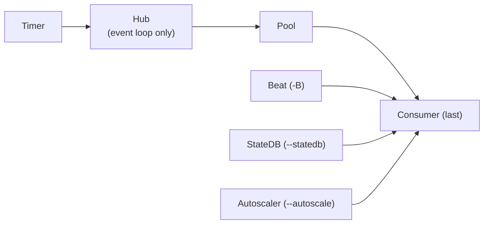

## Overview

`celery worker` turns command-line options into a `Worker` object, a subclass of `WorkController` that adds the banner, logging and signal handling a program needs. `WorkController` itself is a container for *bootsteps*: small objects that each create one part of the worker (the event loop hub, the execution pool, the timer, the embedded beat scheduler, the state database, the consumer) and start and stop it in dependency order. This page follows startup from the CLI to a running consumer and the shutdown paths back out. What the consumer does once started is in [[The Consumer and Event Loop]]; the pools in [[Execution Pools]].

Sources: [celery/bin/worker.py:307-371](repo://celery/bin/worker.py#L307-L371), [celery/worker/worker.py:63-88](repo://celery/worker/worker.py#L63-L88)

## From the command line

The `worker` command reads its options (node name `-n`, `-D/--detach`, `-l`, `-c/--concurrency`, `-P/--pool` defaulting to `prefork`, `-Q`/`-X` queues, time limits, `--autoscale`, `-B` for embedded beat, `--without-gossip/mingle/heartbeat` and more), parses any extra `key=value` arguments into settings in the `worker` namespace, and then:

Sources: [celery/bin/worker.py:136-220](repo://celery/bin/worker.py#L136-L220), [celery/bin/worker.py:221-306](repo://celery/bin/worker.py#L221-L306)

1. With `--detach`, re-executes `python -m celery ...` without the detach, uid and gid flags inside `platforms.detached`, and returns ([[Daemonization and celery multi]]).
2. Otherwise drops privileges to `--uid`/`--gid` with `maybe_drop_privileges`.
3. Builds `app.Worker(...)`, expanding `%n`-style node placeholders in `--pidfile` and `--statedb`.
4. Calls `worker.start()` and exits with `worker.exitcode`. A `SecurityError` is printed and exits with status 1.

Sources: [celery/bin/worker.py:324-371](repo://celery/bin/worker.py#L324-L371)

Before any of this runs, the `celery` entry point applies eventlet or gevent monkey patching if `-P` names one of them, because patching must happen before other imports ([[Command-Line Interface]]).

Sources: [celery/__init__.py:123-148](repo://celery/__init__.py#L123-L148), [celery/__main__.py:10-15](repo://celery/__main__.py#L10-L15)

## Building the WorkController

`WorkController.__init__` sets the node name, records the start time, and calls `app.loader.init_worker()`, which imports the task modules ([[Configuration and Loaders]]). It then runs the hooks `on_before_init`, `setup_defaults`, `on_after_init` and `setup_instance`.

Sources: [celery/worker/worker.py:90-99](repo://celery/worker/worker.py#L90-L99)

`setup_defaults` resolves every option against configuration with `app.either`: concurrency, task events, pool class, consumer and timer classes, autoscaler, pool putlocks and restarts, state DB, beat schedule file and scheduler, time limits, max tasks and memory per child, prefetch multiplier, rate-limit disabling and `worker_lost_wait`.

Sources: [celery/worker/worker.py:351-410](repo://celery/worker/worker.py#L351-L410)

`setup_instance` then:

Sources: [celery/worker/worker.py:101-139](repo://celery/worker/worker.py#L101-L139)

1. Selects and deselects queues on `app.amqp.queues` from `-Q` and `-X`, raising `ImproperlyConfigured` for unknown names, and adds the worker's own direct queue when `worker_direct` is on.
2. Imports `--include` modules and adds every registered task's module to `include`, so a re-executed worker imports them too.
3. Defaults concurrency to the CPU count (or 2).
4. Decides whether to use the event loop: only in a non-green environment, when the broker transport is asynchronous, and not on Windows.
5. Sends `worker_init`, resolves the pool class by name, and builds the worker `Blueprint` with user steps from `app.steps['worker']`, then applies it.

Sources: [celery/worker/worker.py:101-139](repo://celery/worker/worker.py#L101-L139), [celery/worker/worker.py:167-193](repo://celery/worker/worker.py#L167-L193), [celery/worker/worker.py:239-242](repo://celery/worker/worker.py#L239-L242)

## Bootsteps

### Steps and blueprints

A `Step` is a class with a `name` (its qualified name by default), `requires` (other steps that must come first), an optional `label`, and `enabled`/`include_if` to decide whether it applies. Its `__init__` runs when the blueprint is applied and may set attributes on the parent; `create(parent)` builds the step's object. A `StartStopStep` keeps that object and is added to `parent.steps`, so it is started, stopped, closed and terminated with the worker. A `ConsumerStep` is a start/stop step that opens consumers on the consumer's connection.

Sources: [celery/bootsteps.py:266-353](repo://celery/bootsteps.py#L266-L353), [celery/bootsteps.py:355-415](repo://celery/bootsteps.py#L355-L415)

`Blueprint.apply(parent)` loads the step classes, follows `requires` to pull in dependencies not listed, builds a `DependencyGraph`, makes the step marked `last` depend on every other step, and instantiates the steps in topological order before calling `include` on each. An unknown dependency raises `KeyError('unknown bootstep: ...')`.

Sources: [celery/bootsteps.py:186-264](repo://celery/bootsteps.py#L186-L264)

Sources: [celery/worker/components.py:56-66](repo://celery/worker/components.py#L56-L66), [celery/worker/components.py:101-115](repo://celery/worker/components.py#L101-L115), [celery/worker/components.py:181-246](repo://celery/worker/components.py#L181-L246), [celery/worker/worker.py:76-88](repo://celery/worker/worker.py#L76-L88)

### Starting and stopping

`Blueprint.start` sets the state to `RUN`, calls `on_start`, and starts each step in `parent.steps` in order, counting how many started. `stop` closes all steps, then stops (or terminates) them in reverse order without propagating errors, calls `on_stopped` and signals `shutdown_complete`. A blueprint that never finished starting is just marked terminated.

Sources: [celery/bootsteps.py:110-184](repo://celery/bootsteps.py#L110-L184)

Custom steps are added per blueprint through `app.steps['worker']` or `app.steps['consumer']`; `celery graph bootsteps` draws the resulting graph.

Sources: [celery/worker/worker.py:131-138](repo://celery/worker/worker.py#L131-L138), [celery/app/base.py:376-376](repo://celery/app/base.py#L376-L376)

## The worker components

### Timer and Hub

`Timer` creates `w.timer`: with the event loop it is a Kombu timer driven by the hub; otherwise it is the pool's own timer class (eventlet needs its own, for instance) running on `worker_timer_precision`. `Hub` is included only when the event loop is used. It reuses an existing Kombu hub or creates one (honouring a transport that requires a specific hub), and replaces the app clock's lock and billiard's pool lock with dummy locks since everything runs in one thread.

Sources: [celery/worker/components.py:32-99](repo://celery/worker/components.py#L32-L99)

### Pool

`Pool` parses `--autoscale max,min` into `max_concurrency`/`min_concurrency`, then instantiates the pool class with the minimum concurrency, the app and hostname as child initializer arguments, per-child task and memory limits, time limits and `worker_lost_wait`. Without threads (event-loop mode) it adds a `LaxBoundedSemaphore` sized to the concurrency and, when `pool_putlocks` is on and the pool uses a semaphore, routes tasks through it. Finally it sets the synchronous-subtask guard from the pool's `task_join_will_block` ([[Task Results and States]]).

Sources: [celery/worker/components.py:101-179](repo://celery/worker/components.py#L101-L179)

### Beat, StateDB and Consumer

`Beat` is enabled by `-B` and runs `beat.EmbeddedService` inside the worker; it refuses to start with eventlet or gevent pools ([[Periodic Tasks with Beat]]). `StateDB` is enabled by `--statedb` and loads a `Persistent` store of revoked task ids and the logical clock, saved again at exit ([[Task Execution Pipeline]]).

Sources: [celery/worker/components.py:181-218](repo://celery/worker/components.py#L181-L218)

`Consumer` is the step marked `last`. It computes the initial prefetch count as concurrency (or the autoscaler's maximum) times `worker_prefetch_multiplier`, and instantiates `worker_consumer` with the task callback, pool, timer, hub and controller. Starting this step starts the consumer blueprint, which blocks in the event loop until shutdown.

Sources: [celery/worker/components.py:221-246](repo://celery/worker/components.py#L221-L246)

## The Worker program

`celery.apps.worker.Worker` fills the hooks. `on_before_init` sets up the fast tracer, sends `celeryd_init` (receivers can configure workers by node name) and checks that pickle is not accepted while running as root. `on_after_init` decides stdout redirection and colour. `on_init_blueprint` sets up logging and finalizes the app.

Sources: [celery/apps/worker.py:91-126](repo://celery/apps/worker.py#L91-L126)

`on_start` creates the pidfile lock, sends `celeryd_after_setup` (where queues can still change), purges queues with `--purge`, prints the banner with the configuration and task list, sets the process title, installs signal handlers, redirects stdout and stderr to the logger when configured, and warns about old-style setting names. `on_consumer_ready` sends `worker_ready` and logs `<hostname> ready.`.

Sources: [celery/apps/worker.py:128-182](repo://celery/apps/worker.py#L128-L182), [celery/worker/worker.py:150-152](repo://celery/worker/worker.py#L150-L152)

## Shutdown

### Signals

`install_platform_tweaks` installs the handlers. Each shutdown handler, in the main process, runs its callback, prints the kind of shutdown, sends `worker_shutting_down`, and sets `state.should_stop` (warm) or `state.should_terminate` (cold), which the consumer loop checks ([[The Consumer and Event Loop]]).

Sources: [celery/apps/worker.py:254-274](repo://celery/apps/worker.py#L254-L274), [celery/apps/worker.py:288-316](repo://celery/apps/worker.py#L288-L316)

| Signal | Effect |
| --- | --- |
| `SIGTERM` | Warm shutdown: stop consuming, finish running tasks (cold instead when billiard's `REMAP_SIGTERM` is `SIGQUIT`) |
| `SIGINT` (first) | Warm shutdown; the next `SIGINT` becomes cold |
| `SIGQUIT` | Cold shutdown: optional soft-shutdown wait, then cancel running tasks |
| `SIGINT`/`SIGQUIT` during cold shutdown | Cancel unacknowledged requests; the next one raises `WorkerTerminate` (hard shutdown) |
| `SIGHUP` | Restart by re-executing the program, only when detached from a terminal (not supported on macOS) |
| `SIGUSR1` | Log the stack of every thread |
| `SIGUSR2` | Open a remote debugger, when `CELERY_RDBSIG` is set |

Sources: [celery/apps/worker.py:319-410](repo://celery/apps/worker.py#L319-L410), [celery/apps/worker.py:430-467](repo://celery/apps/worker.py#L430-L467), [celery/apps/worker.py:469-523](repo://celery/apps/worker.py#L469-L523)

### Cold and soft shutdown

`on_cold_shutdown` waits for `wait_for_soft_shutdown`: when `worker_soft_shutdown_timeout` is positive and tasks are running (or `worker_enable_soft_shutdown_on_idle` is set), the worker sleeps that long so short tasks can finish. It then cancels the task consumer so requeued messages are not redelivered to it, cancels all unacknowledged requests so they return to the queue, sets `should_terminate`, and stops the pool.

Sources: [celery/apps/worker.py:369-430](repo://celery/apps/worker.py#L369-L430), [celery/worker/worker.py:412-435](repo://celery/worker/worker.py#L412-L435)

### Stopping the controller

`WorkController.start` runs the blueprint and maps its exits: `WorkerTerminate` calls `terminate()`, `SystemExit` and `KeyboardInterrupt` call `stop()` with the exit code, and any other exception is logged as an unrecoverable error. `stop()` (warm) and `terminate()` (cold) close the consumer and stop the blueprint with a socket timeout, unless called from a signal handler on a pool that is not signal safe. `on_close` shuts the loader down, and `on_stopped` stops the timer, shuts the consumer down and releases the pidfile. `worker_shutdown` is sent at the end of a warm stop.

Sources: [celery/worker/worker.py:201-212](repo://celery/worker/worker.py#L201-L212), [celery/worker/worker.py:244-267](repo://celery/worker/worker.py#L244-L267), [celery/worker/worker.py:157-165](repo://celery/worker/worker.py#L157-L165)

## Reload and statistics

`reload(modules, reload=False)` imports (or force-reloads) task modules, refreshes the consumer's strategies and rate limits, and restarts the pool if it supports it; the `pool_restart` remote command uses it. `stats()` merges uptime, pid, clock and total task counts with each blueprint's step info and `rusage`, and is what `celery inspect stats` returns ([[Remote Control and Inspection]]).

Sources: [celery/worker/worker.py:269-334](repo://celery/worker/worker.py#L269-L334)
