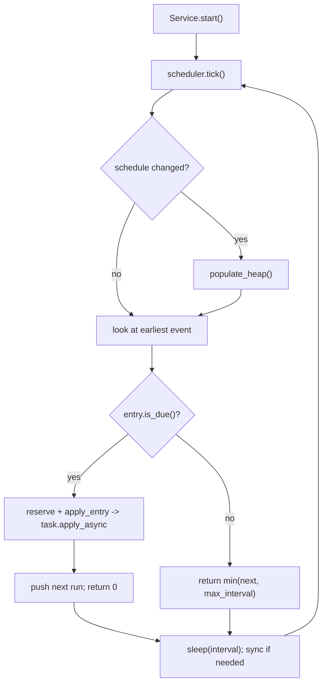

## Overview

`celery beat` is a separate scheduler process that sends tasks at regular times. It does not run tasks itself: when an entry of its schedule is due, it publishes the task to the broker like any client would, and workers execute it. The schedule comes from the `beat_schedule` setting and `app.add_periodic_task`, and the default scheduler keeps the last run time of each entry in a local `shelve` file so restarts do not re-run or skip tasks.

Sources: [celery/beat.py:219-264](repo://celery/beat.py#L219-L264), [celery/beat.py:505-530](repo://celery/beat.py#L505-L530)

Only one beat should run per schedule, since two would send every task twice. How each schedule type computes when it is due is on [[Schedules: Interval, Crontab and Solar]].

Sources: [celery/beat.py:297-298](repo://celery/beat.py#L297-L298)

## Declaring the schedule

### beat_schedule

`beat_schedule` is a dict of entry name to a dict with `task` (the task name), `schedule` (a number of seconds, a `timedelta`, or a schedule object), and optionally `args`, `kwargs`, `options` (any `apply_async` option) and `relative`. Each value becomes a `ScheduleEntry`. Arguments may contain `BeatLazyFunc` objects, which are called just before each send, for values such as the current time.

Sources: [celery/beat.py:82-129](repo://celery/beat.py#L82-L129), [celery/beat.py:50-79](repo://celery/beat.py#L50-L79), [celery/beat.py:201-216](repo://celery/beat.py#L201-L216)

### add_periodic_task

`app.add_periodic_task(schedule, sig, args=(), kwargs=(), name=None, **opts)` builds the same kind of entry from a signature: the key is `name` or the signature's `repr`, and the entry holds its task name, args, kwargs and options merged with `opts`. Before configuration is loaded the call is queued and applied when it is. Adding an unnamed entry with an existing key logs a warning that it shadowed the previous one.

Sources: [celery/app/base.py:1295-1333](repo://celery/app/base.py#L1295-L1333), [celery/app/base.py:1269-1273](repo://celery/app/base.py#L1269-L1273)

The periodic-tasks example connects to `on_after_configure` so the entry is added once the configuration exists:

Sources: [examples/periodic-tasks/myapp.py:45-53](repo://examples/periodic-tasks/myapp.py#L45-L53)

```python
@app.on_after_configure.connect
def setup_periodic_tasks(sender, **kwargs):
    # Calls say('hello') every 10 seconds.
    sender.add_periodic_task(10.0, say.s('hello'), name='add every 10')
```

Sources: [examples/periodic-tasks/myapp.py:50-53](repo://examples/periodic-tasks/myapp.py#L50-L53)

### Default entries

`install_default_entries` adds `celery.backend_cleanup` at 04:00 every day (expiring after 12 hours) when results expire and the result backend does not expire them itself. See [[Result Backend Interface]].

Sources: [celery/beat.py:268-277](repo://celery/beat.py#L268-L277)

## The scheduler loop

### Service.start

`Service` owns a scheduler and runs it. `start()` sends `beat_init` (and `beat_embedded_init` when embedded), then loops until stopped: `interval = scheduler.tick()`, sleep for that long if positive, and sync the schedule if due. `KeyboardInterrupt` and `SystemExit` stop the loop, and the schedule is synced and closed on the way out.

Sources: [celery/beat.py:612-680](repo://celery/beat.py#L612-L680)

The scheduler class comes from `beat_scheduler` (default `celery.beat:PersistentScheduler`) or `-S`, and may be an alias registered in the `celery.beat_schedulers` entry-point group, which is how third-party schedulers plug in.

Sources: [celery/beat.py:666-676](repo://celery/beat.py#L666-L676), [celery/app/defaults.py:73-82](repo://celery/app/defaults.py#L73-L82)

### tick

The scheduler keeps a heap of `(time, priority, entry)` events. `tick()` rebuilds the heap whenever the schedule changed since the last tick (compared by entry name and editable fields), then looks at the earliest event:

Sources: [celery/beat.py:326-345](repo://celery/beat.py#L326-L345)

1. If the heap is empty, return `max_interval`.
2. Ask the entry whether it is due, which also yields the seconds until its next run.
3. If due: pop the event, `reserve` the entry (replace it with a copy whose `last_run_at` is now and `total_run_count` is one higher), send it with `apply_entry`, push the new entry at its next time, and return 0 so the next tick runs at once.
4. If not due: return the time until it is due, capped by `max_interval`.

Sources: [celery/beat.py:300-379](repo://celery/beat.py#L300-L379), [celery/beat.py:389-391](repo://celery/beat.py#L389-L391)

`max_interval` (`beat_max_loop_interval`, default 300 s) bounds how long beat sleeps, so schedule changes are noticed. Next times are nudged 10 ms earlier (`adjust`) so beat wakes just before an entry is due rather than just after.

Sources: [celery/beat.py:252-266](repo://celery/beat.py#L252-L266), [celery/beat.py:292-308](repo://celery/beat.py#L292-L308), [celery/beat.py:43](repo://celery/beat.py#L43)



Sources: [celery/beat.py:326-364](repo://celery/beat.py#L326-L364), [celery/beat.py:633-655](repo://celery/beat.py#L633-L655)

### Sending

`apply_async(entry)` evaluates lazy args, then calls `task.apply_async(args, kwargs, producer=..., **entry.options)` if the task is registered in beat's process, or `app.send_task(entry.task, ...)` otherwise — beat does not need to import task code. Errors are re-raised as `SchedulingError`; `apply_entry` logs them so one broken entry does not stop beat. The producer uses a write connection established with retries, logging each connection error.

Sources: [celery/beat.py:279-290](repo://celery/beat.py#L279-L290), [celery/beat.py:393-421](repo://celery/beat.py#L393-L421), [celery/beat.py:474-499](repo://celery/beat.py#L474-L499)

Because the entry is reserved before sending, a send failure does not cause the entry to be retried immediately in a tight loop; the comment notes this is so it "doesn't schedule forever".

Sources: [celery/beat.py:393-397](repo://celery/beat.py#L393-L397)

## Persisting the schedule

### Syncing

`should_sync()` is true every `sync_every` seconds (3 minutes) or, with `beat_sync_every`, after that many sent tasks. `_do_sync` calls `sync()` and resets both counters. The base `Scheduler` keeps everything in memory and `sync` does nothing.

Sources: [celery/beat.py:235-249](repo://celery/beat.py#L235-L249), [celery/beat.py:381-387](repo://celery/beat.py#L381-L387), [celery/beat.py:427-436](repo://celery/beat.py#L427-L436)

`merge_inplace(beat_schedule)` reconciles the stored entries with the configuration: entries no longer configured are removed, existing ones get the configured task, schedule, args, kwargs and options while keeping their `last_run_at` and run count, and new ones are added.

Sources: [celery/beat.py:452-472](repo://celery/beat.py#L452-L472), [celery/beat.py:149-159](repo://celery/beat.py#L149-L159)

### PersistentScheduler

`PersistentScheduler` stores entries in a `shelve` database at `beat_schedule_filename` (default `celerybeat-schedule`, `-s`). On setup it opens the file, removing and recreating it if it is corrupted (some database errors only appear on the first key read, so it reads the keys immediately). It clears the stored entries when the stored version markers are missing from older releases, when the `timezone` changed, or when `enable_utc` changed, since stored times would be wrong. Then it merges the configuration, adds default entries, records the version, timezone and UTC flag, and syncs.

Sources: [celery/beat.py:505-610](repo://celery/beat.py#L505-L610)

## Running beat

### celery beat

The `celery beat` command applies trailing `key=value` settings, drops privileges, and runs `app.Beat(...)`, detached as a daemon with `--detach`. `apps.beat.Beat.run` prints the banner, initializes the loader and finalizes the app (importing task modules), sets the process title, creates the pid lock, sets up logging and a default socket timeout of 30 seconds, installs `SIGTERM`/`SIGINT` handlers that sync the schedule before exiting, and starts the service.

Sources: [celery/bin/beat.py:12-72](repo://celery/bin/beat.py#L12-L72), [celery/apps/beat.py:78-118](repo://celery/apps/beat.py#L78-L118), [celery/apps/beat.py:129-160](repo://celery/apps/beat.py#L129-L160)

### Embedded beat

`celery worker -B` runs beat inside the worker through the `Beat` bootstep. `EmbeddedService` returns a child process by default (which resets signals, closes inherited file descriptors and sets the app as default and current before starting), or a daemon thread with a 1-second maximum interval so it can be stopped promptly. The bootstep refuses eventlet and gevent pools. See [[Worker Startup and Bootsteps]].

Sources: [celery/beat.py:682-738](repo://celery/beat.py#L682-L738), [celery/worker/components.py:181-205](repo://celery/worker/components.py#L181-L205)
