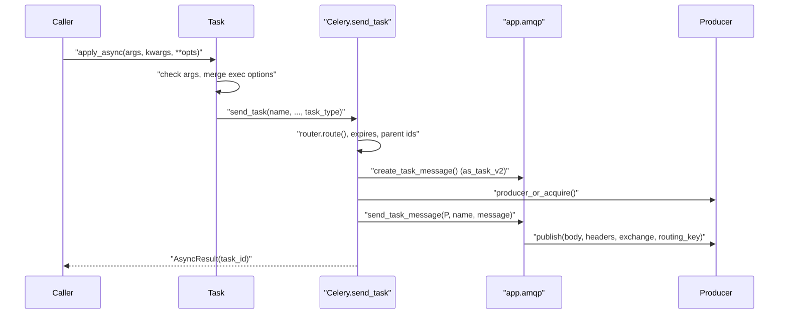

## Overview

Calling a task means publishing a message that a worker will turn back into a function call. Three layers take part: `Task.apply_async` validates the call and merges the task's defaults, `Celery.send_task` resolves the destination and the message metadata, and the app's `AMQP` helper serializes the message and publishes it through a pooled producer. `send_task` can also be called directly with a task name, so a client can call tasks it does not import.

Sources: [celery/app/task.py:657-708](repo://celery/app/task.py#L657-L708), [celery/app/base.py:846-862](repo://celery/app/base.py#L846-L862)

Which queue and exchange the message goes to is decided by the router, described on [[Queues and Routing]]. Workflow options (`link`, `chain`, `chord`) are filled in by the canvas, described on [[Signatures]].

Sources: [celery/app/base.py:928-929](repo://celery/app/base.py#L928-L929)

## apply_async

`delay(*args, **kwargs)` is `apply_async(args, kwargs)`. `apply_async` then:

Sources: [celery/app/task.py:523-534](repo://celery/app/task.py#L523-L534)

1. Raises `ValueError` if the task's `soft_time_limit` is greater than its `time_limit`.
2. With `typing` enabled, calls the generated `__header__` with the arguments so a wrong call raises `TypeError` in the caller.
3. Computes a `shadow` name through `shadow_name(args, kwargs, options)`, which lets a task show a different name in logs and monitoring.
4. Merges the task's execution options (`queue`, `routing_key`, `exchange`, `priority`, `expires`, `serializer`, `delivery_mode`, `compression`, `time_limit`, `soft_time_limit`) under the caller's options, and defaults `ignore_result` and `priority` from the task.
5. If `task_always_eager` is set, serializes and deserializes the arguments with the chosen serializer — so non-serializable arguments fail as they would in production — and runs `apply()` locally under `denied_join_result`.
6. Otherwise calls `app.send_task(self.name, ..., task_type=self)`.

Sources: [celery/app/task.py:523-534](repo://celery/app/task.py#L523-L534), [celery/app/task.py:657-708](repo://celery/app/task.py#L657-L708), [celery/app/task.py:32-36](repo://celery/app/task.py#L32-L36)

The docstring lists the options `apply_async` accepts beyond those: `countdown`, `eta`, `expires`, `connection`, `producer`, `retry`, `retry_policy`, `queue`, `exchange`, `routing_key`, `priority`, `serializer`, `compression`, `link`, `link_error`, `add_to_parent`, `ignore_result`, `headers` and `task_id`, plus any keyword accepted by kombu's `Producer.publish`.

Sources: [celery/app/task.py:536-655](repo://celery/app/task.py#L536-L655)

## send_task

### Task id and eager mode

`send_task` builds and publishes the message. It generates a task id unless one is given, and warns with `AlwaysEagerIgnored` when `task_always_eager` is set, since `send_task` never runs tasks locally.

Sources: [celery/app/base.py:863-873](repo://celery/app/base.py#L863-L873)

### Task defaults for name-only calls

When called with a name only (no `task_type`), `send_task` looks the name up in the underlying registry without finalizing the app, and merges that task's non-`None` execution options under the caller's options. The comments explain both choices: `apply_async` has already merged options so doing it again would override explicit values, and a remote task name must stay sendable without finalizing the app.

Sources: [celery/app/base.py:875-907](repo://celery/app/base.py#L875-L907)

### Limits, routing and delays

`time_limit`, `soft_time_limit` and `expires` are explicit arguments; when the caller omits them, the values merged from the task are used, and an explicit `None` clears a task default. `ignore_result` is popped, then the router computes `queue`, `exchange` and `routing_key`.

Sources: [celery/app/base.py:909-929](repo://celery/app/base.py#L909-L929)

If the call has an `eta` or `countdown` and the transport uses quorum queues, the message is not held by the worker: for topic and fanout exchanges `send_task` converts the delay to a countdown, computes a routing key with `calculate_routing_key`, and publishes to the `celery_delayed_27` topic exchange instead (RabbitMQ native delayed delivery). Direct exchanges log a warning, because native delayed delivery does not support them. The worker side is described on [[Consumer Bootsteps]].

Sources: [celery/app/base.py:931-961](repo://celery/app/base.py#L931-L961)

`expires` (seconds, a datetime or an ISO string) is converted to seconds from now and set as the message `expiration` property, which brokers use as a TTL. A past expiry is clamped to 0 with a warning quoting RabbitMQ's documentation that a TTL of 0 expires the message unless a consumer takes it at once.

Sources: [celery/app/base.py:963-987](repo://celery/app/base.py#L963-L987)

### Parent, root and priority

When called from inside a task executed by a worker, `send_task` fills `root_id` from the parent's root (or the parent's id) and `parent_id` from the parent's id. With `task_inherit_parent_priority`, the parent's delivery priority becomes the default priority.

Sources: [celery/app/base.py:989-1000](repo://celery/app/base.py#L989-L1000)

### Publishing

The message is built with `amqp.create_task_message`, the method for the configured `task_protocol` (2 by default). `reply_to` defaults to the app's `thread_oid`. Stamp headers are removed from the publish options because they are already in the message headers. A producer is created on the given `connection`, or taken from the pool; unless the result is ignored, the backend's `on_task_call` hook runs (the RPC backend uses it to start listening for the reply), and `send_task_message` publishes.

Sources: [celery/app/base.py:1002-1027](repo://celery/app/base.py#L1002-L1027), [celery/app/amqp.py:265-271](repo://celery/app/amqp.py#L265-L271)

Finally `send_task` returns an `AsyncResult` (or `result_cls`) for the id with `ignored` set from `ignore_result`, and when the call happens inside a worker task and `add_to_parent` is true, appends it to the parent's `request.children`.

Sources: [celery/app/base.py:1028-1041](repo://celery/app/base.py#L1028-L1041)

## Message protocol version 2

### Headers, properties and body

`as_task_v2` returns a `task_message` tuple of `headers`, `properties`, `body` and `sent_event`. It checks that `args` is a list or tuple and `kwargs` a mapping, converts `countdown` to an absolute `eta` and a numeric `expires` to a datetime in the app's timezone, formats both as ISO 8601, and computes `argsrepr` and `kwargsrepr` with `saferepr` limited to 1024 characters. An empty `root_id` defaults to the task id.

Sources: [celery/app/amqp.py:32-33](repo://celery/app/amqp.py#L32-L33), [celery/app/amqp.py:326-361](repo://celery/app/amqp.py#L326-L361)

| Part | Field | Content |
| --- | --- | --- |
| headers | `lang`, `task`, `id`, `shadow` | `'py'`, task name, task id, display name |
| headers | `eta`, `expires` | ISO 8601 strings or `None` |
| headers | `group`, `group_index`, `retries` | Group membership, retry count |
| headers | `timelimit` | `[time_limit, soft_time_limit]` |
| headers | `root_id`, `parent_id`, `origin` | Workflow ancestry, node name of the sender |
| headers | `argsrepr`, `kwargsrepr` | Truncated `repr` for logs and events |
| headers | `ignore_result`, `replaced_task_nesting` | Result storage, depth of `Task.replace` |
| headers | `stamped_headers`, `stamps` | See [[Stamping]] |
| properties | `correlation_id`, `reply_to` | Task id, reply queue for the RPC backend |
| body | `(args, kwargs, embed)` | `embed` holds `callbacks`, `errbacks`, `chain`, `chord` |

Sources: [celery/app/amqp.py:363-418](repo://celery/app/amqp.py#L363-L418)

The worker routes the message by the `task` header and can check `eta`, `expires` and revocation before decoding the body. `sent_event` is only built when `task_send_sent_event` is enabled, and holds the fields of the `task-sent` event.

Sources: [celery/app/amqp.py:384-418](repo://celery/app/amqp.py#L384-L418), [celery/app/base.py:1003-1011](repo://celery/app/base.py#L1003-L1011)

### Protocol version 1

`as_task_v1` puts everything in the body as one dict (`task`, `id`, `args`, `kwargs`, `group`, `retries`, `eta`, `expires`, `utc`, `callbacks`, `errbacks`, `timelimit`, `taskset`, `chord`) and sends no headers. Workers still accept it and convert it to the version 2 layout.

Sources: [celery/app/amqp.py:420-478](repo://celery/app/amqp.py#L420-L478)

## send_task_message

`_create_task_sender` reads the defaults once (`task_publish_retry`, `task_publish_retry_policy`, `task_default_delivery_mode`, `task_serializer`, `task_compression`, the default exchange and routing key) and returns the `send_task_message` closure, cached on the `AMQP` object.

Sources: [celery/app/amqp.py:485-504](repo://celery/app/amqp.py#L485-L504)

For each message it merges extra `headers` and properties, resolves a queue name to its `Queue` object (using the default queue if neither queue nor exchange is given), and takes the delivery mode from the queue's exchange or the default. For a direct exchange with no explicit exchange or routing key, it publishes through the default (anonymous) exchange with the queue name as routing key; otherwise it uses the queue's exchange and routing key. The queue is declared on publish unless it is a `Broadcast` queue.

Sources: [celery/app/amqp.py:506-547](repo://celery/app/amqp.py#L506-L547)

It then sends `before_task_publish`, calls `producer.publish` with the serializer, compression, retry flag and the merged retry policy (by default 3 retries starting at 0 s, stepping 0.2 s, at most 1 s apart), sends `after_task_publish`, and publishes the `task-sent` event if one was built. Each signal is sent only if it has receivers.

Sources: [celery/app/amqp.py:549-604](repo://celery/app/amqp.py#L549-L604), [celery/app/defaults.py:299-305](repo://celery/app/defaults.py#L299-L305)

Sources: [celery/app/task.py:657-708](repo://celery/app/task.py#L657-L708), [celery/app/base.py:928-1041](repo://celery/app/base.py#L928-L1041), [celery/app/amqp.py:506-604](repo://celery/app/amqp.py#L506-L604)

## Producers and connections

Producers come from `app.amqp.producer_pool`, a kombu producer pool over `connection_for_write()` whose limit follows the connection pool (`broker_pool_limit`). Waiting longer than `broker_pool_acquire_timeout` for a producer raises `OperationalError`. Passing `producer=` to `apply_async` reuses one, which matters when sending many tasks in a loop.

Sources: [celery/app/amqp.py:636-642](repo://celery/app/amqp.py#L636-L642), [celery/app/base.py:1162-1191](repo://celery/app/base.py#L1162-L1191)

## Running a task locally with apply

`Task.apply` runs the task in the calling process and returns an `EagerResult`. It builds a request dict marked `is_eager`, with the parent and root ids taken from the task currently on the stack, the callbacks and errbacks, the time limits and delivery info, then runs a tracer built with `eager=True` and `propagate` from `throw` (default `task_eager_propagates`). A `Retry` result runs the retry signature eagerly; see [[Retries and Task Errors]].

Sources: [celery/app/task.py:869-951](repo://celery/app/task.py#L869-L951), [celery/result.py:1025-1030](repo://celery/result.py#L1025-L1030)
