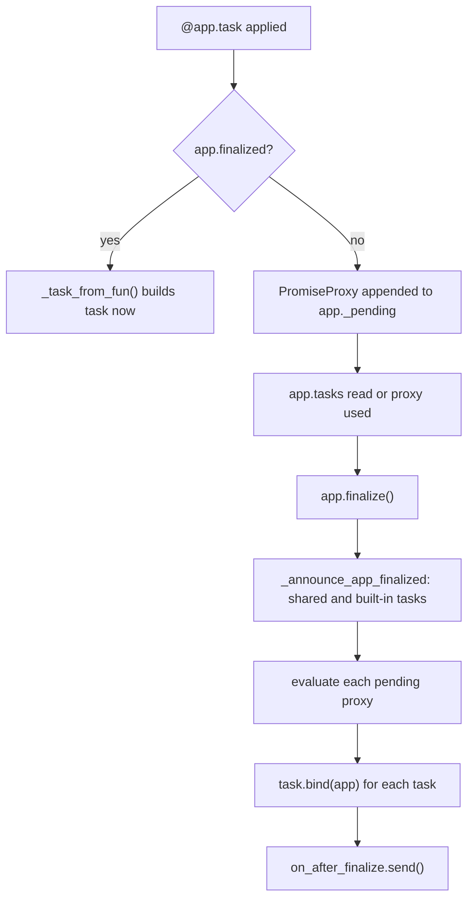

## Overview

Every Celery program, client or worker, goes through one `Celery` instance. It holds the configuration, the task registry, and lazily created helpers for messaging (`amqp`), the result backend, remote control, events, logging and the loader. Nothing that needs the configuration or a broker connection is built in the constructor: each helper is a cached property created on first access, so an app can be defined at import time and configured afterwards.

Sources: [celery/app/base.py:310-318](repo://celery/app/base.py#L310-L318), [celery/app/base.py:1534-1610](repo://celery/app/base.py#L1534-L1610)

This page follows the app from its constructor to finalization, then covers how code finds "the current app" and how the app hands out broker connections. Settings themselves are on [[Configuration and Loaders]]; the task class that `@app.task` builds is on [[Defining Tasks]].

Sources: [celery/app/base.py:343-434](repo://celery/app/base.py#L343-L434)

## Construction

`Celery.__init__` records the classes to use for each helper (from arguments or the class attributes `amqp_cls`, `events_cls`, `log_cls`, `control_cls`, `task_cls`, `registry_cls`), creates an empty `TaskRegistry`, and stores `broker`, `backend`, `include` and any extra keyword arguments as pending settings (`broker_url`, `result_backend`, `include`). The configuration object is a `Settings` wrapping a `PendingConfiguration`, so no configuration is read yet.

Sources: [celery/app/base.py:343-400](repo://celery/app/base.py#L343-L400)

The constructor then instantiates the fix-ups (by default the Django fix-up, see [[Django Integration]]), makes the app the current app unless `set_as_current=False`, creates the `on_configure`, `on_after_configure`, `on_after_finalize` and `on_after_fork` signals, calls the `on_init` hook and registers the app in a global weak set of active apps.

Sources: [celery/app/base.py:402-434](repo://celery/app/base.py#L402-L434), [celery/_state.py:33-34](repo://celery/_state.py#L33-L34)

The loader class defaults to the `CELERY_LOADER` environment variable, then `loader_cls`, then `celery.loaders.app:AppLoader`. The command line's `--loader` option works by setting that variable.

Sources: [celery/app/base.py:436-442](repo://celery/app/base.py#L436-L442)

## Helpers created on demand

| Attribute | Built from | Notes |
| --- | --- | --- |
| `conf` | `_load_config()` | Read on first key access; see [[Configuration and Loaders]] |
| `amqp` | `amqp_cls` | Queues, router, message creation; see [[Calling Tasks and the Message Protocol]] |
| `backend` | `result_backend` via `backends.by_url` | Cached on the app if `thread_safe`, else per thread |
| `control` | `control_cls` | See [[Remote Control and Inspection]] |
| `events` | `events_cls` | See [[Events and Monitoring]] |
| `log` | `log_cls` | See [[Logging]] |
| `loader` | `loader_cls` | Imports modules, reads config |
| `tasks` | `_tasks` | Accessing it finalizes the app |
| `Task`, `AsyncResult`, `GroupResult`, `Worker`, `WorkController`, `Beat` | `subclass_with_self` | Classes bound to this app |
| `timezone` | `timezone` / `enable_utc` settings | UTC when `enable_utc` and no zone is set |

Sources: [celery/app/base.py:1430-1470](repo://celery/app/base.py#L1430-L1470), [celery/app/base.py:1534-1632](repo://celery/app/base.py#L1534-L1632), [celery/app/base.py:1224-1228](repo://celery/app/base.py#L1224-L1228)

`subclass_with_self` creates a subclass of a class whose `app` attribute (or another named attribute) points at this app. Unless `keep_reduce` is set, the subclass gets a `__reduce__` that unpickles by looking the class up again on the current app, so an `app.AsyncResult` sent to another process is rebuilt against that process's app.

Sources: [celery/app/base.py:1342-1377](repo://celery/app/base.py#L1342-L1377), [celery/app/base.py:111-115](repo://celery/app/base.py#L111-L115)

The app itself pickles as its constructor keywords: main name, configuration changes, the helper class names, fix-ups, `config_source`, `task_cls` and `namespace`. Only changes are sent, not the full default configuration, which is how pool child processes rebuild the same app.

Sources: [celery/app/base.py:1391-1428](repo://celery/app/base.py#L1391-L1428)

## The task decorator

### Building a task from a function

`app.task` accepts either a bare function or options. For each function it does two things. If `shared` is true (the default) it registers a constructor with `connect_on_app_finalize`, so every app finalized later builds its own copy of the task. Then, if the app is already finalized or `lazy=False`, it builds the task at once with `_task_from_fun`; otherwise it returns a `PromiseProxy` around `_task_from_fun` and appends it to `app._pending`.

Sources: [celery/app/base.py:515-585](repo://celery/app/base.py#L515-L585)

When the worker runs under `FORKED_BY_MULTIPROCESSING` (child processes started with execv), the decorator delegates to `shared_task(lazy=False)`, because the task object in the original module would otherwise point at a different app than the one the child uses.

Sources: [celery/app/base.py:85](repo://celery/app/base.py#L85), [celery/app/base.py:545-552](repo://celery/app/base.py#L545-L552)

`_task_from_fun` generates the name with `gen_task_name` when none is given: the function's module plus its name, with `__main__` replaced by `app.main`. If the name is not yet registered it creates a subclass of `base` (default `app.Task`) whose `run` is the function — a `staticmethod` unless `bind=True` — together with the function's annotations and an argument checker `__header__`. It instantiates the class, stores it in the registry, binds it to the app and adds autoretry behaviour. A second decoration under the same name returns the existing instance.

Sources: [celery/app/base.py:590-633](repo://celery/app/base.py#L590-L633), [celery/utils/imports.py:122-141](repo://celery/utils/imports.py#L122-L141)

With `pydantic=True`, the function is first wrapped by `pydantic_wrapper`, which validates arguments against the annotations and dumps a model return value. This is covered on [[Defining Tasks]].

Sources: [celery/app/base.py:127-205](repo://celery/app/base.py#L127-L205)

### shared_task

`shared_task` is the decorator for libraries that do not own an app. It connects a finalize callback that creates the task on every app, immediately creates it on every app that is already finalized, and returns a plain `Proxy` whose target is looked up in the current app's registry on every access.

Sources: [celery/app/__init__.py:24-76](repo://celery/app/__init__.py#L24-L76)

### Registering class-based tasks

`register_task` instantiates a `Task` subclass if needed, generates a name from the class when it has none, adds autoretry behaviour, stores it in `app.tasks` and binds it. The registry itself is a `dict` subclass whose missing keys raise `NotRegistered`.

Sources: [celery/app/base.py:635-652](repo://celery/app/base.py#L635-L652), [celery/app/registry.py:12-47](repo://celery/app/registry.py#L12-L47)

## Finalization

`finalize()` runs once under `_finalize_mutex`. It marks the app finalized, calls every callback registered with `connect_on_app_finalize` (shared tasks and the built-in tasks), evaluates every pending `PromiseProxy`, binds every registered task to the app, and sends `on_after_finalize`. With `autofinalize=False`, an implicit finalization raises `RuntimeError('Contract breach: app not finalized')`.

Sources: [celery/app/base.py:657-677](repo://celery/app/base.py#L657-L677), [celery/_state.py:43-52](repo://celery/_state.py#L43-L52)

Finalization happens implicitly the first time `app.tasks` is read. The built-in tasks added at that point include `celery.backend_cleanup`, `celery.accumulate`, `celery.chord_unlock` and the tasks that run `map`, `starmap`, `chunks`, `group`, `chain` and `chord` signatures by name.

Sources: [celery/app/base.py:1601-1609](repo://celery/app/base.py#L1601-L1609), [celery/app/builtins.py:12-40](repo://celery/app/builtins.py#L12-L40)

Sources: [celery/app/base.py:554-575](repo://celery/app/base.py#L554-L575), [celery/app/base.py:657-677](repo://celery/app/base.py#L657-L677)

## Proxies and the current app

`celery.local.Proxy` forwards every attribute, operator and call to the object returned by a callable, evaluated each time. `PromiseProxy` evaluates the callable once, caches the result, drops the callable and its arguments, and runs any callbacks queued with `__then__` before the evaluation. `maybe_evaluate` evaluates a promise and returns anything else unchanged.

Sources: [celery/local.py:52-112](repo://celery/local.py#L52-L112), [celery/local.py:282-358](repo://celery/local.py#L282-L358)

`celery._state` keeps the current app in a thread-local, a process-wide default app, and a thread-local stack of executing tasks. `current_app` and `current_task` are `Proxy` objects over `get_current_app` and `get_current_task`. When no app has been created, `get_current_app` creates a fallback app named `default` with no fix-ups and the `default` loader.

Sources: [celery/_state.py:64-142](repo://celery/_state.py#L64-L142)

`get_current_worker_task` walks the task stack from the top and returns the first task whose request was not `called_directly`; the app uses it in `send_task` to fill `parent_id` and `root_id` and to attach the new result to the parent's trail. The environment variables `C_STRICT_APP`, `C_WARN_APP` and `CELERY_TRACE_APP` make use of the implicit current app raise or print a stack, to find code that should pass an app explicitly.

Sources: [celery/_state.py:107-135](repo://celery/_state.py#L107-L135), [celery/_state.py:163-197](repo://celery/_state.py#L163-L197)

## Task discovery

`autodiscover_tasks(packages, related_name='tasks')` imports `<package>.tasks` for each package. It is lazy by default: it connects a receiver to the `import_modules` signal, which the loader sends when the worker imports its default modules. `force=True` imports immediately. With no package list, the packages come from the fix-ups' `autodiscover_tasks`, which is how the Django fix-up finds tasks in installed apps.

Sources: [celery/app/base.py:782-843](repo://celery/app/base.py#L782-L843)

## Broker connections and producers

`connection_for_write` and `connection_for_read` build a `kombu` connection from `broker_write_url` or `broker_read_url`, filling user, password, virtual host, port, transport, SSL, login method, failover strategy, transport options and connect timeout from the configuration.

Sources: [celery/app/base.py:1043-1057](repo://celery/app/base.py#L1043-L1057), [celery/app/base.py:1102-1127](repo://celery/app/base.py#L1102-L1127)

`app.pool` is a connection pool limited by `broker_pool_limit`; it is created on first use and registers an after-fork handler that drops the pool and the producer pool in the child. `connection_or_acquire` and `producer_or_acquire` return context managers that use a connection or producer passed by the caller, or acquire one from the pool within `broker_pool_acquire_timeout`. A timeout raises `OperationalError` with a message suggesting a larger pool limit.

Sources: [celery/app/base.py:1131-1191](repo://celery/app/base.py#L1131-L1191), [celery/app/base.py:1488-1500](repo://celery/app/base.py#L1488-L1500), [celery/app/base.py:1282-1288](repo://celery/app/base.py#L1282-L1288)

`oid` identifies the app per process and `thread_oid` per thread; the comment on `oid` explains that thread identity was dropped from it because the RPC backend uses a single thread to receive results. `send_task` uses `thread_oid` as the default `reply_to`.

Sources: [celery/app/base.py:1516-1532](repo://celery/app/base.py#L1516-L1532), [celery/app/base.py:1003-1012](repo://celery/app/base.py#L1003-L1012)

## Running programs from the app

`app.start(argv)` runs the `celery` click command with this app preset as the `--app` value, and `worker_main(argv)` does the same but requires `worker` in `argv`. Using the app as a context manager calls `close()` on exit, which drops the connection pool and removes the app from the active set.

Sources: [celery/app/base.py:466-513](repo://celery/app/base.py#L466-L513), [celery/app/base.py:1382-1386](repo://celery/app/base.py#L1382-L1386)
