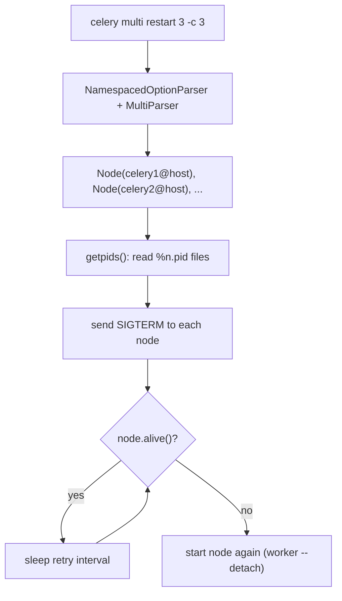

## Overview

`celery multi` manages several worker nodes on one machine from a single command line. It does not supervise the workers: `start` launches each node as a detached `celery worker` daemon with its own name, pid file and log file, and `stop`, `restart` and `kill` later find the processes again through those pid files and send them signals. All per-node arguments are recomputed from the command line each time, so the same arguments must be repeated for `restart` and `stop`, as the module's examples point out.

Sources: [celery/bin/multi.py:1-26](repo://celery/bin/multi.py#L1-L26), [celery/apps/multi.py:122-142](repo://celery/apps/multi.py#L122-L142)

How a detached worker becomes a daemon is described on [[Daemonization and Platform Helpers]]; how the worker reacts to the signals `multi` sends is on [[Worker Signals and Shutdown]].

Sources: [celery/apps/multi.py:195-206](repo://celery/apps/multi.py#L195-L206)

## Commands

| Command | Effect |
| --- | --- |
| `start <nodes> [options]` | Start each node detached; exit code 1 if any failed |
| `stop <nodes> [-SIG]` | Send the signal (default `TERM`) and return |
| `stopwait <nodes>` | Send the signal and wait until every node is gone |
| `restart <nodes>` | Stop each node, waiting, and start it again |
| `kill <nodes>` | Send `SIGKILL` |
| `show <nodes>` | Print the command line for each node |
| `names <nodes>` | Print the expanded node names |
| `get <name> <nodes>` | Print one node's arguments |
| `expand <template> <nodes>` | Expand `%n`, `%h`, ... for each node |

Sources: [celery/bin/multi.py:240-342](repo://celery/bin/multi.py#L240-L342)

The `celery multi` click command moves `multi` to the front of `sys.argv` before handing it to `MultiTool`, because global options such as `-A` come before the subcommand in Celery 5 but `multi` passes them on to each worker. `--nosplash`, `--quiet`/`-q`, `--verbose` and `--no-color` are consumed by `multi` itself.

Sources: [celery/bin/multi.py:463-480](repo://celery/bin/multi.py#L463-L480), [celery/bin/multi.py:232-289](repo://celery/bin/multi.py#L232-L289)

A signal for `stop`, `stopwait` and `restart` is given as the last argument, as a number (`-9`) or a name (`-KILL`).

Sources: [celery/bin/multi.py:344-357](repo://celery/bin/multi.py#L344-L357)

## From arguments to nodes

### Node names

The positional values name the nodes. A single number `N` means `N` nodes named `celery1` … `celeryN` (or `--range-prefix` instead of `celery`). Other names become `<prefix><name>@<suffix>`, where `--prefix` defaults to nothing and the suffix to `--hostname` (or the current host name); a name that already contains `@` is used as a full node name after expanding `%h`.

Sources: [celery/apps/multi.py:28-39](repo://celery/apps/multi.py#L28-L39), [celery/apps/multi.py:297-332](repo://celery/apps/multi.py#L297-L332)

```console
$ celery multi start 3 -c 3
celery worker -n celery1@myhost -c 3
celery worker -n celery2@myhost -c 3
celery worker -n celery3@myhost -c 3
```

Sources: [celery/bin/multi.py:30-34](repo://celery/bin/multi.py#L30-L34)

### Per-node options

`NamespacedOptionParser` splits the arguments into positional values, options for every node, per-node options, and everything after `--`, which is passed through unchanged. An option with a `:` suffix applies to some nodes only: `-c:1 10` to the first node, `-c:image 10` to the node named `image`, `-c:1-3 10` or `-c:1,2,3 10` to several. Indexes start at 1; an index past the last node raises `KeyError`. Each node gets the common options merged with its own.

Sources: [celery/apps/multi.py:70-119](repo://celery/apps/multi.py#L70-L119), [celery/apps/multi.py:334-364](repo://celery/apps/multi.py#L334-L364)

```console
$ celery multi start 10 -l INFO -Q:1-3 images,video -Q:4,5 data \
    -Q default -L:4,5 DEBUG
```

Sources: [celery/bin/multi.py:58-63](repo://celery/bin/multi.py#L58-L63)

### Building the command line

A `Node` adds `-n <nodename>` and defaults for `--pidfile` (`/var/run/celery/%n.pid`), `--logfile` (`/var/log/celery/%n%I.log`) and `--executable` (the current Python), creating the directories if needed. Its command is `python -m celery worker --detach` by default (`--cmd` changes it). Global options (`-A`, `-b`, `--result-backend`, `--loader`, `--config`, `--workdir`, `-C`, `-q`) are moved before the subcommand; the rest follow it. Every value is expanded with the node's name: `%n` short name, `%h` full node name, `%d` domain, `%N` short name, and `%i`/`%I` are left for the worker to expand with the pool process index.

Sources: [celery/apps/multi.py:122-190](repo://celery/apps/multi.py#L122-L190), [celery/apps/multi.py:42-51](repo://celery/apps/multi.py#L42-L51)

The `%I` in the default log file means each pool child writes to its own file (see [[Logging]]).

Sources: [celery/utils/nodenames.py:89-113](repo://celery/utils/nodenames.py#L89-L113)

## The cluster

### Starting

`Cluster.start()` starts each node in turn: `Node.start` runs the command with `Popen` and waits for it. Since the worker detaches, the command returns once the daemon has forked; a non-zero code is reported as a failure, a negative one as killed by a signal.

Sources: [celery/apps/multi.py:406-421](repo://celery/apps/multi.py#L406-L421), [celery/apps/multi.py:208-233](repo://celery/apps/multi.py#L208-L233)

### Stopping and restarting

`getpids()` yields the nodes whose pid file can be read and reports the rest as already down. `shutdown_nodes` sends the signal to each; a node whose process no longer exists counts as stopped. With a retry interval (`stopwait` and `restart` use 2 seconds), it then polls `alive()` — signal 0 — until every node is gone, printing progress. `restart` starts each node again as soon as it is down.

Sources: [celery/apps/multi.py:423-496](repo://celery/apps/multi.py#L423-L496), [celery/apps/multi.py:192-206](repo://celery/apps/multi.py#L192-L206)



Sources: [celery/apps/multi.py:431-483](repo://celery/apps/multi.py#L431-L483)

`MultiTool` connects all of the cluster's callbacks (`on_node_start`, `on_node_down`, `on_still_waiting_for`, ...) to terminal output, so each step is printed with an OK, FAILED or DOWN marker.

Sources: [celery/bin/multi.py:373-460](repo://celery/bin/multi.py#L373-L460)
