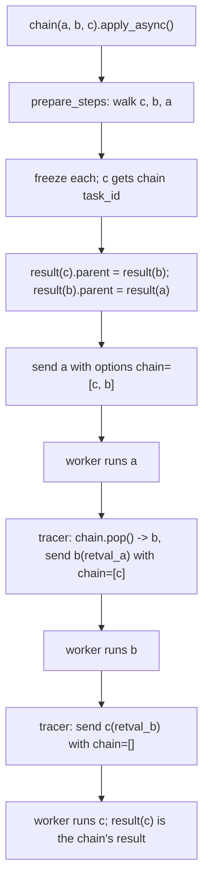

## Overview

A chain runs tasks one after another, passing each task's return value as the first argument of the next. Celery does not run chains from a coordinator: the client freezes every step, sends only the first task, and puts the remaining steps in that message. When the worker finishes a step, it sends the next one with the rest of the list. The client gets back the result of the *last* step, whose `parent` links lead back to the first.

Sources: [celery/canvas.py:1322-1382](repo://celery/canvas.py#L1322-L1382), [celery/app/trace.py:465-473](repo://celery/app/trace.py#L465-L473)

Chains are signatures (see [[Signatures]]); when a group appears inside one, the chain turns it into a chord, described on [[Groups and Chords]].

Sources: [celery/canvas.py:935-955](repo://celery/canvas.py#L935-L955)

## Building a chain

### chain() and the | operator

`chain(a, b, c)` and `a | b | c` produce the same object: `chain.__new__` reduces its arguments with the `|` operator starting from an empty chain. A single iterable argument (including a generator) is treated as the list of tasks. The underlying class `_chain` is a signature for the pseudo-task `celery.chain` with the steps stored in `kwargs['tasks']` and `subtask_type` `'chain'`.

Sources: [celery/canvas.py:1322-1382](repo://celery/canvas.py#L1322-L1382), [celery/canvas.py:935-955](repo://celery/canvas.py#L935-L955)

```python
res = chain(add.s(2, 2), add.s(4))()   # ((2 + 2) + 4)
res.get()          # 8
res.parent.get()   # 4
```

Sources: [celery/canvas.py:1329-1343](repo://celery/canvas.py#L1329-L1343)

### Composition rules

`_chain.__or__` flattens and upgrades as it goes:

Sources: [celery/canvas.py:960-962](repo://celery/canvas.py#L960-L962)

| Expression | Result |
| --- | --- |
| `chain \| chain` | One chain with both lists of steps |
| `chain \| group` | Chain ending with the group (a one-member group is unrolled first) |
| `chain[..., chord] \| group` | The group is chained onto the chord's body |
| `chain[..., group] \| task` | The last group becomes `chord(group, task)`; if the step before was also a chord, the new chord is chained into its body |
| `chain[..., chord] \| task` | The task is chained onto the chord's body |
| `chain \| task` or `chain \| chord` | Chain with the task appended |

Sources: [celery/canvas.py:960-1006](repo://celery/canvas.py#L960-L1006)

`unchain_tasks()` returns clones of the steps with the chain's own `link` callbacks moved to the last step and its `link_error` errbacks added to every step, so composing chains keeps their callbacks. `clone()` clones every step as well.

Sources: [celery/canvas.py:1008-1034](repo://celery/canvas.py#L1008-L1034)

## Running a chain

### apply_async and run

`chain.apply_async(args, kwargs, **options)` runs the chain eagerly with `apply` when `task_always_eager` is set; otherwise it calls `run` with the chain's options merged with the call's. `run` prepends the call's arguments to the chain's own (unless immutable), prepares the steps, adds any `link` to the last step, pops the first step and sends it with the remaining steps as its `chain` option. It returns the result of the last step, or — for a one-step chain — the real result from sending, which matters for a group whose result object must be the one that gets fulfilled.

Sources: [celery/canvas.py:1036-1094](repo://celery/canvas.py#L1036-L1094)

### prepare_steps

`prepare_steps` walks the steps **backwards**, popping from the end, so the list it builds is reversed: the worker can later take the next step with a cheap `pop()`. For each step it:

Sources: [celery/canvas.py:1178-1197](repo://celery/canvas.py#L1178-L1197)

1. Turns dicts into signatures and unrolls a one-member group.
2. Clones the step, giving the first step of the chain the call's partial arguments.
3. Splices a nested chain's steps into the queue instead of adding the chain itself.
4. Upgrades a group followed by a task into `chord(group, body=task)`, reusing the task's frozen id for the chord.
5. Freezes the step: the last step with the chain's `task_id`, `group_id`, chord body and group index (so an enclosing group or chord waits for the chain's end), the others with just the root id.
6. Sets the previously processed (later) step's result's `parent` to this step's result, building the parent links.
7. Adds the chain's `link_error` to the step, and to a chord's body too.
8. For a chord, checks that the backend allows chords and moves the parent pointer to the chord's header result.

Sources: [celery/canvas.py:1178-1292](repo://celery/canvas.py#L1178-L1292)



Sources: [celery/canvas.py:1048-1094](repo://celery/canvas.py#L1048-L1094), [celery/canvas.py:1178-1292](repo://celery/canvas.py#L1178-L1292), [celery/app/trace.py:465-473](repo://celery/app/trace.py#L465-L473)

The comment at the top of `prepare_steps` explains why the remaining steps travel in a message field rather than as nested `link` callbacks: linking tasks into a tree made pickle recurse deeply enough to blow the stack. With message protocol 1, which has no `chain` field, chains still use links (`use_link`).

Sources: [celery/canvas.py:1168-1176](repo://celery/canvas.py#L1168-L1176)

### Not mutating shared options

`_prepare_chain_from_options` builds the options for the first step as a `ChainMap` over the caller's options, and when a `chain` option already exists it creates a new list (`options['chain'] + tasks`) instead of extending it. Its long comment explains why: groups reuse one options dict for all their members, and extending the list in place made later group members inherit other members' chain steps (issue #5354), producing results such as `[16, 14]` instead of `[14, 14]`.

Sources: [celery/canvas.py:877-932](repo://celery/canvas.py#L877-L932)

## Continuing in the worker

The `chain` list rides in the message body's `embed` dict and becomes `request.chain`. After a successful step the tracer calls `_dispatch_callbacks_and_chain`, which takes the last element of the list as the next step and sends it with the return value as argument, `chain=chain[:-1]`, and the current task as parent. The root id is carried along so every step shares the chain's root.

Sources: [celery/app/amqp.py:384-391](repo://celery/app/amqp.py#L384-L391), [celery/app/trace.py:426-473](repo://celery/app/trace.py#L426-L473)

If a step fails, the remaining steps never run. To keep the chain's final result from staying `PENDING`, the backend's `mark_as_failure` stores the same failure on every remaining step's task id, notifying chords they belong to; see [[Result Backend Interface]]. The chain's `link_error` errbacks were attached to every step, so they fire whichever step fails.

Sources: [celery/backends/base.py:196-252](repo://celery/backends/base.py#L196-L252), [celery/canvas.py:1268-1273](repo://celery/canvas.py#L1268-L1273)

A step that retries keeps its place: `Task.retry` re-sends the same request, including its `chain`, so the chain continues after the retried step succeeds. A step that calls `Task.replace` appends the rest of its chain to the replacement signature.

Sources: [celery/app/task.py:731-754](repo://celery/app/task.py#L731-L754), [celery/app/task.py:1088-1095](repo://celery/app/task.py#L1088-L1095)

## Freezing and eager execution

`chain.freeze()` runs `prepare_steps` without cloning and returns the result of the last step, so a chain can be given ids before it is sent (for example as part of a group or chord).

Sources: [celery/canvas.py:1096-1105](repo://celery/canvas.py#L1096-L1105)

`chain.apply()` runs the steps in the calling process: each step is applied with the previous step's `get()` value as its argument, and each result's `parent` is set to the previous one.

Sources: [celery/canvas.py:1294-1302](repo://celery/canvas.py#L1294-L1302)

The built-in task named `celery.chain` exists only for compatibility and raises `NotImplementedError` if called; chains are never executed as a task of their own.

Sources: [celery/app/builtins.py:156-162](repo://celery/app/builtins.py#L156-L162)
