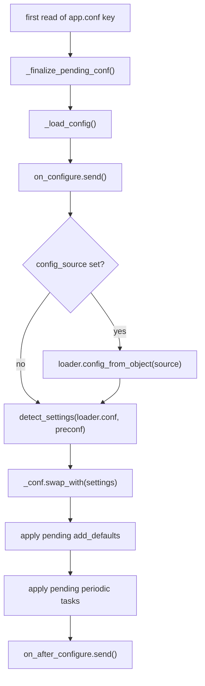

## Overview

An app's settings come from four places, in increasing precedence: the built-in defaults declared in `celery/app/defaults.py`, the configuration source loaded by the loader (`config_from_object` or a `celeryconfig` module), the values passed to the `Celery` constructor or set on `app.conf` before configuration, and, for the broker and backend URLs, environment variables. None of this is read until a setting is first accessed. This page follows that resolution and the loader that imports modules; each subsystem's own settings are described on its page.

Sources: [celery/app/base.py:1230-1280](repo://celery/app/base.py#L1230-L1280), [celery/app/utils.py:84-111](repo://celery/app/utils.py#L84-L111)

## Declaring settings

Every setting is an `Option` with a default and a type (`string`, `int`, `float`, `bool`, `dict`, `tuple`, `list`, `any`), grouped into nested namespaces in `NAMESPACES`: `beat`, `broker`, `result`, `task`, `worker`, `event`, `redis`, `database`, `security` and others. A namespace may declare old-style key patterns such as `celery_{0}` or `celeryd_{0}`, which each option inherits unless it sets `old` itself.

Sources: [celery/app/defaults.py:22-64](repo://celery/app/defaults.py#L22-L64), [celery/app/defaults.py:66-82](repo://celery/app/defaults.py#L66-L82)

`flatten` walks the namespaces and joins keys with underscores, so `task=Namespace(acks_late=...)` becomes the setting `task_acks_late`. From the flattened list the module builds `DEFAULTS` (new key to default), `_OLD_DEFAULTS`, and the two maps `_TO_OLD_KEY` and `_TO_NEW_KEY` that translate between `task_acks_late` and `CELERY_ACKS_LATE`.

Sources: [celery/app/defaults.py:378-413](repo://celery/app/defaults.py#L378-L413)

An option can carry `deprecate_by`, `remove_by` and `alt`; `find_deprecated_settings` warns when such a setting is present in the loaded source. `find(name)` looks an option up by name, trying the given namespace first and then every other one; `app.conf.find_option` exposes it.

Sources: [celery/app/defaults.py:416-447](repo://celery/app/defaults.py#L416-L447), [celery/app/defaults.py:265-272](repo://celery/app/defaults.py#L265-L272)

## Lazy loading

### PendingConfiguration

Before configuration, `app.conf` is a `Settings` view whose first layer is a `PendingConfiguration`. Writes (`app.conf.x = 1`, `update`, `setdefault`) and `in` checks go to a plain dict of pending changes. Any read of a value evaluates the `data` property, which calls `app._finalize_pending_conf()` and replaces the configuration with the loaded one. The comment in the class explains the intent: the app keeps settings assigned directly on `app.conf` before a later `config_from_object` call.

Sources: [celery/app/base.py:208-249](repo://celery/app/base.py#L208-L249), [celery/app/base.py:395-400](repo://celery/app/base.py#L395-L400)

### _load_config

`_load_config` sends `on_configure`, asks the loader to load `config_source` if one was given, and marks the app configured. It then calls `detect_settings` with the loader's configuration and the constructor's pending values, swaps the result into the existing `Settings` object in place (so references to `app.conf` taken earlier stay valid), applies queued `add_defaults` callables and queued `add_periodic_task` calls, and sends `on_after_configure`.

Sources: [celery/app/base.py:1247-1280](repo://celery/app/base.py#L1247-L1280)

Sources: [celery/app/base.py:1230-1280](repo://celery/app/base.py#L1230-L1280)

### Configuration sources

`config_from_object(obj)` records the source and, only when `force=True` or the app is already configured, discards the current configuration and reloads. `obj` may be a module, a class, any object, or a string; the loader imports a string from the current directory, treating `module:attr` as an attribute path and otherwise trying a module import before falling back to `module.attr`. The loaded object is wrapped with `force_mapping`, and an `override_backends` key in it adds backend aliases.

Sources: [celery/app/base.py:703-725](repo://celery/app/base.py#L703-L725), [celery/loaders/base.py:119-145](repo://celery/loaders/base.py#L119-L145)

`config_from_envvar(name)` reads a module name from an environment variable and passes it to `config_from_object`; a missing variable raises `ImproperlyConfigured` unless `silent=True`. `add_defaults(d_or_callable)` adds a layer of defaults without copying, deferring a callable until configuration is loaded.

Sources: [celery/app/base.py:679-701](repo://celery/app/base.py#L679-L701), [celery/app/base.py:727-743](repo://celery/app/base.py#L727-L743)

## The Settings view

`Settings` is a `ConfigurationView`: a chain of mappings where writes go to the first map (the changes) and reads fall through to the defaults. With a `namespace` (the app's `namespace` argument, for example `CELERY`), every key is looked up first with the prefix (`CELERY_TASK_ACKS_LATE`), then without it. The key translators passed to the view let a lookup by a new name find a value stored under the old name and the reverse.

Sources: [celery/utils/collections.py:353-405](repo://celery/utils/collections.py#L353-L405), [celery/app/base.py:395-400](repo://celery/app/base.py#L395-L400)

A few settings are properties that consult the environment first. `broker_url` reads `CELERY_BROKER_URL`; `broker_read_url` and `broker_write_url` read their own variables and fall back to `broker_url`; `result_backend` reads `CELERY_RESULT_BACKEND`. `task_default_exchange` and `task_default_routing_key` fall back to `task_default_queue`, and `timezone` also accepts Django's `TIME_ZONE`.

Sources: [celery/app/utils.py:84-127](repo://celery/app/utils.py#L84-L127)

`Settings` also offers `without_defaults()` (everything but the last layer), `value_set_for(key)`, `get_by_parts('worker', 'disable_rate_limits')`, `finalize()` to force loading, and `table`/`humanize`, which hide values whose names match `API|TOKEN|KEY|SECRET|PASS|...`. `update` notifies observers registered with `bind_to`; the AMQP helper uses this to rebuild its router when `task_routes` changes.

Sources: [celery/app/utils.py:129-202](repo://celery/app/utils.py#L129-L202), [celery/app/utils.py:37-40](repo://celery/app/utils.py#L37-L40), [celery/utils/collections.py:299-304](repo://celery/utils/collections.py#L299-L304), [celery/app/amqp.py:659-663](repo://celery/app/amqp.py#L659-L663)

## Old and new setting names

`detect_settings` counts how many keys in the source are new-style and how many old-style. The majority decides which format is used; if the source mixes formats, the minority keys are reported in an `ImproperlyConfigured` error that lists each rename, except for keys whose counterpart in the other format is also present. With a namespace prefix the new format is always used. The returned `Settings` records the old keys found, and `maybe_warn_deprecated_settings` warns that they are removed in 6.0.

Sources: [celery/app/utils.py:221-283](repo://celery/app/utils.py#L221-L283), [celery/app/utils.py:189-202](repo://celery/app/utils.py#L189-L202)

## Settings from the command line

`celery worker` and `celery beat` accept trailing `key=value` arguments, passed to `config_from_cmdline`. The loader's `cmdline_config_parser` lower-cases the key, turns dots into underscores, uses the given namespace for keys that start with `_` or `.`, and converts the value with the option's declared type, or with an explicit `(type)` prefix where `tuple`, `list` and `dict` are parsed as JSON.

Sources: [celery/app/base.py:745-748](repo://celery/app/base.py#L745-L748), [celery/loaders/base.py:161-206](repo://celery/loaders/base.py#L161-L206), [celery/bin/worker.py:330](repo://celery/bin/worker.py#L330)

## Loaders

A loader reads the configuration and imports task modules. `get_loader_cls` resolves the aliases `app` (`AppLoader`, used for every app created by user code) and `default` (`Loader`, used by the fallback app); anything else is a dotted path imported from the current directory.

Sources: [celery/loaders/__init__.py:10-18](repo://celery/loaders/__init__.py#L10-L18), [celery/loaders/app.py:1-8](repo://celery/loaders/app.py#L1-L8)

`BaseLoader.read_configuration` imports the module named by `CELERY_CONFIG_MODULE` if it is set. The default `Loader` instead always tries `CELERY_CONFIG_MODULE` or `celeryconfig`, returns empty settings when it is missing, and warns about it only when `C_WNOCONF` is set.

Sources: [celery/loaders/base.py:208-216](repo://celery/loaders/base.py#L208-L216), [celery/loaders/default.py:13-44](repo://celery/loaders/default.py#L13-L44)

The loader also holds the hooks the worker calls: `init_worker` imports the default modules once and calls `on_worker_init`; `init_worker_process` calls `on_worker_process_init` in each pool child; `on_task_init` and `on_process_cleanup` run around each task. The default modules are the loader's `builtin_modules` plus the `imports` and `include` settings. Before importing them, `import_default_modules` sends the `import_modules` signal, which is how lazy `autodiscover_tasks` calls run, and re-raises any exception a receiver returned.

Sources: [celery/loaders/base.py:33-117](repo://celery/loaders/base.py#L33-L117), [celery/loaders/base.py:223-236](repo://celery/loaders/base.py#L223-L236)

`autodiscover_tasks` imports `<package>.<related_name>` for each package and returns `None` when that module does not exist, but re-raises a `ModuleNotFoundError` raised by a nested import inside it, so a broken import in a task module is not hidden. A module-level flag stops recursive discovery when a task module triggers discovery again.

Sources: [celery/loaders/base.py:239-278](repo://celery/loaders/base.py#L239-L278)
