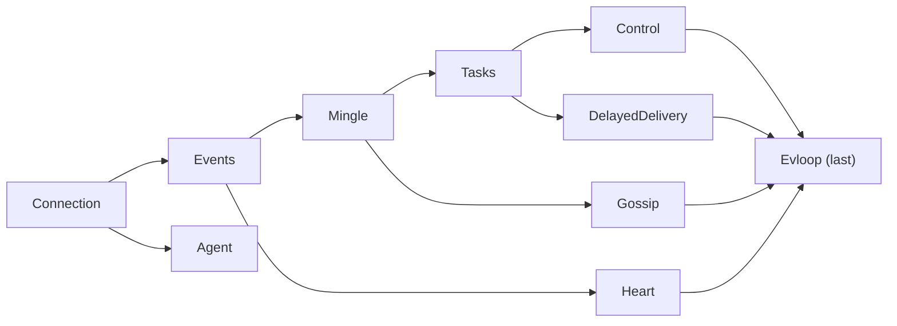

## Overview

The consumer's blueprint is a set of bootsteps that run on every (re)connection: each is started after the broker connection is open and stopped before it is replaced. They give a worker its connection, its event dispatcher, its knowledge of other workers, its heartbeat, its task consumer, its remote control mailbox and, with quorum queues, native delayed delivery. This page is a catalogue of those steps. The consumer itself, the restart loop and the event loop step `Evloop` are covered on [[The Consumer and Message Loop]]; the bootstep framework is on [[Worker Startup and Bootsteps]].

Sources: [celery/worker/consumer/consumer.py:171-189](repo://celery/worker/consumer/consumer.py#L171-L189)

## Start order

The dependencies give this order; `Evloop`, marked `last`, always starts at the end.

Sources: [celery/worker/consumer/consumer.py:857-866](repo://celery/worker/consumer/consumer.py#L857-L866)

Sources: [celery/worker/consumer/events.py:15-18](repo://celery/worker/consumer/events.py#L15-L18), [celery/worker/consumer/mingle.py:13-24](repo://celery/worker/consumer/mingle.py#L13-L24), [celery/worker/consumer/gossip.py:23-30](repo://celery/worker/consumer/gossip.py#L23-L30), [celery/worker/consumer/tasks.py:20-23](repo://celery/worker/consumer/tasks.py#L20-L23), [celery/worker/consumer/control.py:18-21](repo://celery/worker/consumer/control.py#L18-L21), [celery/worker/consumer/delayed_delivery.py:39-53](repo://celery/worker/consumer/delayed_delivery.py#L39-L53)

| Step | Requires | Enabled when | Disabled by |
| --- | --- | --- | --- |
| `Connection` | — | always | — |
| `Events` | `Connection` | task events, gossip or heartbeat wanted | `--without-gossip --without-heartbeat` and no `-E` |
| `Mingle` | `Events` | transport is `amqp`, `redis` or `gcpubsub` | `--without-mingle` |
| `Gossip` | `Mingle` | transport is `amqp` or `redis` | `--without-gossip` |
| `Heart` | `Events` | always | `--without-heartbeat` |
| `Tasks` | `Mingle` | always | — |
| `Control` | `Tasks` | `worker_enable_remote_control` and fanout exchanges supported | setting off |
| `DelayedDelivery` | `Tasks` | a quorum queue is declared on `amqp` | — |
| `Agent` | `Connection` | `worker_agent` set | — |

Sources: [celery/worker/consumer/events.py:20-33](repo://celery/worker/consumer/events.py#L20-L33), [celery/worker/consumer/mingle.py:25-34](repo://celery/worker/consumer/mingle.py#L25-L34), [celery/worker/consumer/gossip.py:34-38](repo://celery/worker/consumer/gossip.py#L34-L38), [celery/worker/consumer/heart.py:21-26](repo://celery/worker/consumer/heart.py#L21-L26), [celery/worker/consumer/control.py:31-33](repo://celery/worker/consumer/control.py#L31-L33), [celery/worker/consumer/delayed_delivery.py:55-64](repo://celery/worker/consumer/delayed_delivery.py#L55-L64), [celery/worker/consumer/agent.py:9-21](repo://celery/worker/consumer/agent.py#L9-L21)

## Connection

`Connection` opens the consumer's broker connection on start through `Consumer.connect()` and logs `Connected to <uri>`. On shutdown it closes the connection and sets it to `None`, which also tells the green pidbox thread to exit. Its `info()` reports the connection parameters without the password.

Sources: [celery/worker/consumer/connection.py:14-45](repo://celery/worker/consumer/connection.py#L14-L45)

## Events

`Events` creates the consumer's `EventDispatcher` on a separate write connection. With task events off (`-E` not given), it limits the dispatcher to the `worker` group so heartbeats and gossip still flow. With the hub, task events are buffered and flushed from the event loop. On restart, it takes the events buffered by the previous dispatcher, flushes them on the new one and points every reserved request at it, so events sent while the connection was down are not lost. Event transport is on [[Events and Monitoring]].

Sources: [celery/worker/consumer/events.py:20-71](repo://celery/worker/consumer/events.py#L20-L71)

## Mingle

`Mingle` synchronizes with other workers when the consumer starts. It broadcasts the `hello` control command with a 1-second timeout, sending this worker's node name and its revoked-task set, and drops its own reply. For each other worker that replied, it adjusts the logical clock to the peer's value and merges the peer's revoked ids into its own. With no replies it logs `mingle: all alone`. Errors from one peer are logged and do not stop the sync.

Sources: [celery/worker/consumer/mingle.py:13-76](repo://celery/worker/consumer/mingle.py#L13-L76)

## Gossip

### Watching other workers

`Gossip` is a `ConsumerStep`: it consumes other workers' events (routing key `worker.#`) on an auto-delete queue whose TTL equals the heartbeat interval, without acknowledgements. It keeps a small `events.State` of the cluster (see [[Cluster State from Events]]) and calls the handlers registered in `gossip.on.node_join`, `node_leave` and `node_lost`. Every 5 seconds `periodic` removes workers whose heartbeats stopped, calling `node_lost` for each. Events from this worker itself only advance the clock; task events are skipped, as Redis without `fanout_patterns` can deliver them here.

Sources: [celery/worker/consumer/gossip.py:23-79](repo://celery/worker/consumer/gossip.py#L23-L79), [celery/worker/consumer/gossip.py:136-206](repo://celery/worker/consumer/gossip.py#L136-L206)

### Elections

Gossip also implements a simple leader election. `election(id, topic, action)` sends a `worker-elect` event. Every worker, including the sender, pushes `(clock, hostname.pid, topic, action)` onto a heap for that id and replies with `worker-elect-ack`. When a worker has acks from as many workers as it believes are alive, it sorts the heap by logical clock; the first entry is the leader. If that is this worker, it runs the handler for the topic — the only built-in topic, `task`, applies the given signature.

Sources: [celery/worker/consumer/gossip.py:81-134](repo://celery/worker/consumer/gossip.py#L81-L134)

## Heart

`Heart` starts a `celery.worker.heartbeat.Heart` on the consumer's timer, not to be confused with AMQP protocol heartbeats. It sends `worker-online` when started, `worker-heartbeat` every interval (2 seconds by default) and `worker-offline` when stopped. Each event carries the interval as `freq`, the number of active requests, the total processed count, the load average and the software information. The heart follows the dispatcher: enabling or disabling events with remote control starts or stops it. If the `heartbeat_sent` signal has receivers, it is sent with each heartbeat.

Sources: [celery/worker/consumer/heart.py:10-36](repo://celery/worker/consumer/heart.py#L10-L36), [celery/worker/heartbeat.py:14-61](repo://celery/worker/heartbeat.py#L14-L61)

## Tasks

`Tasks` builds the strategies and tracers for every registered task, sets the initial prefetch count, creates the task consumer for the selected queues and wraps its QoS. Stopping cancels the consumer; shutting down also closes its channel. Its `info()` reports the current prefetch count. The QoS rules are described on [[The Consumer and Message Loop]].

Sources: [celery/worker/consumer/tasks.py:20-101](repo://celery/worker/consumer/tasks.py#L20-L101)

## Control

`Control` gives the worker its remote control mailbox. It wraps a `Pidbox` — or a `gPidbox` for green pools — that registers a kombu pidbox `Node` named after the worker, with the command handlers from `celery.worker.control` and a state holding the app, hostname and consumer. Each command first advances the logical clock; an unknown command is logged, and a failing command is logged and resets the mailbox consumer.

Sources: [celery/worker/consumer/control.py:1-33](repo://celery/worker/consumer/control.py#L1-L33), [celery/worker/pidbox.py:20-80](repo://celery/worker/pidbox.py#L20-L80)

The green variant runs the mailbox in a greenlet of its own with a separate connection, draining events with a 1-second timeout until shutdown or until the consumer's connection is gone. The commands themselves are on [[Remote Control and Inspection]].

Sources: [celery/worker/pidbox.py:83-126](repo://celery/worker/pidbox.py#L83-L126)

## DelayedDelivery

`DelayedDelivery` prepares RabbitMQ native delayed delivery, which `send_task` uses for ETA and countdown tasks when quorum queues are in use (see [[Queues and Routing]]). It is included only when a declared queue is a quorum queue on the `amqp` transport.

Sources: [celery/worker/consumer/delayed_delivery.py:39-64](repo://celery/worker/consumer/delayed_delivery.py#L39-L64)

On start it validates the configuration — `broker_url` must be non-empty (a `;`-separated string or a list of strings) and `broker_native_delayed_delivery_queue_type` must be `classic` or `quorum` — and raises `ValueError` otherwise. For each broker URL it declares the delayed-delivery exchanges and queues and binds every non-broadcast application queue to them, retrying up to 3 times, 1 second apart, on `ConnectionRefusedError` and `OSError`. Failures to bind individual queues are collected into an `ExceptionGroup`. A URL that still fails is logged as a warning; if all fail, a critical message says native delayed delivery will not be available, and the worker continues.

Sources: [celery/worker/consumer/delayed_delivery.py:66-150](repo://celery/worker/consumer/delayed_delivery.py#L66-L150), [celery/worker/consumer/delayed_delivery.py:152-199](repo://celery/worker/consumer/delayed_delivery.py#L152-L199), [celery/worker/consumer/delayed_delivery.py:216-279](repo://celery/worker/consumer/delayed_delivery.py#L216-L279)

## Agent

`Agent` is an optional hook for the `cell` actor library: when `worker_agent` names a class, it is instantiated with the consumer's connection and stored as `c.agent`.

Sources: [celery/worker/consumer/agent.py:1-21](repo://celery/worker/consumer/agent.py#L1-L21)

## Adding a step

Steps added to `app.steps['consumer']` join this blueprint. A `bootsteps.ConsumerStep` subclass only needs `get_consumers(channel)` returning kombu consumers; it is started after `Connection` and its consumers are cancelled when the connection is replaced.

Sources: [celery/worker/consumer/consumer.py:246-251](repo://celery/worker/consumer/consumer.py#L246-L251), [celery/bootsteps.py:386-415](repo://celery/bootsteps.py#L386-L415)
