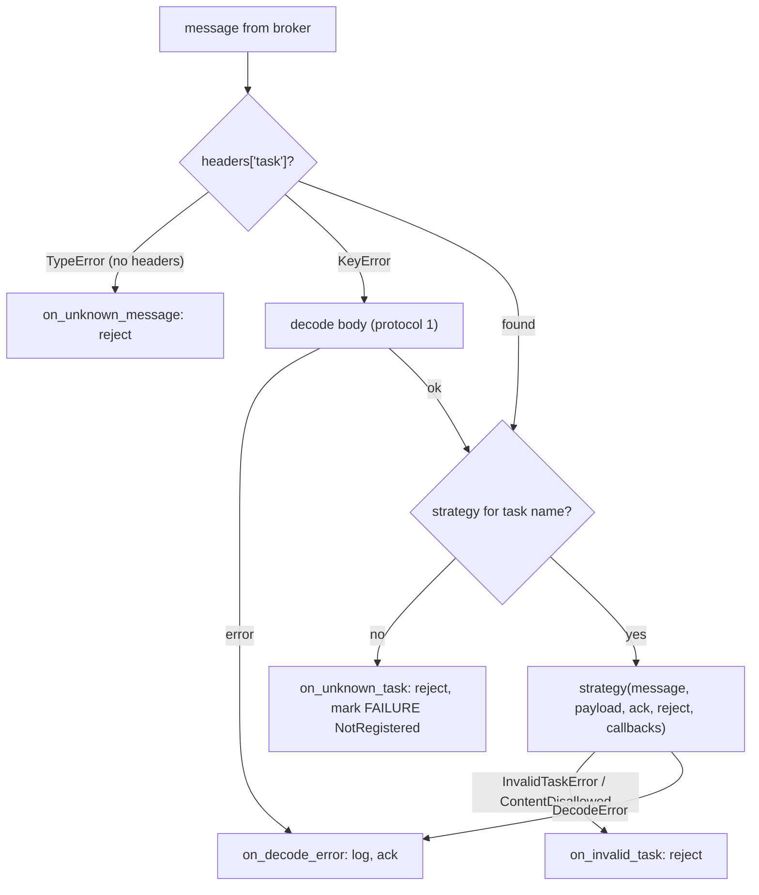

## Overview

The `Consumer` is the part of the worker that talks to the broker. It owns the broker connection, the task consumer and its prefetch limit (QoS), the per-task strategies, the rate-limit buckets and the event loop that drives all of them. Its module docstring sums it up: consuming messages, processing them, and "keeping the broker connections up and running". It is created by the worker's `Consumer` bootstep with the worker's `process_task` as `on_task_request`, the callback that hands a ready request to the pool.

Sources: [celery/worker/consumer/consumer.py:1-5](repo://celery/worker/consumer/consumer.py#L1-L5), [celery/worker/components.py:221-246](repo://celery/worker/components.py#L221-L246)

Like the worker, the consumer is assembled from bootsteps. This page follows the consumer's start, reconnect and message loop; the individual steps are catalogued on [[Consumer Bootsteps]], and what happens to each task message after it is received is on [[Task Requests and Strategies]].

Sources: [celery/worker/consumer/consumer.py:171-189](repo://celery/worker/consumer/consumer.py#L171-L189)

## Construction

`Consumer.__init__` stores the pool, timer, hub and controller, creates an empty strategy map, and reads `connection_errors` and `channel_errors` from a not-yet-connected read connection. It creates one rate-limit bucket per registered task, chooses the AMQP heartbeat (only with the hub or a green pool; otherwise 0), and picks the loop: `asynloop` when there is a hub, `synloop` otherwise. Under gevent it clears `broker_connection_timeout`, because the comment notes a gevent bug where an expired timeout is never reset. Finally it builds the consumer blueprint with `app.steps['consumer']` and applies it.

Sources: [celery/worker/consumer/consumer.py:191-255](repo://celery/worker/consumer/consumer.py#L191-L255)

The default steps are `Connection`, `Mingle`, `Events`, `Gossip`, `Heart`, `Control`, `Tasks`, `DelayedDelivery`, `Evloop` and `Agent`. `Evloop` is marked `last`, so the loop starts only after the connection, task consumer and control consumer exist.

Sources: [celery/worker/consumer/consumer.py:171-189](repo://celery/worker/consumer/consumer.py#L171-L189), [celery/worker/consumer/consumer.py:857-872](repo://celery/worker/consumer/consumer.py#L857-L872)

## Start and reconnect

### The restart loop

`Consumer.start` loops while the blueprint is not stopping. Each pass calls `maybe_shutdown()`, throttles restarts with billiard's `restart_state` (at most 5 restarts per second, logging "Frequent restarts detected" and sleeping 1 s when exceeded), and starts the blueprint. A connection error — and also a channel error when `broker_channel_error_retry` is set — is recoverable: the consumer runs the matching error handler, calls `on_close`, and restarts the blueprint, which reconnects and rebuilds every step.

Sources: [celery/worker/consumer/consumer.py:366-407](repo://celery/worker/consumer/consumer.py#L366-L407)

If retrying is disabled for this situation the worker shuts down instead. `_get_connection_retry_type` picks `broker_connection_retry_on_startup` for a failure on the very first attempt (when that setting is not `None`) and `broker_connection_retry` otherwise. The shutdown paths are described on [[Worker Signals and Shutdown]].

Sources: [celery/worker/consumer/consumer.py:383-399](repo://celery/worker/consumer/consumer.py#L383-L399), [celery/worker/consumer/consumer.py:409-413](repo://celery/worker/consumer/consumer.py#L409-L413)

### Connecting

The `Connection` step calls `connect()`, which opens a read connection with the heartbeat and registers its transport with the hub. `ensure_connected` either connects once (retry disabled) or calls kombu's `ensure_connection` with `broker_connection_max_retries`, logging each failed attempt with the next retry delay (or "trying failover" when alternates exist) and calling `maybe_shutdown` between attempts so a shutdown signal interrupts the retries. When `broker_connection_retry_on_startup` is unset, `broker_connection_retry` decides, with a pending-deprecation warning for Celery 6.0.

Sources: [celery/worker/consumer/connection.py:14-45](repo://celery/worker/consumer/connection.py#L14-L45), [celery/worker/consumer/consumer.py:549-622](repo://celery/worker/consumer/consumer.py#L549-L622)

### Cleaning up after a lost connection

`on_close` runs before each restart. Delivery tags belong to the old channel and can no longer be acknowledged, so it clears the worker's semaphore, drops requests waiting in rate-limit buckets, forgets reserved requests that never became active, and flushes the pool. A connection error before the connection was established only logs, runs pending operations and shuts the blueprint's steps down; the handling after a connection loss is on [[Worker Signals and Shutdown]].

Sources: [celery/worker/consumer/consumer.py:532-547](repo://celery/worker/consumer/consumer.py#L532-L547), [celery/worker/consumer/consumer.py:415-417](repo://celery/worker/consumer/consumer.py#L415-L417)

## The task consumer and QoS

### Prefetch

The `Tasks` step, started after `Mingle`, rebuilds the strategy for every registered task and builds its tracer (`update_strategies`), sets the initial `basic_qos` prefetch count, creates the kombu consumer for the selected queues, and wraps the prefetch setter in a kombu `QoS` object capped by `worker_eta_task_limit`. The initial prefetch count is the concurrency times `worker_prefetch_multiplier`; `max_prefetch_count` is the current number of pool processes times the multiplier.

Sources: [celery/worker/consumer/tasks.py:20-57](repo://celery/worker/consumer/tasks.py#L20-L57), [celery/worker/consumer/consumer.py:716-721](repo://celery/worker/consumer/consumer.py#L716-L721), [celery/worker/consumer/consumer.py:809-815](repo://celery/worker/consumer/consumer.py#L809-L815)

Global QoS is used when the broker's QoS semantics differ from the AMQP spec (RabbitMQ 3.3 and later). With `worker_detect_quorum_queues` and quorum queues in use it is turned off, and the prefetch count becomes static. The step records the mode on the consumer as `qos_global`.

Sources: [celery/worker/consumer/tasks.py:103-124](repo://celery/worker/consumer/tasks.py#L103-L124), [celery/worker/consumer/tasks.py:33-38](repo://celery/worker/consumer/tasks.py#L33-L38)

`worker_disable_prefetch`, supported only with the Redis transport, patches the channel's `can_consume` so that no new message is fetched while the number of reserved requests is at the pool size (or the autoscaler's maximum).

Sources: [celery/worker/consumer/tasks.py:59-83](repo://celery/worker/consumer/tasks.py#L59-L83)

### Changing the prefetch count

Tasks with an ETA are held in memory, so the strategy calls `qos.increment_eventually()` for each one and `apply_eta_task` decrements it when the ETA fires; otherwise the prefetch limit would fill with waiting tasks. Pool grow and shrink operations call `_update_prefetch_count` with the change in process count. The loops apply a changed value only when `qos.prev != qos.value`, grouping updates.

Sources: [celery/worker/consumer/consumer.py:305-327](repo://celery/worker/consumer/consumer.py#L305-L327), [celery/worker/consumer/consumer.py:659-663](repo://celery/worker/consumer/consumer.py#L659-L663), [celery/worker/loops.py:89-93](repo://celery/worker/loops.py#L89-L93)

After a reconnect with `worker_enable_prefetch_count_reduction`, the prefetch count starts lowered by the number of tasks still running, so the worker does not over-fetch; each acknowledgement then raises it by one multiplier step via `_restore_prefetch_count_after_connection_restart` until the maximum is reached and logs "Resuming normal operations". The reduction is skipped with per-consumer QoS, because broker-side updates would not reach the running consumer (#9512).

Sources: [celery/worker/consumer/consumer.py:453-491](repo://celery/worker/consumer/consumer.py#L453-L491), [celery/worker/consumer/consumer.py:788-807](repo://celery/worker/consumer/consumer.py#L788-L807)

## Receiving a message

### The task handler

`create_task_handler` returns `on_task_received`, installed as the kombu consumer's `on_message`. For protocol 2 it reads the task name from the `task` header without decoding the body. A message without headers is decoded as protocol 1 and the name taken from the body; a decode failure goes to `on_decode_error`. It looks up the strategy for the name and calls it with the message, the decoded payload (protocol 1 only), promises that acknowledge or reject the message, and the `on_task_message` callbacks (the autoscaler registers one).

Sources: [celery/worker/consumer/consumer.py:723-786](repo://celery/worker/consumer/consumer.py#L723-L786)

Sources: [celery/worker/consumer/consumer.py:516-530](repo://celery/worker/consumer/consumer.py#L516-L530), [celery/worker/consumer/consumer.py:665-714](repo://celery/worker/consumer/consumer.py#L665-L714), [celery/worker/consumer/consumer.py:731-784](repo://celery/worker/consumer/consumer.py#L731-L784)

The error paths treat messages differently on purpose. A body that cannot be decoded is acknowledged, so it "doesn't enter a loop". A message in an unknown format or failing validation is rejected and the `task_rejected` signal is sent. A message for a task that is not registered is rejected, stored as a `FAILURE` with `NotRegistered(name)` so the client sees the error, announced with a `task-failed` event, and reported with the `task_unknown` signal.

Sources: [celery/worker/consumer/consumer.py:516-530](repo://celery/worker/consumer/consumer.py#L516-L530), [celery/worker/consumer/consumer.py:672-714](repo://celery/worker/consumer/consumer.py#L672-L714)

### Acknowledgements without a hub

`call_soon` defers a callback to the hub, or, without one, to a list run at the top of each `synloop` iteration. Acknowledgements use `call_soon_ack`, which runs immediately without a hub; its docstring explains that deferring the ack with `acks_late` and a prefetch of 1 delayed every next task by 50–400 ms in gevent and eventlet workers.

Sources: [celery/worker/consumer/consumer.py:257-294](repo://celery/worker/consumer/consumer.py#L257-L294)

## Rate limits

Each task with a `rate_limit` gets a kombu `TokenBucket` of capacity 1; `reset_rate_limits` rebuilds them (the `rate_limit` control command uses it). The strategy passes a limited request to `_limit_task`, which adds it to the bucket and drains it: requests are moved to the pool while tokens are available, and otherwise the first waiting request is put back and `_schedule_bucket_request` is scheduled on the timer after the bucket's expected wait. Requests stay in order within a bucket.

Sources: [celery/worker/consumer/consumer.py:296-364](repo://celery/worker/consumer/consumer.py#L296-L364)

## Event loops

### asynloop

`asynloop` is the non-blocking loop used with the hub (the prefork pool on Linux and macOS). It installs the task handler on the consumer, schedules AMQP heartbeat checks on the hub timer, registers the worker's and consumer's steps with the hub, starts consuming and calls `on_ready` (the first time, the worker's ready callback). On the first start it raises `WorkerLostError` if the pool processes did not start. Then it repeatedly checks for shutdown flags and heartbeat errors, updates QoS when it changed and advances the hub loop.

Sources: [celery/worker/loops.py:48-93](repo://celery/worker/loops.py#L48-L93), [celery/worker/consumer/consumer.py:506-514](repo://celery/worker/consumer/consumer.py#L506-L514)

On an exception (a lost connection, for example) the hub is reset and its timer cleared before re-raising, so stale file descriptors and periodic callbacks from the old connection do not fire during the reconnect; on a normal exit the hub is left alone so heartbeats continue while the pool drains.

Sources: [celery/worker/loops.py:94-130](repo://celery/worker/loops.py#L94-L130)

### synloop

`synloop` is the blocking fallback for transports without asynchronous I/O and for green pools. Each cycle checks shutdown flags, raises a recorded heartbeat error, updates QoS, runs pending operations and calls `connection.drain_events(timeout=2.0)`, ignoring socket timeouts. Heartbeats are only enabled with a green pool.

Sources: [celery/worker/loops.py:133-183](repo://celery/worker/loops.py#L133-L183)

## Queues at runtime

`add_task_queue` adds a queue to the selected set (creating a declaration if the name is unknown, with a direct exchange by default) and starts consuming from it if the task consumer is not already doing so; `cancel_task_queue` deselects it and cancels consumption. The `add_consumer` and `cancel_consumer` remote control commands call these; see [[Remote Control and Inspection]].

Sources: [celery/worker/consumer/consumer.py:632-657](repo://celery/worker/consumer/consumer.py#L632-L657)
