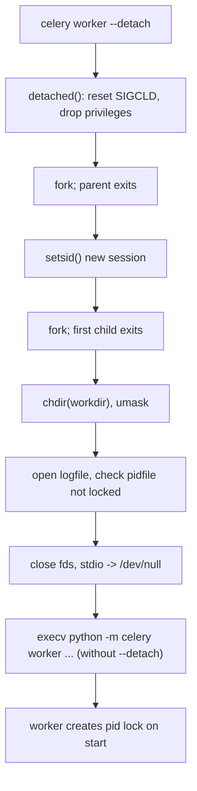

## Overview

`celery.platforms` holds the operating-system plumbing that the worker, beat and `celery multi` share: detaching into the background, pid file locks, dropping root privileges, a friendlier interface to Unix signals, process titles, and the check that refuses to run as root with pickle. None of it is Celery-specific in idea — it is the classic Unix daemon recipe — but every long-running Celery program goes through it.

Sources: [celery/platforms.py:40-62](repo://celery/platforms.py#L40-L62)

`celery multi` starts workers with `--detach` and later finds them by their pid files (see [[Running Multiple Workers]]); the worker's own signal handlers are on [[Worker Signals and Shutdown]].

Sources: [celery/apps/multi.py:122-142](repo://celery/apps/multi.py#L122-L142)

## Detaching

### detached and DaemonContext

`detached(logfile, pidfile, uid, gid, umask, workdir, fake)` prepares and returns a `DaemonContext`. Before forking it resets `SIGCLD` to its default handler and drops privileges. Inside the context, after changing directory, it opens the log file for appending — since stderr will be gone, any error would otherwise be lost silently — and checks that the pid file is not held by a running process, without creating it; creating the pid file is the child program's job. Platforms without the `resource` module raise `RuntimeError`.

Sources: [celery/platforms.py:376-429](repo://celery/platforms.py#L376-L429)

`DaemonContext.open()` performs the double fork: fork, `setsid()` in the child to start a new session, fork again and exit the intermediate process, so the daemon cannot reacquire a controlling terminal. It then changes to the working directory (default `/`), applies the umask (a string with a leading zero is read as octal), runs the after-chdir hook, closes every file descriptor except stdin, stdout, stderr and `/dev/urandom` — kept open because beat's `shelve` needs it — redirects the standard streams to `/dev/null`, and runs multiprocessing's after-fork hooks. With `fake=True` it skips forking and closing, for debugging.

Sources: [celery/platforms.py:310-374](repo://celery/platforms.py#L310-L374)

Sources: [celery/platforms.py:333-374](repo://celery/platforms.py#L333-L374), [celery/bin/worker.py:108-133](repo://celery/bin/worker.py#L108-L133), [celery/worker/worker.py:150-152](repo://celery/worker/worker.py#L150-L152)

### Worker and beat

The worker detaches by re-executing itself: `celery worker --detach` removes `--detach`/`-D`, `--uid` and `--gid` from its arguments, enters `detached(...)` (with node-name placeholders already expanded in the log file name), and `execv`s `python -m celery ...` with the rest. If exec fails, it sets up logging to the log file and logs the error. The `C_FAKEFORK` environment variable turns on fake mode.

Sources: [celery/bin/worker.py:108-133](repo://celery/bin/worker.py#L108-L133), [celery/bin/worker.py:336-356](repo://celery/bin/worker.py#L336-L356)

`celery beat --detach` and `celery events --camera ... --detach` instead run their program directly inside the `detached()` context.

Sources: [celery/bin/beat.py:62-72](repo://celery/bin/beat.py#L62-L72), [celery/bin/events.py:24-37](repo://celery/bin/events.py#L24-L37)

The daemon options `--logfile`, `--pidfile`, `--uid`, `--gid`, `--umask` and `--executable` are shared by these commands and default to settings named after the command, such as `worker_pidfile`.

Sources: [celery/bin/base.py:209-238](repo://celery/bin/base.py#L209-L238)

## Pid files

### Pidfile

`Pidfile(path)` is a lock based on a file containing the process id and a newline. `write_pid` creates it with `O_CREAT | O_EXCL` (so creation fails if it exists) and mode 0644, flushes and fsyncs it, then reads it back and raises `LockFailed` if the content differs. `read_pid` rejects files without the trailing newline as partial. `release` removes the file.

Sources: [celery/platforms.py:125-241](repo://celery/platforms.py#L125-L241)

### create_pidlock

`create_pidlock(path)` is the function programs use. If the file exists, `remove_if_stale` removes it when it is unreadable, empty, contains this process's own pid (common for pid 1 in containers), or names a process that no longer exists or cannot be signalled. If the file is still held, it prints `Pidfile (...) already exists. Seems we're already running?` and exits with `EX_CANTCREAT`. Otherwise it acquires the lock and registers its release at exit.

Sources: [celery/platforms.py:183-213](repo://celery/platforms.py#L183-L213), [celery/platforms.py:244-272](repo://celery/platforms.py#L244-L272), [celery/platforms.py:64-65](repo://celery/platforms.py#L64-L65)

The worker creates its lock when the blueprint starts and releases it when stopped; beat creates it before starting the scheduler.

Sources: [celery/worker/worker.py:150-165](repo://celery/worker/worker.py#L150-L165), [celery/apps/beat.py:93-95](repo://celery/apps/beat.py#L93-L95)

## Dropping privileges

### maybe_drop_privileges

`maybe_drop_privileges(uid, gid)` changes to another user and group when started as root; user and group may be names or numbers. With a uid it sets the group (the user's primary group if none was given) before initializing supplementary groups and finally the user — the comments explain that `setgid` must come first or it may fail and leave the process in a privileged group. It then tries `setuid(0)` and raises `SecurityError` if that succeeds, and it also raises if the real or effective id is still root afterwards. A non-root process whose real uid is root raises `SecurityError` too.

Sources: [celery/platforms.py:528-584](repo://celery/platforms.py#L528-L584), [celery/platforms.py:432-463](repo://celery/platforms.py#L432-L463)

`setgroups` truncates the group list to the platform's `SC_NGROUPS_MAX` and, if the kernel still refuses, removes groups one at a time — a workaround the comment attributes to glibc.

Sources: [celery/platforms.py:466-499](repo://celery/platforms.py#L466-L499)

### Running as root

The worker program calls `check_privileges(accept_content)` at startup. If the process runs as root, or its group is `sudo` or `wheel`, or its group cannot be looked up, it warns that this is not recommended — and when the worker accepts `pickle`, it refuses to start with `SecurityError` unless `C_FORCE_ROOT` is set, because unpickling a message can run arbitrary code with root rights.

Sources: [celery/platforms.py:788-845](repo://celery/platforms.py#L788-L845), [celery/platforms.py:67-89](repo://celery/platforms.py#L67-L89), [celery/apps/worker.py:94-104](repo://celery/apps/worker.py#L94-L104)

## Signals and process titles

### The signals helper

`platforms.signals` wraps the `signal` module so code can use names: `signals['TERM'] = handler`, `signals.update(INT=h, TERM=h)`, `signals.reset('HUP')`, `signals.ignore('USR1')`, `signals.supported('SIGHUP')` and `signals.signum('TERM')`. Names must be upper case and may omit the `SIG` prefix. Setting a handler for a signal the platform does not have is silently ignored, which keeps the worker's handler setup portable to Windows. `signal_name(15)` maps back to `TERM`.

Sources: [celery/platforms.py:594-704](repo://celery/platforms.py#L594-L704)

`set_pdeathsig` asks the kernel to `SIGKILL` the current process when its parent dies; prefork children call it so they never outlive a killed worker.

Sources: [celery/platforms.py:713-720](repo://celery/platforms.py#L713-L720), [celery/concurrency/prefork.py:47-48](repo://celery/concurrency/prefork.py#L47-L48)

### Process titles

When the `setproctitle` package is installed, `set_process_title(progname, info)` sets the name shown by `ps` to `[progname] info`, and `set_mp_process_title` adds the node name and the multiprocessing process name, giving titles such as `[celeryd: w1@host:MainProcess] -active-`. Setting `NOSETPS` disables it.

Sources: [celery/platforms.py:723-749](repo://celery/platforms.py#L723-L749), [celery/apps/worker.py:280-285](repo://celery/apps/worker.py#L280-L285)

## Exit codes and errno helpers

The module defines the exit codes used across the CLI: `EX_OK` (0), `EX_FAILURE` (1), `EX_USAGE` (64), `EX_UNAVAILABLE` (69) and `EX_CANTCREAT` (73). `ignore_errno(*errnos)` is a context manager that swallows OS errors with the given error codes (names or numbers) and re-raises others.

Sources: [celery/platforms.py:49-53](repo://celery/platforms.py#L49-L53), [celery/platforms.py:752-785](repo://celery/platforms.py#L752-L785)
