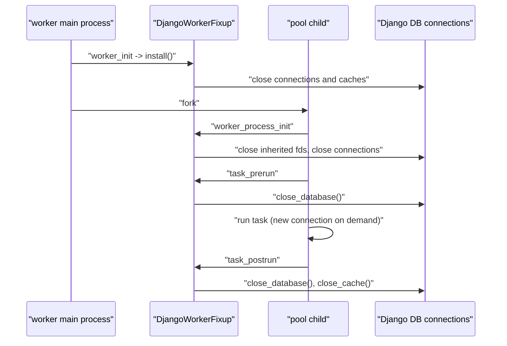

## Overview

Celery works with Django without a separate integration package. Every app loads the built-in *fix-up* `celery.fixups.django:fixup`, which activates when the `DJANGO_SETTINGS_MODULE` environment variable is set: it calls `django.setup()` before task modules are imported, lets `autodiscover_tasks()` find tasks in every installed Django app, uses Django's timezone-aware clock, makes `DjangoTask` the default task class, and in workers closes database connections and caches around each task and after forking. Configuration usually comes from Django's settings module.

Sources: [celery/app/base.py:81-83](repo://celery/app/base.py#L81-L83), [celery/fixups/django.py:52-89](repo://celery/fixups/django.py#L52-L89)

Fix-ups are loaded by the `Celery` constructor (see [[The Celery Application]]); the `fixups` argument replaces the default set.

Sources: [celery/app/base.py:402-405](repo://celery/app/base.py#L402-L405)

## The project's celery module

The Django example creates the app in `proj/celery.py`:

Sources: [examples/django/proj/celery.py:5-8](repo://examples/django/proj/celery.py#L5-L8)

```python
import os

from celery import Celery

# Set the default Django settings module for the 'celery' program.
os.environ.setdefault('DJANGO_SETTINGS_MODULE', 'proj.settings')

app = Celery('proj')

# Using a string here means the worker doesn't have to serialize
# the configuration object to child processes.
# - namespace='CELERY' means all celery-related configuration keys
#   should have a `CELERY_` prefix.
app.config_from_object('django.conf:settings', namespace='CELERY')

# Load task modules from all registered Django apps.
app.autodiscover_tasks()
```

Sources: [examples/django/proj/celery.py:1-17](repo://examples/django/proj/celery.py#L1-L17)

With `namespace='CELERY'`, every setting is read from Django settings with a `CELERY_` prefix, so `CELERY_BROKER_URL` sets `broker_url`; the configuration view looks up the prefixed key first. `timezone` also falls back to Django's `TIME_ZONE`. See [[Configuration and Loaders]].

Sources: [celery/utils/collections.py:368-394](repo://celery/utils/collections.py#L368-L394), [celery/app/utils.py:122-125](repo://celery/app/utils.py#L122-L125)

`autodiscover_tasks()` without arguments asks the fix-ups for packages: the Django fix-up returns the name of every installed app config, and each app's `tasks` module is imported when the worker imports its modules.

Sources: [celery/app/base.py:828-843](repo://celery/app/base.py#L828-L843), [celery/fixups/django.py:121-123](repo://celery/fixups/django.py#L121-L123)

## Activating the fix-up

### fixup()

`fixup(app)` does nothing unless `DJANGO_SETTINGS_MODULE` is set and the app does not already use a Django-specific loader. If Django cannot be imported it warns with `FixupWarning`; Django older than 1.11 raises `ImproperlyConfigured`.

Sources: [celery/fixups/django.py:47-63](repo://celery/fixups/django.py#L47-L63)

### DjangoFixup.install

`DjangoFixup` makes the app the default app if none is set yet. `install()`:

Sources: [celery/fixups/django.py:69-73](repo://celery/fixups/django.py#L69-L73)

1. Puts the current directory first on `sys.path`, so the project's modules take precedence over installed ones.
2. Replaces the loader's `now` with Django's `timezone.now`.
3. Sets the app's task class to `celery.contrib.django.task:DjangoTask` unless a custom task class was given.
4. Connects `import_modules` (to set up Django before task modules are imported) and `worker_init` (to install the worker-side fix-up).

Sources: [celery/fixups/django.py:66-127](repo://celery/fixups/django.py#L66-L127), [celery/app/base.py:357-363](repo://celery/app/base.py#L357-L363)

On `import_modules`, `validate_models()` calls `django.setup()` and runs Django's system checks, which `--skip-checks` (or `CELERY_SKIP_CHECKS`) disables.

Sources: [celery/fixups/django.py:101-103](repo://celery/fixups/django.py#L101-L103), [celery/fixups/django.py:146-154](repo://celery/fixups/django.py#L146-L154), [celery/bin/celery.py:105-131](repo://celery/bin/celery.py#L105-L131)

## Database connections in workers

### Around each task

`DjangoWorkerFixup.install()` connects to `task_prerun`, `task_postrun`, `worker_process_init` and `beat_embedded_init`, and closes the database connections and caches once at worker start. Before and after every task that is not eager, it closes database connections, and after the task it also closes caches. This mirrors Django's request cycle, so a task never runs on a connection left broken or idle by an earlier one.

Sources: [celery/fixups/django.py:156-163](repo://celery/fixups/django.py#L156-L163), [celery/fixups/django.py:194-203](repo://celery/fixups/django.py#L194-L203)

`CELERY_DB_REUSE_MAX` lets connections be reused: closing then only happens every `2 × CELERY_DB_REUSE_MAX` calls (each task calls it twice).

Sources: [celery/fixups/django.py:134-136](repo://celery/fixups/django.py#L134-L136), [celery/fixups/django.py:205-211](repo://celery/fixups/django.py#L205-L211)

`_close_database` closes every initialized connection (all connections on Django before 4.1). With Django's connection pooling enabled for a database and the prefork pool in use, it also closes the pool. Interface errors and "closed"/"not connected" database errors are ignored.

Sources: [celery/fixups/django.py:213-240](repo://celery/fixups/django.py#L213-L240)

### After fork

In each new pool child, `on_worker_process_init` first validates models again when the child was started by execv (`FORKED_BY_MULTIPROCESSING`). It then closes the file descriptors of database connections inherited from the parent without sending anything over them — the comment explains that a normal `close()` on some databases would also break the parent's connection — and finally closes connections and caches.

Sources: [celery/fixups/django.py:165-192](repo://celery/fixups/django.py#L165-L192), [celery/fixups/django.py:39-44](repo://celery/fixups/django.py#L39-L44)



Sources: [celery/fixups/django.py:156-203](repo://celery/fixups/django.py#L156-L203)

## DjangoTask

`DjangoTask` adds two methods for sending a task only after the current database transaction commits, so a worker cannot run before the data it needs is visible:

Sources: [celery/contrib/django/task.py:8-13](repo://celery/contrib/django/task.py#L8-L13)

```python
class DjangoTask(Task):
    def delay_on_commit(self, *args, **kwargs) -> None:
        """Call :meth:`~celery.app.task.Task.delay` with Django's ``on_commit()``."""
        transaction.on_commit(functools.partial(self.delay, *args, **kwargs))

    def apply_async_on_commit(self, *args, **kwargs) -> None:
        """Call :meth:`~celery.app.task.Task.apply_async` with Django's ``on_commit()``."""
        transaction.on_commit(functools.partial(self.apply_async, *args, **kwargs))
```

Sources: [celery/contrib/django/task.py:8-21](repo://celery/contrib/django/task.py#L8-L21)

Both return `None` rather than an `AsyncResult`, because nothing has been sent when they return; outside a transaction Django runs the callback immediately. The other task options are described on [[Defining Tasks]].

Sources: [celery/contrib/django/task.py:15-21](repo://celery/contrib/django/task.py#L15-L21)
