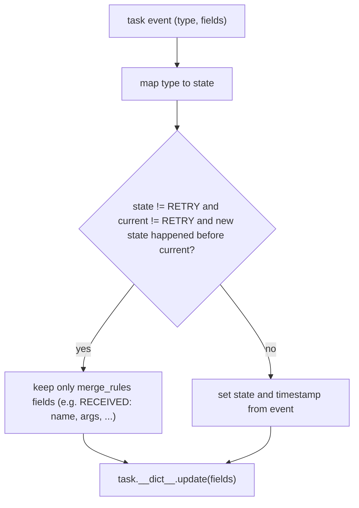

## Overview

Events arrive one by one, possibly out of order, from many workers. `celery.events.state.State` folds that stream into an in-memory picture of the cluster: which workers exist and whether they are alive, and what each task's latest state, timing and result are. The module docstring describes it as representing "the state of the cluster at the time of the last event". Monitoring tools — the `celery events` curses monitor, snapshot cameras, the worker's own gossip step, and external tools — feed events into a `State` and read from it.

Sources: [celery/events/state.py:1-12](repo://celery/events/state.py#L1-L12), [celery/worker/consumer/gossip.py:51-59](repo://celery/worker/consumer/gossip.py#L51-L59)

How events are produced and received is on [[Events and Monitoring]]; the task states and their precedence are defined on [[Results and AsyncResult]].

Sources: [celery/states.py:61-82](repo://celery/states.py#L61-L82)

## Feeding State

`app.events.State()` creates a state bound to the app. Connect it to a receiver with `handlers={'*': state.event}`. `State.event(event)` takes the state's mutex and dispatches by the event type's group (`worker` or `task`); a handler registered in `state.handlers` for a group replaces the built-in handling. An optional `callback(state, event)` is called for every event. `freeze_while(fun)` runs a function under the same mutex, optionally clearing the state afterwards.

Sources: [celery/app/events.py:27-30](repo://celery/app/events.py#L27-L30), [celery/events/state.py:398-449](repo://celery/events/state.py#L398-L449), [celery/events/state.py:501-546](repo://celery/events/state.py#L501-L546)

```python
state = app.events.State()
with app.connection() as conn:
    recv = app.events.Receiver(conn, handlers={'*': state.event})
    recv.capture(limit=None, timeout=None)
```

Sources: [celery/events/snapshot.py:98-106](repo://celery/events/snapshot.py#L98-L106)

Memory is bounded: workers and tasks are kept in LRU caches of `max_workers_in_memory` (5000) and `max_tasks_in_memory` (10000) entries, and the time-ordered event heap is capped at four times the task limit.

Sources: [celery/events/state.py:403-425](repo://celery/events/state.py#L403-L425), [celery/events/state.py:524-529](repo://celery/events/state.py#L524-L529)

## Workers

### Heartbeats and liveness

For a `worker-*` event the state finds or creates the `Worker` by hostname and passes it the event. The worker copies all event fields onto itself (`pid`, `freq`, `active`, `processed`, `loadavg`, software info) and records the receive time in a sorted list of the last four heartbeats. `worker-offline` clears the list.

Sources: [celery/events/state.py:149-214](repo://celery/events/state.py#L149-L214), [celery/events/state.py:555-574](repo://celery/events/state.py#L555-L574)

A worker is `alive` while the current time is before `heartbeat_expires`: the last heartbeat plus `freq` times 200% (`HEARTBEAT_EXPIRE_WINDOW`). With the default 2-second heartbeat, a worker is considered offline after about 4 seconds of silence. `alive_workers()` lists the live ones.

Sources: [celery/events/state.py:41-44](repo://celery/events/state.py#L41-L44), [celery/events/state.py:114-123](repo://celery/events/state.py#L114-L123), [celery/events/state.py:224-240](repo://celery/events/state.py#L224-L240), [celery/events/state.py:706-708](repo://celery/events/state.py#L706-L708)

When the difference between an event's timestamp and its local receive time exceeds 16 seconds, a warning that clocks may be out of sync is logged, once per host.

Sources: [celery/events/state.py:46-52](repo://celery/events/state.py#L46-L52), [celery/events/state.py:106-111](repo://celery/events/state.py#L106-L111), [celery/events/state.py:196-200](repo://celery/events/state.py#L196-L200)

### Joins and leaves

`on_node_join(worker)` is called when a worker is first seen or sends `worker-online`; `on_node_leave(worker)` when it sends `worker-offline`, after which it is removed. Every task event also counts as a sign of life for its worker.

Sources: [celery/events/state.py:567-573](repo://celery/events/state.py#L567-L573), [celery/events/state.py:583-593](repo://celery/events/state.py#L583-L593)

## Tasks

### Updating a task

For a `task-*` event the state finds or creates the `Task` by uuid. A `task-sent` event records the sending client; any other event records the worker. The event is inserted into a heap ordered by `(clock, timestamp, origin)` so tasks can later be listed in logical order, `received` events increment `task_count`, and the task's name is added to the set of seen task types and to the `tasks_by_type` and `tasks_by_worker` indexes.

Sources: [celery/events/state.py:575-634](repo://celery/events/state.py#L575-L634)

`Task.event(type, timestamp, local_received, fields)` maps the event name to a state (`sent` → `PENDING`, `received` → `RECEIVED`, `started` → `STARTED`, `succeeded` → `SUCCESS`, `failed` → `FAILURE`, `retried` → `RETRY`, `revoked` → `REVOKED`, `rejected` → `REJECTED`); an unknown name becomes a custom state in upper case. It stores the event's timestamp in an attribute of the same name (`task.started`, `task.succeeded`, ...).

Sources: [celery/events/state.py:67-78](repo://celery/events/state.py#L67-L78), [celery/events/state.py:305-317](repo://celery/events/state.py#L305-L317)

### Out-of-order events

Events can arrive late — a `task-received` after `task-succeeded`, for example. The task compares the new state's precedence with its current one: if the new state logically happened *before* the current state, it does not change the state or timestamp. Only the fields listed in `merge_rules` for that state are taken — for `RECEIVED`, the `name`, `args`, `kwargs`, `parent_id`, `root_id`, `retries`, `eta` and `expires`, which only the received event carries. `RETRY` is exempt from this rule, since a task can return to an earlier state after a retry.

Sources: [celery/events/state.py:264-277](repo://celery/events/state.py#L264-L277), [celery/events/state.py:319-332](repo://celery/events/state.py#L319-L332)



Sources: [celery/events/state.py:305-332](repo://celery/events/state.py#L305-L332)

### Relations and queries

Tasks know their `parent` and `root` through `parent_id` and `root_id`, and collect `children` as weak references. A child seen before its parent is parked and attached when the parent appears. `info()` returns the fields worth displaying, and `ready` is true for ready states.

Sources: [celery/events/state.py:334-396](repo://celery/events/state.py#L334-L396), [celery/events/state.py:619-641](repo://celery/events/state.py#L619-L641)

| Query | Returns |
| --- | --- |
| `itertasks(limit)` | Tasks in cache order |
| `tasks_by_time(limit, reverse=True)` | `(uuid, task)` from newest event, deduplicated |
| `tasks_by_type[name]`, `tasks_by_worker[hostname]` | Weak sets; called as functions they give time-ordered generators |
| `task_types()` | Sorted seen task names |
| `alive_workers()` | Workers with a recent heartbeat |

Sources: [celery/events/state.py:650-708](repo://celery/events/state.py#L650-L708), [celery/events/state.py:79-103](repo://celery/events/state.py#L79-L103)

`clear_tasks(ready=True)` drops finished tasks and keeps those still in progress; `clear()` also forgets workers and resets the counters. `State` pickles with its workers, tasks and indexes.

Sources: [celery/events/state.py:451-475](repo://celery/events/state.py#L451-L475), [celery/events/state.py:713-720](repo://celery/events/state.py#L713-L720)

## The celery events command

### Modes

`celery events` has three modes, each building on a receiver and, except for the dumper, a `State`.

Sources: [celery/bin/events.py:83-96](repo://celery/bin/events.py#L83-L96)

| Mode | Runs | Purpose |
| --- | --- | --- |
| default | `evtop` | Curses monitor of tasks and workers |
| `--dump` | `evdump` | Print every event as a line of text |
| `--camera <cls>` | `evcam` | Take periodic snapshots of the state |

Sources: [celery/bin/events.py:18-98](repo://celery/bin/events.py#L18-L98)

### Curses monitor

`evtop` feeds a `State` from a receiver in the main thread and redraws the screen from a separate display thread. The monitor lists tasks with their worker, time and state, and lets the user move with `j`/`k` and act on the selected task: `i` info, `t` traceback, `r` result, `c` revoke, `l` change the task type's rate limit. It reconnects after connection errors. The command reports a usage error when the `curses` module is missing.

Sources: [celery/events/cursesmon.py:34-66](repo://celery/events/cursesmon.py#L34-L66), [celery/events/cursesmon.py:479-529](repo://celery/events/cursesmon.py#L479-L529), [celery/bin/events.py:40-48](repo://celery/bin/events.py#L40-L48)

### Dumper

`evdump` prints one line per event: hostname, UTC timestamp, a human-readable event type and the remaining fields. For task events it remembers the task's name and arguments from `task-received` or `task-sent` and repeats them on later events for that uuid. It reconnects after connection or channel errors until interrupted.

Sources: [celery/events/dumper.py:36-99](repo://celery/events/dumper.py#L36-L99)

### Snapshot cameras

A camera is a `Polaroid` subclass. `evcam` creates a `State`, instantiates the camera with it, and captures events. The camera's timer calls `capture` every `freq` seconds (`-F`), which runs `shutter` under the state's mutex — optionally clearing the state afterwards with `clear_after` — and sends the `shutter_signal`, rate-limited by `maxrate` (`-r`, e.g. `10/m`). `on_shutter(state)` is the hook to override, for example to store the state in a database; `on_cleanup` runs every `cleanup_freq` seconds (one hour). With `--detach`, the camera runs as a daemon.

Sources: [celery/events/snapshot.py:24-111](repo://celery/events/snapshot.py#L24-L111), [celery/bin/events.py:24-37](repo://celery/bin/events.py#L24-L37)
