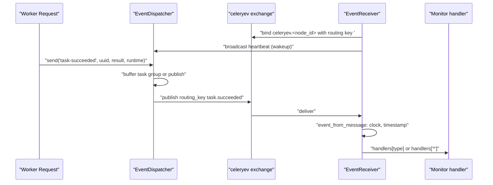

## Overview

Events are a stream of small messages that workers (and optionally clients) publish about what they are doing: a task was received, started, succeeded or failed; a worker came online, is alive, or went offline. The package docstring calls them "a stream of messages sent for certain actions occurring in the worker ... used for monitoring purposes". They go to a dedicated `celeryev` exchange, separate from task queues, so any number of monitors can listen without affecting task delivery.

Sources: [celery/events/__init__.py:1-15](repo://celery/events/__init__.py#L1-L15), [celery/events/event.py:11-15](repo://celery/events/event.py#L11-L15)

This page covers how events are created, sent and received. Turning the stream into a model of the cluster, and the `celery events` tools built on it, are on [[Cluster State from Events]].

Sources: [celery/app/events.py:7-30](repo://celery/app/events.py#L7-L30)

## Event format

An event is a plain dict. `Event(type, **fields)` sets `type` and, unless given, a `timestamp`. Types are named `<group>-<name>`, and `group_from` returns the part before the first dash, so `task-succeeded` is in group `task` and `worker-heartbeat` in group `worker`. The dispatcher adds `hostname`, `utcoffset`, `pid` and the logical `clock` to every event.

Sources: [celery/events/event.py:18-43](repo://celery/events/event.py#L18-L43), [celery/events/dispatcher.py:116-140](repo://celery/events/dispatcher.py#L116-L140)

| Event | Sent by | Main fields |
| --- | --- | --- |
| `task-sent` | Client, with `task_send_sent_event` | `uuid`, `name`, `args`, `kwargs`, `retries`, `eta`, `expires`, `queue`, `exchange`, `routing_key` |
| `task-received` | Worker strategy | `uuid`, `name`, `args`, `kwargs`, `root_id`, `parent_id`, `retries`, `eta`, `expires` |
| `task-started` | Request, when a pool process accepts | `uuid` |
| `task-succeeded` | Request | `uuid`, `result`, `runtime` |
| `task-failed` | Request, consumer for unknown tasks | `uuid`, `exception`, `traceback` |
| `task-retried` | Request | `uuid`, `exception`, `traceback` |
| `task-rejected` | Request | `uuid`, `requeue` |
| `task-revoked` | Request | `uuid`, `terminated`, `signum`, `expired` |
| `task-cancelled` | Request on cold shutdown | `uuid` |
| `worker-online`, `worker-heartbeat`, `worker-offline` | Heart | `freq`, `active`, `processed`, `loadavg`, software info |

Sources: [celery/app/amqp.py:405-418](repo://celery/app/amqp.py#L405-L418), [celery/app/amqp.py:590-602](repo://celery/app/amqp.py#L590-L602), [celery/worker/strategy.py:174-183](repo://celery/worker/strategy.py#L174-L183), [celery/worker/request.py:439-468](repo://celery/worker/request.py#L439-L468), [celery/worker/request.py:511-527](repo://celery/worker/request.py#L511-L527), [celery/worker/request.py:596-620](repo://celery/worker/request.py#L596-L620), [celery/worker/heartbeat.py:39-61](repo://celery/worker/heartbeat.py#L39-L61)

Task events from a request are only sent when the dispatcher is enabled and the task's `send_events` attribute is true.

Sources: [celery/worker/request.py:511-513](repo://celery/worker/request.py#L511-L513)

## The exchange

`get_exchange(conn)` returns the `celeryev` topic exchange (renamed by `event_exchange`), switched to a fanout exchange on Redis and Google Pub/Sub transports — the comment calls this a quick hack for Issue #436. Events are published with routing key `type` with dashes turned into dots (`task.succeeded`), so a topic-exchange receiver can bind to a subset such as `worker.#`.

Sources: [celery/events/event.py:46-63](repo://celery/events/event.py#L46-L63), [celery/events/dispatcher.py:138-140](repo://celery/events/dispatcher.py#L138-L140)

## Sending: EventDispatcher

### Creating a dispatcher

`app.events.Dispatcher(connection, hostname, enabled, channel, buffer_while_offline, groups, ...)` is an `EventDispatcher` bound to the app. It is disabled automatically on the `sql` transport. When enabled it creates a producer on the events exchange with `event_serializer` and non-persistent delivery mode 1. `on_enabled`/`on_disabled` callback sets let other components follow the dispatcher's state — the worker's heart starts and stops with it. `app.events.default_dispatcher()` is a context manager that borrows a producer from the pool.

Sources: [celery/events/dispatcher.py:58-114](repo://celery/events/dispatcher.py#L58-L114), [celery/app/events.py:17-40](repo://celery/app/events.py#L17-L40), [celery/worker/heartbeat.py:31-33](repo://celery/worker/heartbeat.py#L31-L33)

### send and publish

`send(type, **fields)` drops the event if the dispatcher is disabled or `groups` is set and does not contain the event's group. For groups listed in `buffer_group`, the event is appended to an in-memory buffer instead, which is flushed as one message when it reaches `buffer_limit` (24) events, or through the `on_send_buffered` callback. Other events go straight to `publish`, which advances the logical clock (unless `blind`), builds the event and publishes it under a mutex.

Sources: [celery/events/dispatcher.py:116-199](repo://celery/events/dispatcher.py#L116-L199)

If publishing fails and `buffer_while_offline` is on, the event is kept in an outbound buffer instead of raising. `flush()` republishes that buffer and sends each group buffer as a single message with routing key `<group>.multi` whose body is a list of events.

Sources: [celery/events/dispatcher.py:142-213](repo://celery/events/dispatcher.py#L142-L213)

### In the worker

The consumer's `Events` step creates the worker's dispatcher on its own connection. Without `-E` (`worker_send_task_events`) it limits the dispatcher to the `worker` group, so only heartbeats flow. With the event loop, task events are buffered and the hub flushes them after each loop iteration; on reconnect, the previous dispatcher's buffer is carried over and flushed. The `enable_events` and `disable_events` remote control commands add or remove the `task` group at runtime. See [[Consumer Bootsteps]].

Sources: [celery/worker/consumer/events.py:15-71](repo://celery/worker/consumer/events.py#L15-L71), [celery/worker/consumer/consumer.py:624-630](repo://celery/worker/consumer/consumer.py#L624-L630), [celery/worker/control.py:344-367](repo://celery/worker/control.py#L344-L367)

### Heartbeats

`celery.worker.heartbeat.Heart` sends `worker-online` when it starts, `worker-heartbeat` every 2 seconds (configurable), and `worker-offline` when it stops. Each carries the interval as `freq` so monitors know when a heartbeat is overdue. These are application-level events, not the AMQP protocol heartbeats that keep the broker connection alive.

Sources: [celery/worker/heartbeat.py:14-61](repo://celery/worker/heartbeat.py#L14-L61), [celery/worker/consumer/heart.py:10-17](repo://celery/worker/consumer/heart.py#L10-L17)

## Receiving: EventReceiver

### The event queue

`app.events.Receiver(channel, handlers={...}, routing_key='#')` declares a queue named `<event_queue_prefix>.<node_id>` (prefix `celeryev`) bound to the events exchange. By default the queue is exclusive and auto-deleted, with a message TTL of 5 seconds and an expiry of 60 seconds, so an absent monitor does not accumulate events; it may be made durable instead, but not both exclusive and durable.

Sources: [celery/events/receiver.py:23-78](repo://celery/events/receiver.py#L23-L78), [celery/app/defaults.py:179-189](repo://celery/app/defaults.py#L179-L189)

### Capturing

`capture(limit=None, timeout=None, wakeup=True)` consumes events until stopped; `itercapture` yields as it goes. When consuming starts with `wakeup`, the receiver broadcasts the `heartbeat` control command so every worker sends a heartbeat at once and the monitor learns about all of them immediately. Messages are not acknowledged, and a list body (a buffered `.multi` message) is split into its events.

Sources: [celery/events/receiver.py:80-111](repo://celery/events/receiver.py#L80-L111), [celery/events/receiver.py:140-145](repo://celery/events/receiver.py#L140-L145)

Each event is passed to the handler registered for its type, or to the `'*'` handler if there is none.

Sources: [celery/events/receiver.py:80-83](repo://celery/events/receiver.py#L80-L83)

```python
def on_event(event):
    print(event['type'], event.get('uuid'))

with app.connection() as conn:
    recv = app.events.Receiver(conn, handlers={'*': on_event})
    recv.capture(limit=None, timeout=None, wakeup=True)
```

Sources: [celery/events/receiver.py:80-83](repo://celery/events/receiver.py#L80-L83), [celery/events/receiver.py:98-106](repo://celery/events/receiver.py#L98-L106)

### Clocks and timestamps

`event_from_message` keeps the receiver's logical clock in step with the senders: it adjusts to each event's `clock`, or advances its own clock for events without one. `task-sent` events come from clients, which never synchronize their clocks, so their clock is replaced with the receiver's value minus one. With `localize`, the timestamp is converted using the sender's `utcoffset`, and `local_received` records when the event arrived.

Sources: [celery/events/receiver.py:113-138](repo://celery/events/receiver.py#L113-L138), [celery/events/receiver.py:18](repo://celery/events/receiver.py#L18)



Sources: [celery/events/dispatcher.py:164-213](repo://celery/events/dispatcher.py#L164-L213), [celery/events/receiver.py:85-145](repo://celery/events/receiver.py#L85-L145)

## Settings

| Setting | Default | Effect |
| --- | --- | --- |
| `worker_send_task_events` (`-E`) | off | Send task events from workers |
| `task_send_sent_event` | off | Clients send `task-sent` |
| `event_exchange` | `celeryev` | Exchange name |
| `event_serializer` | `json` | Event serializer |
| `event_queue_prefix` | `celeryev` | Receiver queue name prefix |
| `event_queue_ttl`, `event_queue_expires` | 5.0, 60.0 | Message TTL and queue expiry of receiver queues |
| `event_queue_exclusive`, `event_queue_durable` | `True`, `False` | Receiver queue durability |

Sources: [celery/app/defaults.py:179-189](repo://celery/app/defaults.py#L179-L189), [celery/app/defaults.py:311-313](repo://celery/app/defaults.py#L311-L313), [celery/bin/worker.py:212-218](repo://celery/bin/worker.py#L212-L218)
