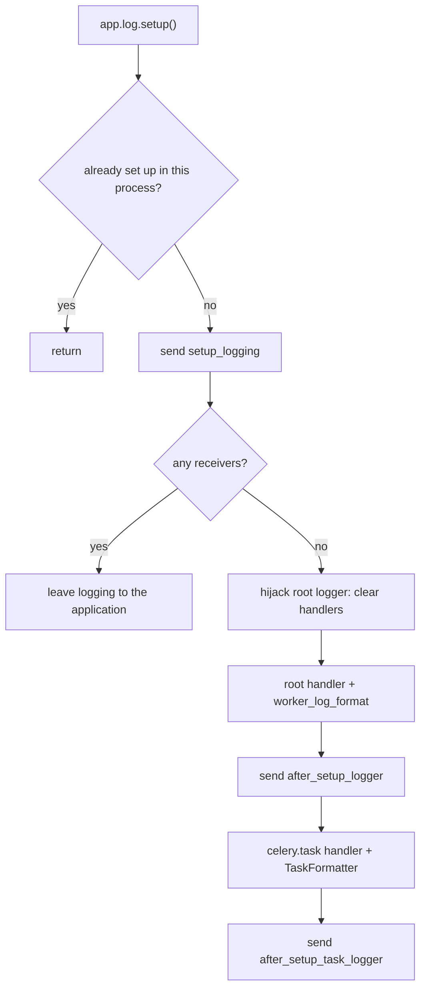

## Overview

Celery uses the standard `logging` module with two logger trees: `celery`, for Celery's own messages, and `celery.task`, for messages from task code. `app.log` (a `Logging` instance) configures handlers and formats for the worker and beat once per process, adds the current task's name and id to task log records, and can redirect `print` output to the log. Applications can take over logging entirely through the `setup_logging` signal.

Sources: [celery/utils/log.py:31-36](repo://celery/utils/log.py#L31-L36), [celery/app/log.py:43-56](repo://celery/app/log.py#L43-L56)

The worker calls this setup from its `on_init_blueprint` hook (see [[Worker Startup and Bootsteps]]); prefork children repeat it in their initializer (see [[Concurrency Pools]]).

Sources: [celery/apps/worker.py:184-190](repo://celery/apps/worker.py#L184-L190), [celery/concurrency/prefork.py:58-66](repo://celery/concurrency/prefork.py#L58-L66)

## Loggers

### The hierarchy

`get_logger(name)` returns a standard logger but re-parents it under the `celery` logger unless it is already a direct child of the root, so all of Celery's internal loggers can be configured through `celery`. `worker_logger` is `celery.worker`, and `task_logger` is `celery.task`.

Sources: [celery/utils/log.py:72-106](repo://celery/utils/log.py#L72-L106)

### Task loggers

`get_task_logger(name)` is what task modules should use: it returns the logger for `name` re-parented under `celery.task`, so it gets the task log format with the task name and id. `celery` and `celery.task` themselves are reserved names and raise `RuntimeError`.

Sources: [celery/utils/log.py:109-113](repo://celery/utils/log.py#L109-L113), [celery/utils/log.py:29](repo://celery/utils/log.py#L29)

```python
from celery.utils.log import get_task_logger

logger = get_task_logger(__name__)

@app.task
def add(x, y):
    logger.info('Adding %s + %s', x, y)
    return x + y
```

Sources: [celery/utils/log.py:109-113](repo://celery/utils/log.py#L109-L113)

## Setting up logging

### Logging.setup

`app.log.setup(loglevel, logfile, redirect_stdouts, redirect_level, colorize, hostname)` configures the logging subsystem, optionally redirects stdout and stderr, and exports `CELERY_LOG_LEVEL` and `CELERY_LOG_FILE` so child processes can repeat the setup. It also makes Celery's deprecation warnings always visible and routes Python warnings into logging.

Sources: [celery/app/log.py:58-72](repo://celery/app/log.py#L58-L72)

### setup_logging_subsystem

Logging is configured only once per process (`Logging._setup`). The steps:

Sources: [celery/app/log.py:83-92](repo://celery/app/log.py#L83-L92)

1. Expand node-name placeholders in the log file name (`%n`, `%h`, `%d`, `%i` for the pool process index, `%I` for it with a dash prefix).
2. Reset billiard's multiprocessing logger.
3. Send `setup_logging`. If any receiver is connected, stop: the application has configured logging itself.
4. Otherwise, with `worker_hijack_root_logger` (on by default), remove existing handlers from the root, `celery`, `celery.task` and `celery.redirected` loggers.
5. Add a handler with `worker_log_format` to the root logger and set its level; configure billiard's multiprocessing logger the same way, at ERROR unless the `MP_LOG` environment variable is set.
6. Send `after_setup_logger`, then configure the task logger with `worker_task_log_format` and send `after_setup_task_logger`.
7. Export the level, file and format in `_MP_FORK_*` environment variables, so logging works in multiprocessing children before `Process.run`.

Sources: [celery/app/log.py:83-145](repo://celery/app/log.py#L83-L145), [celery/utils/nodenames.py:83-113](repo://celery/utils/nodenames.py#L83-L113)



Sources: [celery/app/log.py:83-145](repo://celery/app/log.py#L83-L145), [celery/app/log.py:154-178](repo://celery/app/log.py#L154-L178)

When the log file contains `%i`, each prefork child writes to its own file; the child initializer clears the "already set up" flag so the child configures logging again with its own index.

Sources: [celery/concurrency/prefork.py:58-66](repo://celery/concurrency/prefork.py#L58-L66)

### Handlers

`setup_handlers` skips loggers that already have a real handler (unless that handler was a rudimentary one). Otherwise it adds a `StreamHandler` for `sys.__stderr__` or an open stream, or a `WatchedFileHandler` for a file name — which reopens the file when log rotation moves it — with the formatter for that logger.

Sources: [celery/app/log.py:216-238](repo://celery/app/log.py#L216-L238)

## Formats and colours

| Setting | Default |
| --- | --- |
| `worker_log_format` | `[%(asctime)s: %(levelname)s/%(processName)s] %(message)s` |
| `worker_task_log_format` | `[%(asctime)s: %(levelname)s/%(processName)s] %(task_name)s[%(task_id)s]: %(message)s` |
| `worker_log_color` | Auto: only when logging to a terminal |
| `worker_hijack_root_logger` | `True` |
| `worker_redirect_stdouts`, `worker_redirect_stdouts_level` | `True`, `WARNING` |

Sources: [celery/app/defaults.py:14-18](repo://celery/app/defaults.py#L14-L18), [celery/app/defaults.py:346-370](repo://celery/app/defaults.py#L346-L370)

`TaskFormatter` fills `task_id` and `task_name` from the currently executing task, or `???` outside a task. `ColorFormatter` colours DEBUG blue, WARNING yellow, ERROR red and CRITICAL magenta; if colouring fails on an unrepresentable message, it logs a placeholder instead of breaking the handler. Colour is used only when no log file is set, stderr is a terminal, and the platform is not Windows, unless forced on or off.

Sources: [celery/app/log.py:30-40](repo://celery/app/log.py#L30-L40), [celery/utils/log.py:123-175](repo://celery/utils/log.py#L123-L175), [celery/app/log.py:197-214](repo://celery/app/log.py#L197-L214)

## Redirecting stdout and stderr

With `worker_redirect_stdouts`, the worker replaces `sys.stdout` and `sys.stderr` with a `LoggingProxy` that writes each line to the `celery.redirected` logger at `worker_redirect_stdouts_level`, so `print` in tasks ends up in the log. The proxy guards against recursion when the logger itself writes to stderr, prints straight to the real stderr while in a signal handler, ignores `flush`, and wraps the logger's handlers so their internal errors go to `sys.__stderr__` instead of looping back through the proxy.

Sources: [celery/app/log.py:74-81](repo://celery/app/log.py#L74-L81), [celery/app/log.py:180-195](repo://celery/app/log.py#L180-L195), [celery/utils/log.py:178-260](repo://celery/utils/log.py#L178-L260)

The worker only redirects when it did not hand logging to a `setup_logging` receiver.

Sources: [celery/apps/worker.py:139-140](repo://celery/apps/worker.py#L139-L140)

## Taking over logging

Connecting any receiver to `setup_logging` disables Celery's configuration: the receiver gets `loglevel`, `logfile`, `format` and `colorize` and is expected to configure logging itself, for example with `logging.config.dictConfig`. To keep Celery's setup and only adjust it, connect to `after_setup_logger` or `after_setup_task_logger`, which receive the configured logger. See [[Signals]].

Sources: [celery/app/log.py:98-127](repo://celery/app/log.py#L98-L127), [celery/app/log.py:176-180](repo://celery/app/log.py#L176-L180)

```python
from celery.signals import setup_logging

@setup_logging.connect
def configure_logging(**kwargs):
    import logging.config
    logging.config.dictConfig(MY_LOGGING_CONFIG)
```

Sources: [celery/app/log.py:98-103](repo://celery/app/log.py#L98-L103)

## Logging from tasks in the tracer

Task outcomes are logged by the tracer with structured context: success at INFO with runtime and return value, failures with a policy chosen by exception type, and every record carries an `extra={'data': context}` dict for handlers that want the fields. See [[Task Execution and Tracing]].

Sources: [celery/app/trace.py:123-128](repo://celery/app/trace.py#L123-L128), [celery/app/trace.py:284-311](repo://celery/app/trace.py#L284-L311)
