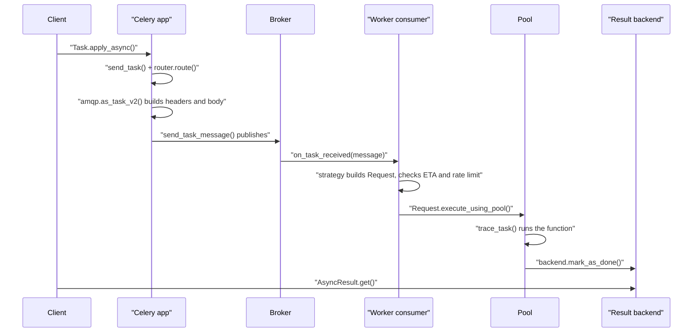

## Overview

Celery is a distributed task queue. A client process turns a function call into a message and publishes it to a broker; worker processes consume those messages, run the function, and optionally store its return value in a result backend where the client can read it. The package exposes its public names (`Celery`, `Task`, `shared_task`, `chain`, `group`, `chord`, `signature` and others) from the top-level `celery` module, which is rebuilt by `local.recreate_module` so that each name is imported only on first attribute access.

Sources: [celery/__init__.py:36-41](repo://celery/__init__.py#L36-L41), [celery/__init__.py:149-180](repo://celery/__init__.py#L149-L180)

Everything starts from an application object, `Celery`. It owns the configuration, the task registry, and the factories for the parts that talk to the outside world: `amqp_cls` builds messages and producers, `events_cls` sends monitoring events, `control_cls` sends remote-control commands, `log_cls` sets up logging, and the result backend is resolved from the `result_backend` setting. Each of these is named by a dotted path, so a subclass or a constructor argument can swap one out.

Sources: [celery/app/base.py:252-339](repo://celery/app/base.py#L252-L339), [celery/app/base.py:1224-1228](repo://celery/app/base.py#L1224-L1228)

## The parts

| Area | What it does | Page |
| --- | --- | --- |
| Application | The `Celery` object, task decorators, lazy finalization, current-app proxies | [[The Celery Application]] |
| Configuration | Setting names and defaults, `config_from_object`, loaders | [[Configuration and Loaders]] |
| Tasks | The `Task` class, its options and request context | [[Defining Tasks]] |
| Retries | `Task.retry`, `autoretry_for`, control-flow exceptions | [[Retries and Task Errors]] |
| Publishing | `apply_async`, `send_task`, the task message protocol | [[Calling Tasks and the Message Protocol]] |
| Routing | Queues, exchanges, `task_routes` | [[Queues and Routing]] |
| Worker | `WorkController` and the bootsteps that assemble it | [[Worker Startup and Bootsteps]] |
| Shutdown | Signal handlers, warm/cold/soft shutdown | [[Worker Signals and Shutdown]] |
| Consumer | Broker connection, event loop, prefetch | [[The Consumer and Message Loop]] |
| Consumer steps | Mingle, gossip, heartbeats, control, delayed delivery | [[Consumer Bootsteps]] |
| Requests | Per-message strategy, ETA, rate limits, revocation | [[Task Requests and Strategies]] |
| Tracing | Running the task body and recording its outcome | [[Task Execution and Tracing]] |
| Pools | prefork, threads, solo, eventlet, gevent | [[Concurrency Pools]] |
| Prefork internals | `AsynPool` and its child processes | [[The Prefork Pool Internals]] |
| Remote control | `inspect` and `control` commands over the pidbox | [[Remote Control and Inspection]] |
| Results | `AsyncResult`, `GroupResult`, task states | [[Results and AsyncResult]] |
| Backends | The backend interface and the concrete stores | [[Result Backend Interface]], [[Redis and RPC Result Backends]], [[Storage Result Backends]] |
| Canvas | Signatures and workflow primitives | [[Signatures]], [[Chains]], [[Groups and Chords]], [[Stamping]] |
| Periodic tasks | `celery beat` and schedule types | [[Periodic Tasks with Beat]], [[Schedules: Interval, Crontab and Solar]] |
| Monitoring | Events, cluster state, signals, logging | [[Events and Monitoring]], [[Cluster State from Events]], [[Signals]], [[Logging]] |
| Operations | The `celery` command, `celery multi`, daemonizing | [[Command-Line Interface]], [[Running Multiple Workers]], [[Daemonization and Platform Helpers]] |
| Extensions | Message signing, Django, testing | [[Message Signing]], [[Django Integration]], [[Testing and Debugging Tasks]] |

Sources: [celery/app/base.py:310-318](repo://celery/app/base.py#L310-L318), [celery/worker/worker.py:75-88](repo://celery/worker/worker.py#L75-L88)

## A task's life

Sources: [celery/app/task.py:680-708](repo://celery/app/task.py#L680-L708), [celery/app/base.py:944-1041](repo://celery/app/base.py#L944-L1041), [celery/worker/consumer/consumer.py:723-786](repo://celery/worker/consumer/consumer.py#L723-L786), [celery/worker/request.py:341-372](repo://celery/worker/request.py#L341-L372)

1. `Task.apply_async` checks the arguments against the function's signature, merges the task's default options, and either runs the task in-process when `task_always_eager` is set or calls `Celery.send_task`. See [[Calling Tasks and the Message Protocol]].
2. `send_task` asks the router for the destination (see [[Queues and Routing]]), turns `expires` into a broker TTL, records the parent and root task ids when called from inside another task, and builds the message with `amqp.create_task_message`.
3. `send_task_message` resolves the exchange and routing key, fires `before_task_publish`, and publishes with the configured serializer and retry policy.
4. In the worker, the consumer's `on_task_received` reads the task name from the `task` header and hands the message to that task's strategy. See [[The Consumer and Message Loop]].
5. The strategy creates a `Request`, drops it if revoked or expired, defers it on the timer if it has an ETA, and passes it through the task's rate-limit bucket. See [[Task Requests and Strategies]].
6. `WorkController._process_task` calls `Request.execute_using_pool`, which submits the trace function to the pool with the request's time limits and callbacks. See [[Concurrency Pools]].
7. `trace_task` pushes the request context, runs the function, applies callbacks and the next chain step, and stores the result. See [[Task Execution and Tracing]].
8. The client's `AsyncResult` reads the stored state from the backend. See [[Results and AsyncResult]] and [[Result Backend Interface]].

Sources: [celery/app/task.py:661-708](repo://celery/app/task.py#L661-L708), [celery/app/amqp.py:506-604](repo://celery/app/amqp.py#L506-L604), [celery/worker/strategy.py:132-208](repo://celery/worker/strategy.py#L132-L208), [celery/worker/worker.py:223-231](repo://celery/worker/worker.py#L223-L231), [celery/app/trace.py:563-640](repo://celery/app/trace.py#L563-L640)

## Design decisions

### Lazy tasks and lazy configuration

Decorating a function with `@app.task` does not build the task class at once. Unless the app is already finalized, the decorator returns a `PromiseProxy` and queues it on `app._pending`; `finalize()` evaluates every pending proxy and binds every registered task to the app. The decorator's docstring gives the reason: for custom apps the act of creating the task is deferred until the task is used or the registry is accessed, so tasks can be declared before the app is configured.

Sources: [celery/app/base.py:515-585](repo://celery/app/base.py#L515-L585), [celery/app/base.py:657-677](repo://celery/app/base.py#L657-L677)

Configuration is deferred the same way. `app.conf` starts as a `Settings` object wrapping a `PendingConfiguration`; reading the first key calls `_finalize_pending_conf`, which sends `on_configure`, loads `config_source` through the loader, and merges it with the values passed to the constructor. Details are on [[Configuration and Loaders]].

Sources: [celery/app/base.py:395-400](repo://celery/app/base.py#L395-L400), [celery/app/base.py:1230-1280](repo://celery/app/base.py#L1230-L1280)

### Message protocol version 2

By default a task message keeps its metadata (task name, id, ETA, retries, time limits, parent and root ids) in the message headers and puts only `(args, kwargs, embed)` in the body. The consumer can therefore pick a strategy from `message.headers['task']` without decoding the body; its comment notes that with protocol 2 the worker "will defer deserializing the message body to the pool". Protocol 1, which puts everything in the body, is still accepted and converted.

Sources: [celery/app/amqp.py:326-418](repo://celery/app/amqp.py#L326-L418), [celery/worker/consumer/consumer.py:731-748](repo://celery/worker/consumer/consumer.py#L731-L748)

### Bootsteps

The worker is not one class with a fixed start sequence. `WorkController` is "a bare-bones worker" whose components (hub, pool, timer, state database, consumer, autoscaler, embedded beat) are bootsteps in a blueprint; each step declares what it requires and the blueprint orders them. Applications add their own steps through `app.steps['worker']` and `app.steps['consumer']`. See [[Worker Startup and Bootsteps]].

Sources: [celery/worker/worker.py:1-12](repo://celery/worker/worker.py#L1-L12), [celery/worker/worker.py:75-88](repo://celery/worker/worker.py#L75-L88), [celery/worker/worker.py:131-140](repo://celery/worker/worker.py#L131-L140)

### Pluggable pools and backends

Execution pools and result backends are both looked up by alias. `celery.concurrency.ALIASES` maps `prefork`, `eventlet`, `gevent`, `solo` and `threads` to their pool classes, and `CELERY_CUSTOM_WORKER_POOL` adds an out-of-tree pool under the name `custom`. `BACKEND_ALIASES` maps URL schemes such as `redis`, `rpc` and `db` to backend classes, and `by_url` splits a `scheme+url` form so the scheme picks the class.

Sources: [celery/concurrency/__init__.py:11-47](repo://celery/concurrency/__init__.py#L11-L47), [celery/app/backends.py:15-69](repo://celery/app/backends.py#L15-L69)

### Callbacks before the stored result

When a task succeeds, the tracer sends its linked callbacks and the next step of its chain before it calls `mark_as_done`. The comment explains that callbacks "must be applied before the result is stored, so that result.children is populated" — a client that sees the result as ready can already follow it to its children.

Sources: [celery/app/trace.py:608-627](repo://celery/app/trace.py#L608-L627)
