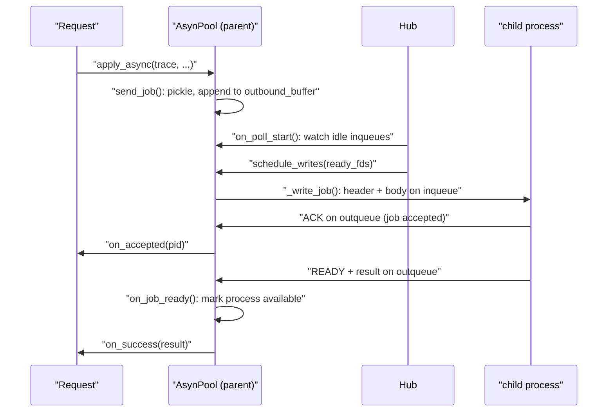

## Overview

When the worker runs its event loop, the prefork pool is an `AsynPool`: a subclass of billiard's process pool that never blocks the worker's main thread. Its module docstring names the three problems it solves — starting child processes and keeping them running, sending jobs to them and receiving results, and shutting the whole thing down safely. Instead of billiard's shared queue and helper threads, every child gets its own pipes, and the parent reads and writes them as non-blocking file descriptors registered with the kombu hub.

Sources: [celery/concurrency/asynpool.py:1-14](repo://celery/concurrency/asynpool.py#L1-L14), [celery/concurrency/prefork.py:104-118](repo://celery/concurrency/prefork.py#L104-L118)

The pool's public face — `TaskPool`, the child initializer, and how it compares with the other pools — is on [[Concurrency Pools]]. This page follows a job from the parent's outbound buffer into a child and its result back.

Sources: [celery/concurrency/asynpool.py:414-488](repo://celery/concurrency/asynpool.py#L414-L488)

## Per-process queues

`AsynPool.__init__` creates one set of queues per process in advance, before any child exists. `create_process_queues` builds an *inqueue* (parent writes jobs, child reads), an *outqueue* (child writes results, parent reads) and, with `synack`, a *synqueue* for acknowledgements. The parent's ends are non-blocking and the child's ends blocking; the comment notes that pipes must be made non-blocking when they are created.

Sources: [celery/concurrency/asynpool.py:428-447](repo://celery/concurrency/asynpool.py#L428-L447), [celery/concurrency/asynpool.py:1153-1169](repo://celery/concurrency/asynpool.py#L1153-L1169)

The pool keeps several indexes keyed by file descriptor: `_fileno_to_inq`, `_fileno_to_outq` and `_fileno_to_synq` map an fd to its process; `_all_inqueues` holds the inqueues of processes ready for work; `_active_writes` the fds currently being written; `_busy_workers` the inqueues of processes running a job; and `outbound_buffer` the jobs waiting to be written. Because file descriptors are reused after a process exits, removal from these indexes always checks that the fd still belongs to the same process.

Sources: [celery/concurrency/asynpool.py:449-488](repo://celery/concurrency/asynpool.py#L449-L488), [celery/concurrency/asynpool.py:663-682](repo://celery/concurrency/asynpool.py#L663-L682)

## Starting children

Before each child is created the pool sends `worker_before_create_process` and runs `gc.collect()` (Issue #2927). A new child's `Worker.on_loop_start` sends a `WORKER_UP` message on its outqueue when it is ready to accept work.

Sources: [celery/concurrency/asynpool.py:490-493](repo://celery/concurrency/asynpool.py#L490-L493), [celery/concurrency/asynpool.py:243-250](repo://celery/concurrency/asynpool.py#L243-L250)

`on_process_up` registers the child's outqueue with the hub, starts watching its sentinel, and puts it in `_waiting_to_start`. Only when `WORKER_UP` arrives does `on_process_alive` add the inqueue to `_all_inqueues`, so no job is written to a process that is not yet reading. If the message does not come within `worker_proc_alive_timeout` (4 seconds by default), `verify_process_alive` logs "Timed out waiting for UP message" and kills the process with signal 9, hoping the replacement will start.

Sources: [celery/concurrency/asynpool.py:610-659](repo://celery/concurrency/asynpool.py#L610-L659), [celery/concurrency/asynpool.py:1171-1185](repo://celery/concurrency/asynpool.py#L1171-L1185), [celery/concurrency/asynpool.py:73-74](repo://celery/concurrency/asynpool.py#L73-L74)

`_track_child_process` registers a duplicate of each process's sentinel fd with the hub; when it becomes readable the process has exited and `maintain_pool` replaces it. The comment explains the duplicate: once the original fd is closed it cannot be unregistered from epoll, which would leave a 100% CPU poll loop.

Sources: [celery/concurrency/asynpool.py:495-520](repo://celery/concurrency/asynpool.py#L495-L520)

## Registering with the event loop

`register_with_event_loop` wires the pool into the hub: the result handler, the time-limit handlers, the process handlers and the write handlers; a sentinel watch for every child; a reader on every outqueue; `maintain_pool` every 5 seconds; and `on_poll_start` on each hub tick — added only once, so a consumer restart after a connection error does not register it twice.

Sources: [celery/concurrency/asynpool.py:522-547](repo://celery/concurrency/asynpool.py#L522-L547), [celery/concurrency/asynpool.py:1415-1417](repo://celery/concurrency/asynpool.py#L1415-L1417)

## Writing jobs

### Queueing

`apply_async` from billiard ends in `send_job`, which pickles the job tuple, prefixes it with a 4-byte big-endian length, stores both as memoryviews on the job and appends the job to `outbound_buffer`.

Sources: [celery/concurrency/asynpool.py:876-885](repo://celery/concurrency/asynpool.py#L876-L885)

### Choosing a process

On every loop iteration `on_poll_start` decides whether to watch the idle inqueues for writability. With the fair strategy it does so only if jobs are waiting and some process is not busy; with the fast strategy whenever jobs are waiting. Otherwise it removes the writers, because an inqueue is writable whenever its buffer has one free byte and would wake the loop constantly. The writable fds are delivered together to `schedule_writes` (the hub's consolidate callback).

Sources: [celery/concurrency/asynpool.py:763-781](repo://celery/concurrency/asynpool.py#L763-L781)

`schedule_writes` walks the ready fds starting at `total_writes % len(ready_fds)` — the comment notes this is about 30% faster than shuffling and distributes writes more evenly. It skips fds already being written, and with the fair strategy fds whose process is busy. For the next job in the buffer it records the target process in `job._scheduled_for`, creates a `_write_job` coroutine, marks the fd active and the process busy, and tries to write at once, registering the coroutine as a hub writer if the pipe is full. When the buffer is empty it removes all inactive writers.

Sources: [celery/concurrency/asynpool.py:796-874](repo://celery/concurrency/asynpool.py#L796-L874)

### Scheduling strategies

| `-O` value | Constant | Behaviour |
| --- | --- | --- |
| `fair` (default), `default`, none | `SCHED_STRATEGY_FAIR` | Write only to processes not currently running a job |
| `fast`, `fcfs` | `SCHED_STRATEGY_FCFS` | Write to any writable inqueue, even if the process is busy |

Sources: [celery/concurrency/asynpool.py:76-86](repo://celery/concurrency/asynpool.py#L76-L86), [celery/concurrency/asynpool.py:739](repo://celery/concurrency/asynpool.py#L739)

With `fair`, a job never waits in the pipe of a process stuck on a long task. With `fast`, jobs may be buffered behind a long task while other processes are idle. `on_job_ready` marks a process available again when its result arrives.

Sources: [celery/concurrency/asynpool.py:607-608](repo://celery/concurrency/asynpool.py#L607-L608), [celery/concurrency/asynpool.py:828-830](repo://celery/concurrency/asynpool.py#L828-L830)

### The write coroutine

`_write_job` writes the header and then the body with `send_job_offset`, yielding whenever the pipe would block. After more than 100 consecutive write errors it calls `on_not_recovering`, which logs "Process inqueue damaged", terminates the process and puts the job back. In all cases it removes the writer, counts the write in `write_stats` for the process, and frees the fd.

Sources: [celery/concurrency/asynpool.py:895-942](repo://celery/concurrency/asynpool.py#L895-L942), [celery/concurrency/asynpool.py:887-893](repo://celery/concurrency/asynpool.py#L887-L893)

`_put_back` returns a job to the front of the buffer — unless it was terminated or its task id is in the revoked set, in which case it is acknowledged and marked terminated instead of being written again.

Sources: [celery/concurrency/asynpool.py:744-755](repo://celery/concurrency/asynpool.py#L744-L755)

## Reading results

The `ResultHandler` reads each outqueue as a coroutine: `_recv_message` reads the 4-byte length, then the body, yielding on `EAGAIN`/`EINTR`, unpickles it and passes it to `on_state_change`, which dispatches to billiard's handlers (job accepted, ready, and the extra `WORKER_UP`). A read of zero bytes raises `EOFError` (or `OSError` mid-message), and the fd is removed from the hub.

Sources: [celery/concurrency/asynpool.py:253-342](repo://celery/concurrency/asynpool.py#L253-L342)

Sources: [celery/concurrency/asynpool.py:763-874](repo://celery/concurrency/asynpool.py#L763-L874), [celery/concurrency/asynpool.py:876-885](repo://celery/concurrency/asynpool.py#L876-L885), [celery/concurrency/asynpool.py:263-342](repo://celery/concurrency/asynpool.py#L263-L342)

## Time limits

`_create_timelimit_handlers` schedules timers on the hub when a job starts: a soft-limit timer that, when it fires, schedules the hard timer for the remaining time and asks billiard to raise `SoftTimeLimitExceeded` in the child; or, with only a hard limit, the hard timer directly, which kills the process. The timers are cancelled when the job finishes, and are kept in a `WeakValueDictionary` keyed by job.

Sources: [celery/concurrency/asynpool.py:549-605](repo://celery/concurrency/asynpool.py#L549-L605), [celery/concurrency/asynpool.py:475-480](repo://celery/concurrency/asynpool.py#L475-L480)

## When a process exits

`on_process_down` flushes any results still in the dead process's outqueue, removes its fds from every index (checking ownership, since fds may already be reused), discards it from the busy and waiting sets and stops watching its sentinel.

Sources: [celery/concurrency/asynpool.py:684-714](repo://celery/concurrency/asynpool.py#L684-L714), [celery/concurrency/asynpool.py:1283-1317](repo://celery/concurrency/asynpool.py#L1283-L1317)

For each job assigned to it, `on_job_process_down` distinguishes two cases. If the job was being written to the process (`_write_to`), `on_partial_read` puts it back if it had not been accepted, marks the process dead and replaces its queues with fresh pipes — the comment explains that message boundaries in the old pipes can no longer be trusted. If the job was only scheduled for the process, it is simply put back. A job that the process had accepted and was running is reported through `on_job_process_lost` as a lost worker, which the request turns into `WorkerLostError` (see [[Retries and Task Errors]]).

Sources: [celery/concurrency/asynpool.py:1187-1204](repo://celery/concurrency/asynpool.py#L1187-L1204), [celery/concurrency/asynpool.py:1319-1370](repo://celery/concurrency/asynpool.py#L1319-L1370)

Process recycling with `worker_max_tasks_per_child` and `worker_max_memory_per_child` is implemented in billiard; the worker's `Pool` step passes both, together with `worker_lost_wait`, when it creates the pool.

Sources: [celery/worker/components.py:155-172](repo://celery/worker/components.py#L155-L172)

## Flushing after a connection loss

When the consumer loses its broker connection it calls `flush`. Unacknowledged messages will be redelivered by the broker, so jobs not yet accepted by a child are cancelled (with `synack`) or discarded, and the outbound buffer is cleared. Writes already started must still finish to keep message boundaries intact, so `flush` keeps advancing each active writer with short sleeps, discarding writers that have not started and jobs whose process has died; pending acknowledgement writes are always completed, since the child would otherwise hang waiting for them. Finally it trims `_busy_workers` to processes still running an accepted job, so the fair scheduler keeps avoiding them after the reconnect.

Sources: [celery/concurrency/asynpool.py:999-1084](repo://celery/concurrency/asynpool.py#L999-L1084), [celery/concurrency/asynpool.py:1085-1131](repo://celery/concurrency/asynpool.py#L1085-L1131), [celery/worker/consumer/consumer.py:532-547](repo://celery/worker/consumer/consumer.py#L532-L547)

## Statistics

`human_write_stats` reports the total writes, the share of writes per process, the scheduling strategy and how many inqueues are active; it appears in the pool section of `celery inspect stats`.

Sources: [celery/concurrency/asynpool.py:1206-1227](repo://celery/concurrency/asynpool.py#L1206-L1227), [celery/concurrency/prefork.py:200-212](repo://celery/concurrency/prefork.py#L200-L212)
