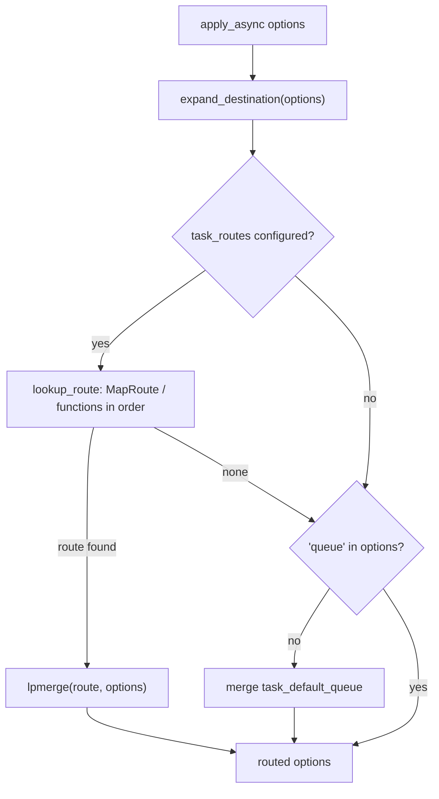

## Overview

Routing answers two questions with one table. On the client, it decides which queue, exchange and routing key a task message is published with. On the worker, it decides which queues are consumed. Both use `app.amqp.queues`, a `Queues` mapping from queue name to kombu `Queue` declaration built from the `task_queues` setting, and the client additionally uses `app.amqp.router`, built from `task_routes`.

Sources: [celery/app/amqp.py:608-634](repo://celery/app/amqp.py#L608-L634)

`send_task` calls `router.route(options, name, args, kwargs, task_type)` before building the message; `send_task_message` then turns the chosen queue into an exchange and routing key, as described on [[Calling Tasks and the Message Protocol]].

Sources: [celery/app/base.py:927-929](repo://celery/app/base.py#L927-L929)

## The Queues mapping

### Default queue

`AMQP.Queues` fills in the settings. When `task_queues` is empty, it creates a single queue named `task_default_queue` (`celery`) bound to the default exchange with the default routing key, adding `x-queue-type: quorum` when `task_default_queue_type` is `quorum`. The default exchange is an `Exchange(task_default_exchange, task_default_exchange_type)`; the exchange name and routing key fall back to the default queue's name, and the exchange type defaults to `direct`.

Sources: [celery/app/amqp.py:273-306](repo://celery/app/amqp.py#L273-L306), [celery/app/amqp.py:644-647](repo://celery/app/amqp.py#L644-L647), [celery/app/utils.py:113-125](repo://celery/app/utils.py#L113-L125)

### Adding queues

The `Queues` constructor accepts `Queue` objects or, in the old style, dicts of options, and remembers the full set as the default set to consume from. `add` takes a `Queue` or a name plus options (where `binding_key` is accepted as the old name for `routing_key`, and the routing key defaults to the queue name). `_add` gives a queue without an exchange the default exchange, without a routing key the default routing key, and adds `x-max-priority` from `task_queue_max_priority` unless the queue sets one. Queues with an `alias` are also reachable by that alias.

Sources: [celery/app/amqp.py:41-142](repo://celery/app/amqp.py#L41-L142)

### Missing queues

Looking up an unknown name calls `__missing__`. With `create_missing` (the `task_create_missing_queues` setting, on by default) it adds a new queue named after the key, bound to an exchange of the same name and with the name as routing key; otherwise it raises `KeyError`. `task_create_missing_queue_type` makes new queues `quorum` (any other value than `classic` or `quorum` raises `ValueError`), and `task_create_missing_queue_exchange_type` sets the new exchange's type.

Sources: [celery/app/amqp.py:99-102](repo://celery/app/amqp.py#L99-L102), [celery/app/amqp.py:201-216](repo://celery/app/amqp.py#L201-L216), [celery/app/defaults.py:278-280](repo://celery/app/defaults.py#L278-L280)

### Selecting queues to consume

`consume_from` is the subset a worker consumes. `select(include)` replaces it with the named queues (`celery worker -Q`), `deselect(exclude)` removes names (`-X`), and `select_add` adds a queue that stays active even after a selection. `WorkController.setup_queues` applies `-Q` and `-X`, turning an unknown name into `ImproperlyConfigured`, and with `worker_direct` enabled adds the worker's own queue `<nodename>.dq2` on the `C.dq2` exchange, so a task can be routed to one specific worker.

Sources: [celery/app/amqp.py:159-223](repo://celery/app/amqp.py#L159-L223), [celery/worker/worker.py:167-181](repo://celery/worker/worker.py#L167-L181), [celery/utils/nodenames.py:38-53](repo://celery/utils/nodenames.py#L38-L53)

The worker's task consumer subscribes to `consume_from` through `AMQP.TaskConsumer`, which also applies `accept_content`.

Sources: [celery/app/amqp.py:317-324](repo://celery/app/amqp.py#L317-L324)

## task_routes

`prepare(task_routes)` turns the setting into a list of routers. A dict, list or tuple becomes a `MapRoute`; a string is a dotted path to a router function or class, imported lazily on first use (pre-4.0 classes with `route_for_task` are instantiated). A single value is wrapped in a list. The table is built on first access to `app.amqp.routes` and rebuilt, together with the router, whenever `app.conf.update` touches `task_routes`.

Sources: [celery/app/routes.py:114-136](repo://celery/app/routes.py#L114-L136), [celery/app/amqp.py:314-315](repo://celery/app/amqp.py#L314-L315), [celery/app/amqp.py:620-624](repo://celery/app/amqp.py#L620-L624), [celery/app/amqp.py:659-663](repo://celery/app/amqp.py#L659-L663)

`MapRoute` splits its keys into exact names and patterns. A key that is a compiled regular expression is used as is; a key containing `*` is translated from a glob with `fnmatch.translate`. Lookup tries the exact name first, then the patterns in insertion order. A route value may be a dict of options or a plain queue name, which becomes `{'queue': name}`.

Sources: [celery/app/routes.py:26-53](repo://celery/app/routes.py#L26-L53)

```python
app.conf.task_routes = {
    'feeds.tasks.import_feed': {'queue': 'feeds'},
    'web.*': 'web',
    re.compile(r'(image|video)\.tasks\..*'): {'queue': 'media'},
}
```

Sources: [celery/app/routes.py:29-53](repo://celery/app/routes.py#L29-L53)

A router function is called as `router(name, args, kwargs, options, task=task_type)` and returns a route or `None`; the first router to return a route wins.

Sources: [celery/app/routes.py:98-111](repo://celery/app/routes.py#L98-L111)

## Router.route

`Router.route` combines the caller's options with the routing table:

Sources: [celery/app/routes.py:56-64](repo://celery/app/routes.py#L56-L64)

1. `expand_destination(options)` replaces a `queue` given as a name with the `Queue` from the mapping, raising `QueueNotFound` if the name is unknown and missing queues are not created.
2. If routes are configured, `lookup_route` asks each router in order; a route found is expanded the same way and merged with `lpmerge(route, options)`, so the caller's own non-`None` options win over the route.
3. If no route applied and the options still have no `queue`, the default queue `task_default_queue` is merged in.

Sources: [celery/app/routes.py:66-96](repo://celery/app/routes.py#L66-L96)



Sources: [celery/app/routes.py:66-111](repo://celery/app/routes.py#L66-L111)

The comments in `expand_destination` describe the two styles: a bare queue name is convenient for direct exchanges, while a dict that names a queue can override specific things such as the routing key, which suits topic exchanges.

Sources: [celery/app/routes.py:78-96](repo://celery/app/routes.py#L78-L96)

## Quorum queues

`detect_quorum_queues(app, driver_type)` reports whether any declared queue has `x-queue-type: quorum`, and only on the `amqp` transport. Three places use it:

Sources: [celery/utils/quorum_queues.py:4-20](repo://celery/utils/quorum_queues.py#L4-L20)

| Where | Effect |
| --- | --- |
| `send_task` | Messages with `eta`/`countdown` go to the `celery_delayed_27` exchange for native delayed delivery |
| Tasks consumer step | Global QoS is disabled, so the prefetch count stays static, when `worker_detect_quorum_queues` is on |
| DelayedDelivery consumer step | Declares the delayed-delivery exchanges and bindings for the worker's queues |

Sources: [celery/app/base.py:931-961](repo://celery/app/base.py#L931-L961), [celery/worker/consumer/tasks.py:105-124](repo://celery/worker/consumer/tasks.py#L105-L124)

The consumer-side details are on [[Consumer Bootsteps]].

Sources: [celery/worker/consumer/delayed_delivery.py:60-65](repo://celery/worker/consumer/delayed_delivery.py#L60-L65)

## Related settings

| Setting | Default | Used by |
| --- | --- | --- |
| `task_queues` | `None` | `AMQP.queues` |
| `task_routes` | `None` | `AMQP.routes` |
| `task_default_queue` | `'celery'` | Default queue and fallback route |
| `task_default_queue_type` | `'classic'` | `x-queue-type` of the default queue |
| `task_default_exchange`, `task_default_exchange_type` | queue name, `'direct'` | `AMQP.default_exchange` |
| `task_default_routing_key` | queue name | Queues without a routing key |
| `task_create_missing_queues` | `True` | `Queues.__missing__` |
| `task_queue_max_priority` | `None` | `x-max-priority` |
| `worker_direct` | `False` | Per-worker `.dq2` queue |

Sources: [celery/app/defaults.py:265-308](repo://celery/app/defaults.py#L265-L308), [celery/app/defaults.py:336](repo://celery/app/defaults.py#L336)
