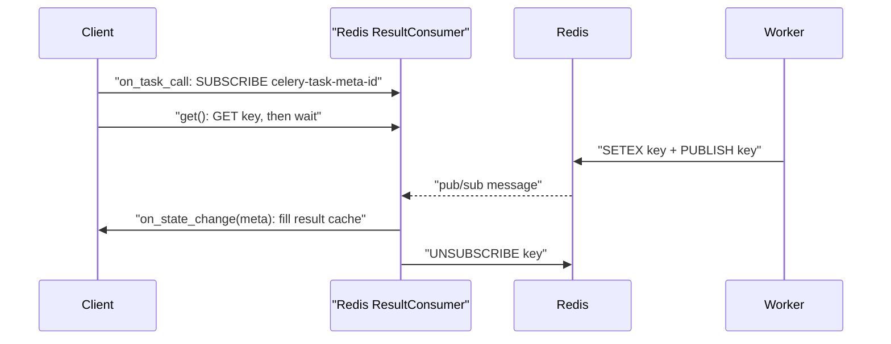

## Overview

Most result backends are polled: a client waiting on a result asks the store again every `interval` seconds. The Redis and RPC backends instead push each new state to the waiting client — Redis through pub/sub on the result key, RPC as a message on a reply queue — and both mix in `AsyncBackendMixin` and supply a `ResultConsumer` that receives those pushes. Both also set `supports_native_join`, so `GroupResult.get()` collects members in the order they finish.

Sources: [celery/backends/redis.py:204-225](repo://celery/backends/redis.py#L204-L225), [celery/backends/rpc.py:147-163](repo://celery/backends/rpc.py#L147-L163)

The shared pending-result bookkeeping, consumers and drainers are described on [[Result Backend Interface]]; how clients wait on results is on [[Results and AsyncResult]].

Sources: [celery/backends/asynchronous.py:225-313](repo://celery/backends/asynchronous.py#L225-L313)

## Redis

### Connection parameters

`RedisBackend` (aliases `redis` and `rediss`) requires the `redis` package. It builds connection parameters from the `redis_*` settings — host (default `localhost`), port (6379), db (0), password, username, `redis_max_connections`, socket and connect timeouts, retry on timeout, keepalive, client name, health check interval and an optional `redis.CredentialProvider` (which drops username and password) — and lets the URL override them.

Sources: [celery/backends/redis.py:227-292](repo://celery/backends/redis.py#L227-L292)

`_params_from_url` reads host, port, credentials and the database number from the URL path, supports `socket://` Unix sockets, and turns query parameters into connection options. TLS comes from `rediss://` with `ssl_*` query parameters or from the `redis_backend_use_ssl` dict; SSL parameters in the query of a plain `redis://` URL raise `ValueError`. `ssl_cert_reqs` must be one of `CERT_REQUIRED`, `CERT_OPTIONAL`, `CERT_NONE` (or the lower-case words), and the weaker two log warnings.

Sources: [celery/backends/redis.py:294-327](repo://celery/backends/redis.py#L294-L327), [celery/backends/redis.py:388-460](repo://celery/backends/redis.py#L388-L460)

The connection errors that count as transient come from kombu's Redis transport plus any `additional_connection_errors` listed in `result_backend_transport_options`; invalid entries are ignored with a warning. `exception_safe_to_retry` returns true for these, so `result_backend_always_retry` retries them.

Sources: [celery/backends/redis.py:333-385](repo://celery/backends/redis.py#L333-L385), [celery/backends/redis.py:487-499](repo://celery/backends/redis.py#L487-L499)

### Storing and publishing

Redis is a key/value backend: task results live under `celery-task-meta-<id>`. `set` refuses values over 512 MB with `BackendStoreError`, then runs `_set` under `ensure`, which retries on connection errors with the backend's retry policy (overridable through `retry_policy` in the transport options) and logs each lost connection. `_set` writes the key with `SETEX` when results expire (or `SET`) and `PUBLISH`es the same value on a channel named after the key, in one pipeline.

Sources: [celery/backends/redis.py:505-539](repo://celery/backends/redis.py#L505-L539)

Because Redis expires keys itself, the backend sets `supports_autoexpire` and needs no periodic cleanup task.

Sources: [celery/backends/redis.py:217-218](repo://celery/backends/redis.py#L217-L218)

### The pub/sub consumer

The Redis `ResultConsumer` subscribes to the result key of each pending task. `on_task_call` subscribes as soon as a task is sent (except inside a pool process where joins would block), so the result cannot be published before the client listens. `drain_events` reads one pub/sub message, decodes it and passes it to `on_state_change`; once a ready state arrives the consumer unsubscribes from that key.

Sources: [celery/backends/redis.py:77-147](repo://celery/backends/redis.py#L77-L147), [celery/backends/redis.py:171-201](repo://celery/backends/redis.py#L171-L201), [celery/backends/redis.py:501-503](repo://celery/backends/redis.py#L501-L503)

Before waiting, `on_wait_for_pending` also reads the current value of the key with `GET`, so a result stored before the subscription is not missed, and removes buffered copies of finished results that would otherwise leak.

Sources: [celery/backends/redis.py:149-169](repo://celery/backends/redis.py#L149-L169)

On a connection error the consumer reconnects: it resets the connection pool, fetches all subscribed keys with `MGET` (states may have changed while disconnected), then opens a new pub/sub and re-subscribes. After a fork it resets the pool and closes the pub/sub so the child does not share sockets with the parent.

Sources: [celery/backends/redis.py:88-132](repo://celery/backends/redis.py#L88-L132)

Sources: [celery/backends/redis.py:134-201](repo://celery/backends/redis.py#L134-L201), [celery/backends/redis.py:532-539](repo://celery/backends/redis.py#L532-L539)

### Chords on Redis

Redis implements chords without the polling `chord_unlock` task. When the header is sent, `set_chord_size` stores the expected count under `<group key>.s`, and `apply_chord` saves the header's `GroupResult` only if some members are themselves groups, keeping the common case cheap.

Sources: [celery/backends/redis.py:570-584](repo://celery/backends/redis.py#L570-L584)

Each finished header task calls `on_chord_part_return`, which in one pipeline adds the encoded `[1, id, state, result]` to `<group key>.j` — a sorted set scored by the task's position in the group (or a list with `result_chord_ordered` off) — counts its entries, reads the extra counter `.t` (incremented by `add_to_chord` when tasks join a running chord) and the size `.s`, and refreshes their expiry. When the count reaches the size, the body is called with the results: decoded from the stored entries in group order, or by joining the saved `GroupResult` for nested groups. A failed header result raises `ChordError("Dependency <id> raised ...")`, and any error — including a failing body — is routed to `chord_error_from_stack`. The three keys are deleted at the end.

Sources: [celery/backends/redis.py:554-568](repo://celery/backends/redis.py#L554-L568), [celery/backends/redis.py:586-686](repo://celery/backends/redis.py#L586-L686)

### Sentinel

`SentinelBackend` (alias `sentinel`) accepts several `sentinel://` URLs separated by `;`, builds a `redis.sentinel.Sentinel` over all of them with `min_other_sentinels` and `sentinel_kwargs` from the transport options, and uses the connection pool of `master_for(master_name)`. TLS uses a sentinel-managed SSL connection class, and `as_uri` sanitizes every URL in the list.

Sources: [celery/backends/redis.py:715-806](repo://celery/backends/redis.py#L715-L806)

## RPC

### Results as messages

The RPC backend (`rpc://`) stores nothing. Its module docstring describes it as "RPC-style result backend, using reply-to and one queue per client". Every client process has a reply queue named after its `oid` (the app's thread oid), declared through the default exchange with `auto_delete` and the result expiry. `send_task` puts that oid in each message's `reply_to`, and `on_task_call` declares the queue before the task is sent.

Sources: [celery/backends/rpc.py:1-3](repo://celery/backends/rpc.py#L1-L3), [celery/backends/rpc.py:209-223](repo://celery/backends/rpc.py#L209-L223), [celery/backends/rpc.py:389-401](repo://celery/backends/rpc.py#L389-L401), [celery/app/base.py:1003-1009](repo://celery/app/base.py#L1003-L1009)

In the worker, `store_result` takes `reply_to` and `correlation_id` from the request, and if there is a reply address publishes `{task_id, status, result, traceback, children}` to it with the result serializer and a retry policy of 20 attempts. Results are transient by default (`persistent = False`, delivery mode 1) unless `result_persistent` is set. A task sent without a reply address stores nothing.

Sources: [celery/backends/rpc.py:225-280](repo://celery/backends/rpc.py#L225-L280), [celery/backends/rpc.py:167-195](repo://celery/backends/rpc.py#L167-L195)

### Receiving

The RPC `ResultConsumer` opens a connection and consumes the reply queue, calling `on_state_change` for every message. All tasks share the one queue, so `consume_from` only starts the consumer, and `on_result_fulfilled` does not cancel anything. On a connection error it reconnects and re-subscribes to the same queues; after a fork it drops the consumer and connection.

Sources: [celery/backends/rpc.py:41-145](repo://celery/backends/rpc.py#L41-L145), [celery/backends/rpc.py:244-247](repo://celery/backends/rpc.py#L244-L247)

When a client polls instead (`get_task_meta`), the backend reads up to 1000 messages from the reply queue with `basic_get`, keeps only the most recent message per task id (acknowledging older ones, since "backends aren't expected to keep history"), requeues the latest message for the requested task, and buffers messages for other tasks as out-of-band results. Exceeding the limit raises `BacklogLimitExceeded`.

Sources: [celery/backends/rpc.py:282-345](repo://celery/backends/rpc.py#L282-L345)

### Limitations

| Feature | RPC | Redis |
| --- | --- | --- |
| Result visible to other clients | No — only the process that sent the task | Yes |
| Results survive a client restart | No | Until `result_expires` |
| Chords | Not supported (`NotImplementedError`) | Native |
| `save_group` / `restore_group` | Not supported | Supported |
| `reload_task_result` | Not supported | Supported |

Sources: [celery/backends/rpc.py:23-29](repo://celery/backends/rpc.py#L23-L29), [celery/backends/rpc.py:214-215](repo://celery/backends/rpc.py#L214-L215), [celery/backends/rpc.py:354-374](repo://celery/backends/rpc.py#L354-L374)

The error message for chords notes that a group chained with a task is also upgraded to a chord, so that pattern needs a different backend too.

Sources: [celery/backends/rpc.py:23-29](repo://celery/backends/rpc.py#L23-L29)
