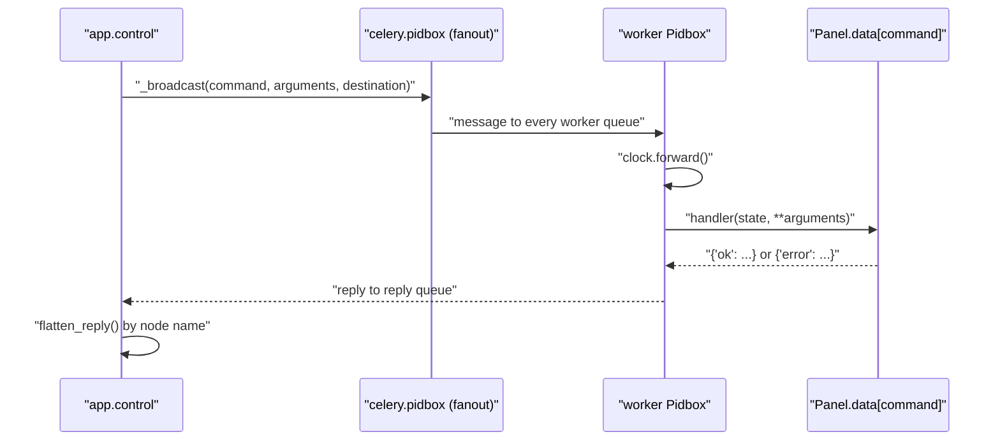

## Overview

Remote control lets any client talk to running workers through the broker: ask what they are doing (`inspect`), or change what they do (`control`) — revoke tasks, change rate and time limits, add or cancel queues, resize the pool, or shut down. Commands travel over a kombu *pidbox* mailbox: a fanout exchange to which every worker binds its own queue, with replies sent back to a per-client reply queue. The client side lives in `celery.app.control`, the worker side in `celery.worker.pidbox` and `celery.worker.control`.

Sources: [celery/app/control.py:426-452](repo://celery/app/control.py#L426-L452), [celery/worker/consumer/control.py:1-6](repo://celery/worker/consumer/control.py#L1-L6)

The mailbox is started by the consumer's `Control` step, described on [[Consumer Bootsteps]]. The worker-side effect of revocation on requests is on [[Task Requests and Strategies]].

Sources: [celery/worker/consumer/control.py:18-33](repo://celery/worker/consumer/control.py#L18-L33)

## The client: Control

### The mailbox

`app.control` is a `Control` built from configuration. Its `Mailbox` uses the `control_exchange` (default `celery`) as a fanout exchange, `accept_content` and the task serializer, the app's producer pool, and the TTL, expiry, exclusive and durable options of the control queues. `control_queue_durable` and `control_queue_exclusive` cannot both be true, since exclusive queues are deleted automatically; the constructor raises `ImproperlyConfigured`. After a fork the producer pool is dropped.

Sources: [celery/app/control.py:426-456](repo://celery/app/control.py#L426-L456), [celery/app/defaults.py:151-157](repo://celery/app/defaults.py#L151-L157)

### broadcast

Every command ends in `broadcast(command, arguments, destination, reply, timeout, limit, callback, pattern, matcher)`. It acquires a connection and calls the mailbox's `_broadcast`. `destination` restricts the command to a list of node names; `reply=True` waits up to `timeout` seconds for replies (stopping early after `limit` replies); `callback` is called for each reply as it arrives; `pattern` and `matcher` select nodes by name pattern.

Sources: [celery/app/control.py:755-790](repo://celery/app/control.py#L755-L790)

### Command helpers

`Control` wraps common commands in methods: `revoke`, `revoke_by_stamped_headers`, `terminate` (revoke with `terminate=True`), `ping`, `rate_limit`, `add_consumer`, `cancel_consumer`, `time_limit`, `enable_events`, `disable_events`, `pool_grow`, `pool_shrink`, `autoscale`, `shutdown`, `pool_restart`, `heartbeat` and `election`. `purge` is different: it does not talk to workers but empties the task queues directly through a task consumer and returns the number of messages discarded.

Sources: [celery/app/control.py:462-558](repo://celery/app/control.py#L462-L558), [celery/app/control.py:560-666](repo://celery/app/control.py#L560-L666), [celery/app/control.py:667-753](repo://celery/app/control.py#L667-L753)

`revoke_by_stamped_headers` first broadcasts the header-based revoke, then collects the task ids the workers report and revokes them by id as well.

Sources: [celery/app/control.py:512-546](repo://celery/app/control.py#L512-L546)

### Inspect

`app.control.inspect(destination=..., timeout=1.0, ...)` returns an `Inspect` bound to the app. Each method — `active`, `scheduled`, `reserved`, `revoked`, `registered`, `stats`, `ping`, `active_queues`, `query_task`, `conf`, `clock`, `report`, `memsample`, `memdump`, `objgraph` — broadcasts with `reply=True` and flattens the list of replies into a dict keyed by node name. With a single destination it returns that node's reply directly. `flatten_reply` warns with `DuplicateNodenameWarning` when two replies share a node name, a sign that two workers were started with the same `-n`.

Sources: [celery/app/control.py:38-63](repo://celery/app/control.py#L38-L63), [celery/app/control.py:73-117](repo://celery/app/control.py#L73-L117), [celery/app/control.py:458-460](repo://celery/app/control.py#L458-L460)

```python
i = app.control.inspect(timeout=2.0)
i.active()       # {'celery@host': [{'id': ..., 'name': ..., ...}]}
app.control.rate_limit('tasks.add', '10/m', destination=['celery@host'])
app.control.revoke(task_id, terminate=True, signal='SIGKILL')
```

Sources: [celery/app/control.py:138-151](repo://celery/app/control.py#L138-L151), [celery/app/control.py:488-510](repo://celery/app/control.py#L488-L510), [celery/app/control.py:578-598](repo://celery/app/control.py#L578-L598)

## The worker: pidbox and Panel

### Receiving commands

`Pidbox` creates a kombu mailbox `Node` named after the worker, whose handlers are the global `Panel.data` registry and whose state gives commands access to the app, the hostname and the consumer. When a message arrives it advances the logical clock (clients usually have no valid clock to merge), then lets the node dispatch it and send the reply. An unknown command logs "No such control command"; any other error is logged and the mailbox consumer is reset. Green pools use `gPidbox`, which runs the mailbox in its own greenlet and connection.

Sources: [celery/worker/pidbox.py:20-80](repo://celery/worker/pidbox.py#L20-L80), [celery/worker/pidbox.py:83-126](repo://celery/worker/pidbox.py#L83-L126)



Sources: [celery/app/control.py:755-790](repo://celery/app/control.py#L755-L790), [celery/worker/pidbox.py:39-49](repo://celery/worker/pidbox.py#L39-L49)

### Registering commands

`Panel` is the global registry. `Panel.register` (through the decorators `control_command` and `inspect_command`) stores the function under its name and optional alias, plus metadata: type, visibility, default timeout, help (the first docstring line), a signature string, typed positional `args` and a `variadic` argument name. The command-line tool uses this metadata to parse arguments. Handlers return `ok(value)` or `nok(error)`, which become `{'ok': ...}` and `{'error': ...}` replies.

Sources: [celery/worker/control.py:25-74](repo://celery/worker/control.py#L25-L74)

A project can add its own commands by decorating a function with `control_command` or `inspect_command` in a module the worker imports.

Sources: [celery/worker/control.py:69-74](repo://celery/worker/control.py#L69-L74)

## Built-in commands

### Inspect commands

| Command | Returns |
| --- | --- |
| `ping` | `{'ok': 'pong'}` (0.2 s default timeout) |
| `stats` | The worker's `stats()`: pool info, totals, rusage, broker, prefetch count |
| `active` | `info()` of each active request (`safe=True` uses reprs) |
| `reserved` | Reserved but not active requests |
| `scheduled` | ETA requests waiting on the timer, with ETA and priority |
| `revoked` | The revoked id set |
| `registered` | Registered task names, optionally with attributes; built-ins only with `builtins=True` |
| `query_task` | State (`active`, `reserved`, `ready`) and info for given ids |
| `active_queues` | Queues the task consumer is consuming from |
| `conf` | The configuration, without defaults unless requested |
| `clock`, `report` | Logical clock value; bug-report text |
| `hello` | Revoked set and clock, for `Mingle` (hidden) |
| `memsample`, `memdump`, `objgraph` | Memory debugging |

Sources: [celery/worker/control.py:79-131](repo://celery/worker/control.py#L79-L131), [celery/worker/control.py:325-431](repo://celery/worker/control.py#L325-L431), [celery/worker/control.py:432-538](repo://celery/worker/control.py#L432-L538), [celery/worker/control.py:631-637](repo://celery/worker/control.py#L631-L637)

### Control commands

| Command | Effect |
| --- | --- |
| `revoke` | Add ids to the revoked set, store `REVOKED` in the backend, optionally terminate matching active requests |
| `revoke_by_stamped_headers` | Add stamp values to `revoked_stamps`; with `terminate`, kill active requests whose stamps match |
| `terminate` | Revoke with terminate and a signal |
| `rate_limit` | Validate and set a task's `rate_limit`, rebuild buckets |
| `time_limit` | Set a task's soft and hard limits |
| `enable_events`, `disable_events` | Add or remove the `task` event group |
| `heartbeat` | Send a `worker-heartbeat` now |
| `election` | Start a gossip election |
| `pool_grow`, `pool_shrink` | Resize the pool and prefetch (refused with autoscale) |
| `autoscale` | Change autoscale limits |
| `pool_restart` | Reload modules and restart the pool (needs `worker_pool_restarts`) |
| `add_consumer`, `cancel_consumer` | Start or stop consuming a queue |
| `shutdown` | Raise `WorkerShutdown` (warm shutdown) |

Sources: [celery/worker/control.py:134-242](repo://celery/worker/control.py#L134-L242), [celery/worker/control.py:245-322](repo://celery/worker/control.py#L245-L322), [celery/worker/control.py:331-378](repo://celery/worker/control.py#L331-L378), [celery/worker/control.py:541-628](repo://celery/worker/control.py#L541-L628)

### Revoke in detail

`_revoke` adds all ids to `worker_state.revoked`, then marks each as `REVOKED` in the result backend so clients see the state even if no worker holds the task (a backend failure only logs a warning). With `terminate`, it looks the ids up among the worker's requests and calls `request.terminate(pool, signal)` on each, returning which ones were terminated or "terminate: tasks unknown". Revoked ids reach other workers that start later through `Mingle`, and survive restarts with `--statedb`.

Sources: [celery/worker/control.py:134-153](repo://celery/worker/control.py#L134-L153), [celery/worker/control.py:214-242](repo://celery/worker/control.py#L214-L242)

`add_consumer` and `cancel_consumer` schedule `add_task_queue`/`cancel_task_queue` with `consumer.call_soon`, so the change runs in the event loop rather than in the mailbox handler. `pool_restart` reloads the task modules, rebuilds the strategies and rate limits, and restarts the pool's processes.

Sources: [celery/worker/control.py:601-628](repo://celery/worker/control.py#L601-L628), [celery/worker/worker.py:269-279](repo://celery/worker/worker.py#L269-L279)

## Command line

`celery inspect <command>` and `celery control <command>` check the command name against `Panel.meta`, convert trailing arguments with the command's `args` types (collecting the rest into the variadic argument), broadcast with `--timeout` (default 1 s) and `--destination`, print each reply as it arrives (or everything as JSON with `--json`), and exit with `EX_UNAVAILABLE` when no node replied. `celery status` pings all workers and prints how many are online. The full CLI is on [[Command-Line Interface]].

Sources: [celery/bin/control.py:26-56](repo://celery/bin/control.py#L26-L56), [celery/bin/control.py:129-208](repo://celery/bin/control.py#L129-L208), [celery/bin/control.py:211-262](repo://celery/bin/control.py#L211-L262)
