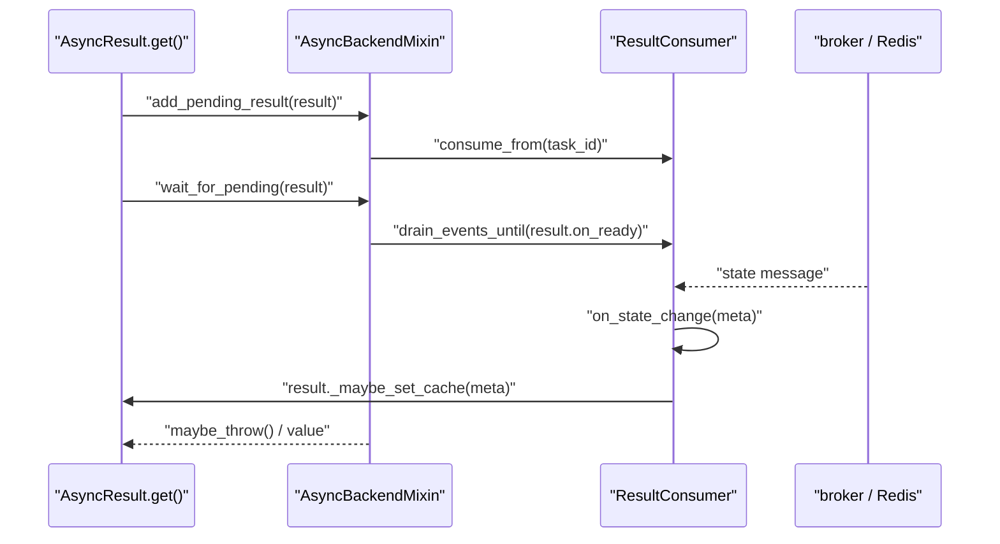

## Overview

A result backend is where workers record task states and return values and where clients read them back. All backends share one base class, `Backend`, which turns states and results into a metadata dict, serializes it, retries failed operations, caches finished results, and hooks into chords and errbacks. Concrete backends only implement storage: a key/value backend implements `get`, `set`, `mget`, `delete` (and optionally `incr`), while others override `_store_result` and `_get_task_meta_for` directly.

Sources: [celery/backends/base.py:108-165](repo://celery/backends/base.py#L108-L165), [celery/backends/base.py:964-1019](repo://celery/backends/base.py#L964-L1019)

The tracer writes through this interface (see [[Task Execution and Tracing]]) and `AsyncResult` reads through it (see [[Results and AsyncResult]]). The concrete stores are described on [[Redis and RPC Result Backends]] and [[Storage Result Backends]].

Sources: [celery/app/trace.py:625-627](repo://celery/app/trace.py#L625-L627)

## Choosing a backend

`app.backend` is created from the `result_backend` setting (or the `CELERY_RESULT_BACKEND` environment variable) by `backends.by_url`. A URL's scheme selects the class through `BACKEND_ALIASES` — `rpc`, `redis`, `rediss`, `sentinel`, `db`/`database`, `cache`, `mongodb`, `dynamodb`, `s3`, `gs`, `azureblockblob`, `file`, `disabled` and more. A scheme of the form `db+postgresql://...` uses the part before `+` as the alias and passes the rest as the URL. The loader's `override_backends` and the `celery.result_backends` entry-point group can add aliases; an unknown name raises `ImproperlyConfigured`. With no backend configured the `DisabledBackend` is used, which stores nothing and raises on reads and on chords.

Sources: [celery/app/backends.py:15-69](repo://celery/app/backends.py#L15-L69), [celery/app/base.py:1224-1228](repo://celery/app/base.py#L1224-L1228), [celery/backends/base.py:1263-1281](repo://celery/backends/base.py#L1263-L1281)

The backend instance is cached on the app when the backend is `thread_safe` (the `result_backend_thread_safe` setting), otherwise once per thread.

Sources: [celery/app/base.py:1539-1563](repo://celery/app/base.py#L1539-L1563)

## Writing state

### The mark_as_* methods

| Method | Stores | Also |
| --- | --- | --- |
| `mark_as_started` | `STARTED` with pid and hostname | — |
| `mark_as_done` | `SUCCESS` and the return value, unless the request ignores results | Notifies the chord if the task is part of one |
| `mark_as_failure` | `FAILURE` and the exception | Notifies the chord, stores the failure on remaining chain steps, calls errbacks |
| `mark_as_revoked` | `REVOKED` with `TaskRevokedError(reason)` | Notifies the chord |
| `mark_as_retry` | `RETRY` and the exception | — |

Sources: [celery/backends/base.py:176-252](repo://celery/backends/base.py#L176-L252), [celery/backends/base.py:306-323](repo://celery/backends/base.py#L306-L323)

`mark_as_failure` walks the request's remaining `chain` and stores the same failure on each step that has a task id, so the chain's last result does not stay `PENDING`; it also calls `on_chord_part_return` for steps that belong to a chord and descends into a chord step's body, so the result a later step waits on is failed too (the comment cites issue #9674).

Sources: [celery/backends/base.py:196-249](repo://celery/backends/base.py#L196-L249)

### Errbacks

`_call_task_errbacks` handles two styles of error callback. A task whose signature accepts more than one argument is called directly in the worker as `errback(request, exc, traceback)`. Older single-argument errbacks, and errbacks for tasks not registered in this worker, are sent as a group with the failed task's id as argument (applied locally in eager mode).

Sources: [celery/backends/base.py:254-304](repo://celery/backends/base.py#L254-L304)

### store_result and retries

`store_result` encodes the result for its state, then calls the backend's `_store_result` through `_ensure_retryable`. When `result_backend_always_retry` is on and the backend's `exception_safe_to_retry(exc)` says the error is transient, it retries up to `result_backend_max_retries` times with an exponential backoff with full jitter between `result_backend_base_sleep_between_retries_ms` and `result_backend_max_sleep_between_retries_ms`, calling `on_backend_retryable_error` before each retry; when retries run out it raises `BackendStoreError`. Reads use the same helper and raise `BackendGetMetaError`. By default no exception is retried.

Sources: [celery/backends/base.py:635-693](repo://celery/backends/base.py#L635-L693), [celery/backends/base.py:732-744](repo://celery/backends/base.py#L732-L744), [celery/backends/base.py:146-150](repo://celery/backends/base.py#L146-L150)

### The metadata dict

`_get_result_meta` builds what is stored: `status`, `result`, `traceback`, `children` (the current task's child results as tuples) and `date_done` for ready states, plus `group_id` and `parent_id` when known. With `result_extended` it adds the task name, args, kwargs, worker hostname, retries, queue and stamps.

Sources: [celery/backends/base.py:581-630](repo://celery/backends/base.py#L581-L630), [celery/backends/base.py:869-872](repo://celery/backends/base.py#L869-L872)

## Encoding

Results are serialized with `result_serializer` and decoded only if their content type is in `result_accept_content` (falling back to `accept_content`). Result objects stored as values are turned into tuples unless the serializer is pickle.

Sources: [celery/backends/base.py:138-165](repo://celery/backends/base.py#L138-L165), [celery/backends/base.py:528-556](repo://celery/backends/base.py#L528-L556)

Exceptions are stored as-is (made pickleable) with pickle-capable serializers. With others, such as JSON, `prepare_exception` stores a dict of `exc_type` (qualified name), `exc_message` (the args) and `exc_module`. `exception_to_python` rebuilds the exception: it looks the class up in its module (creating a stand-in class when the module or class is missing) and refuses with `SecurityError` if the result is not an exception class — the comment explains that otherwise a forged result such as `{"exc_module": "os", "exc_type": "system", ...}` would execute arbitrary code.

Sources: [celery/backends/base.py:447-526](repo://celery/backends/base.py#L447-L526)

## Reading state

### get_task_meta and the cache

`get_task_meta(task_id)` returns the cached metadata when present, otherwise fetches it with `_get_task_meta_for` under the retry policy, and caches it if the state is `SUCCESS`. The cache is an LRU of `result_cache_max` entries, or disabled with `-1`. `get_state`, `get_result`, `get_traceback` and `get_children` read from it. Reading while `task_always_eager` is on (without `task_store_eager_result`) warns that results are not stored.

Sources: [celery/backends/base.py:746-768](repo://celery/backends/base.py#L746-L768), [celery/backends/base.py:700-730](repo://celery/backends/base.py#L700-L730), [celery/backends/base.py:142-143](repo://celery/backends/base.py#L142-L143)

### Waiting for results

Synchronous backends mix in `SyncBackendMixin`. `wait_for` polls `get_task_meta` every `interval` seconds until the state is ready or the timeout passes (raising `TimeoutError`), and `iter_native` yields group members through `get_many`. Asynchronous backends use `AsyncBackendMixin` instead and wait for pushed messages.

Sources: [celery/backends/base.py:879-961](repo://celery/backends/base.py#L879-L961)

### Groups

`save_group`, `restore_group` and `delete_group` store a `GroupResult` under the group id so `GroupResult.restore` can rebuild it; they use the same retry helper and the cache.

Sources: [celery/backends/base.py:785-818](repo://celery/backends/base.py#L785-L818)

## Key/value backends

`BaseKeyValueStoreBackend` maps ids to keys: `celery-task-meta-<id>`, `celery-taskset-meta-<id>` and `chord-unlock-<id>`, all prefixed by `global_keyprefix` from `result_backend_transport_options` when set. `_get_task_meta_for` returns `PENDING` for a missing key.

Sources: [celery/backends/base.py:964-1052](repo://celery/backends/base.py#L964-L1052), [celery/backends/base.py:1148-1153](repo://celery/backends/base.py#L1148-L1153)

`_store_result` first reads the current state and does nothing if it is already `SUCCESS`. The comment explains the reason: with lost workers or network partitions a duplicate execution of the task could otherwise overwrite the successful result.

Sources: [celery/backends/base.py:1116-1138](repo://celery/backends/base.py#L1116-L1138)

`get_many` serves cached ready results first, then repeatedly `mget`s the remaining keys, yielding each ready result as it appears, sleeping `interval` between rounds and raising `TimeoutError` after `timeout`.

Sources: [celery/backends/base.py:1075-1111](repo://celery/backends/base.py#L1075-L1111)

## Chords

### Native chord counting

A backend with `implements_incr` replaces `apply_chord` with `_apply_chord_incr`, which saves the header's `GroupResult`. Each header task's completion then calls `on_chord_part_return`: it restores the group, increments the counter key `chord-unlock-<group_id>`, and when the counter reaches the chord size (from the request, else the group length) joins the header results, calls the body with them, and deletes the group and counter. A missing group, a failed header task or a failing body is reported with `chord_error_from_stack`, which calls the body's errbacks and marks the body failed with a `ChordError`.

Sources: [celery/backends/base.py:1183-1256](repo://celery/backends/base.py#L1183-L1256), [celery/backends/base.py:325-358](repo://celery/backends/base.py#L325-L358)

### Fallback: chord_unlock

Backends without native counting use `fallback_chord_unlock`, which sends the built-in `celery.chord_unlock` task to the body's queue with the header results; that task polls the header and runs the body when it is ready. The chord flow as a whole is described on [[Groups and Chords]].

Sources: [celery/backends/base.py:838-867](repo://celery/backends/base.py#L838-L867)

## Asynchronous backends

### Pending results and the result consumer

Backends that receive results as messages (RPC, Redis) use `AsyncBackendMixin`. `add_pending_result` registers the result by id (strongly or weakly) and tells the backend's `ResultConsumer` to start consuming for that id, after first checking a buffer of messages that arrived before anyone asked for them. When a result is fulfilled it is removed and the consumer stops listening for its id.

Sources: [celery/backends/asynchronous.py:225-313](repo://celery/backends/asynchronous.py#L225-L313)

`BaseResultConsumer.on_state_change` receives each pushed state. For ready states it finds the pending result and fills its cache (fulfilling `then` callbacks and waking waiters), or buffers the message if the result is not pending yet; group members waiting through `iter_native` are delivered via per-result buckets. `reconnect_on_error` catches the transport's connection errors, reconnects once, and raises `RuntimeError` asking for a restart if that fails.

Sources: [celery/backends/asynchronous.py:316-370](repo://celery/backends/asynchronous.py#L316-L370), [celery/backends/asynchronous.py:416-449](repo://celery/backends/asynchronous.py#L416-L449)

### Drainers

Waiting is done by a drainer selected by environment. The default `Drainer` calls the consumer's `drain_events` in the waiting thread, one `interval` at a time, until the result's promise is ready or the timeout passes. Under eventlet and gevent, `greenletDrainer` runs a background greenlet that drains continuously and signals waiters after each pass, so many green threads can wait without each blocking on the connection.

Sources: [celery/backends/asynchronous.py:58-112](repo://celery/backends/asynchronous.py#L58-L112), [celery/backends/asynchronous.py:115-222](repo://celery/backends/asynchronous.py#L115-L222)

Sources: [celery/backends/asynchronous.py:260-313](repo://celery/backends/asynchronous.py#L260-L313), [celery/backends/asynchronous.py:393-449](repo://celery/backends/asynchronous.py#L393-L449)

## Cleanup and expiry

`result_expires` sets how long results are kept; backends that expire keys themselves set `supports_autoexpire`, and the others rely on `cleanup()`, run by the built-in `celery.backend_cleanup` task. `process_cleanup` runs in the worker after each task.

Sources: [celery/backends/base.py:118-121](repo://celery/backends/base.py#L118-L121), [celery/backends/base.py:558-565](repo://celery/backends/base.py#L558-L565), [celery/app/builtins.py:12-23](repo://celery/app/builtins.py#L12-L23)
