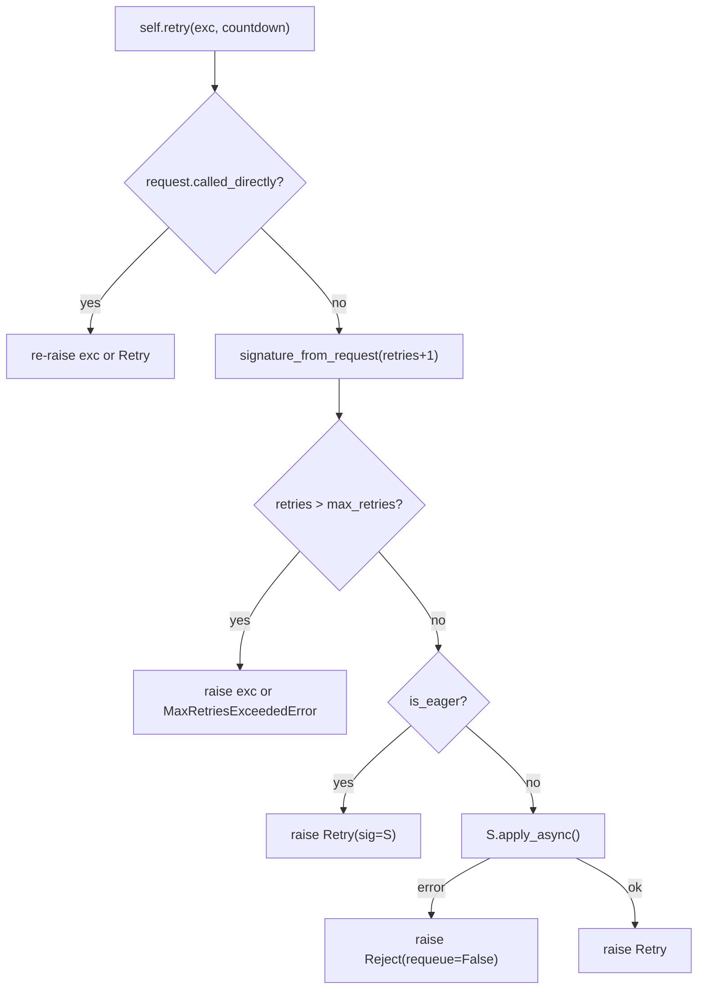

## Overview

A task body controls its own outcome by raising exceptions. An ordinary exception marks the task failed. Three "semi-predicate" exceptions, subclasses of `TaskPredicate`, instead tell the worker what to do with the message: `Retry` (a new message has been sent, record a retry), `Ignore` (do not record any state) and `Reject` (reject the message, optionally requeueing it). `Task.retry` is the normal way to raise `Retry`, and `autoretry_for` raises it automatically for chosen exception types.

Sources: [celery/exceptions.py:141-203](repo://celery/exceptions.py#L141-L203)

This page follows `Task.retry`, the automatic retry wrapper, and the exception hierarchy. How the tracer and the worker's `Request` react to each exception is described on [[Task Execution and Tracing]] and [[Task Requests and Strategies]].

Sources: [celery/app/trace.py:584-602](repo://celery/app/trace.py#L584-L602)

## Task.retry

### The retry sequence

`retry` re-sends the current call as a new message with an incremented retry count and then raises `Retry`. It is used as `raise self.retry(exc=exc, countdown=60)` in a bound task; the docstring notes the `raise` only signals that the rest of the block does not run, since `retry` raises on its own.

Sources: [celery/app/task.py:756-776](repo://celery/app/task.py#L756-L776)

The method works in this order:

Sources: [celery/app/task.py:817-823](repo://celery/app/task.py#L817-L823)

1. Compute `retries = request.retries + 1`. A `max_retries` argument overrides the task's limit for this attempt only, and is remembered in `override_max_retries` for the autoretry wrapper.
2. If the task was called directly (not by a worker and not eagerly), re-raise: the current exception if one is being handled, chained with `exc`, or `exc`, or a plain `Retry`.
3. With neither `eta` nor `countdown`, use `default_retry_delay` (180 seconds by default).
4. Build a signature of the current call with `signature_from_request`, carrying the new `countdown`/`eta`, the retry count and any extra options.
5. If `max_retries` is not `None` and the count exceeds it, raise `exc` if given, else `MaxRetriesExceededError` with the task's arguments attached.
6. Create `Retry(exc=exc, when=eta or countdown, is_eager=..., sig=S)`. In eager mode, raise it (or return it when `throw=False`) without sending anything.
7. Otherwise send the signature with `apply_async`. A failure to send is turned into `Reject(exc, requeue=False)`. Then raise the `Retry`, or return it when `throw=False`.

Sources: [celery/app/task.py:817-867](repo://celery/app/task.py#L817-L867), [celery/utils/serialization.py:267-273](repo://celery/utils/serialization.py#L267-L273)



Sources: [celery/app/task.py:817-867](repo://celery/app/task.py#L817-L867)

> [!NOTE]
> `max_retries=None` passed to `retry` means "use the default", not "retry forever". To retry without limit, set the task's `max_retries` attribute to `None`.

Sources: [celery/app/task.py:793-798](repo://celery/app/task.py#L793-L798)

The new message keeps the original task id, so the client's `AsyncResult` follows the retried attempt. Because `signature_from_request` copies the original delivery info, the retry goes to the same queue (or exchange and routing key) as the first attempt unless `queue` is passed.

Sources: [celery/app/task.py:731-754](repo://celery/app/task.py#L731-L754), [celery/app/task.py:160-195](repo://celery/app/task.py#L160-L195)

### Eager retries

In eager mode nothing is published. `Task.apply` runs the tracer; when the returned value is a `Retry` that carries a signature, it calls `sig.apply(retries=retries + 1)`, so the retry runs immediately and recursively in the same process until it succeeds or exceeds `max_retries`.

Sources: [celery/app/task.py:940-951](repo://celery/app/task.py#L940-L951)

### What the worker records

When the tracer catches `Retry`, it stores the `RETRY` state with the original exception (`reason.exc`), calls the task's `on_retry` handler, sends the `task_retry` signal and logs the retry. It does not call errbacks. The worker's request then acknowledges the old message if the task uses `acks_late` and sends a `task-retried` event.

Sources: [celery/app/trace.py:212-240](repo://celery/app/trace.py#L212-L240), [celery/app/trace.py:596-600](repo://celery/app/trace.py#L596-L600), [celery/worker/request.py:613-620](repo://celery/worker/request.py#L613-L620)

## Automatic retries

### The autoretry wrapper

`add_autoretry_behaviour` runs for every task when it is created or registered. It reads `autoretry_for`, `dont_autoretry_for`, `retry_kwargs`, `retry_backoff`, `retry_backoff_max` (default 600) and `retry_jitter` (default `True`) from the decorator options or the task class. If `autoretry_for` is non-empty, it replaces `task.run` with a wrapper and keeps the original as `_orig_run`.

Sources: [celery/app/autoretry.py:8-33](repo://celery/app/autoretry.py#L8-L33), [celery/app/base.py:628-629](repo://celery/app/base.py#L628-L629)

The wrapper lets `Ignore`, `Retry` and anything in `dont_autoretry_for` propagate unchanged. For an exception in `autoretry_for`, it computes a backoff countdown if `retry_backoff` is set, passes on a per-call `max_retries` override if one is pending, and raises the result of `task.retry(exc=exc, **retry_kwargs)`.

Sources: [celery/app/autoretry.py:35-66](repo://celery/app/autoretry.py#L35-L66)

```python
@app.task(autoretry_for=(ConnectionError,), retry_backoff=True,
          retry_kwargs={'max_retries': 5})
def fetch(url):
    ...
```

Sources: [celery/app/autoretry.py:10-31](repo://celery/app/autoretry.py#L10-L31)

### Exponential backoff

With `retry_backoff` set, the countdown is `get_exponential_backoff_interval(factor, retries, maximum, full_jitter)`: `min(maximum, factor * 2 ** retries)`, where `factor` is `retry_backoff` as an integer and at least 1. With jitter on, the value is replaced by a random integer between 0 and that bound ("full jitter", as the comment cites from the AWS architecture blog). The result is never negative.

Sources: [celery/utils/time.py:463-477](repo://celery/utils/time.py#L463-L477), [celery/app/autoretry.py:48-54](repo://celery/app/autoretry.py#L48-L54)

## Ignore and Reject

`Ignore` tells the worker the task has taken care of its own state: the tracer stores nothing and the worker acknowledges the message. `Task.on_replace` uses it after sending the replacement signature.

Sources: [celery/exceptions.py:190-191](repo://celery/exceptions.py#L190-L191), [celery/worker/request.py:670-671](repo://celery/worker/request.py#L670-L671), [celery/app/task.py:1222-1227](repo://celery/app/task.py#L1222-L1227)

`Reject(reason, requeue=False)` asks the worker to reject the message. With `requeue=True` the broker redelivers it. Without requeue the task would never run again, so the worker records a `FAILURE` result, sends the `task_failure` signal and a `task-failed` event before rejecting, so the task does not stay `PENDING` (the code cites Issue #4222).

Sources: [celery/exceptions.py:194-203](repo://celery/exceptions.py#L194-L203), [celery/worker/request.py:648-669](repo://celery/worker/request.py#L648-L669)

## Failures with late acknowledgement

For an ordinary failure of an `acks_late` task, the worker picks between acknowledging and rejecting. A `TimeLimitExceeded` uses `acks_on_timeout`, any other exception `acks_on_failure`. The message is requeued when the child process was lost and `reject_on_worker_lost` is set, or on a timeout with `acks_on_timeout` false; it is acknowledged when the flag is true, and rejected without requeue otherwise. A requeued task is not marked failed.

Sources: [celery/worker/request.py:675-704](repo://celery/worker/request.py#L675-L704)

## Exception hierarchy

The module docstring of `celery.exceptions` lays out the hierarchy. The classes users meet most often:

Sources: [celery/exceptions.py:1-10](repo://celery/exceptions.py#L1-L10)

| Exception | Base | Raised when |
| --- | --- | --- |
| `Retry` | `TaskPredicate` | `Task.retry` re-sent the task |
| `Ignore` | `TaskPredicate` | Task opts out of state updates |
| `Reject` | `TaskPredicate` | Task rejects or requeues its message |
| `MaxRetriesExceededError` | `TaskError` | `retry` called past `max_retries`; carries `task_args`, `task_kwargs` |
| `NotRegistered` | `KeyError`, `TaskError` | Task name missing from the registry |
| `QueueNotFound` | `KeyError`, `TaskError` | Routed to an undeclared queue |
| `TimeoutError` | `TaskError` | `AsyncResult.get(timeout=...)` expired |
| `TaskRevokedError` | `TaskError` | The task was revoked |
| `InvalidTaskError` | `TaskError` | Malformed task message |
| `ChordError` | `TaskError` | A chord header task failed |
| `BackendGetMetaError`, `BackendStoreError` | `BackendError` | Reading or writing the result backend failed |
| `ImproperlyConfigured` | `CeleryError` | Invalid configuration |
| `SoftTimeLimitExceeded`, `TimeLimitExceeded`, `WorkerLostError`, `Terminated` | billiard | Pool time limits and lost or killed child processes |
| `WorkerShutdown`, `WorkerTerminate` | `SystemExit` | Request a warm or immediate worker shutdown |

Sources: [celery/exceptions.py:1-58](repo://celery/exceptions.py#L1-L58), [celery/exceptions.py:206-304](repo://celery/exceptions.py#L206-L304)

`Retry` stores a pickleable copy of the original exception and its `repr`, so it survives the trip from a pool child to the parent, and its `__str__` reads as `Retry in 60s: <exc>` or `Retry at <eta>: <exc>`. `OperationalError` is re-exported from kombu and does not inherit from `CeleryError`.

Sources: [celery/exceptions.py:145-187](repo://celery/exceptions.py#L145-L187), [celery/exceptions.py:29-35](repo://celery/exceptions.py#L29-L35)

`SoftTimeLimitExceeded` is raised inside the running task when the soft limit passes, so the task can catch it and clean up; the hard limit kills the process. Time limits are enforced by the pool; see [[Concurrency Pools]].

Sources: [celery/exceptions.py:54-60](repo://celery/exceptions.py#L54-L60), [celery/worker/request.py:529-595](repo://celery/worker/request.py#L529-L595)
