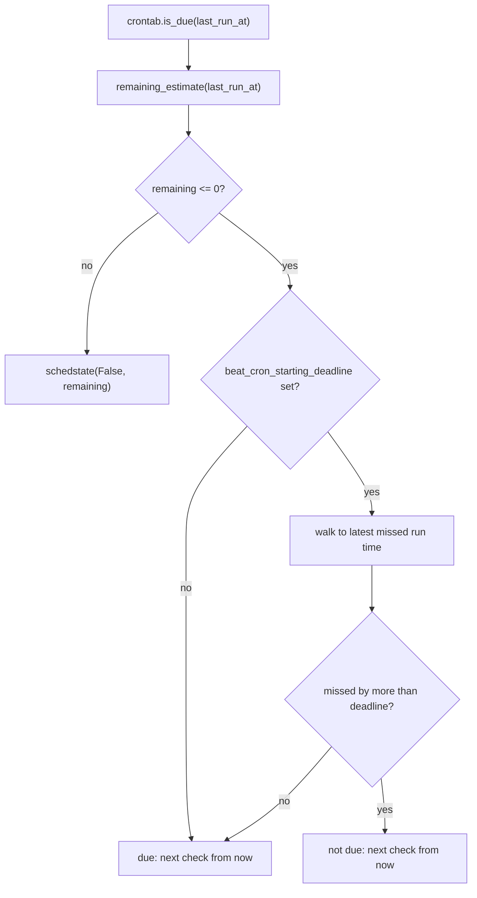

## Overview

A schedule answers one question for the beat scheduler: given when an entry last ran, is it due now, and if not, how long until it should be checked again? `celery.schedules` provides three answers — `schedule` for fixed intervals, `crontab` for cron-style calendar times, and `solar` for sunrise, sunset and similar events — all built on `BaseSchedule`. A periodic task entry's `schedule` may be any of them, or a number of seconds or a `timedelta`, which `maybe_schedule` turns into a `schedule`.

Sources: [celery/schedules.py:65-109](repo://celery/schedules.py#L65-L109), [celery/schedules.py:703-714](repo://celery/schedules.py#L703-L714)

The loop that calls these methods, and how entries are stored, is on [[Periodic Tasks with Beat]].

Sources: [celery/beat.py:161-163](repo://celery/beat.py#L161-L163)

## The schedule contract

### is_due and schedstate

Every schedule implements `is_due(last_run_at)` returning a `schedstate(is_due, next)` named tuple, and `remaining_estimate(last_run_at)` returning a `timedelta`. The docstring of `schedule.is_due` explains `next`: `(True, 20)` means run now and check again in 20 seconds; `(False, 12.3)` means not due, check again in 12.3 seconds. It need not be exact, and beat never sleeps longer than `beat_max_loop_interval` anyway, so schedule changes are picked up within that bound.

Sources: [celery/schedules.py:24](repo://celery/schedules.py#L24), [celery/schedules.py:138-173](repo://celery/schedules.py#L138-L173)

### Time and time zones

`BaseSchedule.now()` uses a custom `nowfun` if given, else `app.now()`, which is the current time in the app's timezone. `maybe_make_aware` attaches the app timezone to naive datetimes, and with `enable_utc` off, `to_local` converts results to local time.

Sources: [celery/schedules.py:65-103](repo://celery/schedules.py#L65-L103), [celery/app/base.py:1197-1200](repo://celery/app/base.py#L1197-L1200)

`remaining(start, ends_in, now, relative)` computes how long is left until `start + ends_in`. It subtracts in UTC because, as the comment notes, Python uses wall-clock arithmetic between datetimes in the same non-UTC timezone, which would be wrong across daylight-saving changes. With `relative`, the end time is first rounded down to the resolution of the interval (days, hours or minutes) by `delta_resolution`.

Sources: [celery/utils/time.py:191-250](repo://celery/utils/time.py#L191-L250)

## schedule: fixed intervals

`schedule(run_every, relative=False)` runs every `run_every` (seconds or a `timedelta`). `remaining_estimate` is `remaining(last_run_at, run_every, now, relative)`; `is_due` is true when nothing remains, and then returns the full interval as the next check.

Sources: [celery/schedules.py:111-194](repo://celery/schedules.py#L111-L194)

With `relative=True` the run time is aligned to the interval's resolution, so an hourly schedule runs at the top of the hour rather than an hour after beat started. A `ScheduleEntry` passes its `relative` flag through `maybe_schedule`.

Sources: [celery/schedules.py:111-130](repo://celery/schedules.py#L111-L130), [celery/beat.py:117-127](repo://celery/beat.py#L117-L127)

## crontab

### Fields

`crontab(minute='*', hour='*', day_of_week='*', day_of_month='*', month_of_year='*')` takes each field as an int, a string pattern, or an iterable of ints, and expands it once into a set. Day of week runs 0–6 with Sunday = 0; day of month 1–31; month 1–12. `crontab.from_string('m h dom mon dow')` splits a classic five-field cron line.

Sources: [celery/schedules.py:323-432](repo://celery/schedules.py#L323-L432)

```python
crontab(minute=0, hour='*/3')                 # every three hours
crontab(minute='*/15', day_of_week='mon-fri')
crontab.from_string('0 4 * * *')              # 04:00 every day
```

Sources: [celery/schedules.py:337-367](repo://celery/schedules.py#L337-L367), [celery/schedules.py:416-431](repo://celery/schedules.py#L416-L431)

The class docstring warns of two cron subtleties: `day_of_week='*/2'` means days whose number is divisible by two, not every other day; and a day must match the day-of-week, day-of-month and month fields **all together**, so `day_of_week=1, day_of_month='1-7,15-21'` means the first and third Monday of the month.

Sources: [celery/schedules.py:351-399](repo://celery/schedules.py#L351-L399)

### Parsing

`crontab_parser(max_, min_)` expands a pattern of comma-separated parts. Each part may be `*`, `*/step`, a number or name, a range `a-b`, or `a-b/step`. Ranges that end below their start wrap around the maximum. Names are month names (`jan`) and weekday names (`mon`, `monday`). Negative numbers, empty parts, empty steps and values outside `min_`…`max_ + min_ - 1` raise `ParseException` or `ValueError`.

Sources: [celery/schedules.py:196-290](repo://celery/schedules.py#L196-L290), [celery/schedules.py:291-320](repo://celery/schedules.py#L291-L320)

### Computing the next run

`remaining_delta(last_run_at)` finds the next matching time after the last run as a `ffwd` (a relative "fast-forward" to set fields), in this order:

Sources: [celery/schedules.py:572-576](repo://celery/schedules.py#L572-L576)

1. If the last run's date matches and it is still the same day and a matching hour with a later matching minute exists, move to that minute.
2. Else, if the date matches and a later matching hour exists today, move to that hour and the first minute.
3. Else, if day of month and month are both `*`, move to the next matching weekday (adding a week if it is the same weekday) at the first hour and minute.
4. Otherwise `_delta_to_next` searches forward through months and days of month, skipping impossible dates (such as 30 February) and dates before the last run, until the weekday also matches; it gives up with `RuntimeError` after 2000 roll-overs, since the specification is then probably unsatisfiable.

Sources: [celery/schedules.py:572-628](repo://celery/schedules.py#L572-L628), [celery/schedules.py:480-555](repo://celery/schedules.py#L480-L555)

`remaining_estimate` turns that into the time left with `remaining`, so the result is computed in UTC. `is_due` is true when nothing remains; when due, the next check is computed from now rather than from the last run.

Sources: [celery/schedules.py:630-688](repo://celery/schedules.py#L630-L688)

### Missed runs and the starting deadline

If beat was down when a crontab entry should have run, the entry is due as soon as beat starts again. `beat_cron_starting_deadline` limits this: `is_due` walks forward from the last run to the most recent missed run time, and if that missed time is older than the deadline (in seconds), the entry is not run now but waits for its next regular time. The docstring describes the intent as preventing tasks that "could have been run according to the crontab, but didn't" from running unexpectedly.

Sources: [celery/schedules.py:641-688](repo://celery/schedules.py#L641-L688), [celery/app/defaults.py:73-81](repo://celery/app/defaults.py#L73-L81)



Sources: [celery/schedules.py:641-688](repo://celery/schedules.py#L641-L688)

Two crontabs compare equal when all five expanded fields match; beat uses equality to decide whether the schedule changed.

Sources: [celery/schedules.py:690-700](repo://celery/schedules.py#L690-L700)

## solar

`solar(event, lat, lon)` runs at a solar event for an observer on the earth, using the `ephem` package. The events are `dawn_astronomical`, `dawn_nautical`, `dawn_civil`, `sunrise`, `solar_noon`, `sunset`, `dusk_civil`, `dusk_nautical` and `dusk_astronomical`; latitude must be between -90 and 90 and longitude between -180 and 180, otherwise `ValueError`.

Sources: [celery/schedules.py:717-818](repo://celery/schedules.py#L717-L818)

Each event maps to an ephem horizon (`-18°`, `-12°`, `-6°` for the twilights, `-0:34` for sunrise and sunset accounting for refraction, `0` for noon), a method (`next_rising`, `next_transit` or `next_setting`), and whether to measure the sun's centre (twilights) or its upper edge (sunrise, sunset). The observer is at sea level with pressure 0.

Sources: [celery/schedules.py:745-818](repo://celery/schedules.py#L745-L818)

`remaining_estimate` asks ephem for the next occurrence after the last run, in UTC, and returns the difference from now. Where the sun does not rise or set that day (polar regions), ephem raises `CircumpolarError` and the schedule checks again one minute after the next anti-transit. `is_due` follows the same pattern as the other schedules.

Sources: [celery/schedules.py:828-878](repo://celery/schedules.py#L828-L878)

## Writing a schedule

A custom schedule subclasses `BaseSchedule` and implements `remaining_estimate` and `is_due` returning `schedstate`. It should also define `__eq__` (beat compares schedules to detect changes) and `__reduce__` (entries are pickled into the schedule file); the built-in classes show both.

Sources: [celery/schedules.py:65-109](repo://celery/schedules.py#L65-L109), [celery/schedules.py:178-186](repo://celery/schedules.py#L178-L186), [celery/schedules.py:557-570](repo://celery/schedules.py#L557-L570)
