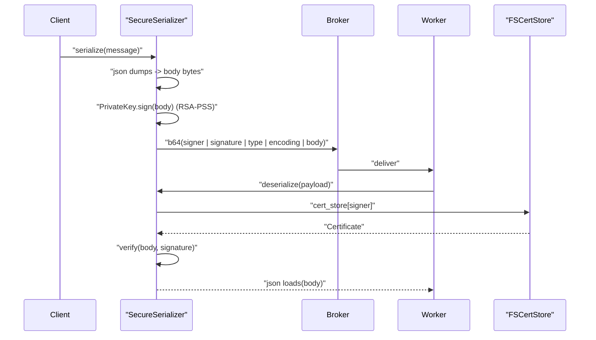

## Overview

Message signing lets workers trust that a task message was produced by a holder of a known private key. Celery implements it as a kombu serializer named `auth`: the sender serializes the message normally (JSON by default), signs the serialized bytes with an RSA private key, and packs the signature, the signer's certificate id and the body together; the receiver looks up the signer's certificate in a store of trusted certificates and verifies the signature before decoding the body. Signing requires the `cryptography` package; importing `celery.security` without it raises `ImproperlyConfigured`.

Sources: [celery/security/serialization.py:20-58](repo://celery/security/serialization.py#L20-L58), [celery/security/__init__.py:9-41](repo://celery/security/__init__.py#L9-L41)

Signing protects the content of task messages (and events, when they use the same serializer); it does not encrypt them. The serializer plugs into the normal publishing path described on [[Calling Tasks and the Message Protocol]].

Sources: [celery/app/amqp.py:549-563](repo://celery/app/amqp.py#L549-L563)

## Setting it up

### Configuration

The repository's example configures signing like this:

Sources: [examples/security/mysecureapp.py:1-26](repo://examples/security/mysecureapp.py#L1-L26)

```python
app.conf.update(
    security_key='ssl/worker.key',
    security_certificate='ssl/worker.pem',
    security_cert_store='ssl/*.pem',
    task_serializer='auth',
    event_serializer='auth',
    accept_content=['auth'],
    result_accept_content=['json']
)
app.setup_security()
```

Sources: [examples/security/mysecureapp.py:30-44](repo://examples/security/mysecureapp.py#L30-L44)

| Setting | Meaning |
| --- | --- |
| `security_key` | Path to the PEM private key used to sign |
| `security_key_password` | Password of the private key, if encrypted |
| `security_certificate` | Path to the PEM certificate matching the key |
| `security_cert_store` | Directory or glob of trusted certificates |
| `security_digest` | Hash algorithm, default `sha256` |

Sources: [celery/app/defaults.py:239-247](repo://celery/app/defaults.py#L239-L247), [celery/app/defaults.py:20](repo://celery/app/defaults.py#L20)

### setup_security

`app.setup_security(allowed_serializers=None, key=None, key_password=None, cert=None, store=None, digest='sha256', serializer='json')` performs the setup; its docstring notes that it is a global operation affecting all apps. It:

Sources: [celery/app/base.py:750-757](repo://celery/app/base.py#L750-L757)

1. Disables kombu's insecure serializers, except those in `allowed_serializers`.
2. Requires `task_serializer == 'auth'` and `accept_content == ['auth']`, raising `ImproperlyConfigured` otherwise — the error message explains there is no point in signing messages that are not verified.
3. Fills key, password, certificate, store and digest from the arguments or the settings, and requires the key, certificate and store.
4. Reads the key and certificate files and calls `register_auth`, then makes `auth` kombu's default serializer.

Sources: [celery/app/base.py:750-780](repo://celery/app/base.py#L750-L780), [celery/security/__init__.py:44-70](repo://celery/security/__init__.py#L44-L70)

`register_auth` builds a `SecureSerializer` from a `PrivateKey`, a `Certificate` and an `FSCertStore`, and registers its `serialize`/`deserialize` with kombu under the name `auth` with content type `application/data`.

Sources: [celery/security/serialization.py:80-90](repo://celery/security/serialization.py#L80-L90)

## The signed message format

### Signing

`SecureSerializer.serialize(data)` serializes the data with the inner serializer (`json` by default) and signs the resulting bytes. The comment explains the choice: signing the serialized body rather than the data lets the receiver verify the signature before decoding anything, avoiding flaws in the decoding step. The signature uses RSA-PSS with MGF1 and the maximum salt length, over the configured digest.

Sources: [celery/security/serialization.py:31-46](repo://celery/security/serialization.py#L31-L46), [celery/security/key.py:27-35](repo://celery/security/key.py#L27-L35)

`_pack` joins five fields with the separator `\x00\x01` — base64 signer id, base64 signature, content type, content encoding and body — and base64-encodes the result. The comment guarantees the separator cannot appear in the serialized data.

Sources: [celery/security/serialization.py:14-17](repo://celery/security/serialization.py#L14-L17), [celery/security/serialization.py:60-66](repo://celery/security/serialization.py#L60-L66)

### Verifying

`deserialize(payload)` decodes and splits the fields (at most four splits, so the body may contain anything), looks up the signer's certificate in the store, verifies the signature over the raw body, and only then decodes the body with the declared content type. A signer not in the store raises `SecurityError('Unknown certificate')`, and a bad signature raises `SecurityError('Bad signature')`.

Sources: [celery/security/serialization.py:48-77](repo://celery/security/serialization.py#L48-L77), [celery/security/certificate.py:65-73](repo://celery/security/certificate.py#L65-L73), [celery/security/certificate.py:86-91](repo://celery/security/certificate.py#L86-L91)



Sources: [celery/security/serialization.py:31-77](repo://celery/security/serialization.py#L31-L77)

## Keys and certificates

### PrivateKey and Certificate

`PrivateKey(pem, password)` loads a PEM private key and accepts only RSA keys. `Certificate(pem)` loads an X.509 certificate and accepts only RSA public keys; its id — used as the signer field — is the issuer followed by the serial number, which together identify a certificate uniquely. `has_expired()` compares the certificate's end of validity with the current UTC time.

Sources: [celery/security/key.py:12-25](repo://celery/security/key.py#L12-L25), [celery/security/certificate.py:31-63](repo://celery/security/certificate.py#L31-L63)

### Certificate stores

`CertStore` maps certificate ids to certificates and raises `SecurityError` for unknown or duplicate ids. `FSCertStore(path)` loads every file matching the path — a directory means all files in it, otherwise the path is a glob — and refuses expired certificates with `SecurityError`. Every certificate whose holder may send tasks must be in the workers' store.

Sources: [celery/security/certificate.py:76-113](repo://celery/security/certificate.py#L76-L113)

### Errors

`reraise_errors` wraps cryptography exceptions (or the given error types) into `SecurityError` with a formatted message, keeping the original traceback; all key, certificate, signing and verification code uses it. `get_digest_algorithm('sha256')` turns the digest name into the corresponding `cryptography` hash object.

Sources: [celery/security/utils.py:13-28](repo://celery/security/utils.py#L13-L28)

## Results

The `auth` serializer applies to whatever uses it. In the example, results are still stored and read as JSON (`result_accept_content=['json']`), so they are not signed; results are serialized with `result_serializer`, independently of `task_serializer`. See [[Result Backend Interface]].

Sources: [examples/security/mysecureapp.py:35-43](repo://examples/security/mysecureapp.py#L35-L43), [celery/backends/base.py:138-160](repo://celery/backends/base.py#L138-L160)
