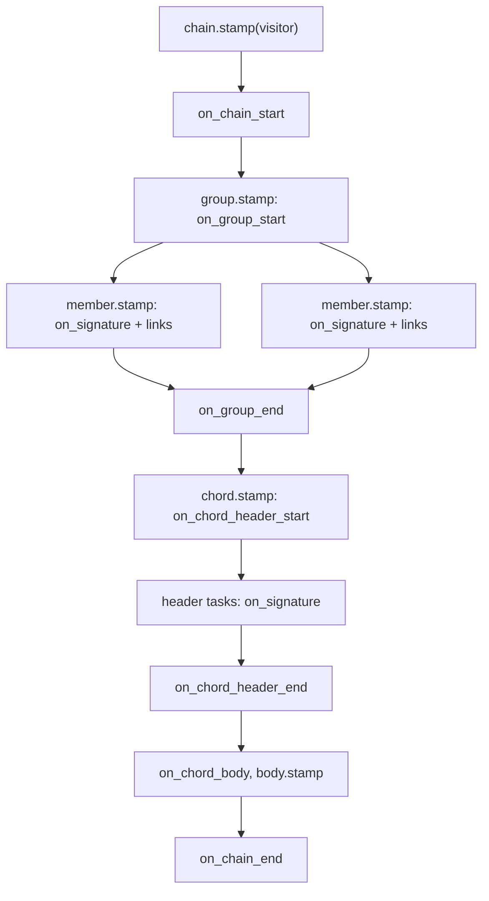

## Overview

Stamping attaches custom key/value headers — *stamps* — to every task in a workflow, including tasks nested in chains, groups and chord bodies, and their callbacks and errbacks. A stamp travels in the task message's headers, shows up on the worker's request, can be stored with extended results, and can be used to revoke every task that carries a given value. Stamping was added in Celery 5.3.

Sources: [celery/canvas.py:614-634](repo://celery/canvas.py#L614-L634), [celery/app/amqp.py:361-381](repo://celery/app/amqp.py#L361-L381)

Stamps are set on [[Signatures]] before a workflow is sent; revocation by stamp goes through [[Remote Control and Inspection]].

Sources: [celery/canvas.py:554-612](repo://celery/canvas.py#L554-L612)

## Stamping a signature

### stamp()

`sig.stamp(visitor=None, append_stamps=False, **headers)` stamps a signature and its links. Without a visitor, the keyword arguments are the stamps:

Sources: [celery/canvas.py:614-628](repo://celery/canvas.py#L614-L628)

```python
sig = add.s(2, 2)
sig.stamp(tenant='acme', batch=42)
sig.options['stamped_headers']   # ['tenant', 'batch']
```

Sources: [celery/canvas.py:614-634](repo://celery/canvas.py#L614-L634)

`stamp` first stamps the links, then asks the visitor (if any) for extra stamps through `on_signature`, merges everything with `_stamp_headers`, and stores the result in the signature's options with `set()`. The options then contain every stamp key with its value plus `stamped_headers`, the list of keys that are stamps.

Sources: [celery/canvas.py:554-634](repo://celery/canvas.py#L554-L634)

### Merging stamps

`_stamp_headers` merges three sources: the keyword headers, the visitor's returned headers, and the stamps already in the signature's options (only keys listed in its `stamped_headers`). With `append_stamps=False` a duplicate key takes the later value — visitor stamps win over keyword headers, the comment explains, to avoid silently turning a stamp into a list. With `append_stamps=True` duplicate values are collected into a list. `_merge_dictionaries` does the merge, extending lists and recursing into dicts.

Sources: [celery/canvas.py:554-612](repo://celery/canvas.py#L554-L612), [celery/canvas.py:74-116](repo://celery/canvas.py#L74-L116)

### Links

`stamp_links` stamps every signature in the `link` and `link_error` options, calling the visitor's `on_callback` and `on_errback`. It merges with `self_headers=False`, so a callback receives the visitor's and caller's stamps but does not copy the stamps of the signature it is linked to.

Sources: [celery/canvas.py:636-683](repo://celery/canvas.py#L636-L683)

## Visitors

A `StampingVisitor` decides stamps per node while the workflow is traversed. Only `on_signature` is abstract; the other hooks return no stamps by default.

Sources: [celery/canvas.py:119-123](repo://celery/canvas.py#L119-L123)

| Hook | Called for | Default |
| --- | --- | --- |
| `on_signature(sig, **headers)` | Every task signature | abstract |
| `on_group_start(group)` / `on_group_end(group)` | Each group | `{}` / nothing |
| `on_chain_start(chain)` / `on_chain_end(chain)` | Each chain | `{}` / nothing |
| `on_chord_header_start(chord)` / `on_chord_header_end(chord)` | A chord's header | Delegate to the group hooks |
| `on_chord_body(chord)` | A chord's body | `{}` |
| `on_callback(sig)` / `on_errback(sig)` | Each link / error link | `{}` |

Sources: [celery/canvas.py:119-230](repo://celery/canvas.py#L119-L230)

The example visitors in the repository return a fixed stamp, a fresh UUID per signature (a monitoring id), or a stamp per hook to show the traversal order:

Sources: [examples/stamping/visitors.py:9-67](repo://examples/stamping/visitors.py#L9-L67)

```python
class MonitoringIdStampingVisitor(StampingVisitor):
    def on_signature(self, sig: Signature, **headers) -> dict:
        mtask_id = str(uuid4())
        logger.critical(f"Visitor: Sig '{sig}' is stamped with: {mtask_id}")
        return {"mtask_id": mtask_id}
```

Sources: [examples/stamping/visitors.py:15-19](repo://examples/stamping/visitors.py#L15-L19)

## Traversal

Each canvas type overrides `stamp` to walk its children and pass the merged headers down:

Sources: [celery/canvas.py:1107-1110](repo://celery/canvas.py#L1107-L1110)

- **chain**: `on_chain_start` → stamp links → stamp each task → `on_chain_end`.
- **group**: `on_group_start` → stamp links → stamp each member (a generator of members is stamped lazily with `_stamp_regen_task`, so it is not consumed) → `on_group_end`.
- **chord**: `on_chord_header_start` (which wraps the header in a group) → stamp links → stamp each header task → `on_chord_header_end` → `on_chord_body` → stamp the body.

Sources: [celery/canvas.py:1107-1118](repo://celery/canvas.py#L1107-L1118), [celery/canvas.py:1668-1689](repo://celery/canvas.py#L1668-L1689), [celery/canvas.py:2122-2151](repo://celery/canvas.py#L2122-L2151), [celery/canvas.py:65-71](repo://celery/canvas.py#L65-L71)



Sources: [celery/canvas.py:1107-1118](repo://celery/canvas.py#L1107-L1118), [celery/canvas.py:1668-1689](repo://celery/canvas.py#L1668-L1689), [celery/canvas.py:2122-2151](repo://celery/canvas.py#L2122-L2151)

Stamps survive merging: `stamped_headers` and every stamped key are treated as immutable options in `_merge`, so passing the same option when the signature is applied does not overwrite a stamp. Group ids are protected the same way.

Sources: [celery/canvas.py:425-437](repo://celery/canvas.py#L425-L437), [celery/canvas.py:290-292](repo://celery/canvas.py#L290-L292)

## In the message and on the worker

When a stamped signature is sent, `as_task_v2` copies the stamped keys into a `stamps` header and lists them in `stamped_headers`; `send_task` then removes those keys from the publish options so they are not sent as AMQP properties.

Sources: [celery/app/amqp.py:359-381](repo://celery/app/amqp.py#L359-L381), [celery/app/base.py:1018-1020](repo://celery/app/base.py#L1018-L1020)

On the worker, `Request.stamped_headers` and `Request.stamps` expose them, and the task's `request.stamps` and `request.stamped_headers` see them through the context. `Context.as_execution_options` puts them back into the options when a task is retried or replaced, so stamps follow the task. With `result_extended`, the backend stores the stamps alongside the result.

Sources: [celery/worker/request.py:327-335](repo://celery/worker/request.py#L327-L335), [celery/app/task.py:168-195](repo://celery/app/task.py#L168-L195), [celery/backends/base.py:609-619](repo://celery/backends/base.py#L609-L619)

Eager calls through `Task.apply` build the same `stamped_headers` and `stamps` request fields from the options.

Sources: [celery/app/task.py:929-933](repo://celery/app/task.py#L929-L933)

## Revoking by stamp

`app.control.revoke_by_stamped_headers({'mystamp': 'I am a stamp!'}, terminate=False)` — or `AsyncResult.revoke_by_stamped_headers(...)` — broadcasts the `revoke_by_stamped_headers` command. Each worker adds the values to `worker_state.revoked_stamps`; with `terminate=True` it also terminates active requests whose stamps match any of the values. The client then revokes by id any task ids the workers reported.

Sources: [celery/app/control.py:512-546](repo://celery/app/control.py#L512-L546), [celery/worker/control.py:156-211](repo://celery/worker/control.py#L156-L211), [celery/result.py:167-189](repo://celery/result.py#L167-L189)

A request arriving later is checked in `Request.revoked()`: when its id is not revoked, each of its stamped headers is looked up in `revoked_stamps`, matching single values or any element of a list, and a match discards the task with a `Discarding revoked task ... (revoked by header: ...)` log line. See [[Task Requests and Strategies]].

Sources: [celery/worker/request.py:470-509](repo://celery/worker/request.py#L470-L509)

The revoke example stamps a workflow with a monitoring id per task, gives the final waiting task a fixed stamp, and revokes it by that stamp either while it runs (`terminate=True`) or before the workflow is sent (by freezing first), so the rest of the workflow completes and only that task is skipped.

Sources: [examples/stamping/revoke_example.py:22-75](repo://examples/stamping/revoke_example.py#L22-L75)
