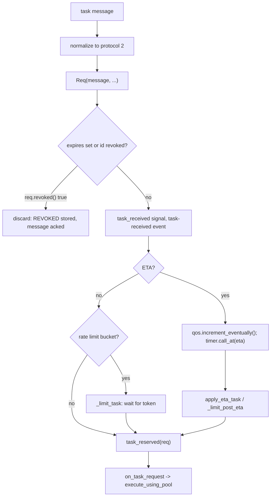

## Overview

Between a task message arriving and its function running, the worker decides whether to run it at all, when, and how to acknowledge it. Each registered task has a **strategy**, a closure built once per consumer start that turns a message into a `Request`, and the `Request` follows the task through the pool and back: it acknowledges or rejects the message, records state, sends events and handles time limits and revocation. Module-level state in `celery.worker.state` tracks the requests a worker holds and the task ids it must not run.

Sources: [celery/worker/strategy.py:99-209](repo://celery/worker/strategy.py#L99-L209), [celery/worker/request.py:67-91](repo://celery/worker/request.py#L67-L91)

The consumer calls the strategy from `on_task_received` (see [[The Consumer and Message Loop]]). Running the function inside a pool process is described on [[Task Execution and Tracing]].

Sources: [celery/worker/consumer/consumer.py:723-786](repo://celery/worker/consumer/consumer.py#L723-L786)

## The default strategy

### Building the handler

`Task.start_strategy` instantiates the task's `Strategy` (by default `celery.worker.strategy:default`) with the task, the app and the consumer. `default` captures everything it needs once: the node name, the event dispatcher and whether this task sends events, the timer's `call_at`, the rate-limit buckets, the consumer's `on_task_request`, and a request class made by `create_request_cls` for this task and pool. Its docstring notes that strategies exist "as an optimization", which is why they are hard to override.

Sources: [celery/app/task.py:520-521](repo://celery/app/task.py#L520-L521), [celery/worker/strategy.py:99-130](repo://celery/worker/strategy.py#L99-L130)

`create_request_cls` subclasses the task's `Request` class and binds the pool's `apply_async`, the task's default time limits, its `acks_late` flag and the trace function into the subclass's `execute_using_pool` and `on_success`, so these are not looked up per message.

Sources: [celery/worker/request.py:818-874](repo://celery/worker/request.py#L818-L874)

### Handling one message

`task_message_handler` runs for each message:

Sources: [celery/worker/strategy.py:132-133](repo://celery/worker/strategy.py#L132-L133)

1. Normalize the message. A protocol 2 message is used as is, with its body still serialized. A protocol 1 body, or a "hybrid" body with `args` in the payload, is converted to protocol 2 by `proto1_to_proto2` or `hybrid_to_proto2`, which build the headers from the body and an `embed` dict of callbacks, errbacks and chord; a body without `args`/`kwargs` or with non-mapping kwargs raises `InvalidTaskError`.
2. Create the `Request` and log `Task <name>[<id>] received` at INFO.
3. If the request has an expiry or its id is in the revoked set, call `req.revoked()`; a revoked or expired request is dropped here.
4. Send the `task_received` signal and, if enabled, a `task-received` event.
5. If the request has an ETA, convert it to a timestamp (rejecting the message without requeue if it cannot be converted), increase the prefetch count with `qos.increment_eventually()`, and schedule the request on the timer at that time, either straight to `apply_eta_task` or, with a rate limit, through `_limit_post_eta`.
6. Otherwise, with a rate limit, hand it to the task's bucket with `_limit_task`.
7. Otherwise mark it reserved, call the `on_task_message` callbacks, and pass it to `on_task_request`, which sends it to the pool.

Sources: [celery/worker/strategy.py:25-96](repo://celery/worker/strategy.py#L25-L96), [celery/worker/strategy.py:132-208](repo://celery/worker/strategy.py#L132-L208)

Sources: [celery/worker/strategy.py:132-208](repo://celery/worker/strategy.py#L132-L208), [celery/worker/consumer/consumer.py:329-364](repo://celery/worker/consumer/consumer.py#L329-L364), [celery/worker/consumer/consumer.py:659-663](repo://celery/worker/consumer/consumer.py#L659-L663)

## The Request object

### What a request holds

`Request.__init__` copies the message headers into `request_dict`, keeps the body undecoded for protocol 2, takes the id and task name (and the `shadow` display name), the time limits from the `timelimit` header, the arg/kwarg reprs, and the per-message `ignore_result` falling back to the task's. It parses `eta` and `expires` from ISO 8601 into timezone-aware datetimes, raising `InvalidTaskError` on bad values, and builds `delivery_info` from the message (exchange, routing key, priority, redelivered). The class uses `__slots__` outside PyPy to keep requests small.

Sources: [celery/worker/request.py:67-176](repo://celery/worker/request.py#L67-L176)

The request's `_context` is a task `Context` built from the headers plus the embedded callbacks, errbacks, chain and chord; the backend uses it when the parent process has to record a failure, and `chord`, `errbacks`, `group` and `group_index` are exposed for the same reason.

Sources: [celery/worker/request.py:778-816](repo://celery/worker/request.py#L778-L816)

### Sending to the pool

`execute_using_pool` raises `TaskRevokedError` if the request was revoked meanwhile; otherwise it calls `pool.apply_async` with the trace function (`fast_trace_task` when worker optimizations are on, else `trace_task_ret`), the task name, id, request dict, body, content type and encoding, and the callbacks `on_accepted`, `on_timeout`, `on_success` and `on_failure`. Time limits are the message's, else the task's. The returned pool result is kept as a weak reference so revocation can terminate it.

Sources: [celery/worker/request.py:341-372](repo://celery/worker/request.py#L341-L372), [celery/worker/request.py:832-853](repo://celery/worker/request.py#L832-L853)

`Request.execute` is the in-process alternative used by tests and the solo path: it acknowledges early unless `acks_late`, runs `trace_task` directly, and rejects or acknowledges by the result.

Sources: [celery/worker/request.py:374-406](repo://celery/worker/request.py#L374-L406)

### Callbacks from the pool

| Callback | When | What it does |
| --- | --- | --- |
| `on_accepted(pid, time_accepted)` | A pool process started the task | Records the pid and start time, marks the request active, acknowledges unless `acks_late`, sends `task-started`, applies a pending terminate |
| `on_success((failed, retval, runtime))` | The trace function returned | If the trace reported failure, delegates to `on_failure`; otherwise marks ready and successful, acknowledges if `acks_late`, sends `task-succeeded` |
| `on_failure(exc_info)` | The task or the process failed | Handles `Terminated`, `Reject`, `Ignore`, `Retry`, time limits and lost workers; see [[Retries and Task Errors]] |
| `on_timeout(soft, timeout)` | A time limit passed | Soft: logs a warning. Hard: stores `FAILURE` with `TimeLimitExceeded`, runs `on_failure`, `after_return`, the `task_failure` signal and a `task-failed` event, then acknowledges or requeues by `acks_on_timeout` |

Sources: [celery/worker/request.py:515-611](repo://celery/worker/request.py#L515-L611), [celery/worker/request.py:622-728](repo://celery/worker/request.py#L622-L728)

The hard-timeout path runs the task's failure hooks in the parent because the child process was killed and could not run them; during a cold shutdown it skips that work.

Sources: [celery/worker/request.py:529-594](repo://celery/worker/request.py#L529-L594)

### Acknowledgement

`acknowledge()` and `reject(requeue)` call the promises the consumer passed in, at most once per request (`acknowledged` guards both); `reject` also sends a `task-rejected` event. Without `acks_late`, the message is acknowledged as soon as a pool process accepts the task. With `acks_late` it is acknowledged after success, or according to the failure rules.

Sources: [celery/worker/request.py:730-740](repo://celery/worker/request.py#L730-L740), [celery/worker/request.py:515-527](repo://celery/worker/request.py#L515-L527)

## Revocation

`revoked()` decides whether to skip a request. It is true if the request was already revoked, if it has expired (`maybe_expire` adds its id to the revoked set), if its id is in the revoked set, or if one of its stamped headers matches a value in `revoked_stamps` (see [[Stamping]]). A skipped request logs `Discarding revoked task`, is marked ready, sends `task-revoked`, stores the `REVOKED` state, is acknowledged and sends the `task_revoked` signal.

Sources: [celery/worker/request.py:408-414](repo://celery/worker/request.py#L408-L414), [celery/worker/request.py:457-509](repo://celery/worker/request.py#L457-L509)

`terminate(pool, signal)` kills a running task: if it has started it signals the child process and announces the revocation as terminated; if it has not started yet it remembers the signal and applies it in `on_accepted`. `cancel` is the shutdown variant described on [[Worker Signals and Shutdown]]. The `revoke` remote control command adds ids to the revoked set and terminates matching active requests; see [[Remote Control and Inspection]].

Sources: [celery/worker/request.py:416-426](repo://celery/worker/request.py#L416-L426)

## Worker state

### Request bookkeeping

`celery.worker.state` keeps module-level collections shared by the consumer, the requests and the control commands:

Sources: [celery/worker/state.py:21-25](repo://celery/worker/state.py#L21-L25)

| Name | Type | Meaning |
| --- | --- | --- |
| `requests` | dict | Reserved requests by task id |
| `reserved_requests` | `WeakSet` | Received and waiting or running |
| `active_requests` | `WeakSet` | Accepted by a pool process |
| `successful_requests` | `LimitedSet` | Recently succeeded ids (1000, 3 h) |
| `total_count`, `all_total_count` | `Counter`, list | Tasks accepted, by name and in total |
| `revoked` | `LimitedSet` | Revoked ids (50000, 3 h) |
| `revoked_stamps` | dict | Stamp header values flagged for revocation |
| `should_stop`, `should_terminate` | flags | Shutdown requests |

Sources: [celery/worker/state.py:27-75](repo://celery/worker/state.py#L27-L75)

`task_reserved` adds a request to `requests` and `reserved_requests`; `task_accepted` adds it to `active_requests` and the counters; `task_ready` removes it from all three and, for successes, records its id in `successful_requests`. The limits come from the environment variables `CELERY_WORKER_REVOKES_MAX`, `CELERY_WORKER_REVOKE_EXPIRES`, `CELERY_WORKER_SUCCESSFUL_MAX` and `CELERY_WORKER_SUCCESSFUL_EXPIRES`.

Sources: [celery/worker/state.py:96-131](repo://celery/worker/state.py#L96-L131), [celery/worker/state.py:34-46](repo://celery/worker/state.py#L34-L46)

### LimitedSet

`LimitedSet` is a set that does not grow without bound: `maxlen` is always enforced by dropping the oldest insertions, and items older than `expires` are purged as new keys are inserted (but never below `minlen`). Workers exchange it in `Mingle` and persist it with `--statedb`.

Sources: [celery/utils/collections.py:441-486](repo://celery/utils/collections.py#L441-L486), [celery/utils/collections.py:577-596](repo://celery/utils/collections.py#L577-L596)

### Persistent state

With `celery worker --statedb=<file>`, the `StateDB` bootstep creates `Persistent`, which keeps the revoked set across restarts in a `shelve` file. On open it merges stored revoked ids (current zlib-compressed pickles, or two older formats) and adjusts the logical clock to the stored value, then purges expired ids. On `save` (registered at exit) it writes the compressed revoked set and the advanced clock and closes the file. The docstring notes that only revoked ids are stored.

Sources: [celery/worker/state.py:190-288](repo://celery/worker/state.py#L190-L288), [celery/worker/components.py:208-218](repo://celery/worker/components.py#L208-L218)
