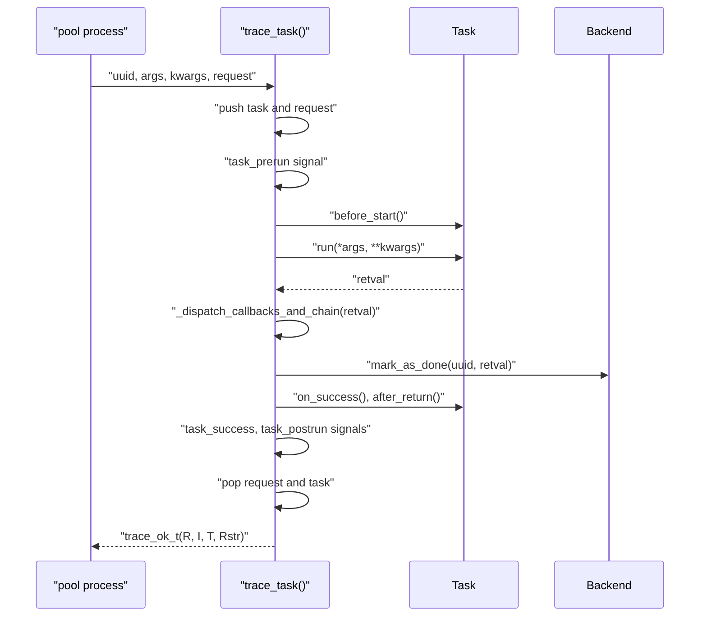

## Overview

The tracer is the code that actually calls a task's function. It runs inside the pool process (or in the caller's process for eager tasks), sets up the request context, sends the task signals, catches every outcome, stores the result through the backend, starts linked callbacks and the next step of a chain, and reports a compact tuple back to the worker's `Request`. `build_tracer` builds one tracer function per task; the worker builds them for every registered task when the task consumer starts.

Sources: [celery/app/trace.py:344-370](repo://celery/app/trace.py#L344-L370), [celery/worker/consumer/consumer.py:716-721](repo://celery/worker/consumer/consumer.py#L716-L721)

The code favours speed over structure: the tracer's comment says the function is "very long because we've unrolled all the calls for performance reasons". This page follows it from the pool entry point to the stored result. What the parent process does with the returned tuple is on [[Task Requests and Strategies]]; how results are stored is on [[Result Backend Interface]].

Sources: [celery/app/trace.py:475-487](repo://celery/app/trace.py#L475-L487)

## Entry points in the pool

### trace_task_ret and fast_trace_task

`Request.execute_using_pool` sends one of two functions to the pool together with the task name, id, request dict and the still-serialized body. Both decode the body with `accept_content` (protocol 2 bodies are only deserialized here, in the child), merge `args`, `kwargs`, the hostname, `is_eager=False` and the embedded callbacks, errbacks, chain and chord into the request, run the task's tracer, and return `(1, R, T)` on failure or `(0, Rstr, T)` on success, where `T` is the runtime and `Rstr` the result's repr.

Sources: [celery/app/trace.py:735-788](repo://celery/app/trace.py#L735-L788), [celery/worker/request.py:356-370](repo://celery/worker/request.py#L356-L370)

`trace_task_ret` looks up the app and task on every call. `fast_trace_task` reads the task registry, accepted content types and hostname from a module-level list filled by `setup_worker_optimizations`, and raises a `RuntimeError` explaining the cause if that list is empty — which happens when pool processes are spawned rather than forked, as with the default prefork pool on Windows.

Sources: [celery/app/trace.py:757-788](repo://celery/app/trace.py#L757-L788)

### Worker optimizations

`setup_worker_optimizations` runs when the worker program starts. It installs stack protection for task classes that override `__call__`, makes the app both current and default (the comment calls this "a hack" that means one app per worker process), finalizes the app, fills the lookup list for `fast_trace_task` and sets `app.use_fast_trace_task`. `reset_worker_optimizations` undoes it.

Sources: [celery/app/trace.py:804-844](repo://celery/app/trace.py#L804-L844)

The stack protection exists because the tracer calls `task.run` directly when a task does not override `__call__`. A custom `__call__` that calls `super().__call__` would push a second request; the patched `BaseTask.__call__` detects the worker's own single request and calls `run` without pushing again.

Sources: [celery/app/trace.py:847-873](repo://celery/app/trace.py#L847-L873), [celery/app/trace.py:366-369](repo://celery/app/trace.py#L366-L369)

### trace_task

`trace_task(task, uuid, args, kwargs, request)` builds the tracer on first use and caches it on `task.__trace__`. An exception raised outside the task body (in the tracer itself) is reported through the `task_internal_error` signal and returned as a `FAILURE` with an internal `ExceptionInfo`; `Reject` is re-raised.

Sources: [celery/app/trace.py:689-732](repo://celery/app/trace.py#L689-L732), [celery/app/trace.py:791-801](repo://celery/app/trace.py#L791-L801)

## Building a tracer

`build_tracer` resolves everything that does not change between calls: the function to call (`task.run` unless `__call__` is overridden), the loader's `on_task_init` and `on_process_cleanup` hooks, the task's `before_start`, `on_success` and `after_return` only if the task overrides them, the request and task stacks, the receivers of `task_prerun`, `task_postrun` and `task_success`, and whether duplicate deliveries of successful tasks should be skipped.

Sources: [celery/app/trace.py:370-415](repo://celery/app/trace.py#L370-L415), [celery/app/trace.py:131-134](repo://celery/app/trace.py#L131-L134)

Duplicate detection (`worker_deduplicate_successful_tasks`) is only enabled for `acks_late` tasks with a persistent backend. For a redelivered message whose id is in the worker's recent successes or whose stored state is already `SUCCESS`, the tracer logs that the task is ignored and, if the stored metadata has no children but the request has callbacks or a chain, dispatches them once; a failure to do so raises `Reject(requeue=True)`.

Sources: [celery/app/trace.py:374-376](repo://celery/app/trace.py#L374-L376), [celery/app/trace.py:510-561](repo://celery/app/trace.py#L510-L561)

## One execution

### Steps of a call

The tracer function performs these steps for each call:

Sources: [celery/app/trace.py:475-476](repo://celery/app/trace.py#L475-L476)

1. Check that `kwargs` is a mapping (else `InvalidTaskError`) and build a `Context` from the request with `called_directly=False`.
2. Decide whether to publish the result: not for ignored results, and for eager calls only when `store_eager_result` is set. `track_started` stores a `STARTED` state with the pid and hostname, unless eager or ignored.
3. Push the task on the current-task stack and the request on the task's request stack.
4. Send `task_prerun`, call the loader's `on_task_init`, store `STARTED` if tracked, call `before_start`.
5. Call the function.
6. On success: dispatch callbacks and the next chain step, then `mark_as_done`, then call `on_success`, send `task_success` and log `succeeded in <runtime>s`.
7. Unless the state is `IGNORED`, `RETRY` or `REJECTED`, call `after_return`.
8. Always send `task_postrun`, pop both stacks and, outside eager mode, run the backend's `process_cleanup` and the loader's cleanup.

Sources: [celery/app/trace.py:487-509](repo://celery/app/trace.py#L487-L509), [celery/app/trace.py:563-670](repo://celery/app/trace.py#L563-L670)

Sources: [celery/app/trace.py:563-670](repo://celery/app/trace.py#L563-L670)

### Callbacks and chains

`_dispatch_callbacks_and_chain` sends each linked callback with the return value as its first argument. With several callbacks, group callbacks are sent individually and the rest are sent together as one group. If the request carries a chain, the last element of the list is the next task: it is sent with the return value and the rest of the list as its own `chain`. Parent id, root id and, with `task_inherit_parent_priority`, the priority are passed along. The docstring notes that dispatching is not atomic, so a redelivery can resend callbacks, which is accepted under at-least-once delivery. See [[Chains]] for how the chain list is built.

Sources: [celery/app/trace.py:426-473](repo://celery/app/trace.py#L426-L473)

Callbacks are sent before the result is stored, so the result's `children` include them. An `EncodeError` raised while storing the result is turned into a task failure.

Sources: [celery/app/trace.py:608-632](repo://celery/app/trace.py#L608-L632)

## Outcomes

### Outcome table

| Raised by the body | State | Handling |
| --- | --- | --- |
| nothing | `SUCCESS` | Callbacks, `mark_as_done`, `on_success`, `task_success` |
| `Reject` | `REJECTED` | Logged with the reject policy; the worker rejects the message |
| `Ignore` | `IGNORED` | Logged at INFO; nothing stored |
| `Retry` | `RETRY` | `handle_retry`: `mark_as_retry`, `on_retry`, `task_retry`; errbacks not called |
| other `Exception` | `FAILURE` | `handle_failure`: `mark_as_failure` (errbacks, chord), `on_failure`, `task_failure` |
| `BaseException` | — | Re-raised |

Sources: [celery/app/trace.py:584-606](repo://celery/app/trace.py#L584-L606), [celery/app/trace.py:206-282](repo://celery/app/trace.py#L206-L282)

`on_error` re-raises immediately when the tracer was built with `propagate=True` (eager calls with `task_eager_propagates` or `throw=True`). Otherwise `TraceInfo.handle_error_state` decides whether to store the error: for ignored results only if `store_errors_even_if_ignored`, for eager calls only with `store_eager_result`.

Sources: [celery/app/trace.py:417-424](repo://celery/app/trace.py#L417-L424), [celery/app/trace.py:188-204](repo://celery/app/trace.py#L188-L204)

`handle_failure` converts the exception into a pickleable one (keeping its traceback) so it can be sent back to the parent process and stored, calls `mark_as_failure`, `on_failure`, sends `task_failure` and logs. `mark_as_failure` also reports the failure to the chord the task belongs to, stores the failure on every task of the remaining chain so the chain's final result does not stay pending, and calls the errbacks.

Sources: [celery/app/trace.py:242-282](repo://celery/app/trace.py#L242-L282), [celery/backends/base.py:188-252](repo://celery/backends/base.py#L188-L252)

### Log policies

Errors are logged by `_log_error` with a policy chosen by `get_log_policy`: `Reject` at WARNING, `Ignore` at INFO, internal errors at CRITICAL, exceptions listed in the task's `throws` at INFO without traceback ("raised expected"), and everything else at ERROR with traceback ("raised unexpected"). The log record's `extra['data']` carries the id, name, exception, traceback and argument reprs for custom handlers.

Sources: [celery/app/trace.py:91-106](repo://celery/app/trace.py#L91-L106), [celery/app/trace.py:137-147](repo://celery/app/trace.py#L137-L147), [celery/app/trace.py:284-311](repo://celery/app/trace.py#L284-L311)

### Memory

Every exception path calls `traceback_clear`, which walks the traceback and clears each frame's locals. The comments tie this to Issue #8882: tracebacks kept alive by stored exception info held on to large local variables.

Sources: [celery/app/trace.py:314-341](repo://celery/app/trace.py#L314-L341)

## Ignored results

`get_actual_ignore_result` lets a per-call `ignore_result` override the task's. Because `Context` defines `ignore_result = False` at class level, it only treats the value as an override when it was set on the instance.

Sources: [celery/app/trace.py:157-176](repo://celery/app/trace.py#L157-L176)
