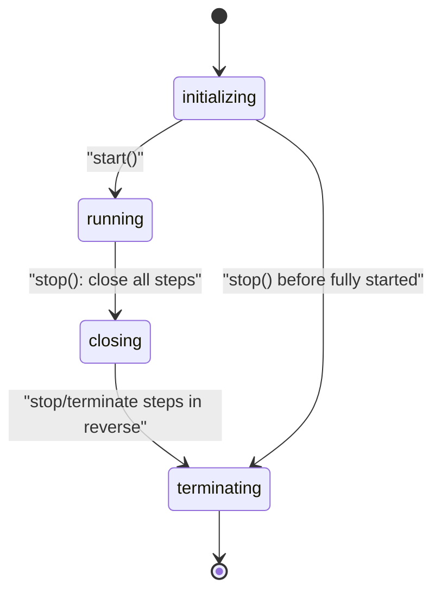

## Overview

`celery worker` builds a `WorkController`, the in-process worker, and starts it. The module docstring describes `WorkController` as "a bare-bones worker without global side-effects": signal handlers, logging and the startup banner belong to its subclass `celery.apps.worker.Worker`, and everything else — event loop, timer, execution pool, embedded beat, state database, autoscaler and consumer — is a bootstep. Bootsteps are small objects that declare dependencies on each other; a blueprint sorts them and starts them in order.

Sources: [celery/worker/worker.py:1-12](repo://celery/worker/worker.py#L1-L12), [celery/worker/worker.py:75-88](repo://celery/worker/worker.py#L75-L88)

This page covers the bootstep framework, the worker's own steps and the startup sequence. The consumer has a second blueprint of its own, described on [[The Consumer and Message Loop]] and [[Consumer Bootsteps]]; stopping is on [[Worker Signals and Shutdown]].

Sources: [celery/worker/components.py:221-246](repo://celery/worker/components.py#L221-L246)

## Bootsteps

### Steps

A `Step` has a `name` (its qualified class name unless set, filled in by the `StepType` metaclass), a `requires` tuple of other steps, an `enabled` flag, an `include_if(parent)` predicate and a `create(parent)` method. Its `__init__` runs when the step is bound to the parent and is the place to set attributes on the parent. `last = True` marks the one step that must start last; the docstring reserves it for the worker's consumer.

Sources: [celery/bootsteps.py:266-352](repo://celery/bootsteps.py#L266-L352)

`StartStopStep` adds a lifecycle. `include` keeps the object returned by `create` as `self.obj` and appends the step to the parent's `steps` list; `start`, `stop` and `terminate` then call the same methods on that object (falling back to `stop` when there is no `terminate`). `ConsumerStep` is a start-stop step that requires the consumer's `Connection` step and starts the kombu consumers returned by `get_consumers(channel)`; applications use it to consume their own queues inside the worker.

Sources: [celery/bootsteps.py:355-415](repo://celery/bootsteps.py#L355-L415)

### Blueprints

A `Blueprint` holds a set of step types: its `default_steps` plus any passed in. `apply(parent)` resolves each step by name, then follows `requires` transitively so a dependency outside the set is pulled in. `_finalize_steps` builds a `DependencyGraph`, adds an edge from the `last` step to every other step so it sorts last, and topologically sorts; an unknown dependency raises `KeyError('unknown bootstep: ...')`. Each step is instantiated with the parent and keyword arguments, then `include(parent)` decides whether it is created.

Sources: [celery/bootsteps.py:74-107](repo://celery/bootsteps.py#L74-L107), [celery/bootsteps.py:186-256](repo://celery/bootsteps.py#L186-L256)

`start(parent)` sets the state to `RUN`, calls `on_start`, and starts every step in `parent.steps` in order, counting how many started. `send_all` calls a method on every step, in reverse order by default, logging rather than raising errors unless `propagate` is set. `stop` closes the steps in forward order, then calls `stop` (or `terminate`) on them in reverse, calls `on_stopped` and sets `shutdown_complete`. If the blueprint never fully started, `stop` only marks it terminated.

Sources: [celery/bootsteps.py:109-184](repo://celery/bootsteps.py#L109-L184)

Sources: [celery/bootsteps.py:91-97](repo://celery/bootsteps.py#L91-L97), [celery/bootsteps.py:155-176](repo://celery/bootsteps.py#L155-L176)

### Extending the worker

`app.steps` is a `defaultdict(set)` keyed by blueprint (`'worker'`, `'consumer'`). `WorkController.setup_instance` passes `app.steps['worker']` to its blueprint, so a custom step class added there joins the dependency graph like a built-in one.

Sources: [celery/app/base.py:368-369](repo://celery/app/base.py#L368-L369), [celery/worker/worker.py:131-140](repo://celery/worker/worker.py#L131-L140)

## The worker blueprint

### Steps at a glance

| Step | Requires | Included when | What it creates |
| --- | --- | --- | --- |
| `Timer` | — | always | `kombu` timer for the event loop, or the pool's `Timer` class |
| `Hub` | `Timer` | `use_eventloop` | The kombu event loop hub |
| `Pool` | `Hub` | always | The execution pool (`w.pool`) |
| `Beat` | — | `-B` | An embedded beat service |
| `StateDB` | — | `--statedb` | Persistent revoked-task state |
| `Autoscaler` | `Pool` | `--autoscale` | The autoscaler |
| `Consumer` | — (last) | always | The `Consumer` and its blueprint |

Sources: [celery/worker/worker.py:79-88](repo://celery/worker/worker.py#L79-L88), [celery/worker/components.py:32-120](repo://celery/worker/components.py#L32-L120), [celery/worker/components.py:181-246](repo://celery/worker/components.py#L181-L246), [celery/worker/autoscale.py:31-58](repo://celery/worker/autoscale.py#L31-L58)

### Timer and Hub

With the event loop, the timer is a kombu `Timer` with a 10-second maximum interval and no thread of its own; otherwise it is the pool's timer class (the eventlet pool supplies its own), run as a thread at `worker_timer_precision`. The `Hub` step reuses the current event loop or creates one (a transport may require a special hub class), replaces the app clock's mutex and billiard's pool `Lock` with dummy locks because everything runs in one thread, and initializes the poller on start.

Sources: [celery/worker/components.py:32-98](repo://celery/worker/components.py#L32-L98)

The event loop is used when the environment is not monkey-patched (`detect_environment() == 'default'`), the transport supports asynchronous I/O, and the platform is not Windows.

Sources: [celery/worker/worker.py:239-242](repo://celery/worker/worker.py#L239-L242)

### Pool

`Pool.__init__` parses `--autoscale max,min` and sets `max_concurrency` and `min_concurrency`. `create` warns when `worker_pool` names eventlet or gevent (they must be chosen with `-P` so patches apply early), and, outside the event loop or on Windows, runs the pool in threaded mode. With the event loop it creates a `LaxBoundedSemaphore` of the pool size; when `worker_pool_putlocks` is set and the pool uses the semaphore, `process_task` becomes `_process_task_sem`, which acquires a slot before handing a request to the pool. The pool is instantiated with the concurrency, `max_tasks_per_child`, `max_memory_per_child`, time limits, `worker_lost_wait` and the `-O` scheduling strategy. Pool types are on [[Concurrency Pools]].

Sources: [celery/worker/components.py:101-178](repo://celery/worker/components.py#L101-L178), [celery/worker/worker.py:220-231](repo://celery/worker/worker.py#L220-L231)

### Beat, StateDB and Consumer

`Beat` refuses to run with eventlet or gevent pools and creates an `EmbeddedService` with the configured schedule file and scheduler; see [[Periodic Tasks with Beat]]. `StateDB` creates `state.Persistent` over the state file and registers its `save` at exit; see [[Task Requests and Strategies]].

Sources: [celery/worker/components.py:181-218](repo://celery/worker/components.py#L181-L218)

`Consumer` is marked `last`. It sets the initial prefetch count to `max_concurrency` (or `concurrency`) times `worker_prefetch_multiplier` and instantiates `worker_consumer` with `process_task` as the callback for every accepted request.

Sources: [celery/worker/components.py:221-246](repo://celery/worker/components.py#L221-L246)

## WorkController setup

`WorkController.__init__` resolves the node name, records the start time, calls `loader.init_worker()` (which imports the task modules once), then `on_before_init`, `setup_defaults`, `on_after_init` and `setup_instance`.

Sources: [celery/worker/worker.py:90-99](repo://celery/worker/worker.py#L90-L99), [celery/loaders/base.py:107-111](repo://celery/loaders/base.py#L107-L111)

`setup_defaults` resolves every option against its setting with `app.either`, so command-line values win over configuration: concurrency, task events, pool class, consumer and timer classes, put-locks and restarts, state DB, beat scheduler and schedule file, time limits, `max_tasks_per_child`, `max_memory_per_child`, prefetch multiplier, `disable_rate_limits` and `worker_lost_wait`.

Sources: [celery/worker/worker.py:351-410](repo://celery/worker/worker.py#L351-L410)

`setup_instance` applies the queue selection (see [[Queues and Routing]]), imports extra `--include` modules and adds every registered task's module to `include` so that execv-started children import them too, defaults the concurrency to the CPU count (2 if unknown), decides on the event loop, sends `worker_init`, resolves the pool class and builds and applies the blueprint.

Sources: [celery/worker/worker.py:101-140](repo://celery/worker/worker.py#L101-L140), [celery/worker/worker.py:183-193](repo://celery/worker/worker.py#L183-L193)

`start()` starts the blueprint. `WorkerTerminate` leads to `terminate()`, any other exception is logged as an unrecoverable error and stops with a failure exit code, and `SystemExit` or `KeyboardInterrupt` stop the worker. The blueprint's hooks create the pid lock on start, call `loader.shutdown_worker()` on close, and stop the timer, shut down the consumer and release the pid lock when stopped.

Sources: [celery/worker/worker.py:201-212](repo://celery/worker/worker.py#L201-L212), [celery/worker/worker.py:141-165](repo://celery/worker/worker.py#L141-L165)

## The worker program

The `celery worker` command parses its options, applies trailing `key=value` settings in the `worker` namespace, re-executes itself detached when `--detach` is given, drops privileges with `--uid`/`--gid`, expands `%n`-style node formats in the pid file and state DB paths, then creates `app.Worker(...)`, calls `start()` and exits with `worker.exitcode`.

Sources: [celery/bin/worker.py:306-371](repo://celery/bin/worker.py#L306-L371)

`apps.worker.Worker` hooks into each phase:

Sources: [celery/apps/worker.py:91-93](repo://celery/apps/worker.py#L91-L93)

1. `on_before_init` installs the tracer optimizations, sends `celeryd_init` (which can configure workers by node name) and checks privileges against `accept_content`.
2. `on_after_init` reads the stdout redirection settings and sets up colours.
3. `on_init_blueprint` sets up logging and calls `setup_worker_optimizations` again, which finalizes the app.
4. `on_start` sends `celeryd_after_setup` (the place to change queues after `-Q`), purges the queues if `--purge` was given, prints the banner, sets the process title, installs signal handlers and redirects stdout and stderr to the logger.
5. `on_consumer_ready` sends `worker_ready` and logs `<hostname> ready.`.

Sources: [celery/apps/worker.py:91-190](repo://celery/apps/worker.py#L91-L190)

The banner lists the app, node name, broker and result backend URIs, concurrency with the pool name (or the autoscale range), whether task events are on, and the queues being consumed; at `INFO` level and below it also lists the registered tasks, including built-ins at `DEBUG`.

Sources: [celery/apps/worker.py:198-252](repo://celery/apps/worker.py#L198-L252)
