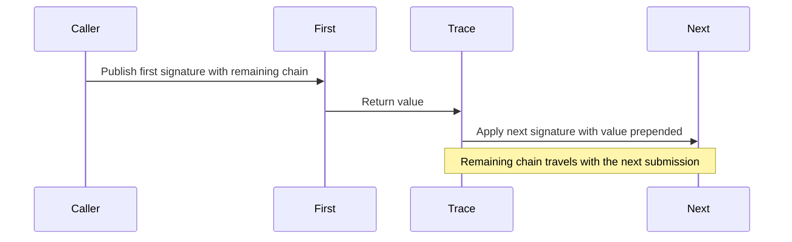

## Overview

Canvas represents task invocations as signatures that can be serialized, combined, and submitted later. A signature holds the task name, arguments, keyword arguments, and execution options. Chains encode successive work, groups fan out, and chords synchronize a group before a callback. Each eventual task submission uses [[Task Publishing and Routing]], while completion and coordination depend on [[Results and Backends]].

Sources: [celery/canvas.py:232-278](repo://celery/canvas.py#L232-L278), [celery/canvas.py:1322-1367](repo://celery/canvas.py#L1322-L1367), [celery/canvas.py:1616-1635](repo://celery/canvas.py#L1616-L1635), [celery/canvas.py:1971-1980](repo://celery/canvas.py#L1971-L1980)

## Describe one invocation

Use `task.s` to create a mutable signature and `task.si` for an immutable one. The signature's dictionary form contains `task`, `args`, `kwargs`, `options`, `subtask_type`, and `immutable`; it can also be reconstructed from an existing dictionary. `set` can attach execution options after creating a signature, which keeps invocation data separate from the act of publishing it.

Sources: [celery/app/task.py:962-986](repo://celery/app/task.py#L962-L986), [celery/canvas.py:252-263](repo://celery/canvas.py#L252-L263), [celery/canvas.py:323-345](repo://celery/canvas.py#L323-L345)

Applying a signature merges partial inputs with stored values. Additional positional arguments are prepended, additional keyword arguments override matching stored keys, and options merge subject to protected keys. Immutable signatures keep their stored arguments unless merging is explicitly forced; stamped option keys remain protected separately. This is why a chain callback can receive the previous task's result without spelling it into the original signature.

Sources: [celery/canvas.py:370-443](repo://celery/canvas.py#L370-L443), [celery/app/trace.py:467-473](repo://celery/app/trace.py#L467-L473)

Calling a plain signature directly invokes its task in the current process. `delay` calls `apply_async`, which resolves the task's asynchronous submission function. `freeze` assigns an ID and result handle without dispatching the task; its documentation warns that publishing a frozen signature twice produces two messages with the same task ID. Cloning copies options before later workflow preparation mutates them.

Sources: [celery/canvas.py:347-354](repo://celery/canvas.py#L347-L354), [celery/canvas.py:370-401](repo://celery/canvas.py#L370-L401), [celery/canvas.py:461-520](repo://celery/canvas.py#L461-L520)

## Run a chain

The chain class's example adds two numbers, then passes that result into the next addition. The returned handle represents the last task; following `parent` reaches the earlier result. With the `add` implementation from [[Quickstart]], this expression computes eight when its worker and result backend are configured.

Sources: [celery/canvas.py:1333-1348](repo://celery/canvas.py#L1333-L1348), [examples/tutorial/tasks.py:6-8](repo://examples/tutorial/tasks.py#L6-L8)

```pycon
>>> res = chain(add.s(2, 2), add.s(4))()
>>> res.get()
8
```

Sources: [celery/canvas.py:1338-1340](repo://celery/canvas.py#L1338-L1340)

Chain `run` prepares the steps, freezes result identities, removes the first runnable task from its prepared stack, and publishes it with the remaining chain options. A single-task chain returns the actual submission result; a longer chain returns the prepared final result. Preparation splices nested chains, clones tasks, connects parent result handles, and attaches error callbacks across steps.

Sources: [celery/canvas.py:1048-1092](repo://celery/canvas.py#L1048-L1092), [celery/canvas.py:1201-1213](repo://celery/canvas.py#L1201-L1213), [celery/canvas.py:1243-1275](repo://celery/canvas.py#L1243-L1275)



Sources: [celery/canvas.py:1080-1092](repo://celery/canvas.py#L1080-L1092), [celery/app/trace.py:467-473](repo://celery/app/trace.py#L467-L473)

The worker trace dispatches linked callbacks and then the next chain signature after a successful function return. It passes the value as the next task's partial arguments and preserves root and parent identity. [[Task Retries and Failure Handling]] explains why this publication is not atomic with all other completion work and why redelivery can repeat continuations.

Sources: [celery/app/trace.py:426-473](repo://celery/app/trace.py#L426-L473), [celery/app/trace.py:619-627](repo://celery/app/trace.py#L619-L627)

## Fan out with groups

`group.apply_async` freezes a group identity, prepares member signatures, applies them, and builds a `GroupResult` with a readiness barrier. It can add that group result to a current parent task's trail. Empty groups return a frozen result, and eager configuration takes the local apply path. Members are independently submitted work rather than sequential chain steps.

Sources: [celery/canvas.py:1616-1650](repo://celery/canvas.py#L1616-L1650)

Passing `link` directly to `group.apply_async` raises an error directing the caller to use a chord; passing `link_error` there also raises. The separate `group.link` method links an immutable callback only to the first member, whose result cannot represent its siblings. `group.link_error` clones the errback onto every child and explicitly allows multiple invocations. A group link therefore does not establish a completion barrier.

Sources: [celery/canvas.py:1616-1623](repo://celery/canvas.py#L1616-L1623), [celery/canvas.py:1691-1712](repo://celery/canvas.py#L1691-L1712)

## Synchronize with chords

A chord has a header group and a body. The body receives the header return values as a list after the header completes. Chain preparation automatically upgrades a group followed by a task into a chord. That introduces backend coordination even if the original expression used a chain operator, so the configured backend must support the resulting workflow.

Sources: [celery/canvas.py:1971-1980](repo://celery/canvas.py#L1971-L1980), [celery/canvas.py:1215-1235](repo://celery/canvas.py#L1215-L1235), [celery/backends/base.py:864-867](repo://celery/backends/base.py#L864-L867)

Chord `run` freezes the body and header identities, removes chain and chord options that should not leak into nested headers, asks the backend to apply chord coordination, and publishes the header. For an empty header, no part-completion notification can occur, so it invokes the body with an empty list directly. The body's result handle receives the header result as its parent.

Sources: [celery/canvas.py:2226-2286](repo://celery/canvas.py#L2226-L2286)

The fallback `celery.chord_unlock` task reconstructs the group result and checks readiness. It retries if the header is incomplete or readiness checks fail, then joins results with propagation enabled and calls the body. Join or callback failures go through `chord_error_from_stack` with a cause-bearing error. Native backend coordination and RPC's explicit chord rejection are documented in [[Results and Backends]].

Sources: [celery/app/builtins.py:37-97](repo://celery/app/builtins.py#L37-L97), [celery/backends/rpc.py:214-215](repo://celery/backends/rpc.py#L214-L215)

## Batch work and attach stamps

Canvas also provides `xmap`, `xstarmap`, and `chunks`. Chunks divides an iterable into partitions and constructs a group of `xstarmap` invocations, then submits that group with the underlying task's route name. This makes partitioning part of the workflow representation while preserving routing to the task being batched.

Sources: [celery/canvas.py:1385-1435](repo://celery/canvas.py#L1385-L1435), [celery/canvas.py:1437-1472](repo://celery/canvas.py#L1437-L1472)

`stamp` attaches custom headers, optionally using a visitor's `on_signature` result and propagating through links. Duplicate values are replaced by default or accumulated when `append_stamps=True`. These stamps are protected during later signature-option merges and enter task message headers. [[Monitoring and Worker Control]] uses stamped headers for selecting revocations across related tasks.

Sources: [celery/canvas.py:403-440](repo://celery/canvas.py#L403-L440), [celery/canvas.py:554-568](repo://celery/canvas.py#L554-L568), [celery/canvas.py:614-634](repo://celery/canvas.py#L614-L634), [celery/app/amqp.py:370-390](repo://celery/app/amqp.py#L370-L390), [celery/worker/request.py:480-498](repo://celery/worker/request.py#L480-L498)
