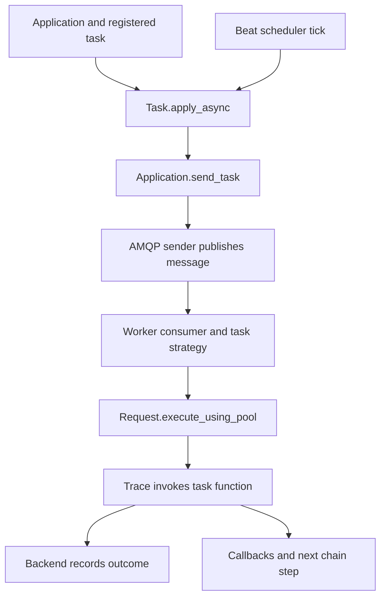

## Overview

Celery distributes Python tasks through messages. A client submits a task, a broker delivers its message, and a worker executes the registered implementation. Multiple workers can consume work across machines. The application object connects this system: it owns task registration, configuration, messaging, and the result backend. Start with [[Quickstart]] to run the tutorial task, then use the flow pages below to understand the boundaries involved.

Sources: [README.rst:91-105](repo://README.rst#L91-L105), [celery/app/base.py:343-408](repo://celery/app/base.py#L343-L408)

The central distinction is between submitting work and executing it. `Task.apply_async` normally delegates to `app.send_task`, which publishes a message and constructs an `AsyncResult`; the return value represents the task identifier, not the function's computed value. The worker later invokes the function through a trace that records its outcome. This separation allows callers and workers to run in different processes without transferring the Python function itself.

Sources: [celery/app/task.py:682-708](repo://celery/app/task.py#L682-L708), [celery/app/base.py:1006-1041](repo://celery/app/base.py#L1006-L1041), [celery/app/trace.py:580-605](repo://celery/app/trace.py#L580-L605)

## System map

| Area | What it does | Documentation |
| --- | --- | --- |
| First task | Defines the tutorial app and its addition task | [[Quickstart]] |
| Application | Builds configuration and finalizes the task registry | [[Application and Configuration]] |
| Publishing | Resolves destinations and serializes task messages | [[Task Publishing and Routing]] |
| Worker | Starts components and sends requests to an execution pool | [[Worker Lifecycle and Execution]] |
| Failure policy | Resubmits tasks and handles execution control exceptions | [[Task Retries and Failure Handling]] |
| Results | Records completion and connects it to the configured backend | [[Results and Backends]] |
| Workflows | Chains task signatures and synchronizes groups with chords | [[Canvas Workflows]] |
| Scheduling | Publishes tasks when schedule entries become due | [[Periodic Scheduling]] |
| Operations | Broadcasts commands to all or selected workers | [[Monitoring and Worker Control]] |
| Integration | Defers Django task publication until transaction commit | [[Framework Integration and Extensions]] |
| Testing | Runs an embedded worker and verifies it with a ping task | [[Development and Testing]] |

Sources: [examples/tutorial/tasks.py:1-12](repo://examples/tutorial/tasks.py#L1-L12), [celery/app/base.py:657-677](repo://celery/app/base.py#L657-L677), [celery/app/amqp.py:565-575](repo://celery/app/amqp.py#L565-L575), [celery/worker/request.py:341-372](repo://celery/worker/request.py#L341-L372), [celery/app/autoretry.py:33-66](repo://celery/app/autoretry.py#L33-L66), [celery/app/trace.py:619-627](repo://celery/app/trace.py#L619-L627), [celery/canvas.py:1322-1367](repo://celery/canvas.py#L1322-L1367), [celery/canvas.py:1971-1980](repo://celery/canvas.py#L1971-L1980), [celery/beat.py:326-364](repo://celery/beat.py#L326-L364), [celery/app/control.py:755-776](repo://celery/app/control.py#L755-L776), [celery/contrib/django/task.py:8-21](repo://celery/contrib/django/task.py#L8-L21), [celery/contrib/testing/worker.py:99-136](repo://celery/contrib/testing/worker.py#L99-L136)

## A task from call to completion

Sources: [celery/app/task.py:682-708](repo://celery/app/task.py#L682-L708), [celery/app/base.py:1006-1041](repo://celery/app/base.py#L1006-L1041), [celery/app/amqp.py:565-575](repo://celery/app/amqp.py#L565-L575), [celery/worker/strategy.py:119-150](repo://celery/worker/strategy.py#L119-L150), [celery/worker/strategy.py:193-208](repo://celery/worker/strategy.py#L193-L208), [celery/worker/request.py:341-372](repo://celery/worker/request.py#L341-L372), [celery/app/trace.py:580-605](repo://celery/app/trace.py#L580-L605), [celery/app/trace.py:619-627](repo://celery/app/trace.py#L619-L627), [celery/beat.py:393-410](repo://celery/beat.py#L393-L410)

1. [[Application and Configuration]] explains how a decorated function becomes a named task and how finalization binds pending tasks to the application.
2. [[Task Publishing and Routing]] follows the call into a message containing its task name, identifier, arguments, execution options, and workflow metadata.
3. [[Worker Lifecycle and Execution]] follows the consumer strategy into a request, an execution pool, and the function invocation.
4. [[Results and Backends]] explains the recorded outcome; [[Canvas Workflows]] follows callbacks and the next chain step dispatched around completion.
5. [[Periodic Scheduling]] adds a producer that reads due entries and uses the same task submission interfaces.

Sources: [celery/app/base.py:590-633](repo://celery/app/base.py#L590-L633), [celery/app/base.py:657-677](repo://celery/app/base.py#L657-L677), [celery/app/amqp.py:370-405](repo://celery/app/amqp.py#L370-L405), [celery/worker/request.py:341-372](repo://celery/worker/request.py#L341-L372), [celery/app/trace.py:619-627](repo://celery/app/trace.py#L619-L627), [celery/beat.py:393-410](repo://celery/beat.py#L393-L410)

## Decisions that cross system boundaries

**Task names cross the broker boundary.** The message identifies a task by name. A worker builds strategies from its own registry and rejects unknown task names, recording `NotRegistered`. Producer and worker imports therefore matter independently: successfully publishing a task does not demonstrate that a worker loaded its implementation. [[Application and Configuration]] explains registration; [[Monitoring and Worker Control]] covers inspecting worker state.

Sources: [celery/app/amqp.py:370-405](repo://celery/app/amqp.py#L370-L405), [celery/worker/consumer/consumer.py:677-721](repo://celery/worker/consumer/consumer.py#L677-L721)

**Application setup is deferred.** Decorators can return a `PromiseProxy` instead of immediately constructing a task. Configuration also starts behind `PendingConfiguration`. The decorator's own documentation warns against accessing proxy attributes before setup is complete when deferred binding matters. Finalization drains pending tasks and binds them together, keeping task construction tied to an application lifecycle rather than requiring every import to finish setup immediately.

Sources: [celery/app/base.py:403-408](repo://celery/app/base.py#L403-L408), [celery/app/base.py:536-570](repo://celery/app/base.py#L536-L570), [celery/app/base.py:657-677](repo://celery/app/base.py#L657-L677)

**Publication and execution have separate retry paths.** The messaging layer passes a publication retry policy to the producer. Task autoretry instead wraps the task function and calls `task.retry` after selected exceptions. A third path, broker redelivery, depends on request acknowledgment and rejection. [[Task Retries and Failure Handling]] explains these distinctions so an execution failure is not confused with failure to send the original message.

Sources: [celery/app/amqp.py:485-488](repo://celery/app/amqp.py#L485-L488), [celery/app/amqp.py:553-575](repo://celery/app/amqp.py#L553-L575), [celery/app/autoretry.py:33-66](repo://celery/app/autoretry.py#L33-L66), [celery/worker/request.py:590-618](repo://celery/worker/request.py#L590-L618)

**Workflow dispatch is not atomic.** The trace explicitly documents that callbacks and the next chain step can be sent separately; a rejection and redelivery can dispatch already-sent callbacks again. Successful execution, result recording, and follow-up publication are distinct operations. Read the failure guarantees in [[Task Retries and Failure Handling]] alongside [[Canvas Workflows]] when reasoning about repeated effects.

Sources: [celery/app/trace.py:426-438](repo://celery/app/trace.py#L426-L438), [celery/app/trace.py:619-627](repo://celery/app/trace.py#L619-L627)

**Workers are assembled from components.** The worker blueprint includes the hub, pool, timer, state database, consumer, optional Beat, and autoscaling component; application-provided steps join that blueprint. [[Worker Lifecycle and Execution]] explains the built-in assembly, while [[Framework Integration and Extensions]] describes the extension contract that makes additional components participate in startup and shutdown.

Sources: [celery/worker/worker.py:76-88](repo://celery/worker/worker.py#L76-L88), [celery/worker/worker.py:127-139](repo://celery/worker/worker.py#L127-L139)
