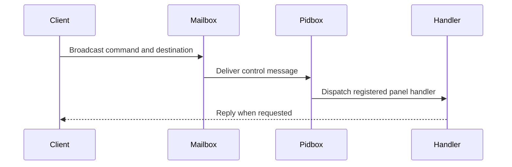

## Overview

Celery exposes command/reply inspection and a separate stream of events. Inspection asks a live worker for its current state; control changes worker behavior; events report activity for a receiver to assemble into a cluster view. [[Worker Lifecycle and Execution]] describes the services that emit and receive these messages. [[Results and Backends]] describes persisted task outcomes, which have a different lifetime from live monitoring data.

Sources: [celery/app/control.py:107-117](repo://celery/app/control.py#L107-L117), [celery/worker/control.py:400-448](repo://celery/worker/control.py#L400-L448), [celery/events/dispatcher.py:116-140](repo://celery/events/dispatcher.py#L116-L140), [celery/events/state.py:398-436](repo://celery/events/state.py#L398-L436), [celery/backends/base.py:581-597](repo://celery/backends/base.py#L581-L597)

## Follow a remote command

The application's `Control` creates a fanout mailbox using configured exchange, serializer, accepted content, queue lifetime, and durability options. `broadcast` acquires a connection and passes the command, arguments, destinations, reply flag, timeout, callback, and reply limit to that mailbox. Destination lists and optional pattern matching constrain which workers should receive a request.

Sources: [celery/app/control.py:431-451](repo://celery/app/control.py#L431-L451), [celery/app/control.py:755-790](repo://celery/app/control.py#L755-L790)

`Inspect._request` broadcasts with `reply=True`, then flattens responses by node name. A single destination can produce that node's value, while a destination list produces a mapping. The default inspection timeout is one second. The worker's pidbox node uses `Panel.data` as its handler registry, invokes the selected command with app/hostname/consumer state, and logs unknown commands or handler errors.

Sources: [celery/app/control.py:82-117](repo://celery/app/control.py#L82-L117), [celery/worker/pidbox.py:25-54](repo://celery/worker/pidbox.py#L25-L54)

Sources: [celery/app/control.py:107-117](repo://celery/app/control.py#L107-L117), [celery/app/control.py:776-790](repo://celery/app/control.py#L776-L790), [celery/worker/pidbox.py:25-54](repo://celery/worker/pidbox.py#L25-L54)

The control bootstep is included only when `worker_enable_remote_control` is true and the transport supports fanout exchanges. It selects a green pidbox implementation for green pools. When inspection receives no replies, the CLI reports that no nodes replied within the time constraint; that response is a bounded observation, not a query to the result backend.

Sources: [celery/worker/consumer/control.py:18-33](repo://celery/worker/consumer/control.py#L18-L33), [celery/bin/control.py:178-198](repo://celery/bin/control.py#L178-L198)

## Inspect worker state

For the tutorial app from [[Quickstart]], `celery -A tasks status` requests ping replies. `celery -A tasks inspect registered` requests its registry listing, and other inspection command names below follow the same interface. The CLI verifies the command category and compiles positional arguments using panel metadata before broadcasting.

Sources: [celery/bin/control.py:129-143](repo://celery/bin/control.py#L129-L143), [celery/bin/control.py:178-191](repo://celery/bin/control.py#L178-L191), [celery/worker/control.py:462-486](repo://celery/worker/control.py#L462-L486), [examples/tutorial/tasks.py:1-8](repo://examples/tutorial/tasks.py#L1-L8)

| Command | What the worker returns |
| --- | --- |
| `ping` | `pong` response |
| `stats` | Controller statistics |
| `active` | Requests currently executing |
| `reserved` | Reserved requests with active requests removed |
| `scheduled` | ETA/countdown requests in the worker timer |
| `revoked` | Worker-local revoked task IDs |
| `registered` | Registered task names and requested attributes, excluding built-ins by default |
| `active_queues` | The task consumer's current queues |

Sources: [celery/worker/control.py:400-486](repo://celery/worker/control.py#L400-L486), [celery/worker/control.py:631-637](repo://celery/worker/control.py#L631-L637)

The worker's `scheduled` view contains messages already held for ETA/countdown execution. It reads timer entries, extracting request ETA, priority, and request information. It does not list recurring Beat configuration: [[Periodic Scheduling]] owns that producer-side schedule. Similarly, `registered` inspects the worker's registry, making it useful when a name can be published but the consumer reports `NotRegistered`.

Sources: [celery/worker/control.py:412-429](repo://celery/worker/control.py#L412-L429), [celery/worker/control.py:462-486](repo://celery/worker/control.py#L462-L486), [celery/worker/consumer/consumer.py:677-700](repo://celery/worker/consumer/consumer.py#L677-L700), [celery/app/base.py:1318-1333](repo://celery/app/base.py#L1318-L1333)

## Change worker behavior

`rate_limit` validates its input, updates the named task, and resets consumer rate buckets; an unknown task returns an error. `add_consumer` and `cancel_consumer` schedule queue changes on the consumer's event path. These commands affect the addressed workers' live consumption behavior; [[Task Publishing and Routing]] controls where future producer messages are sent.

Sources: [celery/worker/control.py:259-284](repo://celery/worker/control.py#L259-L284), [celery/worker/control.py:610-628](repo://celery/worker/control.py#L610-L628)

Pool grow/shrink commands update pool size and prefetch counts, but reject direct resizing when an autoscaler is active. The `autoscale` command changes an existing autoscaler's range and fails if autoscaling is not enabled. Pool restart requires `worker_pool_restarts`; shutdown raises `WorkerShutdown`. The relevant pool capabilities and shutdown paths are documented in [[Worker Lifecycle and Execution]].

Sources: [celery/worker/control.py:545-596](repo://celery/worker/control.py#L545-L596)

## Revoke IDs or stamped tasks

ID revocation updates the worker's revoked set and attempts to mark each ID revoked in the backend, logging backend failures. With termination requested, it finds known requests and invokes their termination path. A task not yet executing can later be discarded at the request's revocation check, as explained in [[Task Retries and Failure Handling]]. Revocation and termination have separate branches and responses.

Sources: [celery/worker/control.py:214-242](repo://celery/worker/control.py#L214-L242), [celery/worker/request.py:470-508](repo://celery/worker/request.py#L470-L508)

Stamped-header revocation accumulates values under each header name in `revoked_stamps`. With termination enabled, the worker scans active requests and terminates those with intersecting stamp values. [[Canvas Workflows]] explains how stamps enter signatures; the request admission check also consults these stamped revocation values for later deliveries.

Sources: [celery/worker/control.py:160-211](repo://celery/worker/control.py#L160-L211), [celery/worker/request.py:480-508](repo://celery/worker/request.py#L480-L508)

## Publish and receive events

`EventDispatcher` adds hostname, process ID, UTC offset, and a logical clock to event fields, then converts dash-separated event types into dotted routing keys. Sending can filter groups or buffer groups until a size threshold. Publication errors are buffered when offline buffering is enabled and propagate otherwise. Event delivery therefore follows its own publishing and buffering policy.

Sources: [celery/events/dispatcher.py:116-199](repo://celery/events/dispatcher.py#L116-L199)

`EventReceiver` creates its event queue with routing, TTL, expiration, and exclusive/durable settings. Its consumer uses automatic acknowledgments and dispatches each event to an exact type handler or wildcard handler. Receipt adjusts the logical clock, optionally localizes timestamps, and attaches local receive time. A receiver can feed these events into `State.event` to construct an in-memory view.

Sources: [celery/events/receiver.py:36-98](repo://celery/events/receiver.py#L36-L98), [celery/events/receiver.py:113-147](repo://celery/events/receiver.py#L113-L147), [celery/events/state.py:501-511](repo://celery/events/state.py#L501-L511)

`State` keeps bounded LRU caches for workers and tasks, plus indexes by task type and worker. Its dispatcher separates worker events from task events and updates the corresponding objects. Task event handling compares state precedence so an out-of-order event can merge useful fields without necessarily replacing the later state. This is a view assembled from received events, with configured memory limits rather than permanent result retention.

Sources: [celery/events/state.py:305-332](repo://celery/events/state.py#L305-L332), [celery/events/state.py:407-436](repo://celery/events/state.py#L407-L436), [celery/events/state.py:540-570](repo://celery/events/state.py#L540-L570)
