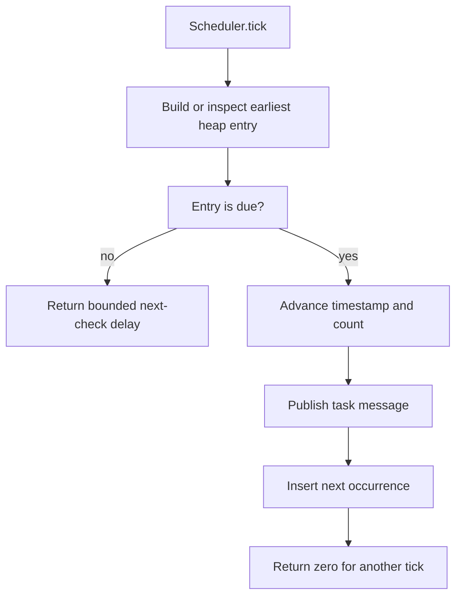

## Overview

Beat is a producer that turns recurring schedule entries into ordinary task messages. Its scheduler decides what is due and publishes through a registered task's `apply_async` or the application's `send_task`. A separate worker executes those messages through [[Worker Lifecycle and Execution]]. Schedule persistence records scheduling progress; task return values belong to [[Results and Backends]].

Sources: [celery/beat.py:326-358](repo://celery/beat.py#L326-L358), [celery/beat.py:393-418](repo://celery/beat.py#L393-L418), [celery/beat.py:505-523](repo://celery/beat.py#L505-L523), [examples/periodic-tasks/myapp.py:3-9](repo://examples/periodic-tasks/myapp.py#L3-L9)

## Register recurring work

`app.add_periodic_task` converts a signature and schedule into an entry containing the task name, arguments, keyword arguments, and merged execution options. Its key is an explicit name or the signature's representation. Registering the same unnamed signature again overwrites the earlier entry and logs a warning; distinct names allow separate schedules for otherwise identical calls.

Sources: [celery/app/base.py:1295-1333](repo://celery/app/base.py#L1295-L1333)

Before application configuration is loaded, periodic registrations enter a pending queue. Configuration loading later drains that queue into `beat_schedule`. After configuration, registration updates the schedule immediately. The repository example connects registration to `on_after_configure`, the lifecycle signal explained in [[Application and Configuration]], and builds its call using the signature interface in [[Canvas Workflows]].

Sources: [celery/app/base.py:1304-1309](repo://celery/app/base.py#L1304-L1309), [celery/app/base.py:1273-1279](repo://celery/app/base.py#L1273-L1279), [examples/periodic-tasks/myapp.py:50-53](repo://examples/periodic-tasks/myapp.py#L50-L53)

```python
@app.on_after_configure.connect
def setup_periodic_tasks(sender, **kwargs):
    # Calls say('hello') every 10 seconds.
    sender.add_periodic_task(10.0, say.s('hello'), name='add every 10')
```

Sources: [examples/periodic-tasks/myapp.py:50-53](repo://examples/periodic-tasks/myapp.py#L50-L53)

## Understand schedule entries

`ScheduleEntry` holds its entry name, task name, normalized schedule, call arguments, options, last-run time, and total-run count. Missing timestamps start at the schedule's current time. Advancing an entry creates another instance with a new timestamp and incremented count. Updating an existing entry changes only editable fields, preserving its accumulated runtime state.

Sources: [celery/beat.py:117-159](repo://celery/beat.py#L117-L159)

The entry delegates `is_due` to its schedule with `last_run_at`. The scheduler's `reserve` replaces the stored entry with its next instance before publication. Its comment explains the reason: even when sending raises, advancing first prevents the same due entry from being scheduled forever. A run count therefore records scheduling attempts rather than proof of worker completion.

Sources: [celery/beat.py:161-163](repo://celery/beat.py#L161-L163), [celery/beat.py:389-410](repo://celery/beat.py#L389-L410)

## Select a schedule type

| Schedule | Inputs and due calculation |
| --- | --- |
| `schedule` | A seconds interval or `timedelta`, optionally rounded relative to interval resolution; compares elapsed time with `last_run_at` |
| `crontab` | Minute, hour, weekday, day-of-month, and month fields; computes the next matching calendar time |
| `solar` | Solar event, latitude, and longitude, using astronomical calculations for the observer |

Sources: [celery/schedules.py:111-173](repo://celery/schedules.py#L111-L173), [celery/schedules.py:401-431](repo://celery/schedules.py#L401-L431), [celery/schedules.py:641-688](repo://celery/schedules.py#L641-L688), [celery/schedules.py:730-808](repo://celery/schedules.py#L730-L808)

Schedules return a due flag and a number of seconds until the next check. That second value is a scheduling hint bounded by the scheduler's maximum loop interval, so it affects precision and responsiveness to changed schedules. Cron's `beat_cron_starting_deadline` can suppress a missed occurrence whose latest feasible time lies too far in the past. Interval and cron scheduling therefore have different rules for delayed checks.

Sources: [celery/schedules.py:138-173](repo://celery/schedules.py#L138-L173), [celery/schedules.py:641-688](repo://celery/schedules.py#L641-L688), [celery/beat.py:362-364](repo://celery/beat.py#L362-L364)

## Follow a scheduler tick

`tick` rebuilds its heap when necessary, examines the earliest event, and asks whether its entry is due. It processes at most one due task per call. A due entry is removed, reserved, published, and replaced in the heap with its next occurrence; the method returns zero so the loop can check again immediately. An entry not yet due yields a bounded delay before another check.

Sources: [celery/beat.py:326-364](repo://celery/beat.py#L326-L364)



Sources: [celery/beat.py:326-364](repo://celery/beat.py#L326-L364), [celery/beat.py:389-410](repo://celery/beat.py#L389-L410)

Dispatch evaluates lazy entry arguments, looks for the task in the local registry, and uses either that task's submission interface or name-based submission. It passes the entry's options and producer into the normal publication path in [[Task Publishing and Routing]]. Exceptions are wrapped as `SchedulingError`, and the finally block counts the attempt and synchronizes when required.

Sources: [celery/beat.py:393-421](repo://celery/beat.py#L393-L421)

## Persist scheduling progress

The default `PersistentScheduler` uses a `shelve` database and opens it with writeback enabled. Startup detects corruption when opening or reading the store and removes its known database files before reopening. The stored timezone and UTC mode are checked against current configuration; changing either clears the schedule database so old timing state is not retained under new time rules.

Sources: [celery/beat.py:505-565](repo://celery/beat.py#L505-L565)

Persistent setup merges current `beat_schedule` entries with stored ones, removes entries no longer configured, updates editable fields on retained entries, installs default entries, and records version/timezone metadata. Synchronization flushes the shelf; close synchronizes then closes it. The scheduler tracks both elapsed time and attempts since the last sync when deciding whether another sync is needed.

Sources: [celery/beat.py:381-387](repo://celery/beat.py#L381-L387), [celery/beat.py:458-472](repo://celery/beat.py#L458-L472), [celery/beat.py:557-565](repo://celery/beat.py#L557-L565), [celery/beat.py:599-605](repo://celery/beat.py#L599-L605)

## Run or extend Beat

In `examples/periodic-tasks`, the application exposes the same `app.start` entry point as the tutorial. Run the example's worker and Beat service in separate terminals. Beat emits scheduled messages; the worker's log shows the `say` task executing. The example uses an AMQP broker and sets the application timezone to UTC.

Sources: [examples/periodic-tasks/myapp.py:3-12](repo://examples/periodic-tasks/myapp.py#L3-L12), [examples/periodic-tasks/myapp.py:31-60](repo://examples/periodic-tasks/myapp.py#L31-L60)

```bash
python myapp.py worker -l INFO
```

Sources: [examples/periodic-tasks/myapp.py:5-6](repo://examples/periodic-tasks/myapp.py#L5-L6)

```bash
python myapp.py beat -l INFO
```

Sources: [examples/periodic-tasks/myapp.py:8-9](repo://examples/periodic-tasks/myapp.py#L8-L9)

The Beat CLI exposes schedule database, scheduler class, and maximum interval options. `Service.start` repeatedly calls `tick`, sleeps for positive returned intervals, and synchronizes on shutdown. A custom scheduler can be resolved by class path or `celery.beat_schedulers` entry point; [[Framework Integration and Extensions]] describes the wider component extension model.

Sources: [celery/bin/beat.py:19-37](repo://celery/bin/beat.py#L19-L37), [celery/beat.py:633-658](repo://celery/beat.py#L633-L658), [celery/beat.py:666-675](repo://celery/beat.py#L666-L675)
