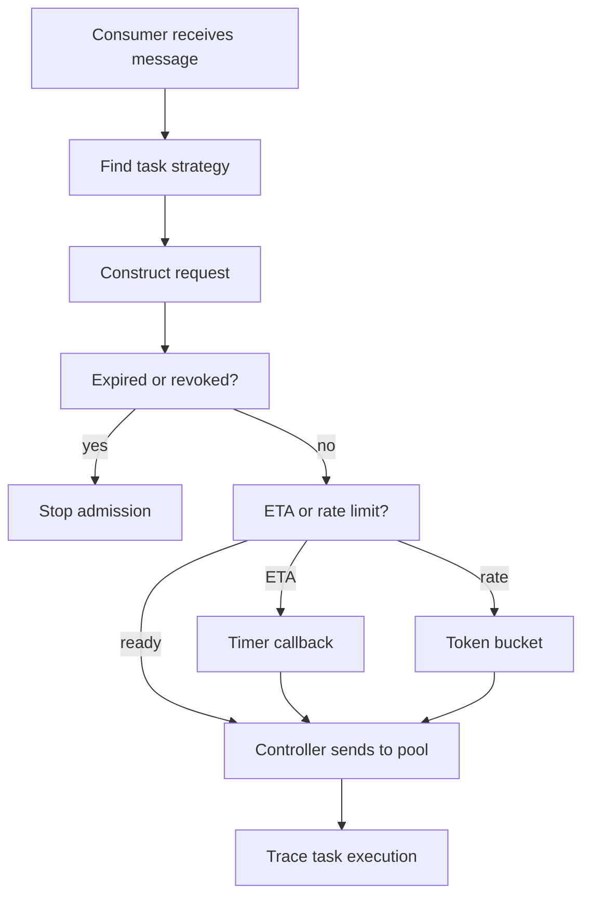

## Overview

A worker connects registered task names to execution capacity. The CLI constructs an application-bound worker, its controller assembles bootsteps, and the consumer dispatches messages through per-task strategies into a pool. [[Application and Configuration]] owns registration and imports; [[Task Publishing and Routing]] owns the messages that arrive here. This page follows receipt through execution and shutdown, leaving delivery failure policy to [[Task Retries and Failure Handling]].

Sources: [celery/bin/worker.py:358-368](repo://celery/bin/worker.py#L358-L368), [celery/worker/worker.py:90-139](repo://celery/worker/worker.py#L90-L139), [celery/worker/consumer/consumer.py:716-721](repo://celery/worker/consumer/consumer.py#L716-L721)

## Start the controller

The `worker` command takes the app from CLI context, applies extra worker configuration, drops requested privileges, constructs `app.Worker`, and calls `start`. Queue selection, pool choice, concurrency, and autoscaling are command inputs. [[Quickstart]] uses the minimal invocation; the command's own examples also show `-Q hipri,lopri`, `--concurrency=4`, and `--autoscale=10,0`.

Sources: [celery/bin/worker.py:307-335](repo://celery/bin/worker.py#L307-L335), [celery/bin/worker.py:358-368](repo://celery/bin/worker.py#L358-L368)

`WorkController.__init__` initializes the loader before setting up its instance. Instance setup selects queues and includes, derives concurrency from CPU count when unspecified, and checks whether to use an event loop. It sends `worker_init`, resolves the pool implementation, and applies the worker blueprint, including application-provided steps. The blueprint's built-ins cover hub, pool, Beat, timer, state persistence, consumer, and autoscaling.

Sources: [celery/worker/worker.py:76-139](repo://celery/worker/worker.py#L76-L139)

The consumer is a second blueprint with connection, mingle, events, gossip, heartbeat, remote control, task consumption, delayed delivery, and event-loop components. Dependencies determine which services are available when a step starts. [[Framework Integration and Extensions]] explains the bootstep extension interface; [[Monitoring and Worker Control]] covers the operational services in this assembly.

Sources: [celery/worker/consumer/consumer.py:171-189](repo://celery/worker/consumer/consumer.py#L171-L189), [celery/worker/consumer/tasks.py:20-31](repo://celery/worker/consumer/tasks.py#L20-L31)

## Build strategies and admit messages

The task-consumer bootstep updates strategies before creating its Kombu consumer. `update_strategies` walks the application's tasks, stores each task's strategy under its registered name, and builds its tracer. On receipt, protocol 2 reads the name from message headers and defers body deserialization to the pool; the protocol 1 path decodes the payload first. Missing or invalid task information follows separate unknown-message, unknown-task, or decode-error paths.

Sources: [celery/worker/consumer/tasks.py:29-47](repo://celery/worker/consumer/tasks.py#L29-L47), [celery/worker/consumer/consumer.py:716-751](repo://celery/worker/consumer/consumer.py#L716-L751), [celery/worker/consumer/consumer.py:775-784](repo://celery/worker/consumer/consumer.py#L775-L784)

The selected strategy builds a request with acknowledgment and rejection callbacks, task metadata, consumer context, and the message body. It checks expiration or revocation before emitting `task_received`. An ETA task enters the timer path; a rate-limited task enters a token bucket; an ordinary task is reserved and handed to the controller. These admission paths decide when execution may begin, rather than changing the task's Python implementation.

Sources: [celery/worker/strategy.py:119-176](repo://celery/worker/strategy.py#L119-L176), [celery/worker/strategy.py:178-208](repo://celery/worker/strategy.py#L178-L208)

Sources: [celery/worker/consumer/consumer.py:731-780](repo://celery/worker/consumer/consumer.py#L731-L780), [celery/worker/strategy.py:145-208](repo://celery/worker/strategy.py#L145-L208), [celery/worker/consumer/consumer.py:333-363](repo://celery/worker/consumer/consumer.py#L333-L363), [celery/worker/consumer/consumer.py:659-663](repo://celery/worker/consumer/consumer.py#L659-L663), [celery/worker/request.py:341-372](repo://celery/worker/request.py#L341-L372)

## Control prefetch and capacity

The consumer component derives its initial prefetch count from maximum autoscale concurrency, or ordinary concurrency, multiplied by the prefetch multiplier. The task bootstep applies broker QoS and creates a `QoS` object with `worker_eta_task_limit` as its maximum-prefetch bound. This controls admission independently from how many pool slots are currently executing work.

Sources: [celery/worker/components.py:221-245](repo://celery/worker/components.py#L221-L245), [celery/worker/consumer/tasks.py:29-57](repo://celery/worker/consumer/tasks.py#L29-L57)

`worker_disable_prefetch` is specifically implemented for Redis brokers. Other transports log a warning and ignore it. On Redis, consumption pauses when reserved requests reach the worker's maximum concurrency or current pool size. Autoscaling separately compares workload with configured minimum and maximum processes, calls pool grow/shrink, and uses a keepalive interval before shrinking after growth.

Sources: [celery/worker/consumer/tasks.py:59-83](repo://celery/worker/consumer/tasks.py#L59-L83), [celery/worker/autoscale.py:83-129](repo://celery/worker/autoscale.py#L83-L129)

## Select an execution pool

| Pool | Execution model in this repository |
| --- | --- |
| `prefork` / `processes` | Multiprocessing pool with child initialization and timeout support |
| `solo` | Inline blocking execution with concurrency fixed at one |
| `threads` | `ThreadPoolExecutor` submits task targets |
| `gevent` | Greenlet pool with its own timer and spawn path |
| `eventlet` | `GreenPool` with eventlet lifecycle signals |
| `custom` | Implementation named by `CELERY_CUSTOM_WORKER_POOL`, selected with `--pool custom` |

Sources: [celery/concurrency/__init__.py:11-43](repo://celery/concurrency/__init__.py#L11-L43), [celery/concurrency/prefork.py:95-125](repo://celery/concurrency/prefork.py#L95-L125), [celery/concurrency/solo.py:11-30](repo://celery/concurrency/solo.py#L11-L30), [celery/concurrency/thread.py:30-56](repo://celery/concurrency/thread.py#L30-L56), [celery/concurrency/gevent.py:85-110](repo://celery/concurrency/gevent.py#L85-L110), [celery/concurrency/eventlet.py:88-121](repo://celery/concurrency/eventlet.py#L88-L121)

The pool component supplies child task and memory limits, hard and soft timeouts, restart behavior, and semaphore settings to the selected implementation. These are passed through a common construction interface; actual behavior comes from the implementation. For example, solo reports no timeouts and threads reports `signal_safe=False`. Choose a pool with its implementation's capabilities in mind when relying on shutdown or timeout behavior.

Sources: [celery/worker/components.py:138-171](repo://celery/worker/components.py#L138-L171), [celery/concurrency/solo.py:22-30](repo://celery/concurrency/solo.py#L22-L30), [celery/concurrency/thread.py:30-43](repo://celery/concurrency/thread.py#L30-L43)

## Execute and trace

The controller calls `req.execute_using_pool`. The request checks revocation again and submits either `fast_trace_task` or `trace_task_ret`, passing task name, ID, request metadata, body, and content information. Pool callbacks handle acceptance, timeouts, success, and failure. The trace optimizes ordinary tasks by calling `task.run` directly; a custom `__call__` preserves the task's overridden call path.

Sources: [celery/worker/worker.py:223-231](repo://celery/worker/worker.py#L223-L231), [celery/worker/request.py:341-372](repo://celery/worker/request.py#L341-L372), [celery/app/trace.py:374-377](repo://celery/app/trace.py#L374-L377)

Execution pushes task and request context, emits prerun signals, initializes the loader's task hook, and optionally stores `STARTED`. It invokes `before_start` when customized, then the function. Success dispatches workflow continuations before marking the result done so child results are available to the recorded trail. [[Canvas Workflows]] and [[Results and Backends]] explain those two completion responsibilities.

Sources: [celery/app/trace.py:563-605](repo://celery/app/trace.py#L563-L605), [celery/app/trace.py:610-638](repo://celery/app/trace.py#L610-L638)

The trace calls customized `after_return` outside ignored control states, sends postrun, pops contexts, and performs backend and loader cleanup for non-eager execution. Cleanup failures are logged except for process-control and memory exceptions that propagate. Task exceptions and request acknowledgments are covered in [[Task Retries and Failure Handling]].

Sources: [celery/app/trace.py:649-672](repo://celery/app/trace.py#L649-L672)

## Shut down the worker

`stop` implements warm shutdown: it closes the consumer, stops the blueprint gracefully, joins its components, and sends the shutdown signal. `terminate` requests cold shutdown through the same blueprint with termination enabled. A positive `worker_soft_shutdown_timeout` can add a bounded wait before cold shutdown; it normally requires active requests unless `worker_enable_soft_shutdown_on_idle` is set.

Sources: [celery/worker/worker.py:244-267](repo://celery/worker/worker.py#L244-L267), [celery/worker/worker.py:412-435](repo://celery/worker/worker.py#L412-L435)
