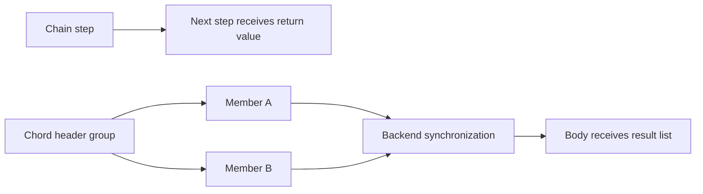

## Overview

Canvas represents invocations as signatures and composes them into chains, groups and chords. A signature stores task identity, arguments and execution options in a dictionary-compatible form suitable for restricted serializers. Its asynchronous call eventually enters [[Task Publishing and Routing]]. Workflow results use the handles described in [[Results and State]], while continuation dispatch happens at the execution boundary described in [[Task Execution and Retries]].

Sources: [celery/canvas.py:233-278](repo://celery/canvas.py#L233-L278), [celery/canvas.py:370-401](repo://celery/canvas.py#L370-L401), [celery/app/trace.py:426-473](repo://celery/app/trace.py#L426-L473)

## Build, clone and freeze signatures

Tasks expose `signature` and the positional-argument shortcut `s`; signature options can be added with `set`, which updates the options and returns the same signature. Calling a signature merges partial arguments with the stored invocation. New positional values are prepended, new keyword values override matching stored keys, and ordinary options override earlier options. Immutable signatures retain their argument collections while still permitting option updates.

Sources: [celery/canvas.py:243-263](repo://celery/canvas.py#L243-L263), [celery/canvas.py:403-443](repo://celery/canvas.py#L403-L443), [celery/canvas.py:540-552](repo://celery/canvas.py#L540-L552)

Some execution options remain protected independently of argument immutability, including existing stamped headers. `clone` creates a signature copy and deep-copies options so modifying links does not change their origin. `freeze` assigns a concrete task ID and returns its result handle without publishing. Its warning is operationally significant: sending the same frozen signature twice creates two messages with the same task ID.

Sources: [celery/canvas.py:424-469](repo://celery/canvas.py#L424-L469), [celery/canvas.py:473-520](repo://celery/canvas.py#L473-L520)

## Select the composition boundary

| Construct | Flow | Returned observation boundary |
| --- | --- | --- |
| Chain | Publish the first step, then pass each return value into the next signature | Result associated with the final prepared step |
| Group | Publish member invocations as a fan-out | `GroupResult` containing member results |
| Chord | Run a group header, synchronize its results, then publish the body | Body result with header result as parent |

Sources: [celery/canvas.py:1048-1096](repo://celery/canvas.py#L1048-L1096), [celery/canvas.py:1616-1636](repo://celery/canvas.py#L1616-L1636), [celery/canvas.py:2226-2287](repo://celery/canvas.py#L2226-L2287), [celery/app/trace.py:467-473](repo://celery/app/trace.py#L467-L473)

Sources: [celery/app/trace.py:467-473](repo://celery/app/trace.py#L467-L473), [celery/canvas.py:2267-2287](repo://celery/canvas.py#L2267-L2287), [celery/app/builtins.py:56-97](repo://celery/app/builtins.py#L56-L97)

## Advance a chain

Chain preparation walks tasks in reverse order so workers can take the next step from the end of the embedded chain list. It clones signatures, supplies initial partial arguments to the first step, splices nested chains and freezes result IDs. The final step receives the chain-level task ID and any enclosing group/chord metadata; earlier steps link their result parents to preserve ancestry.

Sources: [celery/canvas.py:1174-1213](repo://celery/canvas.py#L1174-L1213), [celery/canvas.py:1243-1285](repo://celery/canvas.py#L1243-L1285)

The chain's run method publishes its first task with the remaining chain in options. A one-task chain returns the actual invocation result, which matters for group promises; longer chains return the prepared terminal result. When a worker completes a step, continuation dispatch publishes the next signature with the return value as a partial argument and the remaining chain shortened. An immutable next signature therefore provides a boundary that does not absorb the previous result into its task arguments.

Sources: [celery/canvas.py:1069-1096](repo://celery/canvas.py#L1069-L1096), [celery/app/trace.py:467-473](repo://celery/app/trace.py#L467-L473), [celery/canvas.py:439-443](repo://celery/canvas.py#L439-L443)

## Fan out a group and synchronize a chord

Group publication prepares members under a group ID, publishes them and creates a ready barrier for the returned `GroupResult`. `group.apply_async` rejects a direct `link` and tells callers to use a chord; it rejects `link_error` at that invocation boundary and directs it to individual tasks. Composing a group with a following signature using `|` creates a chord, and chain normalization similarly upgrades a group followed by a task into a chord.

Sources: [celery/canvas.py:1598-1607](repo://celery/canvas.py#L1598-L1607), [celery/canvas.py:1616-1636](repo://celery/canvas.py#L1616-L1636), [celery/canvas.py:1215-1235](repo://celery/canvas.py#L1215-L1235)

Chord execution freezes the body result, removes inherited chain/chord options from the header's publication options and freezes header members with their chord body. For a nonempty header it asks the backend to apply chord coordination before publishing the header. An empty header schedules the body immediately with an empty result list. The returned body result records the header result as its parent, keeping the synchronization stage visible to result traversal.

Sources: [celery/canvas.py:2250-2287](repo://celery/canvas.py#L2250-L2287)

The fallback `celery.chord_unlock` task reconstructs header results and checks readiness. It retries while members are unfinished or readiness checking fails. Once ready, it chooses native join where supported, joins with propagation enabled and dispatches the body with collected values. Join or body-publication failure is reported through `chord_error_from_stack`. [[Result Backend Catalogue]] explains native coordination differences and RPC's explicit rejection of chords.

Sources: [celery/app/builtins.py:36-98](repo://celery/app/builtins.py#L36-L98), [celery/backends/rpc.py:214-215](repo://celery/backends/rpc.py#L214-L215)

## Understand callbacks and failure boundaries

Chain preparation attaches an error callback to each constituent task and attaches ordinary chain callbacks to the last task. Chord `link_error` always attaches to the body and can also attach to header tasks when `task_allow_error_cb_on_chord_header` is enabled. A header failure and a body failure can therefore reach configured error handlers through distinct paths. Inspect these attachment rules when deciding how often an error handler may run.

Sources: [celery/canvas.py:1020-1034](repo://celery/canvas.py#L1020-L1034), [celery/canvas.py:2303-2341](repo://celery/canvas.py#L2303-L2341)

Continuation dispatch is explicitly non-atomic: callback publication can succeed before the next chain step fails, or the reverse. Its comment permits redispatch under Celery's at-least-once delivery model. [[Task Execution and Retries]] explains conditional successful-task deduplication and recovery. A workflow's result graph and IDs describe relationships, but they do not make callbacks a transaction across broker sends.

Sources: [celery/app/trace.py:426-473](repo://celery/app/trace.py#L426-L473), [celery/app/trace.py:508-561](repo://celery/app/trace.py#L508-L561)

## Map or batch an argument stream

`xmap` and `xstarmap` wrap an iterable as one task invocation; their built-in task bodies execute the target repeatedly with one argument or unpacked arguments. `chunks` partitions an iterable and builds a group of `xstarmap` signatures, giving a different publication boundary from one message per input. These constructs reuse signature and group behavior, so choose between them based on whether the intended work unit is one mapped batch or several published chunks.

Sources: [celery/canvas.py:1385-1478](repo://celery/canvas.py#L1385-L1478), [celery/app/builtins.py:101-125](repo://celery/app/builtins.py#L101-L125)
