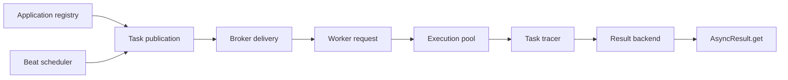

## Overview

Celery distributes named tasks through broker messages. A client submits work, a worker resolves the task name against its application registry, and execution records an outcome through a result backend. The application owns configuration, task classes, loader, messaging, events and control services. Start with [[Quickstart]] to run this flow, then use the system pages to understand the boundaries that affect your application.

Sources: [celery/app/base.py:343-408](repo://celery/app/base.py#L343-L408), [celery/app/base.py:1006-1034](repo://celery/app/base.py#L1006-L1034), [celery/worker/consumer/consumer.py:716-721](repo://celery/worker/consumer/consumer.py#L716-L721)

## Parts of the system

| Area | Responsibility | Page |
| --- | --- | --- |
| Application | Configuration, lazy task creation and finalization | [[Applications and Configuration]] |
| Producer | Task invocation, routing and publication | [[Task Publishing and Routing]] |
| Worker | Consumer dispatch and execution pools | [[Worker Lifecycle and Concurrency]] |
| Execution | Request context, outcomes and hooks | [[Task Execution and Retries]] |
| Result client | Waiting and propagating stored outcomes | [[Results and State]] |
| Storage adapters | Resolving configured result backends | [[Result Backend Catalogue]] |

Sources: [celery/app/base.py:554-633](repo://celery/app/base.py#L554-L633), [celery/app/base.py:1006-1034](repo://celery/app/base.py#L1006-L1034), [celery/worker/request.py:341-372](repo://celery/worker/request.py#L341-L372), [celery/result.py:243-265](repo://celery/result.py#L243-L265), [celery/app/backends.py:15-38](repo://celery/app/backends.py#L15-L38)

| Area | Responsibility | Page |
| --- | --- | --- |
| Workflow | Callback and chain dispatch | [[Canvas Workflows]] |
| Scheduler | Selecting and publishing periodic entries | [[Periodic Scheduling]] |
| Operations | Broadcasting commands and collecting replies | [[Monitoring and Remote Control]] |
| Framework lifecycle | Django setup and worker initialization | [[Framework Integrations]] |
| Serialization trust | Signed messages and accepted content | [[Message Security]] |
| Validation | Unit, integration, smoke and static checks | [[Development and Testing]] |

Sources: [celery/app/trace.py:610-627](repo://celery/app/trace.py#L610-L627), [celery/beat.py:326-364](repo://celery/beat.py#L326-L364), [celery/app/control.py:755-785](repo://celery/app/control.py#L755-L785), [celery/fixups/django.py:75-103](repo://celery/fixups/django.py#L75-L103), [celery/security/__init__.py:44-70](repo://celery/security/__init__.py#L44-L70), [tox.ini:24-52](repo://tox.ini#L24-L52)

## Follow one task

Sources: [celery/app/base.py:607-630](repo://celery/app/base.py#L607-L630), [celery/app/base.py:1006-1034](repo://celery/app/base.py#L1006-L1034), [celery/worker/strategy.py:119-150](repo://celery/worker/strategy.py#L119-L150), [celery/worker/request.py:341-372](repo://celery/worker/request.py#L341-L372), [celery/app/trace.py:619-627](repo://celery/app/trace.py#L619-L627), [celery/result.py:255-265](repo://celery/result.py#L255-L265), [celery/beat.py:393-421](repo://celery/beat.py#L393-L421)

1. [[Applications and Configuration]] creates an application-bound task class, gives it a name and places the instance in the registry.
2. [[Task Publishing and Routing]] constructs a message with that name and a task ID, sends it through a producer and returns a result handle.
3. [[Worker Lifecycle and Concurrency]] creates a request from the delivery and submits a trace function to the execution pool.
4. [[Task Execution and Retries]] invokes the body and dispatches callbacks or the remaining chain before recording success.
5. [[Results and State]] asks the backend to wait for an outcome and applies the client's exception propagation policy.
6. [[Periodic Scheduling]] enters the publishing flow through a task's `apply_async` or the application's `send_task`.

Sources: [celery/app/base.py:607-630](repo://celery/app/base.py#L607-L630), [celery/app/base.py:1006-1034](repo://celery/app/base.py#L1006-L1034), [celery/worker/request.py:341-372](repo://celery/worker/request.py#L341-L372), [celery/app/trace.py:619-627](repo://celery/app/trace.py#L619-L627), [celery/result.py:243-265](repo://celery/result.py#L243-L265), [celery/beat.py:393-421](repo://celery/beat.py#L393-L421)

## Design decisions across the boundaries

Task identity is a name resolved locally. Task pickling records the name and optionally its module; task creation also reuses an existing registry entry with the same name. The producer can therefore describe work without shipping the function's implementation. Workers build strategies from their own registered tasks, so module imports are part of readiness. An unknown name follows an explicit rejection and `NotRegistered` failure path.

Sources: [celery/app/task.py:506-514](repo://celery/app/task.py#L506-L514), [celery/app/base.py:604-633](repo://celery/app/base.py#L604-L633), [celery/worker/consumer/consumer.py:677-721](repo://celery/worker/consumer/consumer.py#L677-L721)

Configuration and decorated tasks can be lazy. Construction wraps pending configuration, and a decorator can return a `PromiseProxy` evaluated at first use. Finalization drains pending decorators and binds tasks under a lock. The decorator comments explain that shared task construction must resolve against the current application. Importing a decorated function and materializing its application-specific task are consequently separate operations.

Sources: [celery/app/base.py:403-408](repo://celery/app/base.py#L403-L408), [celery/app/base.py:548-573](repo://celery/app/base.py#L548-L573), [celery/app/base.py:657-677](repo://celery/app/base.py#L657-L677)

The worker's inner execution path favors prepared functions. The default strategy builds a request class around the selected pool and consumer, while the tracer deliberately unrolls calls for performance. Those comments explain why tracing and consumption have distinct extension points: a task hook belongs to a different boundary from a pool implementation. The pool factory resolves built-in aliases and an optional external pool through the same interface.

Sources: [celery/worker/strategy.py:103-128](repo://celery/worker/strategy.py#L103-L128), [celery/app/trace.py:475-486](repo://celery/app/trace.py#L475-L486), [celery/concurrency/__init__.py:11-43](repo://celery/concurrency/__init__.py#L11-L43)

Result handles and execution have separate lifecycles. Publication returns an `AsyncResult` identified by the task ID and marks whether its result is ignored. A wait can time out without terminating the worker task, and result resources require eventual retrieval or forgetting. Callers can submit work without blocking, but backend choice and result cleanup remain explicit application concerns. Read [[Results and State]] before treating a client's timeout as an execution failure.

Sources: [celery/app/base.py:1025-1034](repo://celery/app/base.py#L1025-L1034), [celery/result.py:191-219](repo://celery/result.py#L191-L219)
