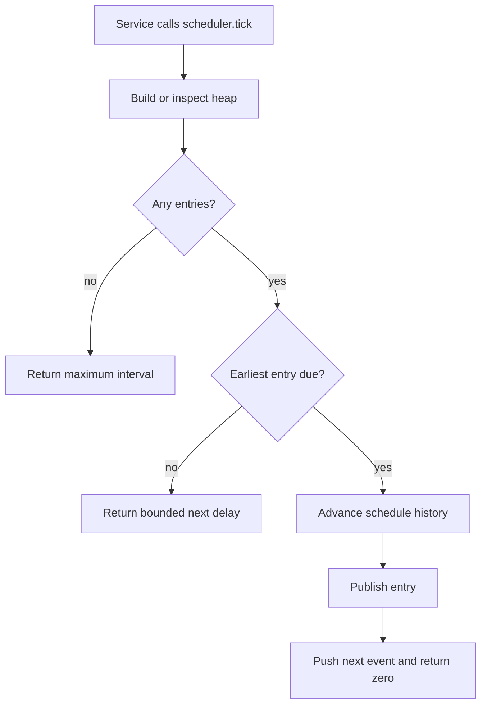

## Overview

Beat evaluates periodic schedule entries and publishes ordinary tasks when they become due. Each entry holds a task name, arguments, publication options and scheduling history. The scheduler does not run the task body: it calls the registered task's `apply_async` or the application's `send_task`, entering [[Task Publishing and Routing]]. Worker execution then follows [[Task Execution and Retries]].

Sources: [celery/beat.py:117-140](repo://celery/beat.py#L117-L140), [celery/beat.py:393-421](repo://celery/beat.py#L393-L421)

## Register an entry

`app.add_periodic_task` converts a signature into a schedule dictionary containing the task name, schedule, arguments and options. An explicit name supplies its key; otherwise the signature representation becomes the key. If configuration is not loaded yet, the entry is queued and applied during configuration completion. [[Applications and Configuration]] explains that lazy milestone, and [[Canvas Workflows]] explains the signature object supplying the task invocation.

Sources: [celery/app/base.py:1295-1333](repo://celery/app/base.py#L1295-L1333), [celery/app/base.py:1273-1279](repo://celery/app/base.py#L1273-L1279)

`ScheduleEntry` normalizes the schedule, initializes `last_run_at` from the schedule/application clock and defaults the run count to zero. Advancing an entry produces a new instance with updated time and incremented count. Updating an existing entry changes only its editable task, schedule, argument and option fields, preserving the scheduler's historical fields. This distinction allows configured definitions to change without automatically discarding every previous run timestamp.

Sources: [celery/beat.py:117-163](repo://celery/beat.py#L117-L163)

## Choose the due calculation

| Schedule | Calculation boundary |
| --- | --- |
| Interval `schedule` | Computes remaining time from `last_run_at`, current time and interval; zero remaining means due |
| `crontab` | Expands minute, hour, weekday, month-day and month fields and computes the next matching time |
| `solar` | Selects an astronomical event at a latitude/longitude using the ephem dependency; validates event and coordinate ranges |

Sources: [celery/schedules.py:125-173](repo://celery/schedules.py#L125-L173), [celery/schedules.py:401-414](repo://celery/schedules.py#L401-L414), [celery/schedules.py:641-688](repo://celery/schedules.py#L641-L688), [celery/schedules.py:792-811](repo://celery/schedules.py#L792-L811)

`is_due` returns both whether to run now and how many seconds until the next check. The latter controls rechecking precision rather than promising an exact execution time. `beat_max_loop_interval` bounds scheduler sleep. For crontab schedules, `beat_cron_starting_deadline` can suppress a missed run whose latest feasible scheduled time is too far in the past, then calculate the next delay from the current clock.

Sources: [celery/schedules.py:138-173](repo://celery/schedules.py#L138-L173), [celery/schedules.py:641-688](repo://celery/schedules.py#L641-L688)

## Follow a scheduler tick

The scheduler rebuilds its heap when it is absent or schedule definitions changed. A tick examines the earliest entry and runs at most one due task. If due, it removes that event, reserves the next entry instance, publishes the old invocation, pushes the next event and returns zero to continue promptly. An empty heap returns the maximum interval; a future entry returns its adjusted next delay bounded by that interval.

Sources: [celery/beat.py:310-364](repo://celery/beat.py#L310-L364)



Sources: [celery/beat.py:326-364](repo://celery/beat.py#L326-L364), [celery/beat.py:643-651](repo://celery/beat.py#L643-L651)

Advancement happens before publication so exceptions do not cause the same due entry to schedule forever. `apply_async` evaluates lazy entry arguments, uses the registered task when available and falls back to sending its name. It wraps publication errors as `SchedulingError` and still increments the synchronization counter. The caller logs message errors; an entry timestamp therefore records a scheduler attempt, not proof that the worker completed that occurrence.

Sources: [celery/beat.py:279-290](repo://celery/beat.py#L279-L290), [celery/beat.py:389-418](repo://celery/beat.py#L389-L418)

## Persist and synchronize scheduler history

`PersistentScheduler` uses a shelve database with writeback. Startup tests opening and reading it; corruption triggers removal of known database-file variants and reopening. The scheduler clears stored state when timezone or UTC mode changes, merges configured entries and stores version/timezone metadata before synchronization. Configuration entries removed from the schedule are also removed from the persisted schedule during merging.

Sources: [celery/beat.py:458-472](repo://celery/beat.py#L458-L472), [celery/beat.py:505-565](repo://celery/beat.py#L505-L565)

Synchronization becomes due after the elapsed sync interval or configured task count. `_do_sync` calls the implementation's `sync` and resets tracking even if synchronization raises. The service loop calls ticks, sleeps for positive returned delays and synchronizes when due; shutdown closes the scheduler. The schedule database stores run history independently of the task result backend described in [[Result Backend Catalogue]].

Sources: [celery/beat.py:381-387](repo://celery/beat.py#L381-L387), [celery/beat.py:427-439](repo://celery/beat.py#L427-L439), [celery/beat.py:633-664](repo://celery/beat.py#L633-L664), [celery/beat.py:505-523](repo://celery/beat.py#L505-L523)

The scheduler installs a daily `celery.backend_cleanup` entry when result expiration is configured and the backend does not declare automatic expiry. It schedules cleanup at 04:00 with a twelve-hour message expiry. That entry uses the same ordinary publication machinery as application tasks; the actual backend cleanup behavior is described in [[Result Backend Catalogue]].

Sources: [celery/beat.py:268-277](repo://celery/beat.py#L268-L277)

## Run and extend beat

The repository's standalone command starts beat for the named application. `-s` can select its schedule file, and a worker can embed beat through `-B`. The periodic-task guide requires one scheduler per schedule to avoid duplicate task publication and warns that periodic tasks can overlap when a prior invocation outlasts the interval. These constraints remain relevant even when workers scale independently.

Sources: [docs/userguide/periodic-tasks.rst:10-28](repo://docs/userguide/periodic-tasks.rst#L10-L28), [docs/userguide/periodic-tasks.rst:155-169](repo://docs/userguide/periodic-tasks.rst#L155-L169), [docs/userguide/periodic-tasks.rst:401-432](repo://docs/userguide/periodic-tasks.rst#L401-L432)

```bash
celery -A proj beat
```

Sources: [docs/userguide/periodic-tasks.rst:407-412](repo://docs/userguide/periodic-tasks.rst#L407-L412)

The beat application initializes worker-style module loading and finalizes the application before starting its service. Scheduler resolution accepts a class name or installed `celery.beat_schedulers` extension alias, passing application, schedule filename, maximum interval and lazy mode to the constructor. Custom schedulers can supply persistence through `sync` and entry handling while retaining the service's tick-and-sleep protocol.

Sources: [celery/apps/beat.py:78-84](repo://celery/apps/beat.py#L78-L84), [celery/apps/beat.py:93-118](repo://celery/apps/beat.py#L93-L118), [celery/apps/beat.py:129-133](repo://celery/apps/beat.py#L129-L133), [celery/beat.py:427-439](repo://celery/beat.py#L427-L439), [celery/beat.py:666-675](repo://celery/beat.py#L666-L675)
