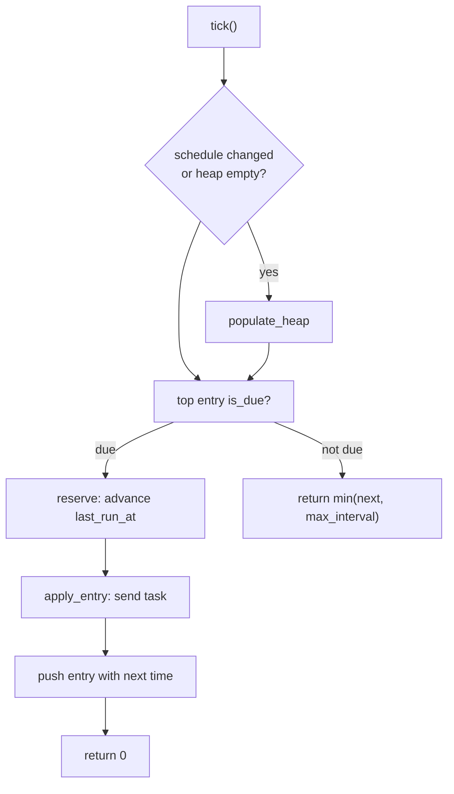

## Overview

Beat is Celery's scheduler. It is not a worker: it reads a schedule, sleeps until the next entry is due, and then publishes an ordinary task message through the same path as `apply_async` ([[Publishing Tasks: apply_async, Routing and Messages]]). A worker running elsewhere executes it. This page covers how entries are defined, the schedule types, the tick algorithm, the persistent store, and the two ways to run the service.

Sources: [celery/beat.py:219-266](repo://celery/beat.py#L219-L266), [celery/beat.py:393-419](repo://celery/beat.py#L393-L419)

## Defining periodic tasks

Entries come from the `beat_schedule` setting, a dict of name to entry; each entry has `task`, `schedule`, optional `args`, `kwargs` and `options`. `app.add_periodic_task(schedule, sig, args, kwargs, name, **opts)` builds the same kind of entry from a signature and the key is `name` or `repr(sig)`. If the app is not yet configured, the entry is queued in `_pending_periodic_tasks` and added to `conf.beat_schedule` when configuration loads (see [[The Celery Application and Configuration]]). Adding the same unnamed signature twice replaces the first and logs a warning.

Sources: [celery/app/base.py:1295-1334](repo://celery/app/base.py#L1295-L1334), [celery/app/base.py:1264-1272](repo://celery/app/base.py#L1264-L1272)

A `ScheduleEntry` holds `name`, `task`, `schedule`, `args`, `kwargs`, `options`, `last_run_at` and `total_run_count`. The constructor converts the schedule with `maybe_schedule` and defaults `last_run_at` to now. `is_due()` delegates to the schedule. `_next_instance` produces a copy with a fresh `last_run_at` and the count increased by one, which is how the scheduler "advances" an entry. Entries compare equal on the editable fields (`task`, `args`, `kwargs`, `options`, `schedule`) only.

Sources: [celery/beat.py:82-196](repo://celery/beat.py#L82-L196)

Values in `args` and `kwargs` may be `BeatLazyFunc` objects. They are called just before sending, so a value such as the current time is evaluated per run instead of once when the schedule is defined.

Sources: [celery/beat.py:50-80](repo://celery/beat.py#L50-L80), [celery/beat.py:197-216](repo://celery/beat.py#L197-L216)

## Schedule types

All schedules derive from `BaseSchedule`, which has a `now()` (the supplied `nowfun` or the app's clock), `remaining_estimate`, and `is_due(last_run_at)` returning `(is_due, seconds_until_next_check)`.

Sources: [celery/schedules.py:65-110](repo://celery/schedules.py#L65-L110)

| Type | Arguments | Behaviour |
| --- | --- | --- |
| `schedule` | `run_every` (seconds or `timedelta`), `relative` | Fixed interval. Due when the time since `last_run_at` reaches the interval; `relative=True` rounds to the interval's resolution |
| `crontab` | `minute`, `hour`, `day_of_week`, `day_of_month`, `month_of_year` | cron-style: each field takes an integer, a list or a pattern like `*/15` or `1,13,30-45,50-59/2` |
| `solar` | `event`, `lat`, `lon` | Due at a solar event such as `sunrise`, `solar_noon` or `dusk_civil` for the given location |

Sources: [celery/schedules.py:111-195](repo://celery/schedules.py#L111-L195), [celery/schedules.py:323-345](repo://celery/schedules.py#L323-L345), [celery/schedules.py:717-760](repo://celery/schedules.py#L717-L760)

For the interval `schedule`, `is_due` returns `(True, seconds)` when no time remains, so the next check is one interval away, and `(False, remaining)` otherwise. The docstring notes that the returned time is only a hint: `beat_max_loop_interval` caps how long the scheduler sleeps, so it decides how quickly a changed schedule takes effect.

Sources: [celery/schedules.py:138-175](repo://celery/schedules.py#L138-L175)

## The scheduler loop

### One tick

`Scheduler.tick` keeps a heap of `event_t(time, priority, entry)` tuples. On the first call, and whenever `schedules_equal` finds the schedule changed since the last call, `populate_heap` rebuilds it: each entry's `is_due()` gives either "now" or a delay, and `_when` converts that to a UTC timestamp, with a small negative drift (`adjust`, -10 ms) so the wakeup is not late.

Sources: [celery/beat.py:292-326](repo://celery/beat.py#L292-L326), [celery/beat.py:366-380](repo://celery/beat.py#L366-L380)

Each tick handles at most one due entry. It looks at the top of the heap and calls `is_due`. If due, it pops the event, checks it is still the heap's top, calls `reserve` (which replaces the entry by `next(entry)` in the schedule, updating `last_run_at` and the count), sends the task with `apply_entry`, pushes the entry back with its next due time, and returns 0 so the loop ticks again at once. If not due, it returns the time to wait, never more than `max_interval`. An empty heap returns `max_interval`.

Sources: [celery/beat.py:326-364](repo://celery/beat.py#L326-L364), [celery/beat.py:389-392](repo://celery/beat.py#L389-L392)

Sources: [celery/beat.py:326-364](repo://celery/beat.py#L326-L364)

`apply_async` on the scheduler first reserves the entry (so the timestamp and count are updated even if sending raises, "doesn't schedule forever" in the code's words), evaluates lazy arguments, and calls `task.apply_async` when the task is registered in this app or `send_task` by name otherwise, so beat can schedule tasks it has not imported. Any error is re-raised as `SchedulingError`; `apply_entry` logs it. After every send the scheduler counts a task toward the sync threshold and syncs if `should_sync` is true.

Sources: [celery/beat.py:279-291](repo://celery/beat.py#L279-L291), [celery/beat.py:393-420](repo://celery/beat.py#L393-L420)

`max_interval` comes from the `max_interval` argument, `beat_max_loop_interval` or the class default of 300 seconds. `sync_every` is 3 minutes and `beat_sync_every` can force a sync after a number of tasks.

Sources: [celery/beat.py:233-266](repo://celery/beat.py#L233-L266), [celery/beat.py:381-388](repo://celery/beat.py#L381-L388)

### Default entry

`install_default_entries` adds `celery.backend_cleanup`, a crontab for 04:00 daily with a 12 hour expiry, but only when `result_expires` is set and the backend does not expire results by itself (`supports_autoexpire` false). See [[Task Results, States and Result Backends]].

Sources: [celery/beat.py:268-277](repo://celery/beat.py#L268-L277), [celery/app/builtins.py:13-25](repo://celery/app/builtins.py#L13-L25)

## Persistent schedule

The configured scheduler is `celery.beat:PersistentScheduler`, which keeps the schedule in a `shelve` database (default file `celerybeat-schedule`). The store keeps each entry's `last_run_at` and `total_run_count` between runs.

Sources: [celery/beat.py:505-530](repo://celery/beat.py#L505-L530), [celery/app/defaults.py:76-81](repo://celery/app/defaults.py#L76-L81)

`setup_schedule` opens the store and, if it is unreadable, deletes the files (trying each known suffix) and opens a fresh one. It clears the store when the version, timezone or UTC fields are missing, and also when the stored `tz` or `utc_enabled` differs from the current configuration, with a warning that the "Timezone changed" or "UTC changed" and the db is reset. It then runs `merge_inplace(app.conf.beat_schedule)`, which removes entries no longer in the configuration, updates existing ones' editable fields (keeping their run history), and adds new ones; installs the default entries; and syncs.

Sources: [celery/beat.py:531-591](repo://celery/beat.py#L531-L591), [celery/beat.py:458-472](repo://celery/beat.py#L458-L472)

The scheduler class is an extension point: `Service.get_scheduler` resolves `scheduler_cls` by name and also through the `celery.beat_schedulers` entry-point group, so alternative scheduler classes can be plugged in.

Sources: [celery/beat.py:666-680](repo://celery/beat.py#L666-L680)

## Running beat

`Service.start` sends `beat_init` (and `beat_embedded_init` when embedded), then loops until shutdown: `interval = scheduler.tick()`, sleep for that interval if positive, and sync the store when `should_sync`. On exit it syncs and closes the scheduler.

Sources: [celery/beat.py:612-665](repo://celery/beat.py#L612-L665)

`celery beat` uses `celery.apps.beat.Beat`, a command-line wrapper around `Service`. It resolves the schedule filename and scheduler class with `app.either` from its arguments and the configuration, like the worker does ([[Worker Startup and Bootsteps]]).

Sources: [celery/apps/beat.py:40-70](repo://celery/apps/beat.py#L40-L70)

With `celery worker -B` the worker embeds beat. The `Beat` bootstep creates an `EmbeddedService` with the worker's schedule filename and scheduler. By default this is a separate process (`_Process`, using multiprocessing) that resets signals, closes inherited file descriptors and runs `Service.start(embedded_process=True)`. When multiprocessing is unavailable, or `thread=True`, it is a daemon `_Threaded` with `max_interval=1` so it stops promptly.

Sources: [celery/beat.py:682-738](repo://celery/beat.py#L682-L738), [celery/worker/components.py:186-210](repo://celery/worker/components.py#L186-L210)

The embedded service is refused with the eventlet and gevent pools: the `Beat` step raises `ImproperlyConfigured` telling you to use standalone beat instead. See [[Worker Pool Implementations]].

Sources: [celery/worker/components.py:28-31](repo://celery/worker/components.py#L28-L31), [celery/worker/components.py:196-205](repo://celery/worker/components.py#L196-L205)
