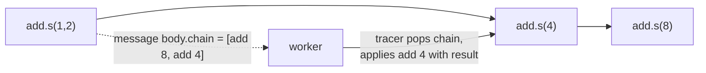

## Overview

The canvas turns tasks into workflows. A `Signature` describes one task call that has not happened yet; `chain` runs signatures one after another, `group` runs them in parallel, and `chord` runs a group and then a callback with all the results. Nothing here has its own transport: a workflow is a set of ordinary task messages ([[Publishing Tasks: apply_async, Routing and Messages]]) that carry the rest of the workflow in their body, and the worker's tracer sends the next step when a task finishes ([[Task Execution, Tracing and Acknowledgement]]). Only chords need the result backend ([[Task Results, States and Result Backends]]), because something must count the finished header tasks.

Sources: [celery/canvas.py:233-250](repo://celery/canvas.py#L233-L250), [celery/app/amqp.py:366-382](repo://celery/app/amqp.py#L366-L382)

## Signatures

`Signature` is a `dict` subclass, so it serialises as plain data and can be an argument of another task. Its keys are `task`, `args`, `kwargs`, `options`, `subtask_type` and `immutable`. Subclasses register under a `subtask_type` name with `Signature.register_type`; `from_dict` looks the type up and rebuilds the right class, which is how a chain or chord survives a trip through JSON.

Sources: [celery/canvas.py:233-346](repo://celery/canvas.py#L233-L346)

Calling a signature calls the task in-process; `delay` and `apply_async` send it; `apply` runs it locally. `apply_async` drops options set to `None`, then `_merge`s the new arguments with the stored ones: new positional arguments are prepended to the stored ones, keyword arguments are merged over them, and options are merged, except that `group_id`, `stamped_headers` and the stamps themselves are never overwritten once set. An immutable signature (`si`, or `.set(immutable=True)`) keeps its own arguments and only merges options. This is why a chained callback receives the previous result as an extra first argument unless it is immutable.

Sources: [celery/canvas.py:347-444](repo://celery/canvas.py#L347-L444)

`clone` deep-copies the options so linking or setting on the copy never changes the original. `freeze` makes the signature concrete: it assigns a `task_id` (given, existing or a new UUID), stores `root_id`, `parent_id`, `group_id`, `chord` and `group_index` in the options, sets `reply_to` to the app's `thread_oid`, and returns an `AsyncResult` for that id without sending anything. Freezing lets a workflow know all ids before the first message is sent.

Sources: [celery/canvas.py:445-523](repo://celery/canvas.py#L445-L523)

`link` and `link_error` append to the `link` and `link_error` option lists; `on_error` is `link_error` that returns the original signature so it can chain. The `|` operator combines signatures into a chain: `task | task`, `task | chain` and `task | group` all give a chain, and a one-member group is unrolled first.

Sources: [celery/canvas.py:717-758](repo://celery/canvas.py#L717-L758), [celery/canvas.py:759-786](repo://celery/canvas.py#L759-L786)

## Chains

A chain is a `Signature` whose task is `celery.chain` and whose `kwargs['tasks']` holds the steps. `chain.run` first calls `prepare_steps`, which returns the frozen steps (as a reversed list) and their results, then applies only the first step and attaches the others as the `chain` option. A chain of one step returns that step's own result; a longer chain returns the result of its last task, with the earlier results linked through `parent`.

Sources: [celery/canvas.py:935-956](repo://celery/canvas.py#L935-L956), [celery/canvas.py:1048-1094](repo://celery/canvas.py#L1048-L1094)

`prepare_steps` walks the steps from last to first, so the remaining chain is stored in reverse and a worker can simply `pop()` the next task. For each step it:

Sources: [celery/canvas.py:1170-1190](repo://celery/canvas.py#L1170-L1190)

1. converts a dict to a signature and unrolls a one-member group;
2. clones it (the first step also receives the chain's own arguments);
3. splices a nested chain's tasks into the list;
4. upgrades a group followed by a task into a `chord(group, body=next_task)`;
5. freezes it (the last step takes the chain's `task_id`, `group_id` and chord body; the others only the root id);
6. with the older protocol 1, links the previous step as a callback instead; adds the chain's `link_error` to every step and to a chord body; and checks the backend allows chords when one was created.

Sources: [celery/canvas.py:1181-1292](repo://celery/canvas.py#L1181-L1292)

Sources: [celery/canvas.py:1048-1094](repo://celery/canvas.py#L1048-L1094), [celery/app/trace.py:456-473](repo://celery/app/trace.py#L456-L473)

At run time the first task carries `chain=[...]` in its message. When it succeeds, `_dispatch_callbacks_and_chain` in the tracer pops the last element of `chain`, makes a signature from it, and applies it with the previous return value as its first argument and the rest of the chain attached. The chain needs no coordinator: each step enqueues the next one.

Sources: [celery/app/trace.py:456-473](repo://celery/app/trace.py#L456-L473), [celery/canvas.py:877-933](repo://celery/canvas.py#L877-L933)

`_prepare_chain_from_options` builds the options for the first step with a `ChainMap` and never mutates the `chain` list in place. The long comment in that function explains why: groups reuse one options dict for every member, and mutating a shared list once made later group members inherit earlier members' chain steps (issue 5354).

Sources: [celery/canvas.py:877-933](repo://celery/canvas.py#L877-L933)

## Groups

`group(a, b, c)` has task `celery.group` and the members in `kwargs['tasks']`. A `group | task` becomes a `chord`. `group.apply_async` rejects `link` and `link_error` (use a chord, or set them on members) and, in eager mode, delegates to `apply`.

Sources: [celery/canvas.py:1492-1535](repo://celery/canvas.py#L1492-L1535), [celery/canvas.py:1580-1608](repo://celery/canvas.py#L1580-L1608), [celery/canvas.py:1616-1651](repo://celery/canvas.py#L1616-L1651)

Otherwise it takes the group id from `task_id` (or a new UUID), calls `_prepared` to produce `(signature, frozen result, group_id)` tuples (cloning each member, unrolling nested groups, prepending partial arguments to mutable members), and then runs `_apply_tasks`, which acquires one producer and sends every member with `add_to_parent=False`. Each result is wired to a `barrier` with `res.then(p, weak=True)`, and `GroupResult(group_id, results, ready_barrier=p)` is returned, so the group result becomes ready when all members have fulfilled.

Sources: [celery/canvas.py:1616-1651](repo://celery/canvas.py#L1616-L1651), [celery/canvas.py:1714-1762](repo://celery/canvas.py#L1714-L1762), [celery/canvas.py:1763-1826](repo://celery/canvas.py#L1763-L1826)

While sending, `_apply_tasks` also totals the chord size: it adds `_chord._descend(sig)` for each member, which counts a plain signature as one, a nested group as the sum of its members, a chain as its last non-empty step and a chord as its body's count. When the last member is reached and the group belongs to a chord, it calls `backend.set_chord_size(group_id, chord_size)`. This is done as members are generated so that a generator of tasks is not consumed up front.

Sources: [celery/canvas.py:1790-1815](repo://celery/canvas.py#L1790-L1815), [celery/canvas.py:2191-2219](repo://celery/canvas.py#L2191-L2219)

## Chords

### Running a chord

A chord is a header (a group) and a body (a signature applied with the list of header results). `chord.freeze` wraps a header list in a group, freezes the header with `chord=self.body`, freezes the body, and links the first parentless result of the body to the header's `GroupResult`, so walking `parent` from the body leads to the header.

Sources: [celery/canvas.py:1971-1995](repo://celery/canvas.py#L1971-L1995), [celery/canvas.py:2094-2126](repo://celery/canvas.py#L2094-L2126)

`chord.apply_async` clones the body with the call options, builds the header group, and runs eagerly through `apply` if `task_always_eager`. Otherwise it calls `run`:

Sources: [celery/canvas.py:2153-2178](repo://celery/canvas.py#L2153-L2178)

1. It picks the group id from the header's `task_id` and freezes the body with that `group_id`, so the body knows which group it waits for.
2. It calls `header._freeze_group_tasks(group_id, chord=body)` so each header task's message carries the body as its `chord` field.
3. If the header has tasks, it calls `backend.apply_chord(...)` and then sends the header with `header.apply_async`; if the header is empty, no task will ever trigger the body, so it calls `body.delay([])`.
4. It returns the body's result, with `bodyres.parent = header_result`.

Sources: [celery/canvas.py:2153-2178](repo://celery/canvas.py#L2153-L2178), [celery/canvas.py:2226-2287](repo://celery/canvas.py#L2226-L2287)

### How a chord fires

When a header task finishes on a worker, `backend.mark_as_done` (or `mark_as_failure`) calls `on_chord_part_return(request, state, result)` if the request has a `chord`. The backend decides how to notice that the last member has finished, and there are two ways.

Sources: [celery/backends/base.py:180-187](repo://celery/backends/base.py#L180-L187)

**Counting backends** (those with `implements_incr = True`: the cache, GCS and DynamoDB backends) do the work in `on_chord_part_return`. `_apply_chord_incr` saves the header `GroupResult` when the chord is applied. Each completing member restores the group, increments a counter at `chord-unlock-<group_id>`, and compares it with the chord size from the request (or the number of restored results). When they are equal it joins the results (with `join_native` if supported), calls `callback.delay(results)`, and deletes the group and counter. If the join raises, it builds a `ChordError` naming the failing dependency and calls `chord_error_from_stack`.

Sources: [celery/backends/base.py:1183-1258](repo://celery/backends/base.py#L1183-L1258)

**Redis** has its own version. `set_chord_size` stores the size at the `.s` key of the group; `apply_chord` saves the `GroupResult` only if the header contains nested group results. Each part appends its encoded result to a sorted set (`.j` key, scored by `group_index`, unless `result_chord_ordered` is off, in which case a list) and reads the size key in one pipeline. When the number of stored results equals the size, it either restores the saved structure and joins it, or reads the stashed results directly, calls `callback.delay(results)`, and deletes the keys.

Sources: [celery/backends/redis.py:570-592](repo://celery/backends/redis.py#L570-L592), [celery/backends/redis.py:593-691](repo://celery/backends/redis.py#L593-L691)

**Polling fallback.** A backend without increment support uses the base `apply_chord`, which calls `fallback_chord_unlock`: it sends the task `celery.chord_unlock` with a countdown, routed to the body's queue and priority. That built-in task rebuilds the `GroupResult` from the stored result tuples and checks `deps.ready()`; if not ready it retries itself every `result_chord_retry_interval`. When ready it joins the results with `result_chord_join_timeout` and calls `callback.delay`, or reports a `ChordError`. The retry loop is unbounded (`max_retries=None`).

Sources: [celery/backends/base.py:838-868](repo://celery/backends/base.py#L838-L868), [celery/app/builtins.py:37-100](repo://celery/app/builtins.py#L37-L100)

## Failures in workflows

When a task fails, `Backend.mark_as_failure` stores the error and then handles the rest of the workflow in the order below. A code comment (issue 9674) explains that a failing step must also reach a chord body further down the chain, because the result that later steps wait on is the chord body, not the chord's own id.

Sources: [celery/backends/base.py:188-253](repo://celery/backends/base.py#L188-L253)

1. If the request belongs to a chord, `on_chord_part_return` is called with the failure so the chord can complete as failed.
2. For each remaining element of `request.chain`, a request context is rebuilt from the element's options; when the state is in `PROPAGATE_STATES` and the element has a task id, the same failure is stored under that id, and an element that is itself in a chord is reported to `on_chord_part_return`. A chord element in the chain adds its body to the queue, because the chord's own id never completes; its body is what later steps wait on.
3. Finally, if `call_errbacks` is set and the request has `errbacks`, they are called.

Sources: [celery/backends/base.py:188-253](repo://celery/backends/base.py#L188-L253)

`chord_error_from_stack(callback, exc)` fails the chord body without running it. It makes a fake request from the callback's `link_error` list, calls the errbacks, then stores a failure for the callback's id (creating an id if needed). When the body is a `group`, `_handle_group_chord_error` revokes the group's tasks, calls errbacks and marks each member and the group failed, so no body member hangs. `ChordError` messages carry the original exception as the cause when available.

Sources: [celery/backends/base.py:325-440](repo://celery/backends/base.py#L325-L440), [celery/backends/base.py:68-94](repo://celery/backends/base.py#L68-L94)

> [!NOTE]
> Chords need a real result backend: `DisabledBackend.ensure_chords_allowed` raises, and `prepare_steps` calls `ensure_chords_allowed` whenever it builds a chord.

Sources: [celery/backends/base.py:1263-1277](repo://celery/backends/base.py#L1263-L1277), [celery/canvas.py:1275-1278](repo://celery/canvas.py#L1275-L1278)
