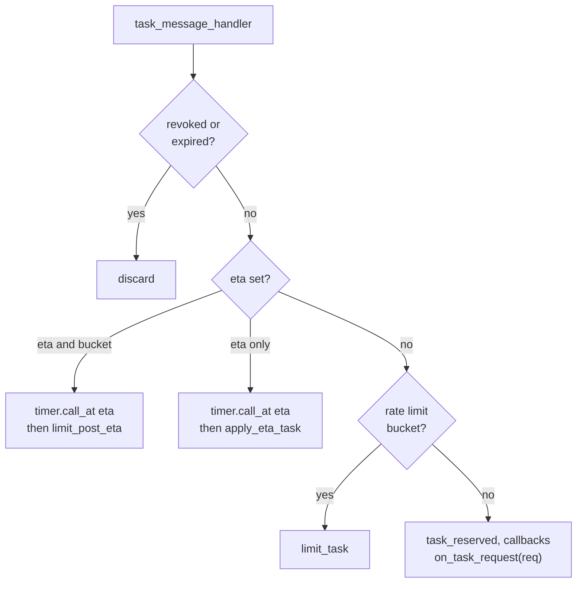

## Overview

The `Consumer` bootstep is the last worker step ([[Worker Startup and Bootsteps]]). It owns the broker connection, consumes task messages, and decides for each message whether to run it now, delay it for its ETA or a rate limit, or reject it. It does not run the task: the accepted request is handed to the pool, and what happens there is in [[Task Execution, Tracing and Acknowledgement]]. This page follows one message from `on_task_received` through the default strategy, and covers the consumer's own bootsteps, connection recovery, prefetch and event loops.

Sources: [celery/worker/consumer/consumer.py:171-210](repo://celery/worker/consumer/consumer.py#L171-L210), [celery/worker/components.py:222-246](repo://celery/worker/components.py#L222-L246)

## Consumer bootsteps

The consumer has its own blueprint. Its default steps are `Connection`, `Mingle`, `Events`, `Gossip`, `Heart`, `Control`, `Tasks`, `DelayedDelivery`, `Evloop` and `Agent`, and apps may add more through `app.steps['consumer']`.

Sources: [celery/worker/consumer/consumer.py:171-189](repo://celery/worker/consumer/consumer.py#L171-L189), [celery/worker/consumer/consumer.py:240-250](repo://celery/worker/consumer/consumer.py#L240-L250)

| Step | Role |
| --- | --- |
| `Connection` | Calls `c.connect()` on start and logs the broker URI; on shutdown it closes the connection and sets `c.connection = None` |
| `Mingle` | At startup or restart, sends a hello to other workers to sync logical clocks and revoked tasks; only on the `amqp`, `redis` and `gcpubsub` transports and unless `--without-mingle` |
| `Events` | Creates the event dispatcher used for task and worker events |
| `Gossip` | Consumes events from other workers to keep the clock current; `amqp` and `redis` transports only |
| `Heart` | Sends worker heartbeat events on a timer; not the AMQP-level heartbeat |
| `Control` | Starts the remote control mailbox (`Pidbox`, or the green variant for green pools) when `worker_enable_remote_control` is on and fanout exchanges are supported |
| `Tasks` | Creates the task consumer and the QoS object |
| `DelayedDelivery` | Declares native delayed-delivery exchanges and queues when quorum queues are detected |
| `Evloop` | Runs the event loop; always last |
| `Agent` | Starts a `cell` actor agent if `worker_agent` is set |

Sources: [celery/worker/consumer/connection.py:11-43](repo://celery/worker/consumer/connection.py#L11-L43), [celery/worker/consumer/mingle.py:18-50](repo://celery/worker/consumer/mingle.py#L18-L50), [celery/worker/consumer/events.py:15-60](repo://celery/worker/consumer/events.py#L15-L60), [celery/worker/consumer/gossip.py:23-60](repo://celery/worker/consumer/gossip.py#L23-L60), [celery/worker/consumer/heart.py:15-36](repo://celery/worker/consumer/heart.py#L15-L36), [celery/worker/consumer/control.py:14-33](repo://celery/worker/consumer/control.py#L14-L33), [celery/worker/consumer/delayed_delivery.py:23-50](repo://celery/worker/consumer/delayed_delivery.py#L23-L50), [celery/worker/consumer/agent.py:8-21](repo://celery/worker/consumer/agent.py#L8-L21)

`Events` is the step that creates `c.event_dispatcher`; on a restart it flushes the old dispatcher's buffered events into the new one and re-points the reserved requests at it. See [[Remote Control, Events and Signals]] for what these events are.

Sources: [celery/worker/consumer/events.py:36-70](repo://celery/worker/consumer/events.py#L36-L70)

The `Tasks` step is where consumption begins. On start it calls `update_strategies`, sets the initial prefetch on the channel with `basic_qos`, creates the task consumer from `app.amqp.TaskConsumer` (which uses `accept_content` and the queues selected for this worker), and wraps the consumer's `prefetch_count` in a `QoS` object capped by `worker_eta_task_limit`.

Sources: [celery/worker/consumer/tasks.py:22-62](repo://celery/worker/consumer/tasks.py#L22-L62), [celery/app/amqp.py:317-324](repo://celery/app/amqp.py#L317-L324)

## Strategies and the task handler

### Finding the strategy for a message

A strategy is a function created once per task type that handles incoming messages for it. `update_strategies` loops over the registry and sets `strategies[name] = task.start_strategy(app, consumer)` and replaces each task's `__trace__` with a tracer built by `build_tracer`. The strategy class is named by `Task.Strategy`, which defaults to `celery.worker.strategy:default`.

Sources: [celery/worker/consumer/consumer.py:716-721](repo://celery/worker/consumer/consumer.py#L716-L721), [celery/app/task.py:211-214](repo://celery/app/task.py#L211-L214), [celery/app/task.py:520-521](repo://celery/app/task.py#L520-L521)

`create_task_handler` returns `on_task_received`, which the event loop installs as the consumer's message callback. For each message it:

Sources: [celery/worker/consumer/consumer.py:731-786](repo://celery/worker/consumer/consumer.py#L731-L786)

1. Reads `message.headers['task']` (protocol 2). If headers are missing it calls `on_unknown_message`; if the header key is absent it decodes the body and reads `payload['task']` (protocol 1), and a decode failure goes to `on_decode_error`.
2. Looks up `strategies[type_]`; a missing entry calls `on_unknown_task`.
3. Builds ack and reject promises that run `message.ack_log_error` or `reject_log_error` through `call_soon_ack`.
4. Calls the strategy with the message, payload, the two promises and the `on_task_message` callbacks. `InvalidTaskError` or `ContentDisallowed` call `on_invalid_task`; `DecodeError` calls `on_decode_error`.

Sources: [celery/worker/consumer/consumer.py:723-786](repo://celery/worker/consumer/consumer.py#L723-L786)

The failure handlers differ in what they leave behind. `on_decode_error` logs critically and acknowledges the message so it cannot loop. `on_unknown_message` and `on_invalid_task` reject it, and `on_unknown_task` rejects it, stores a `NotRegistered` failure in the result backend, sends a `task-failed` event and fires `task_unknown`.

Sources: [celery/worker/consumer/consumer.py:516-530](repo://celery/worker/consumer/consumer.py#L516-L530), [celery/worker/consumer/consumer.py:665-714](repo://celery/worker/consumer/consumer.py#L665-L714)

### The default strategy

`default` binds many attributes to local variables once and returns `task_message_handler`. For each message it:

Sources: [celery/worker/strategy.py:98-157](repo://celery/worker/strategy.py#L98-L157)

1. For protocol 2 it reuses the message body and headers undecoded, because the pool process will decode them; for protocol 1 or a hybrid payload it converts to the protocol 2 shape.
2. Builds a `Request` (a class made once by `create_request_cls`) and logs the receipt at info level.
3. If the request has an expiry or its id is in `revoked`, calls `req.revoked()` and stops if it was discarded.
4. Sends `task_received` and, when events are enabled for the task, a `task-received` event.
5. Converts a present ETA to a timestamp; a conversion error rejects the message without requeue.
6. Looks up the rate-limit token bucket for the task name.
7. Dispatches by case, as shown below.

Sources: [celery/worker/strategy.py:98-209](repo://celery/worker/strategy.py#L98-L209)

Sources: [celery/worker/strategy.py:158-208](repo://celery/worker/strategy.py#L158-L208)

An ETA task increments the QoS prefetch with `increment_eventually`, because the message stays unacknowledged in memory until its time comes, and the timer entry has priority 6. When it fires, `apply_eta_task` reserves the request, sends it to the pool and decrements the prefetch again. The worker limits how many such waiting tasks it holds through `worker_eta_task_limit`.

Sources: [celery/worker/strategy.py:187-203](repo://celery/worker/strategy.py#L187-L203), [celery/worker/consumer/consumer.py:659-663](repo://celery/worker/consumer/consumer.py#L659-L663), [celery/worker/consumer/tasks.py:54-58](repo://celery/worker/consumer/tasks.py#L54-L58)

Rate limits use one `TokenBucket` per task name (capacity 1), created in `reset_rate_limits` from each task's `rate_limit`. `_limit_task` queues the request in the bucket and `_schedule_bucket_request` moves requests to the pool while tokens last; when a request cannot proceed it goes back to the head of the queue, preserving order, and a timer call is set for `bucket.expected_time`. Tasks without a `rate_limit` have no bucket.

Sources: [celery/worker/consumer/consumer.py:296-303](repo://celery/worker/consumer/consumer.py#L296-L303), [celery/worker/consumer/consumer.py:329-364](repo://celery/worker/consumer/consumer.py#L329-L364)

The final step for an unrestricted task is `task_reserved(req)` (which adds it to the worker's reserved set), then each `on_task_message` callback (the autoscaler registers one), then `on_task_request(req)`. That callable is `WorkController.process_task`, which calls `req.execute_using_pool(pool)`, optionally acquiring a semaphore slot first.

Sources: [celery/worker/strategy.py:204-208](repo://celery/worker/strategy.py#L204-L208), [celery/worker/worker.py:220-231](repo://celery/worker/worker.py#L220-L231), [celery/worker/components.py:116-127](repo://celery/worker/components.py#L116-L127)

## Prefetch and QoS

The consumer starts with `initial_prefetch_count = concurrency * prefetch_multiplier`, which the `Consumer` step computes. When the pool grows or shrinks, `_update_prefetch_count` recalculates it as `num_processes * prefetch_multiplier` and adjusts `QoS` by that many units, either `increment_eventually` or `decrement_eventually`. The QoS update itself is deferred: the event loop calls `qos.update()` only when `qos.prev != qos.value`, so QoS changes are grouped and control commands take priority over task messages.

Sources: [celery/worker/components.py:227-232](repo://celery/worker/components.py#L227-L232), [celery/worker/consumer/consumer.py:305-327](repo://celery/worker/consumer/consumer.py#L305-L327), [celery/worker/loops.py:99-103](repo://celery/worker/loops.py#L99-L103)

With `worker_disable_prefetch` on a Redis broker, the `Tasks` step wraps the channel's `can_consume` so that no message is fetched while the number of reserved requests is at or above the pool's capacity (or the autoscaler's maximum); on any other broker it logs a warning and ignores the setting.

Sources: [celery/worker/consumer/tasks.py:63-90](repo://celery/worker/consumer/tasks.py#L63-L90)

## Connection loss and restart

`Consumer.start` loops while the blueprint is not closing or terminating. Each pass calls `blueprint.start(self)`. A recoverable connection error (plus channel errors if `broker_channel_error_retry` is set) selects a retry setting: `broker_connection_retry_on_startup` for the very first attempt when it is set, otherwise `broker_connection_retry`. If retry is disabled it raises `WorkerShutdown(1)`; running out of file descriptors raises `WorkerTerminate(1)`. Otherwise it reports the error, calls `on_close` and `blueprint.restart(self)`. A `restart_state` allows at most 5 restarts per second, and past that it logs a critical error and sleeps for one second.

Sources: [celery/worker/consumer/consumer.py:366-421](repo://celery/worker/consumer/consumer.py#L366-L421), [celery/worker/consumer/consumer.py:208-208](repo://celery/worker/consumer/consumer.py#L208-L208)

After a connection is lost, `on_connection_error_after_connected` closes the broken socket and, if `worker_cancel_long_running_tasks_on_connection_loss` is set, cancels active late-acknowledged requests that were not yet acknowledged (their messages will be redelivered). If `worker_enable_prefetch_count_reduction` is on and QoS is global, it lowers the prefetch count by the number of active requests times the multiplier, so the broker does not hand out more than the worker can hold, and `_restore_prefetch_count_after_connection_restart` raises it again as acknowledgements arrive. With per-consumer QoS (for example quorum queues) this reduction is skipped.

Sources: [celery/worker/consumer/consumer.py:419-492](repo://celery/worker/consumer/consumer.py#L419-L492), [celery/worker/consumer/consumer.py:788-815](repo://celery/worker/consumer/consumer.py#L788-L815)

## Event loops

The `Evloop` step calls `c.loop(*c.loop_args())` after patching the QoS lock. The loop is `asynloop` when the worker has a hub and `synloop` otherwise; the consumer also sets the AMQP heartbeat only when it has a hub or a green pool.

Sources: [celery/worker/consumer/consumer.py:857-872](repo://celery/worker/consumer/consumer.py#L857-L872), [celery/worker/consumer/consumer.py:232-246](repo://celery/worker/consumer/consumer.py#L232-L246)

`asynloop` is non-blocking. It installs `on_task_received` as the consumer's callback, registers the controller and consumer with the hub, starts consuming, and calls `on_ready`. On the first start it checks `pool.did_start_ok()` and raises `WorkerLostError('Could not start worker processes')` if not. It then steps the hub's generator in a loop until the blueprint leaves `RUN` or the connection is gone, checking for shutdown and heartbeat errors on each pass. On any exception it resets the hub and clears its timer queue, so stale callbacks from the lost connection cannot fire after reconnect.

Sources: [celery/worker/loops.py:50-134](repo://celery/worker/loops.py#L50-L134)

`synloop` is the blocking fallback for transports without async I/O. Each cycle updates QoS if needed, runs the consumer's pending operations and calls `connection.drain_events(timeout=2.0)`, ignoring a socket timeout. For acknowledgements it relies on `call_soon_ack` writing immediately instead of waiting for the next cycle, which avoids per-task latency with `acks_late` and a prefetch multiplier of 1.

Sources: [celery/worker/loops.py:137-183](repo://celery/worker/loops.py#L137-L183), [celery/worker/consumer/consumer.py:257-286](repo://celery/worker/consumer/consumer.py#L257-L286)

Both loops use `_enable_amqheartbeats`, which schedules `connection.heartbeat_check` on the timer at `heartbeat / rate` and stores any error so the loop raises it.

Sources: [celery/worker/loops.py:28-47](repo://celery/worker/loops.py#L28-L47)
