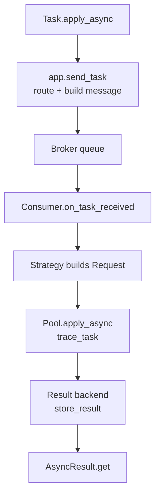

## Overview

Celery is a distributed task queue for Python. A program defines functions as tasks on a `Celery` application object, calls them to publish messages to a broker, and one or more worker processes consume those messages, run the functions and store the outcome in an optional result backend. The package exports the public surface from one place: `Celery`, `shared_task`, `Task`, and the canvas primitives `chain`, `group`, `chord`, `chunks` and `signature`.

Sources: [celery/__init__.py:30-37](repo://celery/__init__.py#L30-L37)

The whole package is organised around the application object. Everything that needs configuration, a broker connection or the task registry reaches it through the `Celery` instance, which creates its AMQP helper, event, log and control objects from class attributes.

Sources: [celery/app/base.py:343-370](repo://celery/app/base.py#L343-L370)

## Parts of Celery

| Area | What it does | Page |
| --- | --- | --- |
| Application | Holds configuration, the task registry, connections and finalization | [[The Celery Application and Configuration]] |
| Tasks | Turns a callable into a `Task`, with retry and per-task options | [[Defining Tasks, Retries and Task Options]] |
| Publishing | Routes and serialises a call into a broker message | [[Publishing Tasks: apply_async, Routing and Messages]] |
| Worker | Builds the worker from bootsteps and starts the pool | [[Worker Startup and Bootsteps]] |
| Consumer | Reads messages and turns them into requests for the pool | [[The Consumer: From Broker Message to Pool]] |
| Execution | Runs the task in a pool process, handles outcome and acknowledgement | [[Task Execution, Tracing and Acknowledgement]] |
| Pools | prefork, threads, solo, eventlet and gevent execution pools | [[Worker Pool Implementations]] |
| Results | Task states, `AsyncResult` and result backends | [[Task Results, States and Result Backends]] |
| Canvas | Signatures, chains, groups and chords | [[Canvas: Signatures, Chains, Groups and Chords]] |
| Beat | Periodic task scheduler | [[Beat: Periodic Task Scheduling]] |
| Control | Remote control, events and signals | [[Remote Control, Events and Signals]] |

Sources: [celery/app/base.py:252-343](repo://celery/app/base.py#L252-L343)

New readers should start with [[Quickstart]].

Sources: [celery/__main__.py:1-19](repo://celery/__main__.py#L1-L19)

## The main flow

Sources: [celery/app/task.py:683-708](repo://celery/app/task.py#L683-L708), [celery/app/base.py:1006-1041](repo://celery/app/base.py#L1006-L1041), [celery/worker/consumer/consumer.py:723-786](repo://celery/worker/consumer/consumer.py#L723-L786), [celery/worker/strategy.py:98-209](repo://celery/worker/strategy.py#L98-L209), [celery/worker/request.py:341-372](repo://celery/worker/request.py#L341-L372)

1. `Task.apply_async` merges execution options and either runs the task eagerly or calls `app.send_task`; see [[Publishing Tasks: apply_async, Routing and Messages]].
2. `send_task` resolves the queue through the router and builds a task message, which `send_task_message` publishes to the broker.
3. The worker's consumer picks the strategy registered for the message's `task` header; see [[The Consumer: From Broker Message to Pool]].
4. The strategy wraps the message in a `Request` and, once it is not delayed by an ETA or a rate limit, hands it to the pool.
5. `Request.execute_using_pool` submits a trace function to the pool, which runs the task body; see [[Task Execution, Tracing and Acknowledgement]] and [[Worker Pool Implementations]].
6. The tracer stores the state and return value through the backend, and the caller reads them with `AsyncResult`; see [[Task Results, States and Result Backends]].

Sources: [celery/app/task.py:683-708](repo://celery/app/task.py#L683-L708), [celery/worker/consumer/consumer.py:731-786](repo://celery/worker/consumer/consumer.py#L731-L786), [celery/worker/request.py:341-372](repo://celery/worker/request.py#L341-L372), [celery/app/trace.py:610-632](repo://celery/app/trace.py#L610-L632)

## Cross-cutting design decisions

**Configuration is read lazily.** The app stores constructor settings in a `PendingConfiguration` wrapped by `Settings`. The first access to a configuration key calls `_finalize_pending_conf`, which loads the real configuration, so settings assigned after the app is created but before first use still apply. See [[The Celery Application and Configuration]].

Sources: [celery/app/base.py:208-250](repo://celery/app/base.py#L208-L250), [celery/app/base.py:402-408](repo://celery/app/base.py#L402-L408), [celery/app/base.py:1230-1280](repo://celery/app/base.py#L1230-L1280)

**Tasks are created lazily.** Unless the app is already finalized, `@app.task` returns a `PromiseProxy` and queues it in `_pending`; `finalize()` evaluates the pending tasks and binds every registered task.

Sources: [celery/app/base.py:556-574](repo://celery/app/base.py#L556-L574), [celery/app/base.py:657-677](repo://celery/app/base.py#L657-L677)

**A task message has headers and a body.** In protocol 2 the headers carry `task`, `id`, `eta`, `expires`, `retries`, `root_id`, `parent_id` and more, so the worker can route a message without decoding the body; the body is `(args, kwargs, embed)` with callbacks, errbacks, chain and chord. The consumer reads `message.headers['task']` and only falls back to decoding the payload for protocol 1.

Sources: [celery/app/amqp.py:326-418](repo://celery/app/amqp.py#L326-L418), [celery/worker/consumer/consumer.py:731-750](repo://celery/worker/consumer/consumer.py#L731-L750)

**Worker components are bootsteps.** Both the worker and its consumer are `Blueprint` objects whose steps declare `requires`; the blueprint sorts them topologically and starts them in order, then stops them in reverse. Third-party code can add steps to `app.steps`. See [[Worker Startup and Bootsteps]].

Sources: [celery/bootsteps.py:186-212](repo://celery/bootsteps.py#L186-L212), [celery/bootsteps.py:109-117](repo://celery/bootsteps.py#L109-L117), [celery/bootsteps.py:155-176](repo://celery/bootsteps.py#L155-L176), [celery/worker/worker.py:76-88](repo://celery/worker/worker.py#L76-L88), [celery/worker/consumer/consumer.py:171-186](repo://celery/worker/consumer/consumer.py#L171-L186)

**Strategies are an optimisation.** The default strategy unrolls attribute lookups into local variables once per task type, and its docstring warns that strategies "are here as an optimization, so sadly it's not very easy to override". The tracer is similarly unrolled: the comment on `trace_task` says it is very long because calls were inlined for performance.

Sources: [celery/worker/strategy.py:98-130](repo://celery/worker/strategy.py#L98-L130), [celery/app/trace.py:475-486](repo://celery/app/trace.py#L475-L486)

**Acknowledgement timing decides the delivery guarantee.** A message is acknowledged when the pool accepts it unless the task has `acks_late`, in which case acknowledgement waits until the task finishes. A failed late-acknowledged task is rejected or acknowledged according to `acks_on_failure`, `acks_on_timeout` and `reject_on_worker_lost`. The tracer's own comment on callback dispatch also states that it "is acceptable under Celery's at-least-once delivery model".

Sources: [celery/worker/request.py:515-527](repo://celery/worker/request.py#L515-L527), [celery/worker/request.py:596-612](repo://celery/worker/request.py#L596-L612), [celery/worker/request.py:662-690](repo://celery/worker/request.py#L662-L690), [celery/app/trace.py:426-440](repo://celery/app/trace.py#L426-L440)

**Workflow state lives in the result backend.** `mark_as_done` and `mark_as_failure` store the result and then call `on_chord_part_return` when the task belongs to a chord, so chord completion is counted by the backend. See [[Canvas: Signatures, Chains, Groups and Chords]].

Sources: [celery/backends/base.py:176-186](repo://celery/backends/base.py#L176-L186), [celery/backends/base.py:1183-1258](repo://celery/backends/base.py#L1183-L1258)
