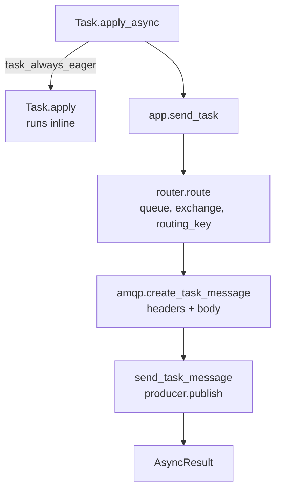

## Overview

Publishing a task means turning a Python call into a broker message and returning an `AsyncResult` without waiting. The path has four stages: `Task.apply_async` merges options, `app.send_task` routes and enriches them, `AMQP.create_task_message` builds the message, and the sender created by `AMQP._create_task_sender` publishes it. The worker side of the same message is described in [[The Consumer: From Broker Message to Pool]]; the task class that starts it is in [[Defining Tasks, Retries and Task Options]].

Sources: [celery/app/task.py:536-540](repo://celery/app/task.py#L536-L540), [celery/app/base.py:846-870](repo://celery/app/base.py#L846-L870)



Sources: [celery/app/task.py:683-708](repo://celery/app/task.py#L683-L708), [celery/app/base.py:930-1041](repo://celery/app/base.py#L930-L1041)

## Task.apply_async

Before sending anything, `apply_async` validates and merges:

Sources: [celery/app/task.py:659-681](repo://celery/app/task.py#L659-L681)

1. It raises `ValueError` if both time limits are set and `soft_time_limit` exceeds `time_limit`.
2. If `typing` is enabled it checks the call against the function signature (`__header__`), raising `TypeError` on a mismatch.
3. It computes a `shadow` name through `shadow_name`.
4. It merges the task's cached execution options under the call's options, defaults `ignore_result` to the task's value, and sets `priority` from the task when it has one.

Sources: [celery/app/task.py:659-681](repo://celery/app/task.py#L659-L681)

If `task_always_eager` is set, it never touches the broker: the arguments are serialised and deserialised with the configured serializer (so the local run sees what a worker would), then `apply` runs the task inline under `denied_join_result`. Otherwise it calls `app.send_task` with `task_type=self` and `result_cls=self.AsyncResult`.

Sources: [celery/app/task.py:683-708](repo://celery/app/task.py#L683-L708)

## send_task

`send_task` accepts a task name, so it also works for tasks that this process has not registered. It warns with `AlwaysEagerIgnored` if `task_always_eager` is set, because eager mode has no effect on it.

Sources: [celery/app/base.py:846-872](repo://celery/app/base.py#L846-L872)

When called directly (no `task_type`), it looks the name up in the app's raw registry (not the auto-finalizing `tasks` property) and merges that task's execution options as defaults, skipping `None` values. When `apply_async` already did this it passes `task_type`, so options are not merged twice and explicit caller values are not overridden.

Sources: [celery/app/base.py:874-908](repo://celery/app/base.py#L874-L908)

`time_limit`, `soft_time_limit` and `expires` are also arguments of `create_task_message`, so the code pops them from `options`. The task-level value is used only if the caller omitted the argument (the `_OMITTED` sentinel); an explicit `None` clears the default.

Sources: [celery/app/base.py:910-930](repo://celery/app/base.py#L910-L930)

`ignore_result` is popped, then `router.route(options, route_name or name, args, kwargs, task_type)` fills in the queue, exchange and routing key. See the next section.

Sources: [celery/app/base.py:930-932](repo://celery/app/base.py#L930-L932)

For `countdown` or `eta` with quorum queues on an AMQP broker, `send_task` switches to native delayed delivery: if the queue's exchange is not `direct`, it computes the delay, rewrites the routing key with `calculate_routing_key` and publishes to the `celery_delayed_27` topic exchange. A direct exchange logs a warning that native delayed delivery is not supported there and that the task may block a worker until its ETA.

Sources: [celery/app/base.py:934-966](repo://celery/app/base.py#L934-L966), [celery/utils/quorum_queues.py:4-20](repo://celery/utils/quorum_queues.py#L4-L20)

An `expires` value (datetime, ISO string or seconds) becomes `options["expiration"]` in seconds. If it is already in the past, a warning is logged and the expiration is set to `0`.

Sources: [celery/app/base.py:968-992](repo://celery/app/base.py#L968-L992)

When called inside a worker task, `root_id` and `parent_id` are taken from the current task's request, and with `task_inherit_parent_priority` the priority is inherited from the parent's delivery info. This is how task trees are linked.

Sources: [celery/app/base.py:994-1005](repo://celery/app/base.py#L994-L1005)

The last steps build the message, remove any stamped header keys from `options`, acquire a producer (from the pool or built from a given connection), call `backend.on_task_call` unless the result is ignored, and publish. It returns `AsyncResult(task_id)` with `ignored` set. If `add_to_parent` is true and a worker task is running, the result is appended to the parent's trail.

Sources: [celery/app/base.py:1007-1041](repo://celery/app/base.py#L1007-L1041)

```python
with self.producer_or_acquire(producer) as P:
    with P.connection._reraise_as_library_errors():
        if not ignore_result:
            self.backend.on_task_call(P, task_id)
        amqp.send_task_message(P, name, message, **options)
result = (result_cls or self.AsyncResult)(task_id)
```

Sources: [celery/app/base.py:1007-1041](repo://celery/app/base.py#L1007-L1041)

## Routing

`Router.route` takes the options and returns them completed:

Sources: [celery/app/routes.py:66-76](repo://celery/app/routes.py#L66-L76)

1. `expand_destination` converts a string route into a queue, or turns a `queue` name into the `Queue` object from `task_queues`; an unknown name raises `QueueNotFound`.
2. If `task_routes` produced any router, `lookup_route` asks them in order and the first non-`None` answer is merged under the explicit options (explicit options win).
3. If there is still no `queue`, the `task_default_queue` is used.

Sources: [celery/app/routes.py:56-112](repo://celery/app/routes.py#L56-L112)

`task_routes` entries are prepared by `prepare`: a mapping or list becomes a `MapRoute`, a string is a lazily imported router, and any callable is used as is. A callable router is called with `(task, args, kwargs, options, task=task_type)`; old-style classes with `route_for_task` are still supported.

Sources: [celery/app/routes.py:106-136](repo://celery/app/routes.py#L106-L136)

`MapRoute` splits its mapping into exact names and patterns. A key containing `*` is translated with `fnmatch` and a compiled regular expression key is kept as is; exact names are checked first, then the patterns in order. A route that is not a dict is taken as a queue name.

Sources: [celery/app/routes.py:26-56](repo://celery/app/routes.py#L26-L56)

`app.amqp.Queues` is a dict of `Queue` objects keyed by name. With `task_create_missing_queues` on (its default), an unknown name creates a queue through `new_missing`, using the `autoexchange`, an optional quorum `x-queue-type` and an optional exchange type; with it off, a `KeyError` is raised. It also tracks which queues a worker consumes from (`select`, `deselect`, `consume_from`), sets `x-max-priority` from `task_queue_max_priority`, and falls back to the default exchange and routing key. See [[Worker Startup and Bootsteps]] for how `-Q` uses this.

Sources: [celery/app/amqp.py:41-143](repo://celery/app/amqp.py#L41-L143), [celery/app/amqp.py:159-223](repo://celery/app/amqp.py#L159-L223), [celery/app/amqp.py:273-306](repo://celery/app/amqp.py#L273-L306)

When `task_routes` changes at runtime, the AMQP object's `_handle_conf_update` flushes the cached routing table and builds a new router.

Sources: [celery/app/amqp.py:659-663](repo://celery/app/amqp.py#L659-L663), [celery/app/amqp.py:308-315](repo://celery/app/amqp.py#L308-L315)

## The task message

`AMQP.__init__` registers two builders, `as_task_v1` and `as_task_v2`, and `create_task_message` is the one selected by the `task_protocol` setting (default 2). Protocol 2 puts routing data in message headers and the call in the body:

Sources: [celery/app/amqp.py:326-418](repo://celery/app/amqp.py#L326-L418)

```python
headers = {
    'lang': 'py',
    'task': name,
    'id': task_id,
    'shadow': shadow,
    'eta': eta,
    'expires': expires,
    'group': group_id,
    'group_index': group_index,
    'retries': retries,
    'timelimit': [time_limit, soft_time_limit],
    'root_id': root_id,
    'parent_id': parent_id,
    'argsrepr': argsrepr,
    'kwargsrepr': kwargsrepr,
    'origin': origin or anon_nodename(),
    ...
}
body = (args, kwargs, {'callbacks': callbacks, 'errbacks': errbacks,
                       'chain': chain, 'chord': chord})
```

Sources: [celery/app/amqp.py:257-268](repo://celery/app/amqp.py#L257-L268), [celery/app/amqp.py:326-418](repo://celery/app/amqp.py#L326-L418), [celery/app/defaults.py:278-278](repo://celery/app/defaults.py#L278-L278)

Before that, the builder checks that `args` is a list or tuple and `kwargs` a mapping, converts `countdown` into an ETA and a numeric `expires` into an absolute time using the app's `now()` and timezone, and stores both as ISO strings. `argsrepr` and `kwargsrepr` are bounded `saferepr` strings (1024 characters by default) used for logs and events. `root_id` defaults to the task id. The `correlation_id` property is the task id and `reply_to` is the thread's result mailbox id, used by the RPC result backend.

Sources: [celery/app/amqp.py:326-376](repo://celery/app/amqp.py#L326-L376), [celery/app/amqp.py:225-256](repo://celery/app/amqp.py#L225-L256)

Protocol 1 instead puts everything, including `task`, `id` and `taskset`, in a single body dictionary with empty headers. The worker accepts both: the consumer checks `message.headers['task']` first and decodes the body only when it is missing.

Sources: [celery/app/amqp.py:420-478](repo://celery/app/amqp.py#L420-L478), [celery/worker/consumer/consumer.py:731-750](repo://celery/worker/consumer/consumer.py#L731-L750)

## Sending the message

`_create_task_sender` captures configuration once (publish retry, retry policy, default delivery mode, serializer, compression, the signal senders) and returns `send_task_message`. When it runs:

Sources: [celery/app/amqp.py:485-506](repo://celery/app/amqp.py#L485-L506)

1. Extra `headers` and message `kwargs` are merged into the message headers and properties.
2. The queue is resolved: with neither `queue` nor `exchange`, the default queue is used; a queue name is looked up in `queues`.
3. Delivery mode and exchange type come from the queue's exchange, defaulting to `direct`.
4. For a `direct` exchange without both exchange and routing key, the message goes to the default (anonymous) exchange with the queue name as routing key; otherwise exchange and routing key come from the queue or `task_default_routing_key`.
5. The queue is declared on publish unless it is a `Broadcast` queue.
6. `before_task_publish` fires, `producer.publish` sends the body with the chosen serializer, compression, retry policy and headers, then `after_task_publish` (and the deprecated `task_sent`) fire.
7. If `task_send_sent_event` was set, a `task-sent` event is published with the queue, exchange and routing key; see [[Remote Control, Events and Signals]].

Sources: [celery/app/amqp.py:506-605](repo://celery/app/amqp.py#L506-L605)

The producer pool behind `producer_or_acquire` is created from `connection_for_write()` and limited by the app's connection pool limit; it is reset after a fork. A timeout waiting for a slot is reported as `OperationalError` naming `broker_pool_limit`.

Sources: [celery/app/amqp.py:635-642](repo://celery/app/amqp.py#L635-L642), [celery/app/base.py:1162-1190](repo://celery/app/base.py#L1162-L1190)
