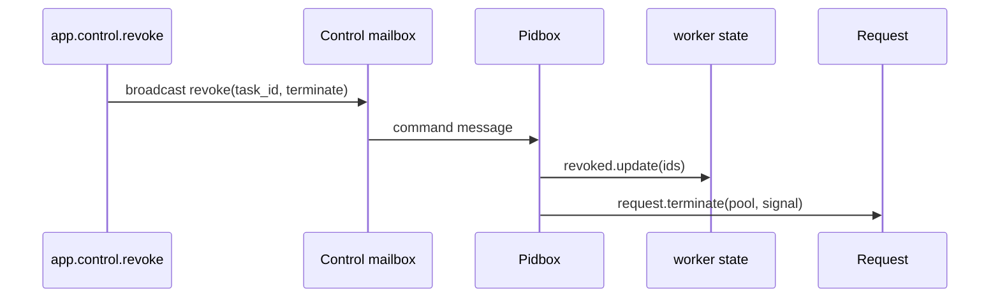

## Overview

A running Celery cluster can be steered and observed in three ways that do not go through the task queue. Remote control broadcasts commands (revoke a task, change a rate limit, inspect active tasks) to workers over a fanout exchange and optionally collects replies. Events are messages that workers and clients publish about what is happening (task started, worker heartbeat), which monitors consume. Signals are in-process hooks that user code connects to for lifecycle moments such as before a task is published or after a worker process starts. This page follows each and how they meet in the worker.

Sources: [celery/app/control.py:426-456](repo://celery/app/control.py#L426-L456), [celery/events/dispatcher.py:19-34](repo://celery/events/dispatcher.py#L19-L34), [celery/signals.py:1-20](repo://celery/signals.py#L1-L20)

## Remote control

### Sending commands

`app.control` is a `Control` object. Its constructor builds a kombu `Mailbox` on the `control_exchange` as a fanout exchange, using the app's accepted content types and serializer, and queue options from `control_queue_ttl`, `control_queue_expires`, `control_queue_exclusive` and `control_queue_durable`. It refuses to start if the queue is configured both durable and exclusive.

Sources: [celery/app/control.py:426-456](repo://celery/app/control.py#L426-L456)

Every client method ends in `broadcast(command, arguments, destination, reply, timeout, limit, callback, ...)`, which sends the command to all workers or to a list of `destination` node names (or a `pattern` with a `matcher`) and, with `reply=True`, collects replies for `timeout` seconds. `revoke`, `terminate`, `rate_limit`, `time_limit`, `add_consumer`, `cancel_consumer`, `pool_grow`, `pool_shrink`, `autoscale`, `shutdown`, `enable_events` and `disable_events` are thin wrappers that name a command and its arguments; `terminate` is just `revoke` with `terminate=True`.

Sources: [celery/app/control.py:488-510](repo://celery/app/control.py#L488-L510), [celery/app/control.py:548-558](repo://celery/app/control.py#L548-L558), [celery/app/control.py:755-790](repo://celery/app/control.py#L755-L790)

`app.control.inspect(...)` returns an `Inspect` proxy for read-only commands such as `active`, `scheduled`, `reserved`, `stats`, `registered`, `ping` and `conf`. It calls `broadcast(..., reply=True)` and reshapes the reply: a single destination returns that node's answer, a pattern filters nodes, and otherwise you get a dict by node name.

Sources: [celery/app/control.py:73-117](repo://celery/app/control.py#L73-L117), [celery/app/control.py:138-181](repo://celery/app/control.py#L138-L181)

### The worker side

Each worker's `Control` consumer step starts a `Pidbox` ([[The Consumer: From Broker Message to Pool]]), only if `worker_enable_remote_control` is on and the transport supports fanout. The `Pidbox` builds a mailbox `Node` named for the worker's hostname, whose handlers are `Panel.data` and whose state carries the app, hostname and consumer. Each incoming message first advances the app's logical clock, then `node.handle_message` runs the handler; an unknown command logs `No such control command`, and any other error is logged and resets the pidbox. With a green pool, `gPidbox` runs the same loop in a greenlet that drains events with a one second timeout and resets on request.

Sources: [celery/worker/consumer/control.py:14-33](repo://celery/worker/consumer/control.py#L14-L33), [celery/worker/pidbox.py:20-60](repo://celery/worker/pidbox.py#L20-L60), [celery/worker/pidbox.py:83-126](repo://celery/worker/pidbox.py#L83-L126)

`Panel` is the global registry of commands. The decorators `@control_command(...)` and `@inspect_command(...)` register a function by name (and optional alias) in `Panel.data` and its description in `Panel.meta`, recording the type (`control` or `inspect`), visibility, default timeout, help (from the docstring), signature and variadic argument. Handlers take the worker state as their first argument and return a dict such as `{'ok': ...}` or `{'error': ...}`.

Sources: [celery/worker/control.py:31-77](repo://celery/worker/control.py#L31-L77)

### Revoking a task

The `revoke` command accepts one id or a list. `_revoke` adds the ids to `worker_state.revoked`, then tries to store `REVOKED` for each id in the result backend (a failure there only logs a warning), and, if `terminate` was requested, finds the matching active `Request` objects and calls `request.terminate(pool, signal)`. The default signal is `TERM`.

Sources: [celery/worker/control.py:134-154](repo://celery/worker/control.py#L134-L154), [celery/worker/control.py:214-243](repo://celery/worker/control.py#L214-L243)

Sources: [celery/app/control.py:488-510](repo://celery/app/control.py#L488-L510), [celery/worker/control.py:214-243](repo://celery/worker/control.py#L214-L243)

Revocation takes effect at two places. A task that has not started is dropped when the strategy or `execute_using_pool` calls `Request.revoked()`, which checks the `revoked` set; a running task is killed by `terminate`. See [[Task Execution, Tracing and Acknowledgement]]. The `revoked` set is a `LimitedSet` capped at `CELERY_WORKER_REVOKES_MAX` (default 50,000) with entries expiring after three hours; with `--statedb` it is persisted. A new worker learns the revoked ids of its peers through the `hello` command that the `Mingle` step sends at startup, which also syncs logical clocks.

Sources: [celery/worker/state.py:35-72](repo://celery/worker/state.py#L35-L72), [celery/worker/control.py:381-396](repo://celery/worker/control.py#L381-L396), [celery/worker/consumer/mingle.py:58-76](repo://celery/worker/consumer/mingle.py#L58-L76)

`revoke_by_stamped_headers` revokes by header values instead of id: the worker records the headers in `revoked_stamps`, which `Request.revoked` compares against each task's stamps (see [[Canvas: Signatures, Chains, Groups and Chords]] for stamping). The client then re-sends a plain `revoke` for the task ids that workers reported.

Sources: [celery/worker/control.py:156-212](repo://celery/worker/control.py#L156-L212), [celery/app/control.py:512-546](repo://celery/app/control.py#L512-L546)

## Events

An event is a dictionary with a `type` (such as `task-started`) and a `timestamp`. `group_from` takes the part before the first dash as the group (`task`, `worker`). All events go to one topic exchange, `celeryev`, with the type's dashes turned into dots as the routing key.

Sources: [celery/events/event.py:8-45](repo://celery/events/event.py#L8-L45), [celery/events/dispatcher.py:116-141](repo://celery/events/dispatcher.py#L116-L141)

`EventDispatcher` publishes events. `send` does nothing if the dispatcher is disabled or the event's group is not in `groups`. For groups listed in `buffer_group` (the worker buffers `task` events when it has an event loop), events are collected and flushed as one multi-event message when `buffer_limit` is reached. Others are published at once with the current logical clock value. If a publish fails and `buffer_while_offline` is true, the event is queued and `flush` retries it after reconnection. `enable` creates the producer and `disable` closes it; each runs registered callbacks.

Sources: [celery/events/dispatcher.py:58-114](repo://celery/events/dispatcher.py#L58-L114), [celery/events/dispatcher.py:142-213](repo://celery/events/dispatcher.py#L142-L213)

Workers produce events at these points:

Sources: [celery/worker/heartbeat.py:14-61](repo://celery/worker/heartbeat.py#L14-L61)

| Event | Sent by |
| --- | --- |
| `task-sent` | The publisher, when `task_send_sent_event` is set ([[Publishing Tasks: apply_async, Routing and Messages]]) |
| `task-received` | The default strategy, when the message is received |
| `task-started`, `task-succeeded`, `task-retried`, `task-failed`, `task-revoked` | `Request` callbacks ([[Task Execution, Tracing and Acknowledgement]]) |
| `worker-online`, `worker-heartbeat`, `worker-offline` | The `Heart` step |

Sources: [celery/app/amqp.py:586-605](repo://celery/app/amqp.py#L586-L605), [celery/worker/strategy.py:174-185](repo://celery/worker/strategy.py#L174-L185), [celery/worker/request.py:515-527](repo://celery/worker/request.py#L515-L527), [celery/worker/heartbeat.py:14-61](repo://celery/worker/heartbeat.py#L14-L61)

`Heart` sends `worker-online` on start and a `worker-heartbeat` every 2 seconds by default, carrying the frequency, active task count, processed count, load average and software info, and `worker-offline` on stop. It registers itself with the dispatcher's `on_enabled` and `on_disabled`, so heartbeats stop when events are disabled. The `enable_events` and `disable_events` control commands add or remove the `task` group on the worker's dispatcher at run time, and the `heartbeat` command sends one at once.

Sources: [celery/worker/heartbeat.py:14-61](repo://celery/worker/heartbeat.py#L14-L61), [celery/worker/control.py:344-379](repo://celery/worker/control.py#L344-L379)

`EventReceiver` consumes events. It creates a queue named `<event_queue_prefix>.<node_id>` bound to the event exchange with a routing key (default `#`), configured from the `event_queue_ttl`, `event_queue_expires`, `event_queue_exclusive` and `event_queue_durable` settings, and rejects a queue that is both exclusive and durable. It dispatches each event to `handlers[type]` or to the `"*"` handler. Before that it adjusts the local logical clock from the event's clock, or, for client-sent `task-sent` events, uses a skewed local value because clients never sync. It also converts the timestamp using the sender's UTC offset and records `local_received`. `capture` runs the consume loop, first broadcasting a `heartbeat` command so workers announce themselves.

Sources: [celery/events/receiver.py:23-107](repo://celery/events/receiver.py#L23-L107), [celery/events/receiver.py:108-147](repo://celery/events/receiver.py#L108-L147)

`State` keeps an in-memory picture of the cluster from events: LRU caches of workers (5,000 by default) and tasks (10,000), a task heap, and indexes by task type and by worker. The `Gossip` consumer step creates one with `max_tasks_in_memory=1` to follow other workers' events and keep the logical clock current.

Sources: [celery/events/state.py:398-440](repo://celery/events/state.py#L398-L440), [celery/worker/consumer/gossip.py:23-60](repo://celery/worker/consumer/gossip.py#L23-L60)

## Signals

Signals are `celery.utils.dispatch.Signal` objects in `celery.signals`; connect a function to one to run code at that point. The module groups them as:

Sources: [celery/signals.py:20-30](repo://celery/signals.py#L20-L30)

| Group | Signals |
| --- | --- |
| Task publishing | `before_task_publish`, `after_task_publish`, deprecated `task_sent` |
| Task execution | `task_received`, `task_prerun`, `task_postrun`, `task_success`, `task_retry`, `task_failure`, `task_internal_error`, `task_revoked`, `task_rejected`, `task_unknown` |
| Worker program | `celeryd_init`, `celeryd_after_setup`, `import_modules`, `worker_init`, `worker_before_create_process`, `worker_process_init`, `worker_process_shutdown`, `worker_ready`, `worker_shutdown`, `worker_shutting_down`, `heartbeat_sent` |
| Logging | `setup_logging`, `after_setup_logger`, `after_setup_task_logger` |
| Beat | `beat_init`, `beat_embedded_init` |
| Eventlet pool | `eventlet_pool_started`, `eventlet_pool_preshutdown`, `eventlet_pool_postshutdown`, `eventlet_pool_apply` |

Sources: [celery/signals.py:31-150](repo://celery/signals.py#L31-L150)

Each signal declares the keyword arguments its receivers get (`providing_args`), for example `task_failure` passes `task_id`, `exception`, `args`, `kwargs`, `traceback` and `einfo`. Senders check `signal.receivers` before building arguments, so unconnected signals cost nothing in the tracer and in the AMQP sender, both of which read `signal.receivers` first.

Sources: [celery/signals.py:31-90](repo://celery/signals.py#L31-L90), [celery/app/trace.py:402-408](repo://celery/app/trace.py#L402-L408), [celery/app/amqp.py:485-497](repo://celery/app/amqp.py#L485-L497)

The app has its own signals as well, `on_configure`, `on_after_configure`, `on_after_finalize` and `on_after_fork` ([[The Celery Application and Configuration]]), and the worker's startup sends `celeryd_init`, `worker_init` and `celeryd_after_setup` in that order ([[Worker Startup and Bootsteps]]).

Sources: [celery/app/base.py:413-434](repo://celery/app/base.py#L413-L434), [celery/apps/worker.py:94-104](repo://celery/apps/worker.py#L94-L104), [celery/worker/worker.py:122-124](repo://celery/worker/worker.py#L122-L124), [celery/apps/worker.py:128-135](repo://celery/apps/worker.py#L128-L135)
